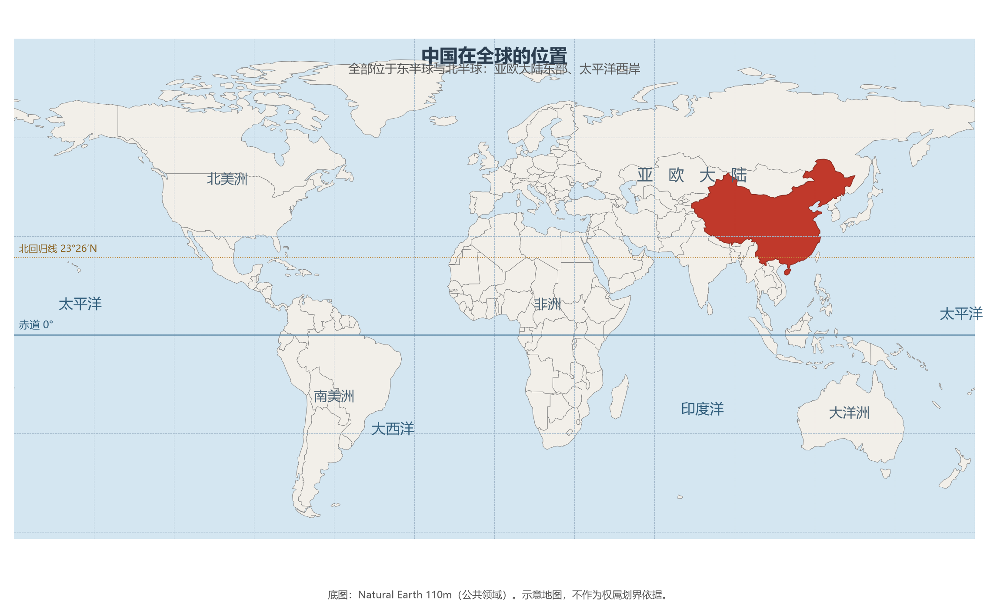
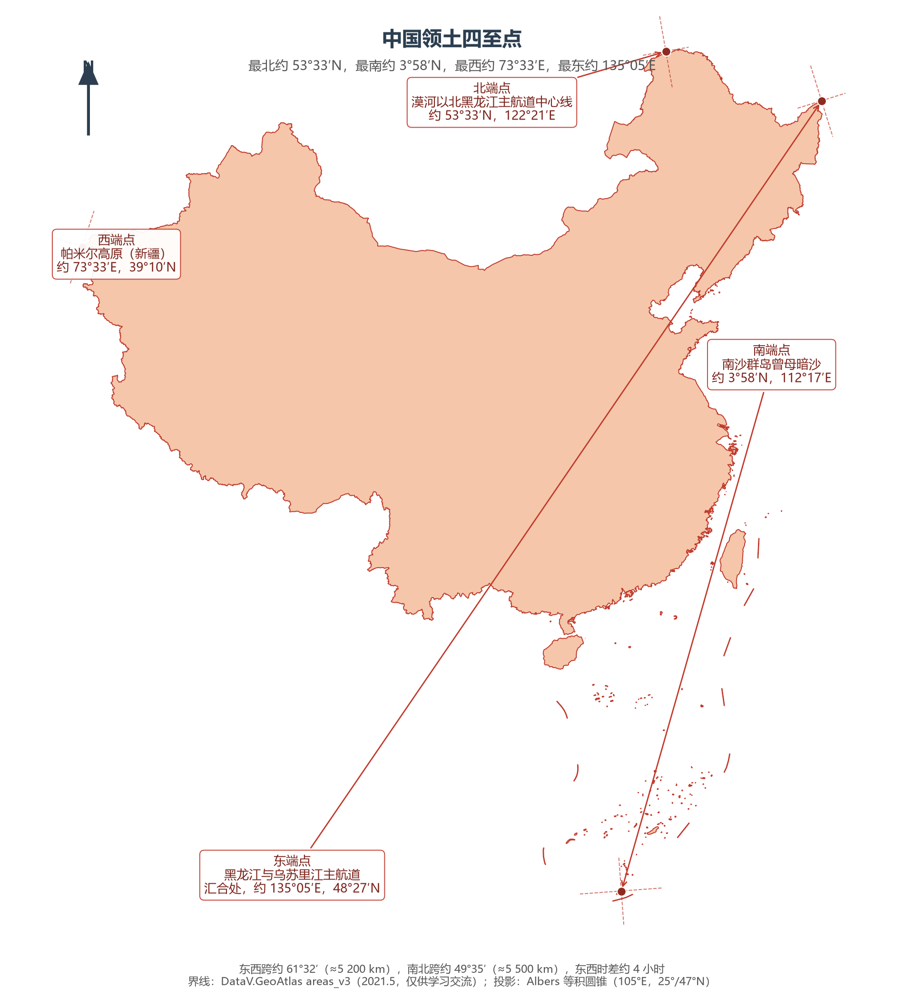

# 1.1 地理位置与四至

打开世界地图，在亚欧大陆东缘、太平洋西岸，一片红色版图自寒温带的林海雪原一直延伸到赤道附近的热带珊瑚礁：这就是中国。她的纬度跨近 50°，经度跨逾 60°，背倚世界上最大的大陆，面朝世界上最大的大洋。要理解中国的气候、物产、人口与经济格局，一切都应从这一位置谈起。

## 一、半球位置与纬度带

中国全部位于**北半球、东半球**：领土最南端在北纬 3°58′（南沙群岛曾母暗沙），最北端在北纬 53°33′（黑龙江省漠河以北的黑龙江主航道中心线），全部位于赤道以北；最西端在东经 73°33′（帕米尔高原），最东端在东经 135°05′（黑龙江与乌苏里江主航道汇合处），处于 20°W—160°E 的东半球范围之内。

按五带划分，中国领土绝大部分处于**北温带**，南部一小部分越过北回归线进入**热带**，没有领土伸入寒带。南北跨纬度约 49°35′，是全球纬度跨度最大的国家之一：从热带雨林（海南岛南部、西双版纳）到寒温带针叶林（大兴安岭北端），从终年无冬的南海诸岛到冬季严寒的漠河，农业熟制自一年三熟到一年一熟依次更替。光热充足而不失四季分明，是这片国土最基本的天赋。

## 二、海陆位置：在最大的大陆与最大的大洋之间

中国位于**亚欧大陆东部、太平洋西岸**。大陆为大国之脊，海洋为大国之门：

- **面向大洋**：东部、东南部濒临渤海、黄海、东海、南海，大陆海岸线约 1.8 万 km。夏季，来自太平洋与印度洋的暖湿季风深入内陆，造就了东部地区雨热同期的季风气候——这是全球同纬度带上的一处例外：北纬 30° 线穿过撒哈拉与阿拉伯半岛时是连绵荒漠，穿过中国长江流域时却是鱼米之乡。
- **背靠大陆**：西部深入亚欧大陆腹地，与 14 国接壤。从张骞凿空西域到今天的中欧班列，这条面向内陆的通道两千年来始终是东西方交流的大动脉。

海陆兼备是稀薄的禀赋。联合国 190 多个会员国中，内陆国约 44 个，它们没有一寸海岸线；岛国如日本、新西兰则缺乏陆上纵深。既有漫长海岸线、又有广袤陆上疆域的大国，只有中国、美国、俄罗斯、印度、巴西等寥寥数家，而其中同时坐拥季风湿润区与大陆腹地的，唯有中国与美国。

**图 1-1 中国在全球的位置**：亚欧大陆东部、太平洋西岸，全部位于东半球与北半球。

## 三、四至点：国土的四个端点

四至点框定了国土的经纬度范围。东、北两端都在黑龙江省，南端在海南省管辖的南沙群岛，西端在新疆维吾尔自治区——一省独占其二的东北角，正是当年闯关东与近代边疆开发的历史注脚。

| 端点 | 位置 | 坐标 | 所属行政区 | 地理志 |
|------|------|------|-----------|--------|
| 最北端 | 漠河以北黑龙江主航道中心线 | 53°33′N，122°21′E | 黑龙江省漠河市 | 北极村为"找北"胜地；1969 年曾录得 −52.3 ℃ 的全国极端最低气温纪录；夏至白昼近 17 小时，可赏"白夜" |
| 最南端 | 南沙群岛曾母暗沙 | 3°58′N，112°17′E | 海南省三沙市管辖 | 隐没水下的珊瑚暗沙，距赤道不足 450 km，终年盛夏 |
| 最东端 | 黑龙江与乌苏里江主航道汇合处 | 135°05′E，48°27′N | 黑龙江省抚远市 | 乌苏镇是中国每天最早迎来日出的地方 |
| 最西端 | 帕米尔高原 | 73°33′E，39°10′N | 新疆维吾尔自治区乌恰县以西 | 古称"葱岭"，丝绸之路出关之后的第一道天堑 |

由此得到国土的量度：**东西跨经度约 61°32′，直线距离约 5 200 km；南北跨纬度约 49°35′，直线距离约 5 500 km。** 当帕米尔迎来日出时，抚远已近正午——这就是"跨五个时区"的直观含义。

**图 1-2 中国领土四至点**：四个端点的位置与坐标，以及国土的东西、南北跨度。

## 四、一个国家，一个时刻

中国领土横跨东五区至东九区共五个时区，但全国统一采用**北京时间**——东八区（东经 120°E）的区时。北京时间由中国科学院国家授时中心产生并发播，该中心位于陕西省西安市临潼区，因此严格地说，"北京时间"既不是北京的地方时（北京位于 116°24′E，其地方时比北京时间晚约 14 分钟），也不产生于北京。

统一时制是大国治理的必需：铁路调度、金融清算、广播电视、国防作战，都必须对表同一时刻。代价则是作息的自然错位——乌鲁木齐（约 87°E）的正午比北京时间推迟约两小时，当地民间长期通行"新疆时间"（UTC+6），机关企业的作息也普遍比东部沿海晚两个小时。这种"钟表上的统一"与"生活中的时差"，是广土众民国家特有的日常景观。

## 五、世界视角：位置如何塑造中国

把中国放回世界坐标系中，她的位置有三点值得专门指出：

- **温带大国**：全球陆地集中在北半球，而全球人口、耕地与经济活动高度集中于温带。中国、美国、欧洲恰好连成北纬 20°—55° 之间的"温带大弧"，这一弧线聚集了世界过半的人口与绝大部分经济总量。中国的纬度位置意味着她生来就处在这条大弧的核心段落上。
- **面向两洋，背靠一洲**：美国面向大西洋与太平洋两洋，中国面向太平洋、经由南海扼印度洋航线之门户，两者都是"海陆双栖"国家。相比之下，俄罗斯虽有最长海岸线，却大部分封冻于北冰洋；巴西、澳大利亚虽临大洋，则缺乏陆上腹地。
- **世界岛的心脏地带之邻**：麦金德所称的欧亚"心脏地带"就在中国以西的中亚。中国的位置使她既是大西洋—太平洋海上体系的东端，又是欧亚大陆桥的起点，这种双重身份世界上没有第二个国家具备。

## 参考与数据来源

1. 领土四至点坐标：自然资源部、民政部公开资料与通行教材口径。
2. 时区与授时：中国科学院国家授时中心。
3. 世界国别面积与内陆国数量：CIA《世界概况》、联合国公开资料。
4. 底图：Natural Earth 110m（公共领域）、DataV.GeoAtlas areas_v3（2021.5，仅供学习交流）。
