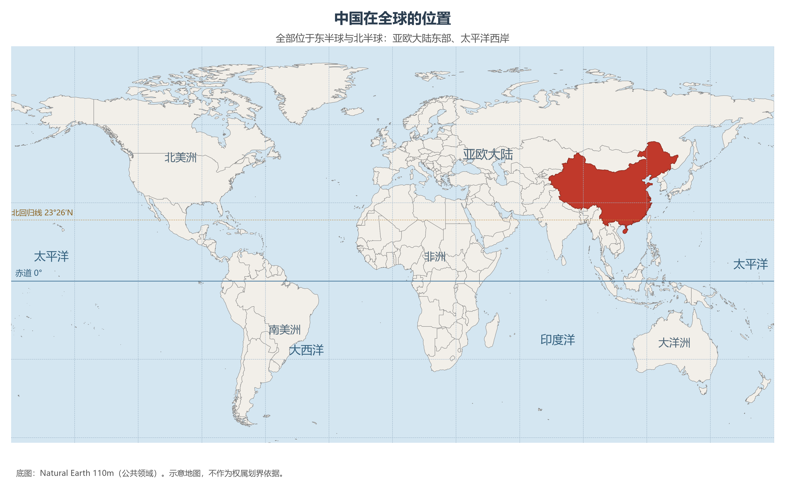
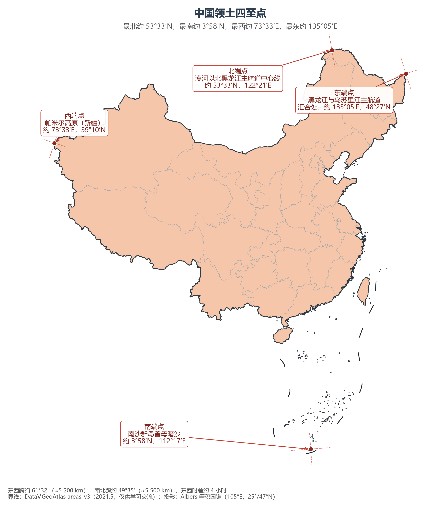

# 1.1 地理位置与四至

打开世界地图，在亚欧大陆东缘、太平洋西岸，一片宛如雄鸡的版图自寒温带的林海雪原一直延伸到赤道附近的热带珊瑚礁：这就是中华人民共和国。她的纬度跨近 50°，经度跨逾 60°，背倚世界上最大的大陆，面朝世界上最大的大洋。经纬交织成网，山海聚合成势，要理解中国的季风气候、农耕物产、人口分布、区域格局与地缘战略，一切探索都必须从这一独一无二的地理空间坐标签跃展开。

**图 1-1 中国在全球的位置**：亚欧大陆东部、太平洋西岸，全部位于东半球与北半球。

## 一、半球位置与全球几何坐标

从全球几何坐标系审视，中国拥有极其明确的半球归属与空间跨度：

- **半球坐标**：中国全部领土均位于**北半球**与**东半球**。从纬度看，领土最南端延伸至北纬 3°58′（南沙群岛曾母暗沙），最北端达到北纬 53°33′（黑龙江省漠河以北黑龙江主航道中心线），全境无一寸土地越过赤道进入南半球；从经度看，领土最西端位于东经 73°33′（帕米尔高原乌恰县以西），最东端位于东经 135°05′（黑龙江与乌苏里江主航道汇合处），完好坐落于东半球（20°W 向东至 160°E）的核心区。
- **经纬跨度与空间尺度**：
  - **经度跨度**：东西跨经度达 **61°32′**，横跨东五区、东六区、东七区、东八区、东九区共 5 个时区。国土最东与最西两端的直线距离约为 **5 200 km**。
  - **纬度跨度**：南北跨纬度达 **49°35′**，近 50 个纬度差造就了约 **5 500 km** 的南北直线纵深。
- **五带划分与热量梯级**：按天文五带划分，中国领土绝大部分位于**北温带**（北回归线 23°26′N 至北极圈 66°34′N 之间），南部少部分（云南南部、广西南部、广东雷州半岛、海南全省、台湾省中南部以及南海诸岛）越过北回归线进入**热带**，全境无领土进入寒带。这种“主体在温带、南缘探热带”的纬度谱系，赋予了这片土地全球最丰沛、最富多样性的光热组合。

| 空间维度 | 指标参数 | 地理意义与自然效应 |
|---------|---------|------------------|
| 纬度范围 | 3°58′N — 53°33′N (跨 49°35′) | 跨越热带、亚热带、暖温带、中温带、寒温带及青藏高寒区，热量梯级连绵完整 |
| 经度范围 | 73°33′E — 135°05′E (跨 61°32′) | 东西日出时差逾 4 小时；自东向西呈现“森林—森林草原—典型草原—荒漠草原—荒漠”水分梯级 |
| 南北直线距离 | 约 5 500 km | 冬季南北温差超过 50 ℃，形成“南国繁花、北境冰封”的宏阔季相景观 |
| 东西直线距离 | 约 5 200 km | 构筑深厚的大陆防御纵深与横贯亚欧的大陆桥交通走廊 |
| 半球归属 | 北半球、东半球 | 坐落于全球陆地与人口最集中的核心半球 |

| 空间方位 | 起讫极点 | 经纬度位置 | 跨度量值 | 直线距离与宏观地貌效应 |
|---------|---------|-----------|---------|---------------------|
| **东西跨度** | 最西端帕米尔高原 ➔ 最东端黑瞎子岛 | 73°33′E ➔ 135°05′E | 跨经度 **61°32′**（横跨 5 个时区） | 直线约 **5 200 km**；东西时差 4 小时 06 分钟，自东向西降水与植被梯级递变 |
| **南北跨度** | 最南端曾母暗沙 ➔ 最北端漠河主航道 | 3°58′N ➔ 53°33′N | 跨纬度 **49°35′**（近 50 个纬度） | 直线约 **5 500 km**；冬季南北温差超 50 ℃，自南向北热量与农业熟制递更 |

## 二、海陆位置与东亚季风：北纬 30° 上的绿色奇迹

海陆位置是塑造一国自然地理与人文演化最深刻的地缘环境要素。中国位于**世界上最大的大陆——亚欧大陆的东南部与东部**，东部与东南部濒临**世界上最大的大洋——太平洋**，西南更靠近印度洋。这种“海陆双向受力、大陆大洋交汇”的位置，在全球同纬度带中呈现出举世瞩目的地理独特性：

### 1. 巨大海陆热力性质差异与东亚季风心脏
亚欧大陆比热容较小，吸热快、散热亦快；太平洋比热容巨大，温度变化极其平缓。这种悬殊的物理性质差异，导致冬夏两季大陆与大洋之间出现强烈而交替反转的巨大气压场：
- **夏季**：大陆剧烈受热，形成印度低压（亚洲低压）；太平洋副热带高压西伸北进，来自低纬度热带海洋的偏南暖湿气流（东南季风与西南季风）长驱直入，为中国东部广大地区带来充沛的降水与高温环境，形成显著的**“雨热同期”**特征。
- **冬季**：西伯利亚—蒙古高原急剧冷却，形成强盛的蒙古—西伯利亚冷高压；海洋相对温暖气压较低，干冷强劲的偏北季风呼啸南下，造成全国普遍降温与严寒干燥，冬季气温显著低于同纬度世界其他地区。

### 2. 回归荒漠带中的“绿色生态走廊”
若将目光投向全球纬度坐标系，会发现一个令人震撼的对比现象：
在北纬 15° 至 30° 的副热带纬度带上，由于常年受副热带高气压带或东北信风控制，下沉气流主导，降水极度稀少，地球表面几乎被连绵数千公里的热带与亚热带荒漠所覆盖——北非的**撒哈拉大沙漠**、西亚的**阿拉伯半岛沙漠**、南亚的**塔尔沙漠**以及北美的**索诺兰沙漠**均横亘于此，被称为地球的“副热带干旱绝望带”。

然而，当北纬 30° 纬线穿过中国南方时，地表景观却发生了戏剧性的彻底逆转：长江中下游平原、四川盆地、江南丘陵呈现出一望无际的水网稻田、茂密的亚热带常绿阔叶林和繁华的城镇村落。正是因为中国东临太平洋的海陆配置，叠加青藏高原的隆升对西风带的阻挡与动力分流，彻底打破了行星风系控制下的下沉干热气流，代之以强盛丰沛的季风环流系统。**中国东部因而成为全球北回归线荒漠带上绝无仅有的“回归绿洲与鱼米之乡”**。

### 3. 海陆兼备的双重战略纵深
海陆兼备是中国作为世界大国的顶层地貌底色：
- **陆向腹地**：向西深入亚欧大陆心脏，与 14 个陆上邻国接壤，拥有广袤的盆地、高原与草原。从两千年前汉唐张骞“凿空西域”、丝绸之路商队驼铃，到今天的“丝绸之路经济带”与中欧班列，构筑了面向大陆腹地开放的大后方与大陆桥战略纽带。
- **海向门户**：向东拥有长达 1.8 万 km 的大陆海岸线与逾 1.4 万 km 的岛屿海岸线，坐拥四大海域与环太平洋黄金航道，构筑了近代以来融入全球化浪潮、发展外向型经济与建设“21 世纪海上丝绸之路”的前沿舞台。

## 三、四至点：国土四端的微观地理志

中国领土的四至点，是国家主权空间的地理界桩，也是自然生态与人文历史沉淀最为深厚的国门地标。

**图 1-2 中国领土四至点**：四个端点的位置与坐标，以及国土的东西、南北跨度。

### 1. 最北端：黑龙江主航道中心线
- **地理位置与坐标**：位于黑龙江省大兴安岭地区漠河市图强镇以北、乌苏里浅滩北红村以北的黑龙江主航道中心线上，地理坐标约为 **53°33′30″N，122°20′40″E**。
- **地理志与环境**：
  - 传统旅游所称“北极村”（53°29′N）并非国土物理最北点，乌苏里浅滩北红村界江段比北极村还要偏北约 4 分纬度（约 7.5 km），立有中国最北的“中国最北点”巨型花岗岩界碑。
  - 气候属于寒温带大陆性季风气候，冬季极其漫长严寒。漠河气象站曾于 1969 年 2 月 13 日测得 −52.3 ℃ 的极端低温纪录；而在 2023 年 1 月 22 日早晨，漠河市阿木尔镇劲涛气象站实测气温跌破 **−53.0 ℃**，刷新了我国有气象记录以来的最低气温历史极值。
  - 夏至日前后，由于纬度极高，太阳接近地平线而不深落，产生奇特壮丽的“白夜”天象，白昼时间长达近 17 小时；冬至日则黑夜漫长，白昼不足 7 小时。

### 2. 最南端：南沙群岛曾母暗沙
- **地理位置与坐标**：位于海南省三沙市南沙区管辖的南沙群岛南部，地理坐标约为 **3°58′00″N，112°17′00″E**。
- **地理志与环境**：
  - 曾母暗沙（James Shoal）并非出露水面的明礁，而是一处隐没于海平面之下的珊瑚暗沙礁丘，由曾母礁丘、八仙暗沙和立地暗沙共同组成曾母暗沙群。礁体长约 2.3 km，宽约 0.6 km，面积约 2.12 km²，终年没于水下，常年最浅水深约为 **−17.5 m** 至 **−21 m**。
  - 曾母暗沙距赤道不足 450 km，处在赤道低气压带边缘，终年盛夏，长夏无冬，海水透明度常年在 25 米以上，珊瑚生长繁茂。
  - 地缘战略上，曾母暗沙紧邻马六甲海峡进入南海国际主航道的必经水道咽喉，自 1983 年中国政府公布标准地名、1994 年与 2010 年等历次中国海军与海警编队巡航投放主权主权碑以来，是我国南部海疆主权不可动摇的地理基石。

### 3. 最东端：黑瞎子岛黑龙江与乌苏里江主航道汇合处
- **地理位置与坐标**：位于黑龙江省佳木斯市抚远市境内的黑瞎子岛（抚远三角洲）东部，黑龙江与乌苏里江主航道中心线汇合处，地理坐标约为 **48°27′N，135°05′E**。
- **地理志与环境**：
  - “华夏东极”抚远市乌苏镇与东极哨所，是中国每天清晨最早迎来第一缕阳光的国土地标。夏至日凌晨 3 时左右，当首都北京尚在沉睡、帕米尔高原黑夜深沉之时，东极大地已霞光万道。
  - 2004 年 10 月，《中华人民共和国和俄罗斯联邦关于中俄国界东段的补充协定》签署；2008 年 10 月 14 日，中俄两国在黑瞎子岛举行“中俄界桩揭幕仪式”，黑瞎子岛西半部约 171 km² 土地正式回归中国管辖，形成“一岛两国”的边境生态保护与口岸开发示范区。

### 4. 最西端：帕米尔高原乌恰县境
- **地理位置与坐标**：位于新疆维吾尔自治区克孜勒苏柯尔克孜自治州乌恰县吉根乡以西的帕米尔高原托克逊阿尔特什山口，地理坐标约为 **39°15′N，73°33′E**。
- **地理志与环境**：
  - 该处平均海拔在 4 000 m 以上，天山山脉南脉与昆仑山脉北支在此雄伟交汇，古称“葱岭”，是千百年来汉唐丝绸之路商旅西出玉门关、翻越中亚荒原的第一道天堑。
  - 位于中吉边界中方的“斯姆哈纳西极哨所”，与东极哨所相隔逾 61 个经度，夏季日落时间通常在晚上 22 时 30 分之后，是全国最晚目送夕阳隐入雪山的哨位。这里分布着我国通往吉尔吉斯斯坦乃至中亚全境的重要陆路口岸——伊尔克什坦口岸。

| 端点方位 | 标志地点 | 精确经纬度 | 气候水文特征 | 地缘与交通纽带 |
|---------|---------|-----------|------------|--------------|
| 最北端 | 黑龙江省漠河市乌苏里浅滩北红村以北 | 53°33′30″N，122°20′40″E | 寒温带大陆季风气候，极端低温曾达 −53.0 ℃，夏至白夜 | 中俄界江界流水文监测，北极林区生态屏障 |
| 最南端 | 海南省三沙市南沙区曾母暗沙 | 3°58′00″N，112°17′00″E | 热带赤道海洋性气候，终年水温 28 ℃，最浅水深 −17.5 m | 扼守马六甲海峡至南海国际航道东口咽喉 |
| 最东端 | 黑龙江省抚远市黑瞎子岛两江汇流处 | 48°27′00″N，135°05′00″E | 中温带季风气候，三江平原湿地，夏至日凌晨 3 点日出 | 中俄“一岛两国”生态保护与国际边境合作区 |
| 最西端 | 新疆乌恰县吉根乡西帕米尔高原 | 39°15′00″N，73°33′00″E | 高原大陆干旱气候，海拔 4 000 m 以上高寒缺氧，夏夜 22:30 日落 | 丝路葱岭古道，伊尔克什坦口岸西联中亚五国 |

## 四、经度时差、全国统一授时与作息地理学

经度跨逾 61 个纬度，不仅是一个抽象的几何数字，它直接深刻影响着一个超大国家的日常生活、交通指挥与经济清算。

### 1. 东西时差的物理量度
地球自西向东自转，每 24 小时旋转 360°，即经度每差 15°，地方平太阳时相差 1 小时；经度每差 1°，时间相差 4 分钟。
中国最东端（135°05′E）与最西端（73°33′E）之间经度相差 **61°32′**，这意味着国土两端的**地方平太阳时差达到 4 小时 06 分钟**。当抚远的渔民在乌苏里江面沐浴清晨旭日捕鱼时，帕米尔高原的柯尔克孜族牧民头顶依然是繁星闪烁的深夜。

### 2. “北京时间”的科学内涵与国家授时体系
中国目前统一采用**北京时间**，即**东八区（120°E）的标准区时**（UTC+8）。
值得特别指出的是关于“北京时间”的几项地理常识：
- **并非北京本地的地方时**：北京市中心经度约为 116°24′E，其地方平太阳时比北京时间（120°E）实际上慢了约 14 分 24 秒。
- **产生与发播地不在北京**：北京时间的产生和发播机构是位于**陕西省西安市临潼区**与**蒲城县**的中国科学院国家授时中心（NTSC）。这里地处中国内陆腹地（距泾阳县的“中华人民共和国大地原点”咫尺之遥），广播信号覆盖全国的几何路径最为均衡，建有高精度的铯原子钟与氢钟守时系统，通过长波（BPC）、短波（BPM）、卫星通信与地面光纤向全国提供毫秒级甚至纳秒级授时基准。

| 授时系统层次 | 核心设施与承载主体 | 信号制式与传输链路 | 关键功能与保障场景 |
|-------------|-------------------|-------------------|-------------------|
| **国家授时基准** | 中国科学院国家授时中心（陕西临潼/蒲城） | 高精度铯原子钟组与氢原子钟（与国际 UTC 比对） | 国家标准时间（北京时间）的产生源头与物理基准 |
| **无线电长短波台** | 蒲城短波台（BPM）、商丘长波台（BPC） | 高频短波、低频长波无线电广播 | 远洋航海、野外地质勘探、无线电电波钟表对时 |
| **空间卫星授时** | 北斗三号全球卫星导航系统（BDS） | B1C / B2a 等导航信号星地双向授时 | 空间纳秒级同步，支撑高铁控制、电网相量与国防通信 |
| **地面光纤网络** | 国家重大科技基础设施“高精度地基授时系统” | 精密时间协议（PTP）与网络时间协议（NTP） | 毫秒/微秒级网络对齐，保障银行跨行清算与 5G 通信 |

### 3. 统一时制与地方生活节奏的弹性适应
实行全国统一时制是大一统治理不可或缺的制度基础设施：庞大的国家高铁网（数十秒级车次追踪）、民航空中交通管制、数以万亿计的证券与银行跨行资金清算，以及全国统一的防空战备系统，都必须在完全同步的绝对时钟下运行。

然而，这种钟表时间（Clock Time）的全国统一，必然与各地日出而作、日落而息的自然太阳时间（Solar Time）产生空间偏离：
- **新疆的“时差适应”**：乌鲁木齐经度约为 87°36′E，太阳正午比北京时间晚约 2 小时 10 分钟；喀什更晚近 3 小时。因此，新疆各族群众与企事业单位在遵守北京时间纪时的同时，形成了独特的作息规律：机关作息通常为上午 10:00 上班、14:00 午餐、下午 16:00 上班、20:00 下班；民间亦长期参照“新疆时间”（UTC+6，比北京时间慢 2 小时）安排农牧耕作与起居。
- **东北的三江平原**：当地经度超过 130°E，冬季下午 15 时 30 分前后天色即已全黑，早晨 6 时早已大亮，当地居民起居普遍早睡早起，形成了顺应极北经纬律动的生产节奏。

## 五、全球视野：经纬与海陆如何塑造大国底色

把中国置于世界地理的宏阔坐标系中横向审视，可以提炼出三条决定性的地缘禀赋规律：

1. **生于“温带大弧”之枢纽**：
   全球 80% 以上的陆地集中在北半球，而人类 70% 以上的人口、80% 以上的优质耕地与 85% 以上的现代经济总量，高度浓缩在北纬 20° 至 55° 之间的“温带与亚热带大弧”之内。中国、美国、欧洲恰好雄踞这一大弧的东段、西段与中段。中国不仅完整坐落于这一文明带的核心区间，更拥有同纬度其他国家难以企及的水热同步条件。
2. **“海陆双栖”的战略纵深**：
   世界上领土排名前列的国家中，俄罗斯海岸线虽长但大部封冻于北冰洋，出海口屡遭地峡封锁；加拿大北部严寒不适宜人类大规模定居；澳大利亚孤悬南半球且腹地大部干旱；巴西偏于南美缺乏陆权地缘对冲。全球唯有中国与美国，真正做到了兼具数百万平方公里深厚大陆纵深与数万公里畅通无阻的温带/亚热带常年不冻海岸线，具备在陆权与海权之间自如切换与双向互动的能力。
3. **欧亚大陆陆桥起点与亚太海洋经济重镇的重合**：
   在麦金德的地缘政治学说中，欧亚大陆腹地是世界的“心脏地带”（Heartland），而沿海陆缘属于“边缘地带”（Rimland）。中国独特的地理位置，使她西界紧扣大陆心脏边缘，东界深嵌世界海洋贸易最繁忙的西太平洋边缘海弧形链。这种海陆兼备的双重身份，是任何纯陆权国家或纯海岛国家所无法复制的天赋基石。

## 参考与数据来源

1. 领土四至点坐标与极值数据：自然资源部、民政部公开标准地理信息底图及权威地名志（2021 版公众数据）。
2. 最低温实测记录：中国气象局国家气象中心，黑龙江省气象局 2023 年 1 月 22 日观测公报。
3. 曾母暗沙水文与地质构造：中国科学院南海海洋研究所、国家海洋局南海分局科考调查数据。
4. 国家授时系统架构：中国科学院国家授时中心（NTSC）官方文献及《中华人民共和国法定计量单位》。
5. 气候与季风动力机制：陶诗言、叶笃正等《东亚季风研究》及《中国自然地理图集》。
6. 底图：Natural Earth 110m（公共领域）、DataV.GeoAtlas（仅供学习交流）。
