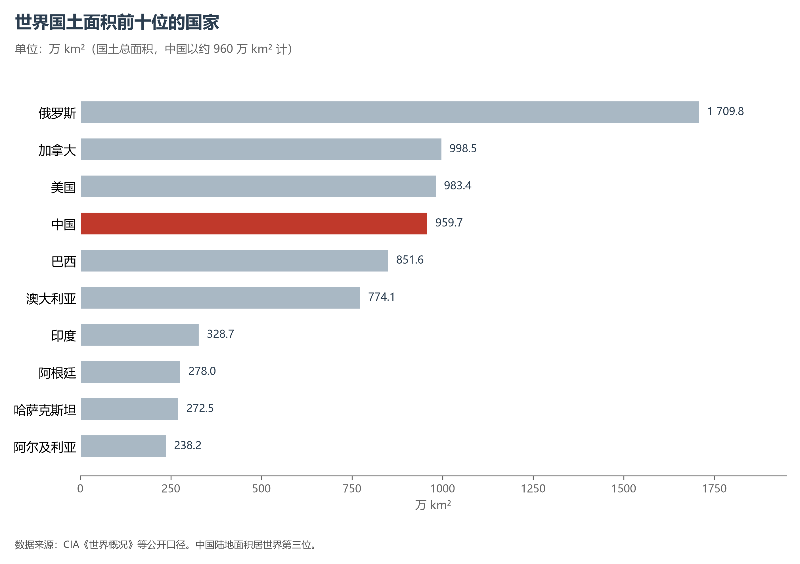
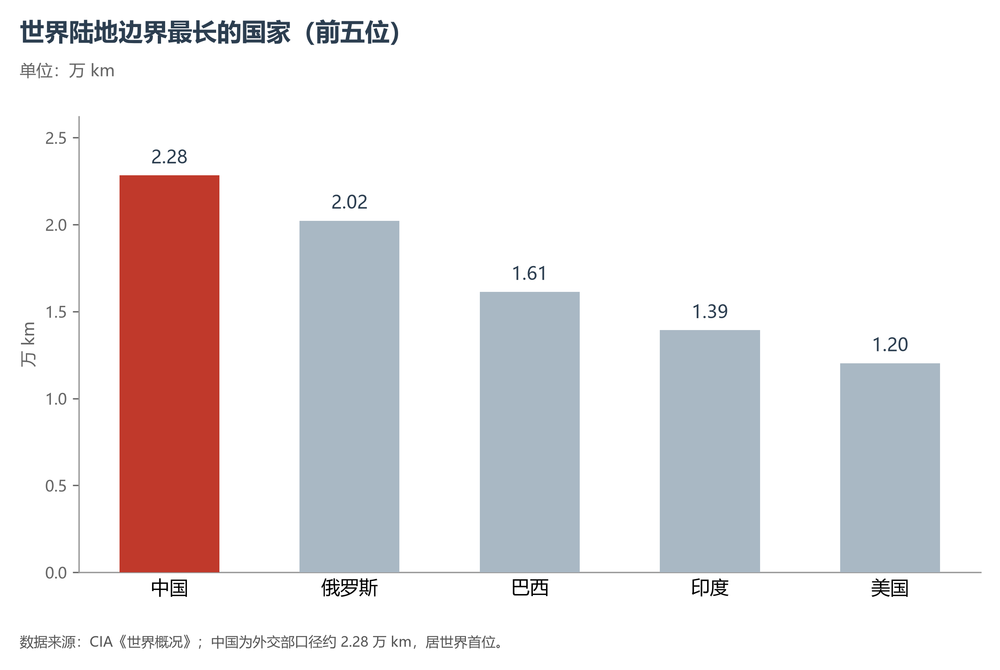
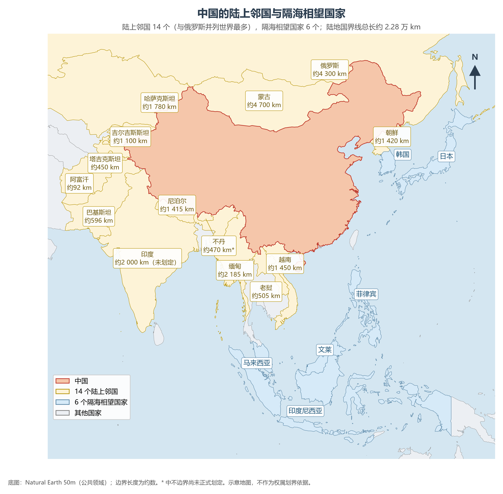
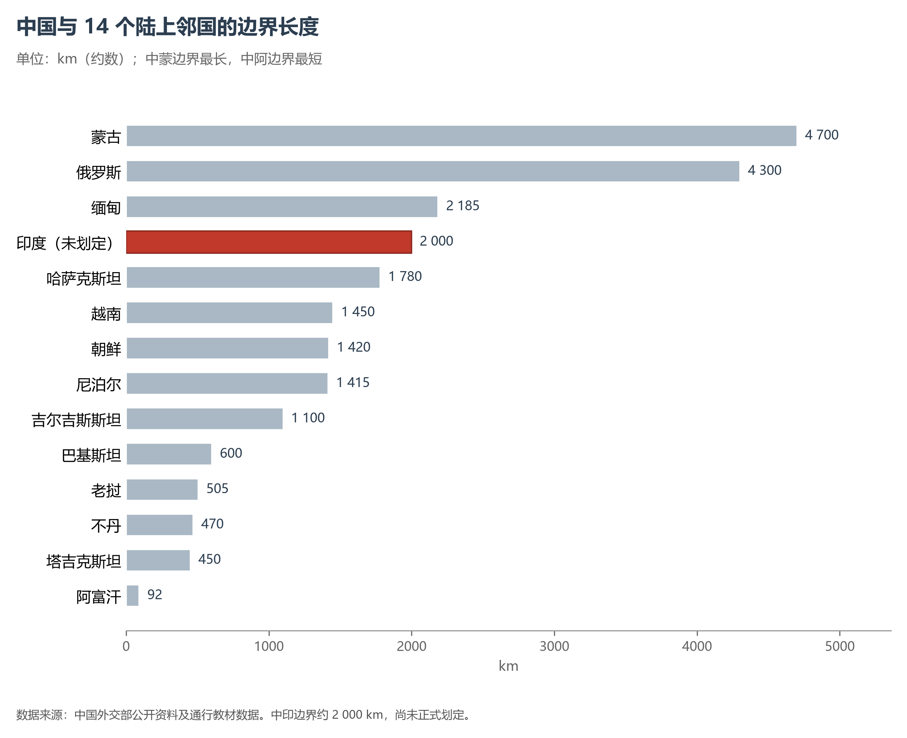

# 1.2 疆域面积与邻国

疆域与边界是一国国家主权存在的物理容器，也是国家安全与对外互动的地理界面。中国拥有约 **960 万 km²** 的陆地国土面积，居世界第三位；同时拥有总长达 **2.28 万 km** 的陆地国界线，与 **14 个国家**在陆上紧密接壤，并与 **6 个国家**隔海相望。这构成了当今世界上规模最庞大、地缘环境最复杂、文明形态最多元的邻国网络体系。

## 一、960 万 km²：世界第三与大国面积口径辨析

### 1. 领土空间构成与国际排位
根据现代国际法《国家权利和义务宣言草案》及普遍公认的法理共识，一国的国家领土（Territory）由**领陆、领水（内水与领海）、领空与底土**四部分不可分割地共同构成：
- **领陆与内水**：中国通常所称的“约 960 万 km²”（自然资源部官方规范口径为约 960 万平方公里），是指中华人民共和国实际行使管辖与主张完整的陆地国土面积，其包含了全部陆地领陆以及河流、湖泊等内陆水域。中国陆地国土面积约占世界陆地总面积（1.49 亿 km²）的 **6.44%**，占亚洲陆地总面积（4 458 万 km²）的 **21.5%**。
- **管辖海域**：在约 960 万 km² 陆地国土之外，根据《联合国海洋法公约》及国内相关法律，中国还主张约 **300 万 km²** 的管辖海域（包括内水、领海、毗连区、专属经济区及大陆架，详见 1.3 节）。若将陆海空间一并计入，中国的国土与管辖空间接近 **1 260 万 km²**。

**图 1-3 世界国土面积前十位的国家**：中国约 960 万 km²，居世界第三。

### 2. 世界面积前列大国的统计口径技术辨析
在国际各类地理百科全书、统计年鉴或地图册中，中国与美国在国土面积排名上常出现“第三”或“第四”的表述差异。这一现象源于各国在统计国土面积时采用的**水域界定标准不同**：
- **俄罗斯（约 1 709.8 万 km²）**：毫无争议的世界第一大国，面积相当于中国与澳大利亚的总和。
- **加拿大（约 998.5 万 km²）**：世界第二大国。但加拿大全境拥有极其广袤的冰蚀湖群（大熊湖、大奴湖、温尼伯湖及五大湖加拿大水域等），其淡水水域面积高达 89.1 万 km²，几乎占其国土总面积的 9%。若仅计算纯陆地领陆面积，加拿大实为 909.4 万 km²，显著小于中国。
- **中国（约 960 万 km²）**：官方统计口径包含陆地与内陆水域，未计入 12 海里领海及沿海水域面积。
- **美国（937 万至 983.4 万 km²）**：美国在不同机构公布的数据跨度极大。例如美国中央情报局（CIA）《世界概况》在 1989 年前列出的美国面积为 937.3 万 km²（仅计本土与阿拉斯加、夏威夷的领陆及内陆湖河）；1990 年代起，CIA 陆续将五大湖美国管辖水域（约 15.6 万 km²）以及沿海领水（Coastal Waters，沿海港湾海峡）和 12 海里领海水域（约 30 余万 km²）全部计入其国土面积，使其数字骤增至 **983.4 万 km²**，从而在部分西方图表中排至中国之前。若遵循同等口径（仅计领陆与内陆水域），中国面积稳居世界第三位。

| 排名 | 国家 | 官方/通行面积 (万 km²) | 领陆面积 (万 km²) | 水域占比 | 相当于中国之比 | 空间地缘特征 |
|------|------|---------------------|-----------------|---------|--------------|------------|
| 1 | 俄罗斯 | 1 709.8 | 1 637.8 | 4.2% | 1.78 倍 | 横跨欧亚两大洲，北冰洋岸线漫长，东西跨 11 个时区 |
| 2 | 加拿大 | 998.5 | 909.4 | 8.9% | 1.04 倍 | 湖泊淡水水域面积世界第一，北部极地严寒 |
| 3 | **中国** | **约 960** | **约 933** | 约 2.8% | **1.00** | **海陆兼备，温带与亚热带季风区广阔，自然阶梯显著** |
| 4 | 美国 | 983.4 (含领海口径) | 914.7 | 7.0% | 1.02 倍 | 东西濒临两洋，五大湖水系庞大，本土兼具平原与高原 |
| 5 | 巴西 | 851.6 | 846.0 | 0.7% | 0.89 倍 | 南美第一大国，坐拥亚马孙热带雨林与巴西高原 |
| 6 | 澳大利亚 | 774.1 | 768.2 | 0.8% | 0.81 倍 | 独占一个大陆，内陆大部为热带干旱沙漠与半荒漠 |
| 7 | 印度 | 328.7 | 297.3 | 9.5% | 0.34 倍 | 南亚次大陆主体，耕地平原广阔，人口总量世界第一 |

## 二、二十二个邻居：十四个陆上邻国全景档案

中国拥有长达 **2.28 万 km** 的陆地国界线，这一长度在全世界所有国家中位居**第一**，超过了俄罗斯（约 2.02 万 km）和巴西（约 1.47 万 km），是美国陆界长度（约 1.20 万 km）的近两倍。

**图 1-6 世界陆地边界最长的国家（前五位）**：中国以约 2.28 万 km 居首。

在这条极其漫长的边界线上，中国与 **14 个国家**陆地接壤（与俄罗斯并列全球接壤邻国最多的国家）。若沿我国国界自东北起按逆时针方向环行巡视，依次为：**朝鲜、俄罗斯、蒙古、哈萨克斯坦、吉尔吉斯斯坦、塔吉克斯坦、阿富汗、巴基斯坦、印度、尼泊尔、不丹、缅甸、老挝、越南**。这十四个邻国按地缘区位可划分为四大地缘板块：

**图 1-4 中国的陆上邻国与隔海相望国家**：14 个陆上邻国（黄）与 6 个隔海相望国家（蓝）。

| 地缘板块 | 涵盖邻国名单 | 接壤边界总长 | 天然地理屏障与依托 | 战略纵深与开放方向 |
|---------|-------------|-------------|-------------------|-------------------|
| **东北亚板块** | 朝鲜、俄罗斯（东段） | 约 5 720 km | 鸭绿江、图们江、黑龙江、乌苏里江、长白山天池 | 东北边疆安全屏障，远东出海口对接与资源经济互补 |
| **北方草原板块** | 蒙古 | 4 700 km（全国最长陆界） | 阿尔泰山分水岭、戈壁荒漠草原 | 中蒙俄经济走廊中通道，矿产进口与过境铁路物流 |
| **中亚内陆板块** | 哈萨克斯坦、吉尔吉斯斯坦、塔吉克斯坦 | 约 3 330 km | 准噶尔阿拉套山、天山天险、帕米尔高原 | 新亚欧大陆桥核心段，中欧班列西向大动脉 |
| **南亚次大陆板块** | 阿富汗、巴基斯坦、印度、尼泊尔、不丹 | 约 4 580 km | 喀喇昆仑山脉、喜马拉雅山脉、瓦罕走廊 | 中巴经济走廊与面向南亚次大陆的高原开放门户 |
| **中南半岛板块** | 缅甸、老挝、越南 | 约 4 140 km | 横断山脉纵向岭谷、高黎贡山、红河水系 | 中老铁路、西部陆海新通道与中国—东盟自贸区协同 |

**图 1-5 中国与 14 个陆上邻国的边界长度**：中蒙最长，中阿最短；中印、中不边界尚未正式划定。

### 14 个陆上邻国全景参数详表

| 邻国 | 首都 | 面积 (万 km²) | 人口 (约) | 边界长度 (km) | 接壤省区 | 边界天然地理依托 | 条约签署与划界现状 |
|------|------|--------------|-----------|--------------|---------|----------------|------------------|
| 朝鲜 | 平壤 | 12.3 | 2 600 万 | 1 420 | 辽宁、吉林 | 鸭绿江、图们江、长白山天池 | 1962 年《中朝边界条约》，已划定 |
| 俄罗斯 | 莫斯科 | 1 709.8 | 1.44 亿 | 4 300 | 黑龙江、吉林、内蒙古、新疆 | 黑龙江、乌苏里江、额尔古纳河、阿尔泰山脉 | 1991/1994/2004 年系列协定，全线勘定立碑 |
| 蒙古 | 乌兰巴托 | 156.7 | 350 万 | 4 700 | 内蒙古、甘肃、新疆 | 阿尔泰山分水岭、戈壁沙漠、达里冈爱高地 | 1962 年《中蒙边界条约》，已划定（最长陆界） |
| 哈萨克斯坦 | 阿斯塔纳 | 272.5 | 2 000 万 | 1 780 | 新疆 | 准噶尔阿拉套山、天山汗腾格里峰 | 1994/1997/1998 年协定，全线勘定立碑 |
| 吉尔吉斯斯坦 | 比什凯克 | 20.0 | 700 万 | 1 100 | 新疆 | 天山南脉、帕米尔北缘、托木尔峰 | 1996/1999 年协定，全线勘定立碑 |
| 塔吉克斯坦 | 杜尚别 | 14.3 | 1 000 万 | 约 450 | 新疆 | 萨雷阔勒岭、帕米尔高原分水岭 | 1999/2002 年协定，2011 年勘界结束 |
| 阿富汗 | 喀布尔 | 65.2 | 4 000 万 | 92 | 新疆 | 瓦罕走廊东端、帕米尔高原马尔坎苏河谷 | 1963 年《中阿边界条约》，已划定（最短陆界） |
| 巴基斯坦 | 伊斯兰堡 | 88.2 | 2.4 亿 | 约 600 | 新疆 | 喀喇昆仑山脉分水岭、乔戈里峰 (K2) | 1963 年《中巴边界协定》，已划定 |
| 印度 | 新德里 | 328.7 | 14.3 亿 | 约 2 000 | 新疆、西藏 | 喜马拉雅山脉主脊、喀喇昆仑山脉 | **未正式划定**，存在传统习惯线与 LAC |
| 尼泊尔 | 加德满都 | 14.7 | 3 000 万 | 1 415 | 西藏 | 喜马拉雅山脉主脊、珠穆朗玛峰、希夏邦马峰 | 1961 年《中尼边界条约》，已划定并联合测绘 |
| 不丹 | 廷布 | 3.8 | 78 万 | 约 470 | 西藏 | 喜马拉雅山脉南坡山脊 | 未建交与正式划定，签署“三步走”备忘录 |
| 缅甸 | 内比都 | 67.7 | 5 400 万 | 2 185 | 西藏、云南 | 高黎贡山、怒山、瑞丽江、打洛江 | 1960 年《中缅边界条约》，新中国首个陆界条约 |
| 老挝 | 万象 | 23.7 | 750 万 | 505 | 云南 | 哀牢山余脉、湄公河支流分水岭 | 1991 年《中老边界条约》，已划定 |
| 越南 | 河内 | 33.0 | 1.0 亿 | 约 1 450 | 云南、广西 | 北仑河、归春河（德天瀑布）、红河、十万大山 | 1999 年签约，2008 年全线勘界立碑 |

## 三、边界划定史：从历史沉疴到和平勘界典范

近代以前，中国传统的天下观与封建朝贡体系下，边疆往往表现为宽窄不一的“边陲羁縻带”或“蕃篱”，缺乏现代国际法意义上经双边条约严格界定、由界桩清晰标示的线性边界。鸦片战争后，西方列强强迫腐朽的清政府签订了《瑷珲条约》《北京条约》《勘分西北界约记》等一系列不平等条约，强行割占我国东北与西北 150 余万平方公里领土，并留下了诸如“麦克马洪线”等严重危害地区稳定的历史沉疴。

新中国成立后，彻底废除了帝国主义在华特权，确立了独立自主的和平外交方针。在“和平共处五项原则”指引下，中国政府本着尊重历史、互谅互让、友好协商的原则，用半个多世纪的时间，稳步解决了世界上面积最大、地形最险峻、地缘最复杂的陆地边界划定工作：

### 1. 探索奠基期（1960—1963 年）
- **中缅边界（1960 年）**：1960 年 10 月 1 日，周恩来总理与缅甸总理吴努在北京签订《中华人民共和国和缅甸联邦边界条约》，这是新中国成立后与邻国签订的**第一个正式划界条约**。它打破了帝国主义制造的历史僵局，为解决复杂的历史遗留问题树立了划时代的标杆范式。
- **西南与西北周边推进**：1961 年与尼泊尔签约划界，双方科学联合测定了珠穆朗玛峰国界归属（北坡属中方，南坡属尼方）；1962 年与蒙古国签署划界条约，彻底稳定了长达 4 700 km 的北方大草原防线；1963 年先后与巴基斯坦、阿富汗签订边界协定。在三年困难时期与外部压力下，中国迅速稳固了西南与西北主要方向的边界安全。

### 2. 苏联解体与全线突破期（1991—2004 年）
- **中俄边界勘定**：中苏边界长达数千公里，历史上屡有摩擦。1991 年 5 月双方签署《中苏国界东段协定》；1994 年签署《中俄国界西段协定》。2004 年 10 月 14 日，双方签署《关于中俄国界东段的补充协定》，标志着中俄长达 4 300 km 的边界全线走向彻底依法落实，抚远三角洲黑瞎子岛西半部与额尔古纳河阿巴该图洲渚和平回归祖国。
- **中亚三国划界**：1991 年苏联解体后，中国与新独立的哈萨克斯坦、吉尔吉斯斯坦、塔吉克斯坦分别展开双边边界谈判，于 1994—2002 年间相继签署全线划界协定，并于 2011 年完成全部野外联合勘界立碑工作，将原本动荡的冷战前沿转化为共建“一带一路”的中亚友好合作长廊。

### 3. 东南亚邻国最终勘定（1991—2008 年）
- **中老与中越边界**：1991 年签署《中老边界条约》；1999 年 12 月 30 日，中越两国在河内签署《陆地边界条约》。经过历时近 10 年极其艰辛的野外排雷与勘界测绘，**2008 年 12 月 31 日，中越陆地边界全线完成勘界立碑**，共树立界碑近 2 000 块，彻底终结了边界纠纷的历史。

### 4. 正在推进与悬而未决的边界
截至目前，在中国的 14 个陆上邻国中，已有 **12 个邻国通过双边条约彻底划定并勘实了边界**（划定率达 86%），仅剩中印、中不边界尚未正式签约：
- **中印边界（约 2 000 km）**：分为东段、中段和西段三部分，历史上从未正式划定。印度独立后单方面继承了英国殖民当局非法的“麦克马洪线”（东段），并在西段与中段侵占我国领土，导致了 1962 年中印边境自卫反击战。目前双方以历史形成的“实际控制线”（LAC）为基准维持接触，建立了边境事务磋商和协调工作机制（WMCC），保持了总体和平态势。
- **中不边界（约 470 km）**：两国边界长约 470 km，尚未建交。中不两国历经数十轮边界会谈，于 2021 年签署了关于加快中不边界谈判“三步走”路线图的谅解备忘录，划界进程正保持积极稳健的推进势头。

## 四、六个隔海相望的国家与海洋地缘互动

在漫长的海岸线之外，中国与 **6 个国家**隔海相望，自北向南依次为：**韩国、日本、菲律宾、马来西亚、文莱、印度尼西亚**。海陆相接处没有天然界墙，广袤的边缘海将这些国家与中国紧紧连结在一起：

| 隔海相望国 | 首都 | 国土面积 (万 km²) | 人口 (约) | 对应濒临海域 | 关键地理交汇点与地缘议题 |
|-----------|------|-----------------|-----------|------------|------------------------|
| 韩国 | 首尔 | 10.0 | 5 100 万 | 黄海、东海北部 | 中韩渔业协定（2001）；黄海专属经济区划界谈判；苏岩礁水下暗礁性质 |
| 日本 | 东京 | 37.8 | 1.24 亿 | 东海 | 钓鱼岛及其附属岛屿主权归属；东海大陆架自然延伸（冲绳海槽）vs 日方“中间线”主张 |
| 菲律宾 | 马尼拉 | 30.0 | 1.1 亿 | 南海（吕宋海峡、南海中部） | 黄岩岛主权与领海；南沙部分岛礁争议（仁爱礁、中业岛）；南海仲裁案非法裁决抵制 |
| 马来西亚 | 吉隆坡 | 33.0 | 3 400 万 | 南海（南沙群岛南部） | 南沙南部陆坡深水油气勘探；曾母暗沙邻近海域维权巡航；双边联合执法与合作 |
| 文莱 | 斯里巴加湾市 | 0.58 | 45 万 | 南海（南沙群岛东南） | 沿海 200 海里重叠区；“海上丝绸之路”联合港口物流与石化合作（恒逸石化基地） |
| 印度尼西亚 | 雅加达 | 191.4 | 2.75 亿 | 南海（纳土纳群岛以北海域） | 中国南海九段线传统捕鱼权与印尼纳土纳群岛专属经济区北缘重叠协调；雅万高铁合作 |

## 五、边境口岸与大通道：从国防前哨到开放前沿

拥有世界上最长的陆地边界线与最多的陆上邻国，赋予了中国无可替代的地缘经济中枢功能。边境不再是封闭戒备的堑壕，而已蜕变演进为支撑国家双循环战略的开放大动脉：

### 1. 国际综合交通大通道网络
- **新亚欧大陆桥与中欧班列西通道**：经新疆**阿拉山口**、**霍尔果斯**口岸出境，横穿哈萨克斯坦与俄罗斯直通欧洲汉堡、杜伊斯堡，承担了全国 50% 以上的中欧班列跨境货运量。
- **中蒙俄经济走廊与中通道**：以**二连浩特**、**满洲里**口岸为门户，沟通蒙古乌兰巴托与俄罗斯跨西伯利亚大铁路。
- **中老铁路与中国—中南半岛经济走廊**：自云南昆明出发，经**磨憨口岸**直抵老挝万象，向南延展对接泰国曼谷，开启了泛亚铁路中线的大贯通格局。
- **中巴经济走廊与喀喇昆仑公路**：穿越海拔近 5 000 m 的红其拉甫口岸，自新疆喀什直抵巴基斯坦印度洋深水港瓜达尔港，构筑起绕开马六甲海峡的能源与商贸战略备用走廊。

| 国际骨干通道 | 核心出境口岸 | 境内货源腹地 | 境外通达枢纽 | 主导运输方式与战略功能 |
|-------------|-------------|-------------|-------------|----------------------|
| **中欧班列西通道** | 阿拉山口、霍尔果斯 | 长三角、珠三角、成渝及全国货源 | 哈萨克斯坦 ➔ 俄罗斯 ➔ 波兰 ➔ 德国杜伊斯堡 | 双向跨国集装箱直达班列，承担全国过半中欧班列运量 |
| **中欧班列中通道** | 二连浩特 | 京津冀、华北、华中等区域 | 蒙古乌兰巴托 ➔ 俄罗斯西伯利亚铁路线 | 经蒙古国横贯亚欧大陆直通莫斯科的最短陆路干线 |
| **中欧班列东通道** | 满洲里、同江、绥芬河 | 东北三省、环渤海及沿海制造业带 | 俄罗斯后贝加尔斯克 ➔ 欧洲及远东港口 | 宽轨与准轨换装枢纽，大宗林木、煤炭与机电跨境运输 |
| **西南陆海新通道** | 磨憨、友谊关、红其拉甫 | 西南成渝、北部湾港、西北内陆 | 老挝万象、越南河内、巴基斯坦瓜达尔港 | 铁海联运与国际铁路联运，中老铁路贯通东南亚腹地 |

## 参考与数据来源

1. 国土面积与边界长度：自然资源部地图技术审查中心、中国外交部边界与海洋事务司公开权威通报。
2. 世界大国面积与口径比较：联合国统计司《世界统计年鉴》（UN Statistical Yearbook）、美国 CIA《The World Factbook》。
3. 邻国边界条约文献：中华人民共和国条约集（第一集至第四十集，世界知识出版社）。
4. 中印边界实际控制线与 WMCC 机制：外交部边界与海洋事务司例行发布公报。
5. 中越陆地边界勘界立碑：中越边界联合勘界委员会《关于中越陆地边界勘界立碑工作的联合公报》（2008 年 12 月）。
6. 口岸与货运数据：中国国家铁路集团有限公司《中欧班列运行年报》（2024 年口径）、交通运输部规划研究院。
