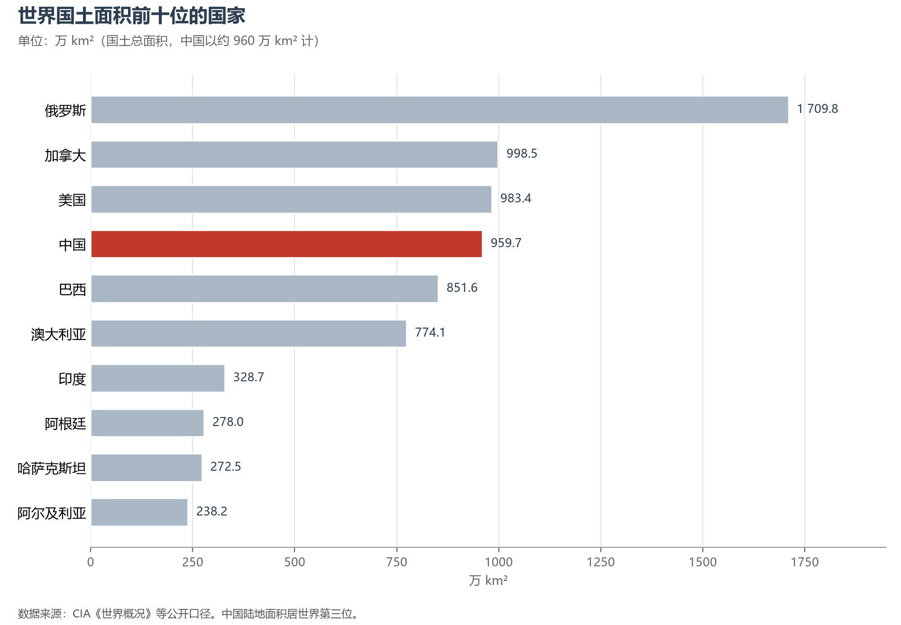
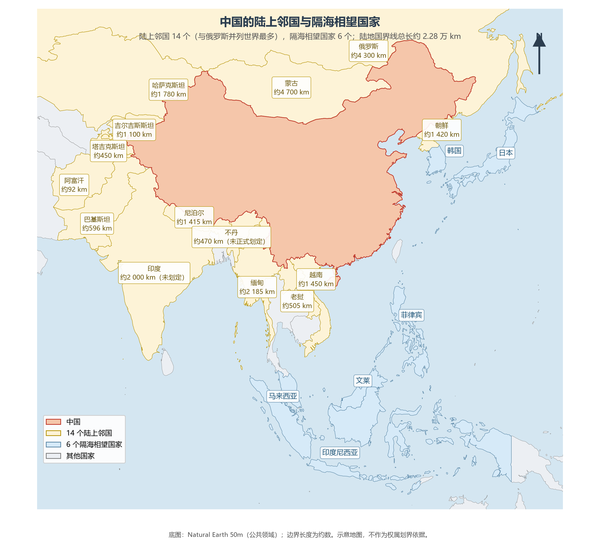
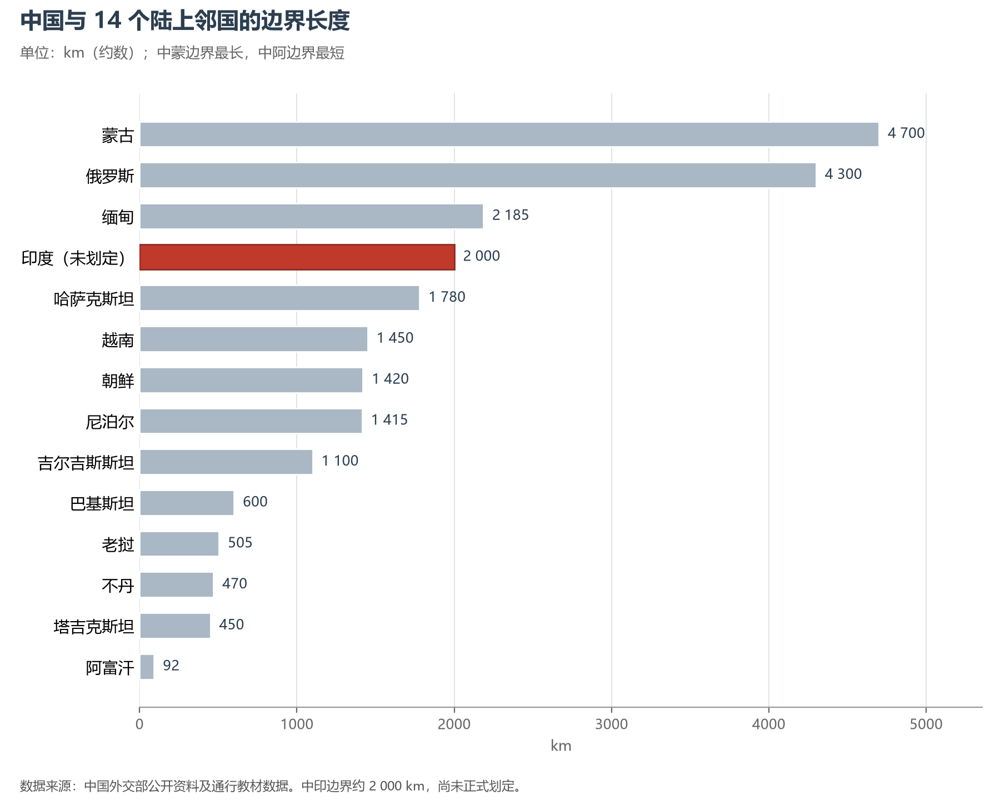
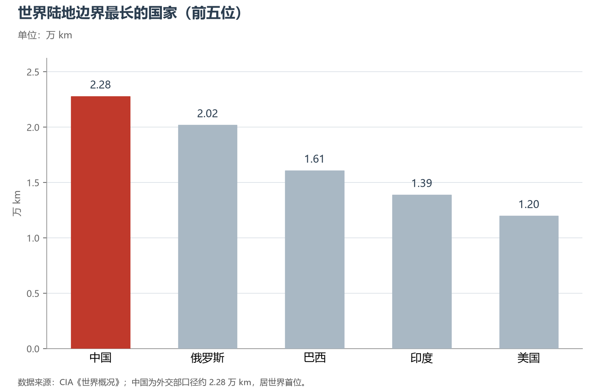

# 1.2 疆域面积与邻国

## 一、960 万 km²：世界第三

中国陆地领土面积约 **960 万 km²**，占世界陆地总面积的约 6.4%，居**世界第三位**——约为俄罗斯的 56%、加拿大的 96%，相当于印度（328.7 万 km²）的近三倍、法国本土（55 万 km²）的十七倍，与整个欧洲（约 1 018 万 km²）大体相当而略小。

| 排名 | 国家 | 国土面积（万 km²） | 与中国之比 |
|------|------|-----------------|-----------|
| 1 | 俄罗斯 | 1 709.8 | 1.78 倍 |
| 2 | 加拿大 | 998.5 | 1.04 倍 |
| 3 | **中国** | **约 960** | — |
| 4 | 美国 | 983.4（含水域口径） | 1.02 倍 |
| 5 | 巴西 | 851.6 | 0.89 倍 |
| 6 | 澳大利亚 | 774.1 | 0.81 倍 |

按国际通行的国家领土概念，一国之领土由**领陆、领水（内水与领海）、领空与底土**构成。约 960 万 km² 指领陆及其内水；在此之外，中国还主张约 300 万 km² 的管辖海域（见 1.3 节）——陆海合计，中国的国土空间接近 1 260 万 km²。

**图 1-3 世界国土面积前十位的国家**：中国约 960 万 km²，居世界第三。

## 二、十四个陆上邻国

中国陆地国界线总长 **2.28 万 km**，与**14 个国家**接壤，与俄罗斯并列世界上陆上邻国最多的国家。自东北逆时针方向数来：朝鲜、俄罗斯、蒙古、哈萨克斯坦、吉尔吉斯斯坦、塔吉克斯坦、阿富汗、巴基斯坦、印度、尼泊尔、不丹、缅甸、老挝、越南——从东北亚的白山黑水，经中亚的戈壁雪山，到南亚的喜马拉雅，再到中南半岛的热带丛林，十四国串起了地球上半数以上的文明类型。

| 邻国 | 首都 | 面积（万 km²） | 人口（约） | 边界长度（km） | 主要接壤省区 | 边界状态 |
|------|------|--------------|-----------|--------------|------------|---------|
| 朝鲜 | 平壤 | 12.3 | 2 600 万 | 1 420 | 辽宁、吉林 | 已划定（1962） |
| 俄罗斯 | 莫斯科 | 1 709.8 | 1.44 亿 | 4 300 | 黑龙江、吉林、内蒙古、新疆 | 已划定（1991/2004 补充协定） |
| 蒙古 | 乌兰巴托 | 156.7 | 350 万 | 4 700 | 内蒙古、甘肃、新疆 | 已划定（1962）；中国最长陆地边界 |
| 哈萨克斯坦 | 阿斯塔纳 | 272.5 | 2 000 万 | 1 780 | 新疆 | 已划定（1994/1997/1998） |
| 吉尔吉斯斯坦 | 比什凯克 | 20.0 | 700 万 | 1 100 | 新疆 | 已划定（1996/1999） |
| 塔吉克斯坦 | 杜尚别 | 14.3 | 1 000 万 | 约 450 | 新疆 | 已划定（1999/2002） |
| 阿富汗 | 喀布尔 | 65.2 | 4 000 万 | 92 | 新疆（瓦罕走廊） | 已划定（1963）；中国最短陆地边界 |
| 巴基斯坦 | 伊斯兰堡 | 88.2 | 2.4 亿 | 约 600 | 新疆 | 已划定（1963） |
| 印度 | 新德里 | 328.7 | 14.3 亿 | 约 2 000 | 新疆、西藏 | **未划定** |
| 尼泊尔 | 加德满都 | 14.7 | 3 000 万 | 1 415 | 西藏 | 已划定（1961） |
| 不丹 | 廷布 | 3.8 | 78 万 | 约 470 | 西藏 | 未正式划定（谈判推进中） |
| 缅甸 | 内比都 | 67.7 | 5 400 万 | 2 185 | 西藏、云南 | 已划定（1960，新中国第一个边界条约） |
| 老挝 | 万象 | 23.7 | 750 万 | 505 | 云南 | 已划定（1991） |
| 越南 | 河内 | 33.0 | 1.0 亿 | 约 1 450 | 云南、广西 | 已划定（1999 签约，2008 全线立碑） |

两条边界最值得驻足端详。**中蒙边界**长约 4 700 km，是中国最长的陆地边界，从东北的阿尔山一路画到新疆阿尔泰山的分水岭，把草原帝国与现代中国隔开一线。**中阿边界**仅 92 km，是阿富汗瓦罕走廊东端与新疆接壤的一段——却是帕米尔高原海拔 4 000 m 以上的人迹罕至之地，也是古丝绸之路从中国出境、进入中亚的最后通道。

**图 1-4 中国的陆上邻国与隔海相望国家**：14 个陆上邻国（黄）与 6 个隔海相望国家（蓝）。

**图 1-5 中国与 14 个陆上邻国的边界长度**：中蒙最长，中阿最短；中印边界为唯一未划定的一条。

## 三、六个隔海相望的国家

与中国隔海相望的国家有六个，自北而南为韩国、日本、菲律宾、马来西亚、文莱、印度尼西亚。它们与中国之间没有一条陆地边界，却共享着黄海、东海、南海的渔场与航道——海上邻国关系的亲疏远近，集中体现在东海钓鱼岛与南海诸岛两大议题上（见 1.3 节与第 8 章）。

| 国家 | 首都 | 面积（万 km²） | 人口（约） | 相望海域 |
|------|------|--------------|-----------|---------|
| 韩国 | 首尔 | 10.0 | 5 100 万 | 黄海、东海 |
| 日本 | 东京 | 37.8 | 1.24 亿 | 东海 |
| 菲律宾 | 马尼拉 | 30.0 | 1.1 亿 | 南海 |
| 马来西亚 | 吉隆坡 | 33.0 | 3 400 万 | 南海 |
| 文莱 | 斯里巴加湾市 | 0.58 | 45 万 | 南海 |
| 印度尼西亚 | 雅加达 | 191.4 | 2.75 亿 | 南海 |

## 四、边界的划定：从"失地"到全线勘定

近代中国积贫积弱，边界从无主动划定之权。新中国以"和平共处五项原则"为基础，用半个多世纪完成了世界最复杂边界体系的谈判与勘定：

- **1960 年**，《中缅边界条约》签订，这是新中国与邻国的第一个边界条约，为后续谈判立下了范式；
- **1961—1963 年**，与尼泊尔、朝鲜、蒙古、巴基斯坦、阿富汗相继签约，西南、西北方向边界基本落定；
- **1991—1999 年**，与苏联及其继承国俄罗斯、哈萨克斯坦、吉尔吉斯斯坦、塔吉克斯坦，以及老挝、越南陆续签约；
- **2008 年**，中越陆地边界全线勘定立碑；**2011 年**，中塔新划界段勘界结束。

至今，14 条陆地边界中 **12 条已划定并勘定**，仅中印边界（约 2 000 km）尚未正式划定，中不边界尚未签订条约。就总长而论，中国的陆地边界居**世界首位**——比第二名俄罗斯长约 2 600 km，是美国（1.20 万 km）的近两倍。一条条边界条约，是理解中国周边外交最直接的文献。

**图 1-6 世界陆地边界最长的国家（前五位）**：中国以约 2.28 万 km 居首。

## 五、地缘格局：陆海之间的枢纽

把 14 个陆上邻国与 6 个海上邻国的人口加在一起，超过 **27 亿人**——世界人口的三分之一环绕着中国边境线而居。这片周边既有人口第一大国印度、面积第一大国俄罗斯，也有全球增长最快的东南亚；中国西南经云南直通中南半岛，西北经中亚通达欧洲，东面则是全球航运最繁忙的西太平洋航线。"陆上丝绸之路经济带"与"21 世纪海上丝绸之路"在此交汇，正是这一地缘格局的直接产物：中国是世界上少数同时具备**陆权**与**海权**双重纵深的国家。

## 参考与数据来源

1. 陆地边界总长与划定状态：中国外交部公开资料。
2. 各段边界长度：外交部公开资料及通行教材口径；邻国面积、人口：各国统计部门与联合国公开数据（2024 年前后）。
3. 世界边界长度排名：CIA《世界概况》；中国采用外交部口径约 2.28 万 km。
4. 底图：Natural Earth 50m（公共领域）。
