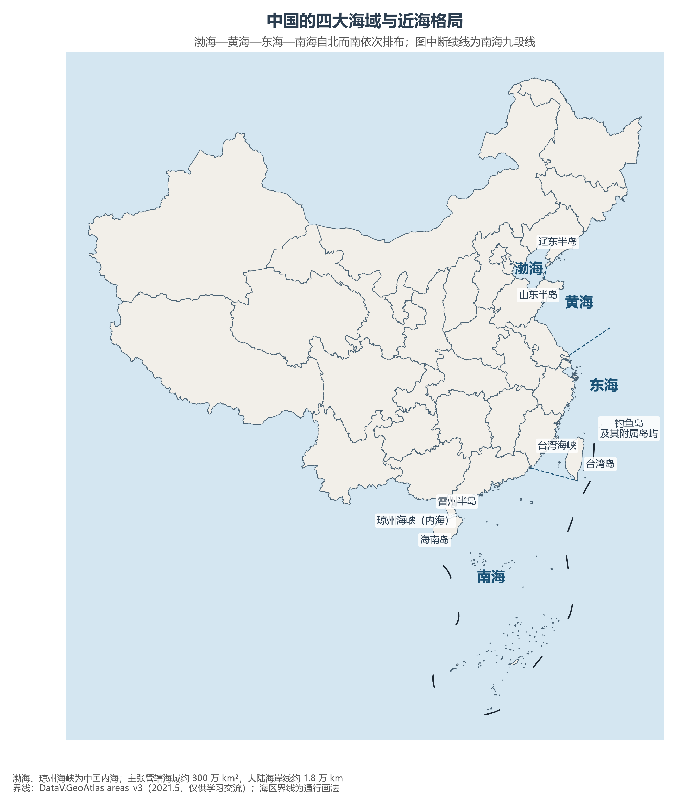
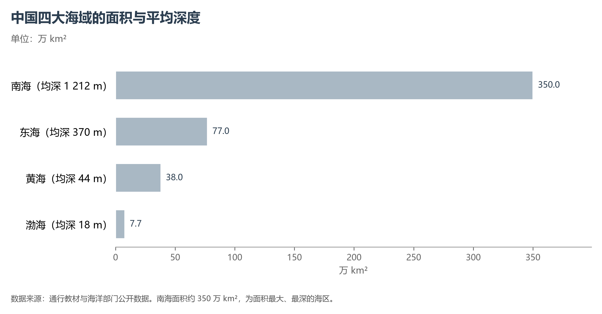
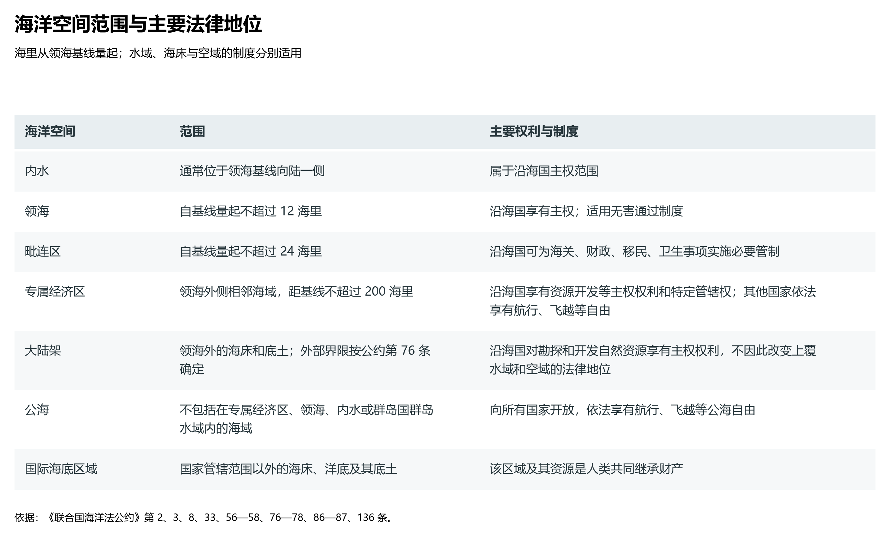
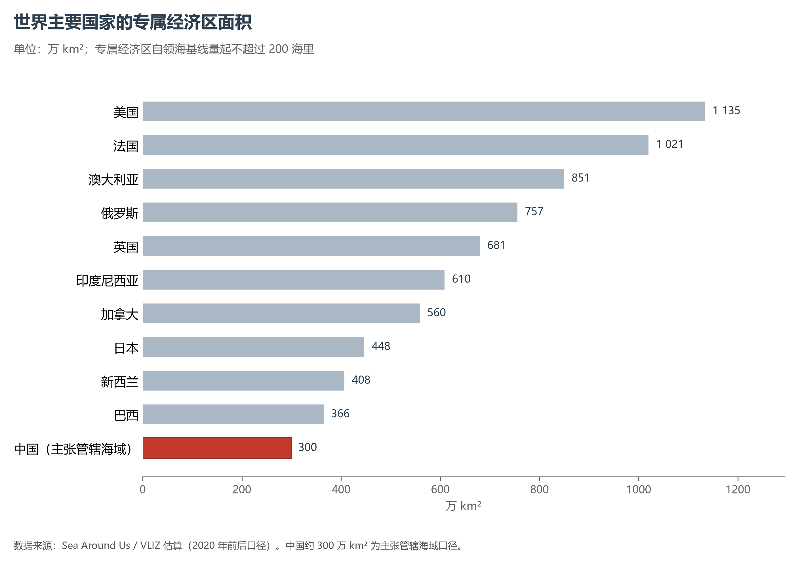

# 1.3 海域与海洋权益

中国不仅是一个陆地大国，也是一个拥有漫长海岸线与广袤管辖海域的海洋大国。大陆边缘自北向南弧形环抱着四大海域，大陆海岸线长达 **1.8 万余 km**，海岛海岸线长达 **1.4 万余 km**，分布着 **1.1 万余个海岛礁**。在国际海洋法的新秩序下，中国主张管辖的海域面积达 **约 300 万 km²**。认识这片深蓝国土的自然禀赋、法律属性与地缘空间，是理解中国从“海陆统筹”迈向“海洋强国”的关键基点。

## 一、四大海域：从陆架浅海到热带深渊

中国大陆以东、以南濒临的海面，自北而南依次为**渤海、黄海、东海、南海**，总面积约 **470 万 km²**。这四片海域在海底地形、地质构造、水文气候与生态环境上呈现出由浅入深、由陆架向大洋过渡的显著阶梯序列：

**图 1-7 中国的四大海域与近海格局**：图中断续线为南海九段线，三大海区界线自北而南依次标注。

**图 1-8 中国四大海域的面积与平均深度**：南海一区即占四大海域总面积的四分之三。

### 1. 渤海：被大陆环抱的内海
- **空间与地质**：渤海是深入中国大陆腹地的内海，被辽东半岛与山东半岛东西合抱，仅通过宽约 105 km 的渤海海峡与黄海沟通。总面积约 **7.7 万 km²**，平均水深仅 **18 m**，全海区水深几乎均在 30 米以内，仅海峡处的老铁山水道因强烈潮流下切冲刷，最大水深达到约 **70 m**。
- **水系与泥沙沉积**：渤海接纳了黄河、海河、滦河、辽河等大江大河。黄河曾年均携入数亿吨泥沙，在渤海湾形成了全球发育最为迅猛的大型泥沙三角洲；沿岸凹陷形成辽东湾、渤海湾、莱州湾三大海湾。
- **冬季海冰现象**：由于水浅、海水盐度较低（约 28‰~30‰）且纬度偏高，每年 12 月至翌年 3 月，辽东湾常出现大面积海冰，冰厚可达 20~40 cm，需出动破冰船保障天津港等北方港口通航安全。

### 2. 黄海：陆架浅海与古黄河印记
- **空间与地质**：黄海是半封闭的大陆架浅海，北起鸭绿江口，南以长江口北岸启东嘴至韩国济州岛西南端连线与东海分界，总面积约 **38 万 km²**，平均水深约 **44 m**。山东半岛成山头与朝鲜长山串连线，将黄海分为北部黄海（约 7.1 万 km²）与南部黄海（约 30.9 万 km²）。
- **自然奇观与洋流**：历史上黄河曾长期夺淮入黄海，巨量黄色泥沙倾泻入海，“黄海”由此得名。在苏北沿海，潮汐与波浪塑造了世界罕见的辐射状沙洲群（南黄海辐射沙脊群），面积达 2 万余平方公里，是中国黄（渤）海候鸟栖息地世界自然遗产的核心组成。黄海中部深水洼地夏季存在常年水温低于 10 ℃ 的**“黄海冷水团”**，成为发展高附加值三文鱼等深远海冷水鱼类养殖的天然温床。

### 3. 东海：宽广陆架与天然海槽断裂
- **空间与地质**：东海西临中国大陆，东北接黄海，东以日本九州岛、琉球群岛为界，南以广东南澳岛至台湾岛南端鹅銮鼻连线与南海相隔。总面积约 **77 万 km²**，平均水深 **370 m**。
- **大陆架与冲绳海槽**：东海具有世界上最宽阔的大陆架之一，水深不足 200 m 的大陆架平缓区占全海区面积的 **三分之二**。大陆架向东急剧过渡为水深深逾 2 000 m 的**冲绳海槽**，最深处达 **2 719 m**。冲绳海槽是新生代形成的强烈构造断裂带，它在地质构造和地理形态上截然阻断了东海陆架向琉球群岛的延伸，是中国东海大陆架自然延伸至海槽轴线的无可争辩的地质学铁证。
- **渔业宝库**：长江与钱塘江每年将数万亿立方米淡水及巨量陆源营养盐注入东海，与北上的黑潮暖流交汇，形成了著名的**舟山渔场**——中国近海最大的海洋水产捕捞基地。

### 4. 南海：辽阔幽深的热带边缘大洋
- **空间与地质**：南海位于中国大陆南方，北接大陆海岸，西抵中南半岛与马来半岛，东临菲律宾群岛，南抵加里曼丹岛，总面积达 **约 350 万 km²**（约为渤、黄、东三海面积总和的三倍），平均水深达 **1 212 m**。南海中部为深海平原，最大水深位于马尼拉海沟东侧边缘，达到 **5 559 m**。
- **珊瑚礁群与资源**：南海散布着东沙、西沙、中沙和南沙四大群岛，是典型的热带珊瑚礁地貌系统；水温常年在 25~29 ℃，生态极其优异。南海海底地质盆地蕴藏着高达数十亿吨规模的油气储量以及极其庞大的天然气水合物（可燃冰）资源，被誉为“第二个波斯湾”。同时，南海是沟通太平洋与印度洋的海上交通十字路口，全球三分之一的国际海上航运贸易货轮需经由此海域。

| 海域 | 面积 (万 km²) | 平均深度 | 最大深度 | 陆架占比 | 主要入海径流 | 核心地缘与生态特征 |
|------|--------------|---------|---------|---------|-------------|------------------|
| 渤海 | 7.7 | 18 m | 约 70 m | 100% | 黄河、海河、辽河、滦河 | 中国唯一完整内海；环渤海港口群；冬季辽东湾结冰 |
| 黄海 | 38.0 | 44 m | 约 140 m | 100% | 淮河、鸭绿江、大洋河 | 苏北辐射沙脊群世界自然遗产；黄海冷水团 |
| 东海 | 77.0 | 370 m | 2 719 m | 约 66% | 长江、钱塘江、闽江、瓯江 | 宽阔大陆架与冲绳海槽天然阻隔；舟山渔场 |
| 南海 | 约 350.0 | 1 212 m | 约 5 559 m | 约 25% | 珠江、红河、湄公河 | 面积最大最深；四大群岛珊瑚礁；油气水合物富集；国际航线咽喉 |

| 海域分界线 | 毗邻北侧海区 | 毗邻南侧海区 | 法定界标端点连线 | 走向与水文分界特征 |
|-----------|-------------|-------------|----------------|-------------------|
| **渤海—黄海分界线** | 渤海 | 黄海 | **辽宁大连老铁山角 ── 山东蓬莱角** | 沿庙岛群岛水道，分隔半封闭内海与陆架浅海 |
| **黄海—东海分界线** | 黄海 | 东海 | **江苏长江口北岸启东嘴 ── 韩国济州岛西南端** | 分隔古黄河冲积泥沙区与长江冲淡水外延区 |
| **东海—南海分界线** | 东海 | 南海 | **广东南澳岛 ── 台湾岛南端鹅銮鼻** | 横贯台湾海峡南口，东海浅陆架向南海热带深海盆过渡 |

## 二、内海、海峡与半岛格局

中国近海的轮廓，由三大半岛与三大海峡相互锁扣而成，构成了天然的国防屏蔽与航运锁钥：

### 1. 两大内海
内海在国际法上享有完全等同于陆地领土的主权地位，未经沿海国允许，任何外国军舰及非民用船舶不得进入：
- **渤海**：辽东半岛的老铁山角与山东半岛的蓬莱角之间，分布着庙岛群岛（长山列岛），各岛屿间水道宽度均在 12 海里领海以内，自清代与北洋水师时期即被公认为中国之内海，1958 年中国政府正式对外声明其内海法律地位。
- **琼州海峡**：位于雷州半岛与海南岛之间，东西长约 80 km，南北最窄处仅 **19.4 km**（平均宽约 29.5 km）。1964 年 6 月 5 日，国务院正式批准将琼州海峡划定为我国定性内水，外国船舶非经批准不得通行。

### 2. 台湾海峡与三大半岛
- **台湾海峡**：位于福建省与台湾岛之间，北连东海，南通南海，南北长约 370 km，东西宽约 130~400 km（平均约 180 km），全区均属东海浅海大陆架，平均水深约 60 m。海峡中分布有澎湖列岛，是西太平洋国际货运最繁忙、战略地位极高的黄金水道。
- **三大半岛**：
  - **辽东半岛**：北起浑河，南至旅顺老铁山，山地丘陵占主体，大连港坐落其南端，拱卫京津海门。
  - **山东半岛**：西起胶莱河，东深入黄海，海岸多花岗岩岬角与海湾，青岛、威海、烟台等深水港星罗棋布。
  - **雷州半岛**：位于广东南部，玄武岩台地平缓，向南直指海南岛，是热带甘蔗与亚热带农业基地。

## 三、海洋权益空间层次与领海基线

1982 年《联合国海洋法公约》（UNCLOS，我国于 1996 年正式批准）与中国国内法律法规（1992 年《领海及毗连区法》、1998 年《专属经济区和大陆架法》），为维护国家海洋权益确立了由海岸向大洋层层推进的空间法理体系：

**图 1-10 海洋空间范围与主要法律地位**：分别比较水域与海床的适用制度，区分公海自由与国际海底区域的人类共同继承财产原则。

### 1. 领海基线的划定与公布
领海基线是测算领海、毗连区、专属经济区和大陆架宽度的起算线：
- **基线方法**：国际法上分为正常基线法（沿海岸低潮线）与**直线基线法**（在海岸曲折或邻近岛屿的适当地点划定基点，以直线相连）。中国海岸曲折且岛屿密集，依法采用**直线基线法**。
- **我国历次公告**：
  - **1958 年 9 月 4 日**，中国政府发表《关于领海的声明》，首次正式宣告中国领海宽度为 **12 海里**（约 22.2 km）。
  - **1996 年 5 月 15 日**，公布第一批领海基线：涵盖自山东半岛成山头向南至海南岛西南部的大陆沿海部分，以及西沙群岛的领海基线，共设 77 个基点。
  - **2012 年 9 月 10 日**，针对日本非法“购岛”行径，中国政府依法公布《关于钓鱼岛及其附属岛屿领海基线的声明》，划定了钓鱼岛、黄尾屿、赤尾屿等 17 个基点的直线领海基线。
  - **2024 年 3 月 1 日**，中国政府依法公布北部湾北部领海基线，共设置 7 个基点，进一步完善了南部海疆领海基线闭合网络。

### 2. 各空间层次法律地位要素对比

| 空间层级 | 起算范围 | 上覆空域地位 | 水体与生物资源权属 | 海床底土与矿产权属 | 航行与飞越权利 |
|---------|---------|-------------|------------------|-------------------|--------------|
| **内水** | 领海基线向陆一侧海域 | 国家领空（完全主权） | 领水水体（完全主权） | 国家领土底土（完全主权） | 未经批准，外国军民船舶与航空器均不得进入 |
| **领海** | 自基线向外至 12 海里 | 国家领空（完全主权） | 领海水体（完全主权） | 领海海床及底土（完全主权） | 外国非军用船舶享**无害通过权**；航空器未经许可不得飞越 |
| **毗连区** | 领海外侧相邻海域，距基线不超过 24 海里 | 依上覆空域适用制度 | 不因毗连区制度改变水域法律地位 | 不因毗连区制度改变海床法律地位 | 沿海国可为海关、财政、移民、卫生事项实施必要管制 |
| **专属经济区** | 自基线向外至 200 海里 | 国际空域（飞越自由） | 勘探、开发、养护生物资源主权权利 | 专属经济区自然资源开发权 | 享有公海自由航行与上空飞越自由；沿海国对人工岛礁建设行使管辖权 |
| **大陆架** | 领海外的海床和底土，外部界限按《公约》第 76 条确定 | 不影响上覆空域法律地位 | 不影响上覆水域法律地位 | 勘探和开发自然资源的主权权利 | 各国依法享有铺设海底电缆和管道的权利；管道路线须经沿海国同意，另适用《公约》第 79 条的相关条件 |

以此国际法架构量算，中国主张管辖的海洋面积达 **约 300 万 km²**，其中内水与领海面积约 **38 万 km²**，专属经济区与大陆架主张海域逾 **260 万 km²**。

**图 1-9 世界主要国家的专属经济区面积**：美国的专属经济区超过其陆地面积，中国 300 万 km² 为主张管辖海域口径。

## 四、海岛谱系与重点岛礁地理志

中国海域岛屿星罗棋布。依据自然资源部《海岛统计调查公报》，我国海域拥有面积在 500 m² 以上的海岛 **7 300 多个**，若计入 500 m² 以下的明礁与暗礁，总数达 **1.1 万余个**，海岛陆地总面积近 8 万 km²：

### 1. 三大岛屿与大群岛
- **台湾岛（约 3.58 万 km²）**：中国第一大岛，构造大陆岛，地处欧亚与菲律宾海板块挤压带，玉山海拔 3 952 m（详见 2.4 节）。
- **海南岛（约 3.4 万 km²）**：中国第二大岛，热带大陆岛，地势中部隆起（五指山 1 867 m）、四周平缓，全岛建设自由贸易港。
- **崇明岛（约 1 267 km²）**：中国第三大岛，**世界最大的河口冲积沙岛**。自唐武德年间露出水面以来，长江泥沙不断堆积，目前岛体仍在以每年数十米的速度向东向北淤涨生长。
- **舟山群岛**：中国最大的群岛，分布有 1 390 个岛屿，大小岛屿拱卫杭州湾与长江口，建有世界级的大宗散货与集装箱枢纽港——宁波舟山港。

### 2. 钓鱼岛及其附属岛屿
钓鱼岛及其附属岛屿位于台湾岛东北约 190 km 处，地处东经 123°20′ 至 124°40′，北纬 25°40′ 至 26°00′ 之间，由钓鱼岛、黄尾屿、赤尾屿、南小岛、北小岛及若干暗礁组成，总面积约 5.69 km²。
- **地质构造**：钓鱼岛诸岛坐落在东海大陆架边缘，其东南侧紧邻深达 2 000 m 以上的冲绳海槽，与琉球群岛在构造地层上截然分开，是台湾岛在东海陆架上的自然地质延伸。
- **历史法理**：明初杨载出使琉球已有确切记载，明清两代册封使航海记录（如陈侃《使琉球录》、郭汝霖《重编使琉球录》）均明确将钓鱼岛、黄尾屿、赤尾屿标定在“中外之界”的中方管辖之内，早在明代即纳入海防防务范围。1895 年甲午战争末期，日本趁清政府战败之机秘密窃占；二战后依据《开罗宣言》和《波茨坦公告》，日本所窃取之中国领土必须全数归还。2012 年以来，中国海警编队依法在钓鱼岛领海内实行常态化维权巡航执法，坚定行使主权管辖。

## 五、南海诸岛经营与三沙市治理

南海是连接世界大洋的“祖宗海”。早在两千多年前的汉代，中国人民就通过海上丝绸之路在南海航行与劳作，称南海为“涨海”，将南海诸岛称作“崎头”；晋唐宋元时期，历代官方文献与《更路簿》详细记录了渔民世代前往西沙、南沙打鱼的固定航线与岛礁俗名：

### 1. “九段线”的历史沿革与法理基石
- **1935 年**，中国政府“水陆地图审查委员会”审定并公布了南海 132 个岛礁沙滩的标准中英文对照名称。
- **1947 年**，抗战胜利后国民政府正式派出军舰接收西沙、南沙群岛，并在太平岛、永兴岛设立主权碑；1948 年 2 月，中国政府内政部公开发行《中华民国行政区域图》，其附图《南海诸岛位置图》以**十一段断续线**标示了我国在南海的主权管辖范围。
- **1953 年**，经中央人民政府批准，删去了北部湾内的两段断续线，确立了沿用至今的**九段线**（在台湾岛东侧海域标注有一段，全书与国家标准底图规范统称为南海断续线）。九段线确认了中国在南海的历史性权利与岛礁主权。

### 2. 三沙市建置与现代经略
- **建制沿革**：1959 年，设立“西沙群岛、南沙群岛、中沙群岛办事处”（县级）；**2012 年 7 月 24 日，海南省三沙市正式挂牌成立**，市政府驻西沙永兴岛，统辖西沙群岛、中沙群岛、南沙群岛的岛礁及其海域，是我国陆地面积最小、总管辖海域面积最大、位置最南的地级市；2020 年，三沙市设立西沙区与南沙区。
- **生态与深蓝基建**：在西沙永乐环礁发现了世界上已知最深的海洋蓝洞——“三沙永乐龙洞”（深达 300.89 m）；在南沙美济礁、渚碧礁、永暑礁建设了绿色低碳海岛生态系统、现代化综合搜救机场、多功能大型灯塔与海洋水文监测中心，为国际航行船只提供了可靠的公共安全产品。

## 六、世界视野：走向海洋强国的经略坐标

在建设海洋强国的时代大潮中，中国 300 万 km² 管辖海域与 1.8 万 km 大陆海岸线正释放出巨大的战略能量：
- **全球造船与港口第一大国**：2024 年全国海洋生产总值突破 **10.5 万亿元**（占国内生产总值 GDP 比重约 7.8%）；全球集装箱吞吐量前十名港口中，中国常年独占七席（上海、宁波舟山、深圳、青岛、广州、天津等）；造船完工量、新接订单量与手持订单量连续十余年雄踞全球第一。
- **深海科学重大跃迁**：“蛟龙”号、“深海勇士”号以及能够在马里亚纳海沟万米海底自由作业的“奋斗者”号全海深载人潜水器相继服役，中国深海科学勘探技术步入世界领跑方阵。
- **维权与合作双轨并行**：坚持“主权属我、搁置争议、共同开发”战略构想，积极落实《南海各方行为宣言》（DOC），加速推进“南海行为准则”（COC）磋商，将南海建设成为和平之海、友谊之海、合作之海。

## 参考与数据来源

1. 海域面积与深度参数：自然资源部海洋咨询中心、中国海洋档案馆权威公开数据。
2. 领海基线法定公报：1958 年《中华人民共和国政府关于领海的声明》、1996 年《关于领海基线的声明》、2012 年《关于钓鱼岛及其附属岛屿领海基线的声明》、2024 年《关于北部湾北部领海基线的声明》。
3. 海洋法理论：联合国《海洋法公约》（UNCLOS，1982）中文官方文本；周忠海《国际海洋法》。
4. 海岛数量与面积：自然资源部《中国海岛统计调查公报》、《全国海岛保护规划》（2012）。
5. 海洋经济统计：自然资源部《2024 年中国海洋经济统计公报》（2025 年初发布）。
6. 底图：Natural Earth 50m、DataV.GeoAtlas（仅供学习交流）。
