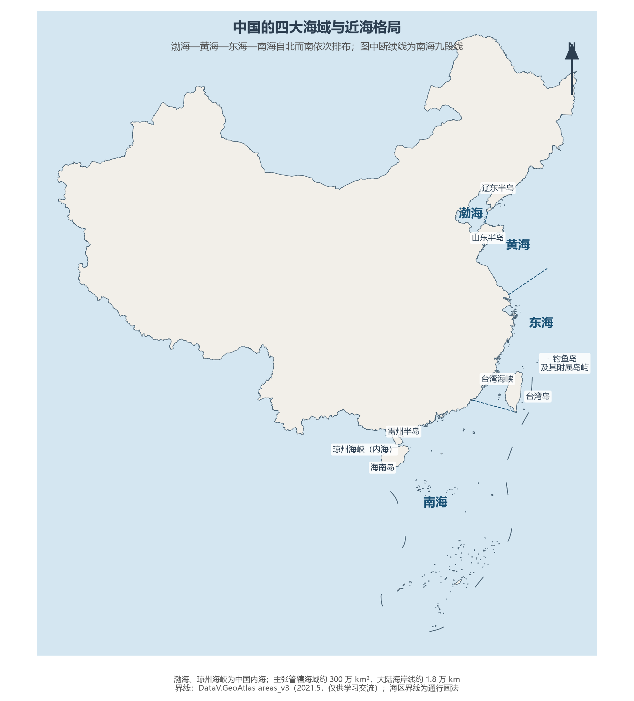
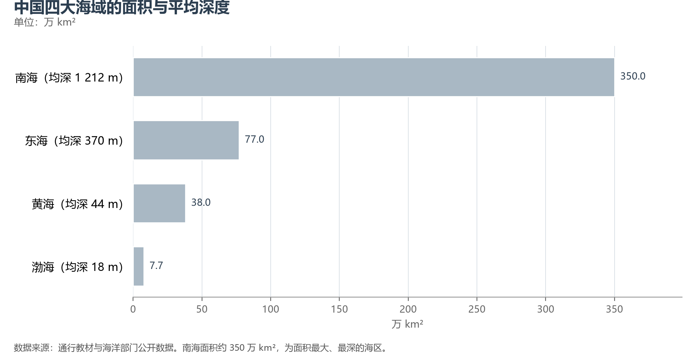
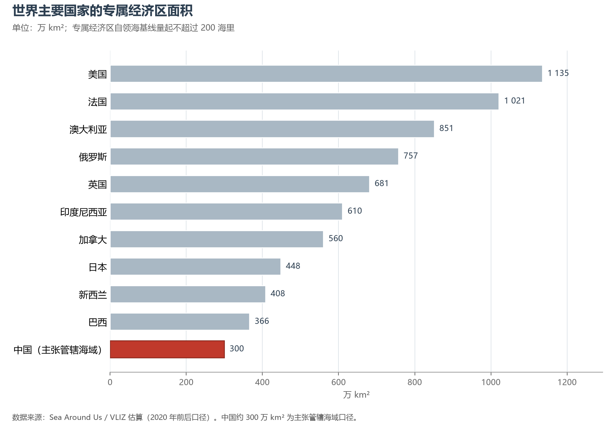

# 1.3 海域与海洋权益

## 一、四大海域：从渤海到南海

中国大陆以东、以南的海面自北而南依次为**渤海、黄海、东海、南海**，弧形环抱着大陆海岸，总面积约 470 万 km²。这四片海有清晰的"身份序列"：渤海是被大陆环抱的内海，黄海是半封闭的浅海，东海是大陆架宽展的边缘海，南海则是伸入热带的深海。

| 海域 | 面积（万 km²） | 平均深度 | 最大深度 | 地理志 |
|------|--------------|---------|---------|--------|
| 渤海 | 7.7 | 18 m | 约 70 m | 中国内海；黄河、海河、辽河在此入海，渤海湾畔是中国北方最大的港口群 |
| 黄海 | 38 | 44 m | 约 140 m | 半封闭浅海；古黄河泥沙染黄海水而得名；苏北沿海辐射沙脊群为全球罕见地貌 |
| 东海 | 77 | 370 m | 约 2 700 m | 大陆架占海区面积约三分之二；长江年输沙与营养盐造就舟山渔场——中国最大的渔场 |
| 南海 | 约 350 | 1 212 m | 约 5 559 m | 面积最大、最深；热带海洋，散布东沙、西沙、中沙、南沙四大群岛，是通往印度洋的咽喉 |

三大海区界线自北而南为：渤海—黄海以**老铁山角—蓬莱角**连线为界；黄海—东海以**长江口北角—济州岛西南端**连线为界；东海—南海以**广东南澳岛—台湾岛南端鹅銮鼻**连线为界。

**图 1-7 中国的四大海域与近海格局**：图中断续线为南海九段线，三大海区界线自北而南依次标注。

**图 1-8 中国四大海域的面积与平均深度**：南海一区即占四大海域总面积的四分之三。

## 二、内海、海峡与半岛

**渤海**与**琼州海峡**是中国的两大内海。内海等同于陆地领土，外国船舶非经许可不得进入——渤海因此被称为"中国的地中海"：辽东半岛与山东半岛南北相夹，仅留宽约 105 km 的渤海海峡与外海相通，庙岛群岛南北纵列其间，把海峡切成若干水道。琼州海峡则夹在雷州半岛与海南岛之间，最窄处仅 19.4 km，是三大海峡中最短的一条。

**台湾海峡**（属东海）平均宽约 180 km，连通东海与南海，是全球货运最繁忙的水道之一。三大半岛——辽东半岛、山东半岛、雷州半岛——自北而南拱卫着渤海与北部湾，构成了中国北方海岸线的骨架。

## 三、海洋权益的空间层次

《联合国海洋法公约》（中国于 1996 年批准）与国内立法（《领海及毗连区法》1992、《专属经济区和大陆架法》1998）为海洋权益划定了由岸及海的五个层次：

| 层次 | 宽度 | 法律地位 |
|------|------|---------|
| 内水 | 领海基线向陆一侧 | 完全主权，等同领土 |
| 领海 | 自基线起 12 海里 | 主权及于水域、上空与海床，他国船舶享无害通过权 |
| 毗连区 | 领海外 12—24 海里 | 就海关、财政、移民、卫生行使管制权 |
| 专属经济区 | 自基线起 200 海里 | 勘探开发自然资源的主权权利 |
| 大陆架 | 至大陆边缘，最短 200 海里 | 海床与底土自然资源的主权权利 |

中国采用**直线基线法**：1958 年《关于领海的声明》首次宣布 12 海里领海，1996 年公布大陆部分领海基线。以此量算，中国主张的**管辖海域约 300 万 km²**。1 海里合 1.852 km，12 海里即约 22.2 km——从海岸线向外望，领海大约只到地平线；真正的海洋国土，在 200 海里专属经济区之内。

## 四、岛屿：7 300 多个海上据点

中国海域分布着面积 500 m² 以上的海岛 **7 300 多个**，若计入更小的岛礁则达 **1.1 万余个**（《2015 年海岛统计调查公报》），海岛总面积约占陆地面积的 0.8%。三大岛依次为**台湾岛**（约 3.6 万 km²）、**海南岛**（约 3.4 万 km²）、**崇明岛**（约 1 200 km²，中国最大的冲积岛，仍以每年数十米的速度向东海生长）；最大群岛是**舟山群岛**（1 390 个岛屿，中国最大渔场与最大渔港所在地）。**钓鱼岛及其附属岛屿**位于台湾岛东北约 190 km 处，由中国海警常态化巡航执法。

## 五、南海诸岛

南海是四大海域中面积最大、地位最重要的海区。中国是最早发现、命名并持续经营南海诸岛的国家：1947 年中国政府审定出版《南海诸岛位置图》，以十一段断续线标示中国在南海的权益范围；1953 年北部湾内两段取消，形成沿用至今的**九段线**（台湾岛东侧另有一段，全图共十段）。断续线之内，散布着东沙、西沙、中沙、南沙四大群岛：西沙永兴岛是地级**三沙市**（2012 年设立）的驻地，南沙的曾母暗沙则是全部领土的最南端。

南海部分岛礁存在主权与海域划界争议。中国的立场一以贯之：**主权属我、搁置争议、共同开发**；争议由直接当事国谈判协商解决（2002 年《南海各方行为宣言》确立的框架），南海的和平由中国与东盟国家共同维护。

## 六、世界视角：300 万 km² 的分量

把海洋空间放到世界坐标系里衡量，会得到几个出乎直觉的结论：

- **美国的海洋国土世界第一**。专属经济区面积达约 1 135 万 km²，超过其陆地面积；法国凭借海外领地位居第二（约 1 021 万 km²），是其本土的 18 倍——今日的"海洋大国"，比拼的早已不是本土海岸线，而是散布全球的岛屿与领地。
- **中国的 300 万 km² 主张管辖海域**，相当于陆地面积的三成，总量居世界前列而人均有限；且与隔海相望的六国之间的划界大多尚未完成。
- **海洋经济已成支柱**。2024 年全国海洋生产总值突破 10 万亿元（约 10.5 万亿元，占 GDP 约 7.8%），世界第一造船大国、第一货物吞吐量港口大国的地位均坐落在这 1.8 万 km 大陆海岸线上。

**图 1-9 世界主要国家的专属经济区面积**：美国的专属经济区超过其陆地面积，中国 300 万 km² 为主张管辖海域口径。

海洋权益从来不在图纸上，而在巡航的航迹里、在渔船与货轮的航线上——这正是理解中国海洋战略的起点。

## 参考与数据来源

1. 四大海域面积、深度与海区界线：通行教材与海洋部门公开数据。
2. 海岛数量：自然资源部《2015 年海岛统计调查公报》、《全国海岛保护规划》（2012）。
3. 海洋权益法律框架：《联合国海洋法公约》（1996 年全国人大常委会批准）、《领海及毗连区法》（1992）、《专属经济区和大陆架法》（1998）。
4. 专属经济区国际比较：Sea Around Us / VLIZ 估算；海洋经济：自然资源部《2024 年中国海洋经济统计公报》。
5. 界线底图：DataV.GeoAtlas areas_v3（2021.5，仅供学习交流）。
