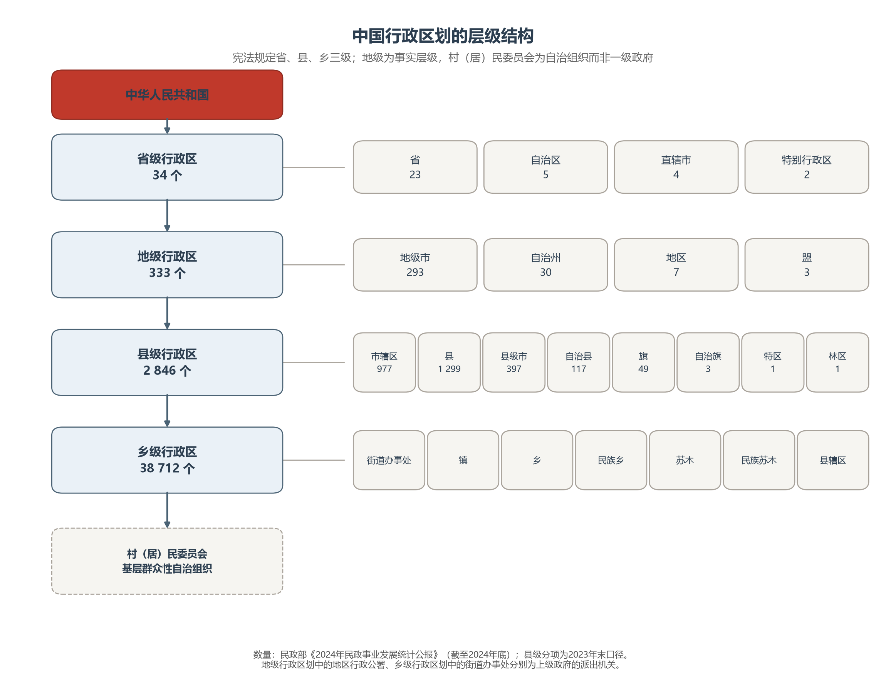
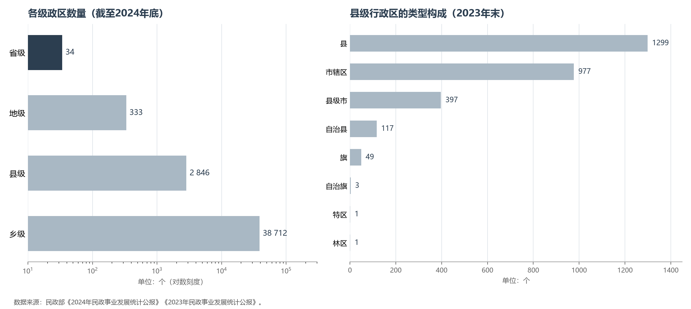

# 2.1 行政区划体系与层级

行政区划是国家治理的空间骨架。截至 2024 年底，中国以 34 个省级单位统摄 333 个地级单位、2 846 个县级单位，再由 38 712 个乡级单位落到每一片村社与街巷——三级骨架、四级运转、五级触达，构成当今世界规模最大的行政分区体系。理解这套体系，是读懂此后所有分省、分县统计数据的前提。

**图 2-1 中国行政区划的层级结构**：宪法确认省、县、乡三级；地级为事实层级，村（居）民委员会为自治组织。

## 一、宪法框架：三级体系与事实上的四级

《宪法》第三十条划定基本框架：全国分为省、自治区、直辖市；省、自治区分为自治州、县、自治县、市；县、自治县分为乡、民族乡、镇；直辖市和较大的市分为区、县。第三十一条则为特别行政区预留了空间。就宪法文本而言，中国是**省、县、乡三级**。

现实运转却是四级：省之下普遍存在**地级**。它的前身是省的派出机构"地区行政公署"；1983 年起推行**市管县体制**，地级市由城市型政区升级为辖县政区，逐渐取代地区成为地级层的主体。今天 333 个地级单位中，293 个是地级市，纯粹派出形态的"地区"只剩 7 个。三级与四级之间的这段"虚实"，是理解中国政区体系的第一把钥匙。

派出机关的痕迹还残留在两端：地级的"地区行署"仅存 7 个；县级政府向人口稠密的城区派出的**街道办事处**，则是今天乡级层中约 9 000 个"街道"的由来——它们不是一级政府，却行使着一级政区的全部日常管理职能。

## 二、省级：一级行政区的四种形态

34 个省级行政区按宪法形态分为四类：

| 类型 | 数量 | 成员与要点 |
|------|------|-----------|
| 省 | 23 | 沿用元明清行省制度；台湾省为其中之一 |
| 直辖市 | 4 | 北京、上海（均设于 1949 年）、天津（1958 年曾并入河北，1967 年复设）、重庆（1997 年自四川分出，最年轻） |
| 自治区 | 5 | 内蒙古（1947，最早）、新疆（1955）、广西与宁夏（1958）、西藏（1965） |
| 特别行政区 | 2 | 香港（1997）、澳门（1999），依基本法实行"一国两制"、高度自治 |

省级建置的设立、撤销、更名，由**全国人民代表大会**批准；省级界线的变更由国务院审批。自治区的法理基础是**民族区域自治制度**——它并不止于自治区一级，而是向下延伸为 30 个自治州、117 个自治县与内蒙古、黑龙江的 3 个自治旗，共同构成全国 155 个民族自治地方的三级体系（内蒙古 49 个普通的旗不在此列，它们与县同级）。

## 三、地级：市管县时代

333 个地级单位中，**293 个地级市**占近九成。其余三类各有来历：

- **30 个自治州**：民族区域自治在地级的体现，集中于云南（8）、青海（6）、新疆（5）、四川与贵州（各 3）等西部省份，是全国唯一广泛存在于省级之下的民族自治地级形态；
- **7 个地区**：新疆 5 个（和田、喀什、阿克苏、塔城、阿勒泰）、西藏阿里、黑龙江大兴安岭——多属地广人稀、设市条件未熟的边远之地，是"地区时代"最后的标本；
- **3 个盟**：内蒙古特有的地级形态（锡林郭勒盟、阿拉善盟、兴安盟），对应下级设旗，保留着清代盟旗制度的印记。

城市型政区内部还有一套"级别"体系：15 个**副省级市**（哈尔滨、长春、沈阳、济南、南京、杭州、广州、武汉、成都、西安十个省会城市，加大连、青岛、宁波、厦门、深圳五个**计划单列市**）在经济管理权限上接近省级，其中五个计划单列市的财政更直接对中央负责——"市"的名义之下，藏着行政级别的精细刻度。

**图 2-2 各级政区数量与县级构成**：左为四级总量（对数刻度），右为县级单位的类型构成。

## 四、县级与乡级：治理的基石

**县级**是中国历史上最稳定的政区单位——"郡县治，天下安"，县制自秦推行至今两千余年未断。县级单位里，1 299 个县与 977 个市辖区为主体（2023 年末口径），397 个县级市绝大多数由地级市**代管**（法律上属省，实际上委托地级市管理），另有河南济源，湖北仙桃、潜江、天门和海南、新疆的十余个县级市由省级政府直辖；另含 117 个自治县、49 个旗、3 个自治旗，以及最后的特例：贵州六枝特区与湖北神农架林区。

**乡级**是基层政权所在，共 38 712 个。其中**镇**约 2.1 万个，已明显多于乡——"撤乡设镇""撤镇设街"的更名方向，正是四十余年城镇化的直接刻度；9 000 余个街道办事处管着城市的每一个街区；民族乡（约 950 个）与内蒙古的苏木、民族苏木则是民族自治在乡级的对应形态。乡级之下还有约 60 万个村（居）民委员会——村委会约 48 万个、居委会约 12 万个——依《宪法》第一百一十一条，它们是**基层群众性自治组织**而非一级政权，却是国家治理链条上最末梢、也最贴近日常生活的环节。

## 五、行政区划的管理：代码、条例与界线

每一级政区都编入国家标准化体系。国家标准**GB/T 2260《中华人民共和国行政区划代码》**以六位数字编码：前两位是省（11 北京、44 广东、65 新疆……），中间两位是地级，末两位是县级；统计部门再扩展三位乡级码，构成九位区划码——身份证号、快递单、统计年鉴里的每一个地址，背后都是这套代码。

区划变更的审批权高度集中：省级建置变动由全国人大批准，县级政区的设立、撤销、更名由**国务院**审批，乡级由省级政府审批，制度依据是《行政区划管理条例》（2018 年公布，2019 年 1 月 1 日施行，取代 1985 年的旧行政法规）。此外，政区之间的界线由民政部组织定期联检——仅 2024 年就完成 14 条省界的联合检查，界桩的每一厘米都记录在案。

## 六、世界视角：一个"分区大国"的坐标系

以政区数量论，中国是当今世界分区最细的大国之一：2 846 个县级单位与美国 3 000 余个县（county）大体同一量级，38 712 个乡级单位则与法国 3.5 万个市镇（commune）、印度 25 万个村潘查亚特属同一量级谱系。但层级结构各不相同：日本是"都道府县—市町村"两级制，法国为"大区—省—市镇"三级制，美国联邦制下州县自成体系；中国的四级实际层级（省—地—县—乡），在全球主要国家中属于层级较多的一种——这是治理一个 14 亿人、960 万 km² 单一制国家的空间代价与效率平衡。

## 参考与数据来源

1. 政区数量：民政部《2024 年民政事业发展统计公报》（截至 2024 年底）、《2023 年民政事业发展统计公报》（县级分项）。
2. 制度框架：《中华人民共和国宪法》第三十条、第三十一条、第一百一十一条；《行政区划管理条例》（2018 年公布）；国家标准 GB/T 2260。
3. 民族自治地方与盟旗制度：国家民族事务委员会公开资料。
