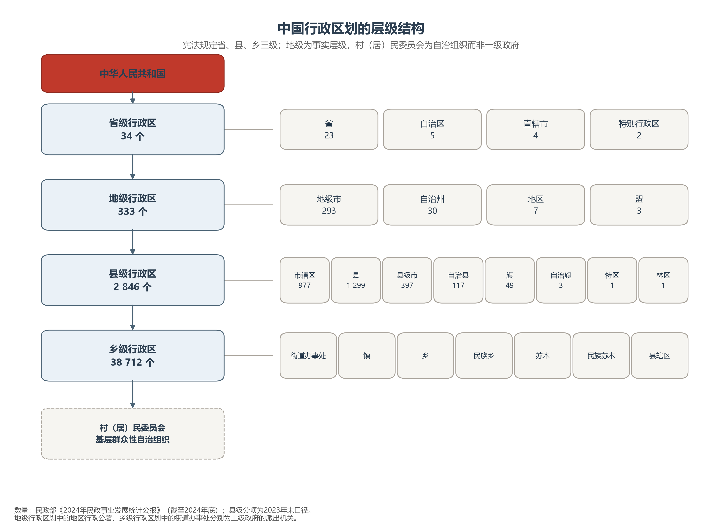
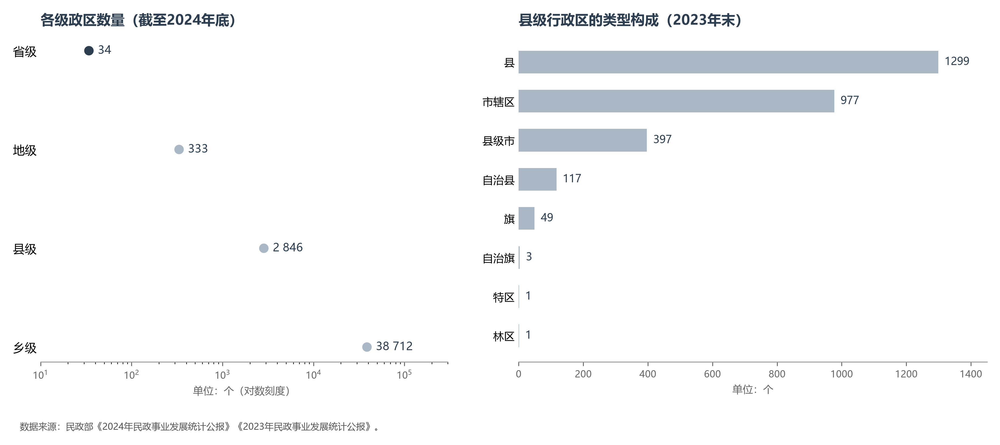

# 2.1 行政区划体系与层级

行政区划是国家权力在地理空间上的投影，是超大国家维系政令统一、组织公共治理、协调区域发展的空间骨架。截至 2024 年底，中国以 **34 个省级行政区**统摄 **333 个地级单位**、**2 846 个县级单位**，再通过 **38 712 个乡级政权与派出机构**落入每一片村庄与社区——法理上的三级体系、事实上的四级运转与直达基层的五级治理，共同构成了人类历史上规模最为庞大、运转最为精密、覆盖逾 14 亿人口的现代政区空间网络。理解这套体系的层级脉络与制度逻辑，是读懂全书所有自然、人口、经济与区域地理数据的总钥匙。

**图 2-1 中国行政区划的层级结构**：宪法确认省、县、乡三级；地级为事实层级，村（居）民委员会为自治组织。

## 一、宪法框架：法理三级与事实四级的制度辩证法

现代中国行政区划的根本法律基石是《中华人民共和国宪法》第三十条与第三十一条：

- **宪法第三十条的明文规范**：
  1. 全国分为省、自治区、直辖市；
  2. 省、自治区分为自治州、县、自治县、市；
  3. 县、自治县分为乡、民族乡、镇；直辖市和较大的市分为区、县。
- **宪法第三十一条的特别安排**：“国家在必要时得设立特别行政区。在特别行政区内实行的制度按照具体情况由全国人民代表大会以法律规定。”

就宪法条文的字面表述而言，中国的基础政区体系是标准的**省—县—乡三级制**。但在当代实际国家行政运转中，绝大多数区域却普遍运行着**省—地（地级市）—县—乡四级制**。三级与四级之间的这段制度张力，源于中国数千年大一统国家治理规模与管理幅度的必然妥协：

### 1. 虚级派出机关的实体化历程
一个省级行政区若直接统辖数十乃至上百个县，管理幅度过宽，中央与省级政府难以及时体察下情与督导推进。因此，历代中央王朝往往在省与县之间设立监察或协调性质的“虚级”派出机构（汉之刺史、唐之观察使、宋之转运司、明清之分巡道/直隶州，详见 2.3 节）。

新中国成立后，省政府在各地设立**地区行政公署**（简称“地区行署”）。地区行署是省人民政府的派出机关，本身不设人民代表大会与政协委员会，不是一级法定政权，但代行管理若干县级政区的职能。

### 2. “市管县”体制的确立与重塑
改革开放后，伴随工业化与商品经济发展，原有的城乡分割壁垒严重制约了中心城市对周边农村的辐射带动。**1983 年起，国务院在全国范围全面推行“以市领导县”体制（地市合并、撤地设市）**。中心城市（原省辖地级市）与周边地区行署合并，成立新的地级市，地级由虚转实，正式演变为主导地方经济社会发展的骨干层级。到 2024 年底，全国 333 个地级单位中，地级市已占 293 个（近 88%），传统意义上的地区行署仅存 7 个。

| 层级序号 | 法理体系（《宪法》第三十条规定） | 事实运转体系（当代治理四级实态） | 代表性政区形态与 2024 年底数量 | 核心治理功能与权力配置 |
|---------|--------------------------------|------------------------------|-----------------------------|---------------------|
| **第一级** | **省 / 自治区 / 直辖市** | **省级行政区** | 34 个（23 省、5 自治区、4 直辖市、2 特区） | 承接中央大政方针，行使省级经济规划与地方立法权 |
| **第二级** | *(由省直接管辖县级，未单列层级)* | **地级行政区**（事实中枢层） | 333 个（293 地级市、30 自治州、7 地区、3 盟） | 统筹城乡“市管县”中枢，推进中心城市辐射与产业布局 |
| **第三级** | **县 / 自治县 / 市** | **县级行政区**（基础基石层） | 2 846 个（1 299 县、977 区、397 县级市等） | “郡县治天下安”，行使基层综合行政与公共服务职能 |
| **第四级** | **乡 / 民族乡 / 镇** | **乡级行政区**（政权末梢层） | 38 712 个（约 2.1 万镇、0.8 万乡、0.9 万街道） | 国家基层政权机关（乡镇）与城市基层派出机构（街道） |
| **自治基层** | *(群众自治，非国家政权机关)* | **基层群众性自治组织** | 约 60 万个（约 48 万村委会、12 万居委会） | 依据《宪法》第 111 条行使村（居）民自治与网格化治理 |

## 二、省级：一级行政区的四种形态与政治地理权能

截至目前，全国共有 **34 个省级行政区**。作为中央直辖的一级政权单元，省级行政区依据宪法与法律划分为四种形态，各自承载着独特的宪制与空间治理功能：

| 类别形态 | 数量 | 成员名单 | 宪制特征与法定治理权能 |
|---------|------|---------|---------------------|
| **省** | 23 | 河北、山西、辽宁、吉林、黑龙江、江苏、浙江、安徽、福建、江西、山东、河南、湖北、湖南、广东、海南、四川、贵州、云南、陕西、甘肃、青海、台湾 | 延续元明清行省制传统；实行普通地方行政制度；台湾省为中华人民共和国不可分割的神圣领土 |
| **直辖市** | 4 | 北京市（首都）、天津市、上海市、重庆市 | 国务院直接管辖的超大中心城市；享有副省级或更高政治经济管理权限；统筹大都市区与广域腹地一体化治理 |
| **自治区** | 5 | 内蒙古（1947）、新疆（1955）、广西（1958）、宁夏（1958）、西藏（1965） | 落实民族区域自治制度；由实行区域自治的民族人员担任政府行政首长；依法行使广泛自治权与单行条例立法权 |
| **特别行政区** | 2 | 香港特别行政区（1997）、澳门特别行政区（1999） | 依据《宪法》第三十一条与各自《基本法》设立；实行“一国两制”；享有行政管理权、立法权、独立司法权与终审权 |

### 民族区域自治的三级地理架构
民族区域自治制度是我国的一项基本政治制度。在行政区划地理上，它并非仅体现在 5 个自治区，而是形成了一个自上而下完整的**三级空间矩阵**：
- **自治区（省级，5 个）**：内蒙古、新疆、广西、宁夏、西藏；
- **自治州（地级，30 个）**：广泛分布于西部 9 个省区（云南 8 个、青海 6 个、新疆 5 个、四川 3 个、贵州 3 个、甘肃 2 个、湖北 1 个、吉林 1 个、湖南 1 个）；
- **自治县与自治旗（县级，120 个）**：包括 117 个自治县与内蒙古的 3 个自治旗（鄂伦春、鄂温克、莫力达瓦达斡尔族自治旗）。
以上三级共 **155 个民族自治地方**。民族自治地方的自治机关为该地方的人民代表大会和人民政府，其行政长官依法由实行区域自治的民族的公民担任。在乡级层面还设有约 950 个民族乡，但民族乡属于普通乡级行政区，不属于法定“民族自治地方”范畴。

## 三、地级：市管县时代的层级构成与特殊谱系

地级行政区共 **333 个**，是省与县之间的中枢传动带。333 个单位按形态分为四类：

**图 2-2 各级政区数量与县级构成**：左为四级总量（对数刻度），右为县级单位的类型构成。

### 1. 293 个地级市（占 88.0%）
地级市是当代地级层面的绝对骨干，其典型特征是“以城带产、市管区县”。一个标准的地级市通常由中心城区（1 至数个市辖区）与外围广阔的腹地（若干县、县级市）共同组成。

### 2. 30 个自治州（占 9.0%）
自治州是民族区域自治在地级层面的主要空间依托，主要设立于少数民族人口聚居比重较高的高原、山地与边疆地带。例如四川省凉山彝族自治州、阿坝藏族羌族自治州，青海省海西蒙古族藏族自治州，吉林省延边朝鲜族自治州等。

### 3. 7 个地区（占 2.1%）
地区是昔日“地区行署”体制留存在当下的最后标本，全部分布于边疆地广人稀区域：
- **新疆维吾尔自治区（5 个）**：喀什地区、和田地区、阿克苏地区、塔城地区、阿勒泰地区；
- **西藏自治区（1 个）**：阿里地区；
- **黑龙江省（1 个）**：大兴安岭地区（全国唯一设立地区行署的林业特区，行署驻加格达奇区）。

### 4. 3 个盟（占 0.9%）
盟（蒙古语称“楚固拉”）是内蒙古自治区特有的地级行政区形态，源自清代漠南蒙古盟旗体制。新中国成立后逐步向地级市转型（如昭乌达盟改赤峰市、哲里木盟改通辽市、伊克昭盟改鄂尔多斯市等），目前仅保留 **锡林郭勒盟、阿拉善盟、兴安盟** 3 个盟，其行政机关为盟行政公署，下辖若干旗、县与县级市。

### 5. 城市行政等级序列：副省级市与计划单列市
在名义上的“地级市”序列中，国家根据战略需要设定了独特的副省级行政层级：
- **15 个副省级市**：包括哈尔滨、长春、沈阳、济南、南京、杭州、广州、武汉、成都、西安 10 个副省级省会城市，以及大连、青岛、宁波、厦门、深圳 5 个计划单列市。副省级市的市委书记、市长及市各直属机构行政级别均较普通地级市高出半格（正职为副省部级），在国家发改、工信、交通等发展规划中享有省一级的自主权。
- **5 个计划单列市的特殊地位**：大连、青岛、宁波、厦门、深圳不仅是副省级，更在国家财政预算中实行“单列”，其财政直接对财政部负责，不与所在省份发生直接分成，在经济管理权限上享有事实上的“准省级”待遇。

## 四、县级与乡级：两千年大一统国家的治理基石

### 1. 县级：两千余年最为稳定的政区细胞
“郡县治，天下安；县域兴，国家兴。”县制自春秋战国萌芽、秦始皇废分封立郡县以来，历经汉唐宋明清两千余年沧海桑田，名称、层级与边界始终保持着惊人的稳定性。全国目前共有 **2 846 个县级单位**，分为七种类型：

| 县级类型 | 数量 | 空间功能与典型分布 |
|---------|------|-------------------|
| **县** | 1 299 | 传统农耕与县域经济主体，幅员广阔，治理传统深厚，正逐步推进县城城镇化与特色产业集群建设 |
| **市辖区** | 977 | 大中城市的中心城区与城市延伸区，人口密度高、产业高度城镇化，不设乡镇人大，设街道办事处管辖 |
| **县级市** | 397 | 县域工商业与城镇化发达单元；绝大多数由所在省委托地级市**代管**；另有部分省直辖县级市 |
| **自治县** | 117 | 少数民族人口相对聚居的县级单元，行使法定自治权，主要分布于中西部省份 |
| **旗** | 49 | 内蒙古自治区特有的县级行政区，与普通“县”在法律与行政地位上完全平级 |
| **自治旗** | 3 | 内蒙古自治区境内的少数民族自治县级单元（鄂伦春自治旗、鄂温克族自治旗、莫力达瓦达斡尔族自治旗） |
| **特区** | 1 | **贵州省六盘水市六枝特区**：全国唯一的“特区”建制县级单位，建于 1960 年代三线建设大型煤炭能源基地开发 |
| **林区** | 1 | **湖北省神农架林区**：全国唯一的“林区”建制县级单位，由湖北省直辖（地级规格管理），以原始林区与世界自然遗产保护为主体 |

#### 省直辖县级市的特殊探索
在 397 个县级市中，除绝大多数由地级市“代管”外，存在着一批**由省级政府直接管辖的县级市**：
- **河南省济源市**：由河南省直辖，地处豫西北，是全国首批产城融合示范区；
- **湖北省“直管市”**：仙桃市、潜江市、天门市，均由湖北省直管（行政级别提格为副厅级）；
- **海南省各县市**：海南省建省后不设地级市管辖腹地，除海口、三亚、儋州、三沙 4 个地级市外，文昌、琼海、万宁、五指山、东方等县级市及各自治县均由省政府直接管辖，是全国唯一全域践行“省直管县”体制的陆上大省；
- **新疆生产建设兵团“师市合一”直辖市**：由新疆维吾尔自治区和新疆生产建设兵团双重直辖，如石河子市（第八师）、阿拉尔市（第一师）、图木舒克市（第三师）、铁门关市（第二师）、五家渠市（第六师）等十余个绿洲新城。

### 2. 乡级：基层国家政权与街道管理网络
全国共有 **38 712 个乡级单位**。它是国家行政权力触达社会的基层末梢：
- **建制镇（约 2.1 万个）**：占全部乡级单位的半数以上，是农村非农产业、人口集聚与商贸流通的节点，数十年来“撤乡设镇”折射出乡村城镇化的巨大成效；
- **乡（约 8 000 个）与民族乡（约 950 个）**：传统纯农业乡村聚落形态；
- **街道办事处（约 9 000 个）**：市辖区与县级市城区普遍设立的机构。街道办事处在法律上是区、县人民政府的**派出机构**，并非宪法规定的一级政权（不设街道人大），但在现代超大城市社区治理中，街道办事处实际上行使着最为繁重的一级地方政府全科管理职能；
- **苏木与民族苏木**：内蒙古牧区特有的乡级行政建制（蒙古语“苏木”意为箭，为清代八旗制度在牧区的遗存）。

### 3. 基层群众性自治组织：六十万个社会治理网格
在乡镇与街道办事处之下，分布着约 **48 万个村民委员会**与约 **12 万个居民委员会**。依据《宪法》第一百一十一条及《村民委员会组织法》《城市居民委员会组织法》，村（居）民委员会是**基层群众性自治组织**，不是国家政权机关，其主任、副主任由村（居）民直接选举产生。但在推进基层治理体系现代化的实践中，村居组织与网格化社会治理机制深度融合，构成了国家宏观大政方针转化为亿万人民切身生活保障的最终触角。

## 五、标准化管理：代码、条例与省界联检

行政区划是现代国家空间信息化与数字治理的基础底座：

### 1. 国家行政区划代码体系（GB/T 2260 与统计用区划代码）
国家标准 **GB/T 2260《中华人民共和国行政区划代码》** 采用 **6 位阿拉伯数字** 为全国县级以上政区编制唯一标识码：
- **前两位（第 1~2 位）**：代表省级行政区（如 11 北京、31 上海、44 广东、51 四川、65 新疆）；
- **中间两位（第 3~4 位）**：代表地级行政区（地级市、自治州、盟，01 通常为省会，00 为省级直辖县市）；
- **末两位（第 5~6 位）**：代表县级行政区（市辖区、县、县级市、旗）。

国家统计局在此基础上进一步扩展为 **12 位全国统计用区划代码**：
`[省级 2位] + [地级 2位] + [县级 2位] + [乡级 3位] + [村/居委会 3位]`
全国统一的公民身份证号码前 6 位、海关物流地址码、全国第七次人口普查数据单元，均无一例外建立在这一套编码基石之上。

### 2. 《行政区划管理条例》与法定审批红线
2018 年 10 月国务院公布、2019 年 1 月 1 日施行的《行政区划管理条例》（国令第 704 号），确立了极其严格的分级审批与规范程序：
- **全国人大批准**：省、自治区、直辖市的设立、撤销以及特别行政区的设立；
- **国务院审批**：省、自治区、直辖市行政区域界线的重大变更；自治州、县、自治县、市、市辖区的设立、撤销、更名和隶属关系变更；
- **省级政府审批**：乡、民族乡、镇的设立、撤销、更名以及行政区域界线变更。
条例明确规定行政区划应当保持总体稳定，必须经过深入科学论证、专家评估、征求公众意见并进行社会稳定风险评估方可变更，彻底遏制了随意盲目更名与撤县设区的行政冲动。

### 3. 法定界线联合检查制度
边界不清是历史滋生地方矛盾与资源纷争的根源。国务院于 1995 年至 2002 年组织开展了建国以来规模最大的**全国省县两级行政区域界线全面勘界工作**，全线埋设永久性花岗岩法定界桩数十万颗。依照《行政区域界线管理条例》，民政部门每 5 年组织一次边界联合检查（界检）。通过无人机航测、高精度卫星定位巡护界桩，使国家每一寸行政分界的法理经纬均做到了清晰可考。

## 参考与数据来源

1. 政区与自治统计：民政部《2024 年民政事业发展统计公报》（2025 年 6 月公布口径）、《2023 年中国民政统计年鉴》。
2. 宪法与法律条文：《中华人民共和国宪法》（2018 修正本）第三十条、第三十一条、第一百一十一条；《中华人民共和国民族区域自治法》。
3. 行政法规：《行政区划管理条例》（国务院令第 704 号，2019 年施行）；《行政区域界线管理条例》（国务院令第 353 号）。
4. 国家代码标准：国家标准化管理委员会 GB/T 2260-2007《中华人民共和国行政区划代码》；国家统计局《统计用区划代码和城乡村划分代码》（2024 年底更新版）。
5. 治理体制沿革：周振鹤《中国行政区划通史》；戴均良《中国古今地名大词典》。
