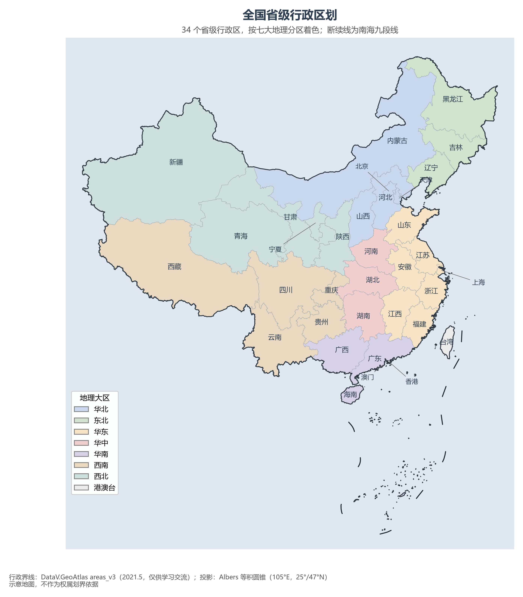
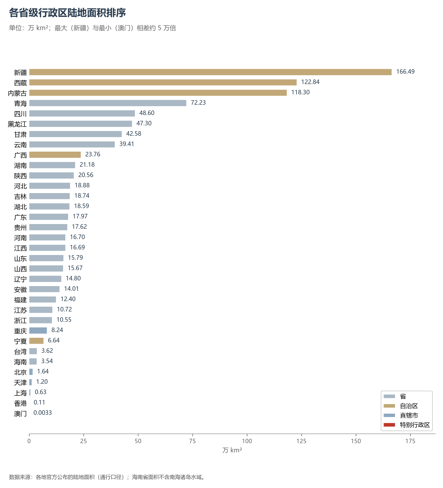
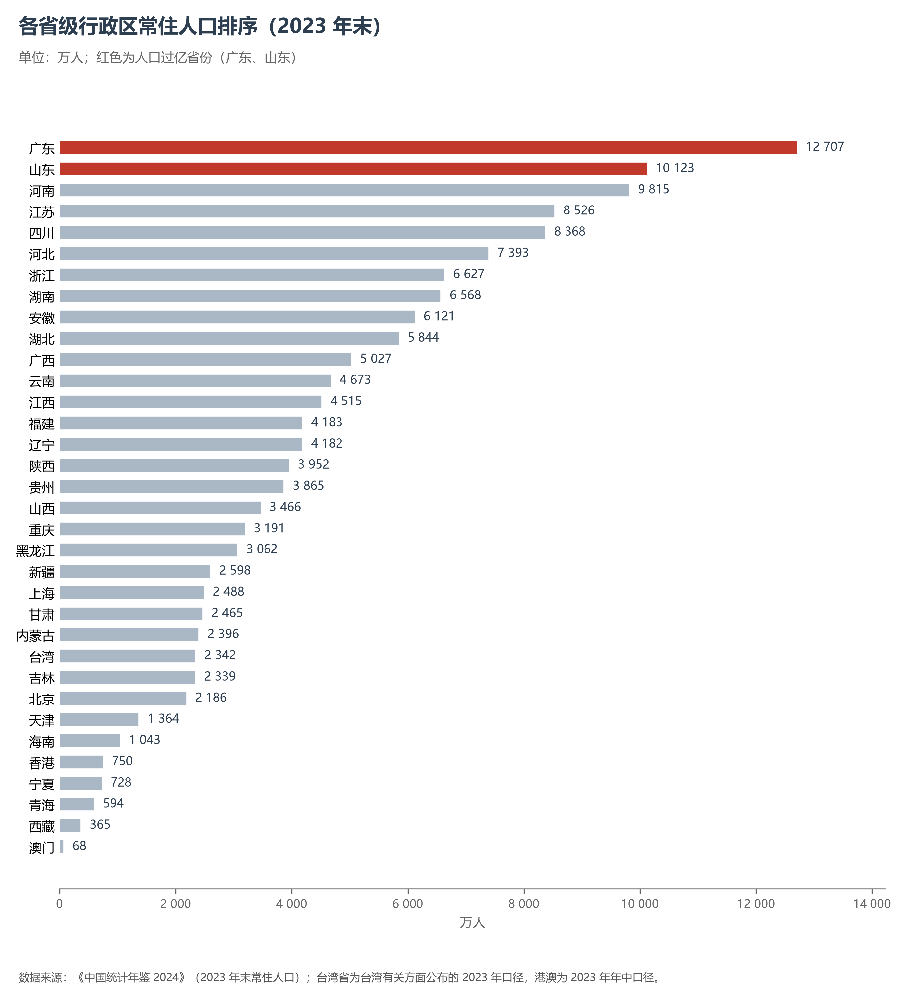
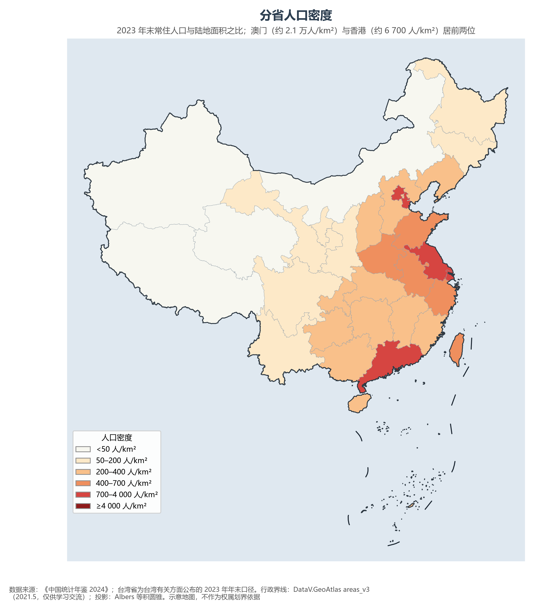

# 2.2 省级行政区总览

在中华大地的地理图景中，34 个省级行政区就像 34 个承载着自然、历史、人口与产业的巨大空间抽屉。它们的陆地面积从新疆的 166 万 km² 到澳门的 33 km²，落差达 **5 万倍**；常住人口从广东的 1.27 亿人到澳门的 68 万人，相差近 **200 倍**；人口密度从澳门的 2 万余人/km² 到西藏的 3 人/km²，跨越近 **4 个数量级**。深入透视这 34 个省级单元的空间矩阵，是全面掌握中国地理格局最直接的纲领。

**图 2-3 全国省级行政区划**：34 个省级行政区按七大地理分区着色，断续线为南海九段线。

## 一、省界划定的古老智慧：“山川形便”与“犬牙相入”

中国今日省界的轮廓，并非现代制图员在图纸上随意勾勒的线条，而是经历了两千余年政治地理演变、兼顾自然规律与统治安全的精妙产物。历史地理学家周振鹤指出，中国历代政区边界的划分贯穿着两条对立统一的核心哲学：**“山川形便”**与**“犬牙相入”**。

| 划界核心原则 | 理论内涵与空间逻辑 | 核心治理优势 | 潜在弊端与安全风险 | 典型地理实证案例 |
|-------------|-------------------|-------------|-------------------|-----------------|
| **山川形便**（自然地理原则） | 顺应名山大川、天然江河山脉的走向与分水岭划分省界 | 区域内水系连贯、方言风土同质，农田水利与经济交通协同顺畅 | 地理单元封闭独立，天险自固，历史上易滋生割据政权（如“天下未乱蜀先乱”） | 太行山分山西与河北；黄河劈开陕西与山西；南岭分界广东与湖南江西；武夷山阻隔福建与江西 |
| **犬牙相入**（政治统治原则） | 打破天然地形险阻，将不同地貌单元乃至天险要隘跨界捆绑划入同一政区 | 消除地方依仗天险割据的地理基础，形成“你中有我、兵制相掣、天下大一统”局面 | 区域内南北或东西自然与文化差异巨大，省内经济统筹难度增加 | **汉中划归陕西**（使四川丧失秦岭天险）；**江南行省南北纵切为苏皖两省**（使两省均跨长江淮河）；南阳属豫襄阳属鄂 |

### 1. 山川形便：顺应地理骨架的自然归属
山川形便是政区划分最原始、也最符合人类生产实践的原则。大山、大河是天然的地理阻隔，生活在同一山川走廊内部的人民往往拥有相同的方言、习俗与水系网络：
- **以山为界**：太行山脉纵贯南北，东侧为华北平原，西侧为黄土高原，天然劈开山西省与河北省；南岭横亘五岭，划出广东与湖南、江西的地理边界；武夷山脉阻隔闽浙丘陵与江南水乡，成为福建与江西的天然分界；大巴山脉横亘陕川之间。
- **以水为界**：黄河中游奔腾于晋陕大峡谷中，自古“秦晋之好”，黄河便是两省浑然天成的界河；长江部分干流成为湖北与湖南、江西的界线。

### 2. 犬牙相入：瓦解割据天险的治国方略
然而，单纯依赖“山川形便”会带来严重的政治安全隐患。巴蜀四周崇山峻岭，历史上“天下未乱蜀先乱，天下已平蜀未平”；江南依仗长江天险，屡建割据政权。为了打破地方据险自固的地理基础，自元代创立行省制度始，中央王朝确立了**“犬牙相入”**的划分方略——故意把不同的自然地貌区、甚至天险要隘的两侧跨界打包划入同一省份：
- **汉中划归陕西**：汉中盆地在自然地理、水系（汉江发源于此）和气候上完全属于秦岭以南的南方湿润区，其方言饮食皆与四川盆地融为一体。但元代与明清政府坚决将汉中划归陕西行省，使四川失去了北方最重要的秦岭天险防御纵深，“自汉中俯瞰巴蜀，如以水瓴建高屋”，彻底消解了四川割据称王的地缘条件。
- **江南行省的横切**：清代初年将富庶的江南行省拆分为江苏与安徽。拆分时没有依循长江或淮河做东西横向分割，而是南北垂直切开——江苏与安徽两省均跨越淮北平原、江淮丘陵与江南水乡，使长江天险不再被任何一个省份独占，淮河与江南的防务紧紧绑定。
- **南阳与襄阳的分治**：南阳盆地本为一个完整的自然盆地，汉水穿流其间，但朝廷将北半部的南阳划归河南，南半部的襄阳划归湖北，使两湖平原与中原之间无险可守、相互维系。

今日中国的 34 个省级行政区，正是这两大地理原则千年博弈沉淀的有机平衡体：既尊重了山水脉络的自然完整，又维护了多民族单一制国家的长治久安。

## 二、面积格局：大省全在边疆，五万倍极端落差

中国的省级行政区面积呈现出极其显著的“由西向东、由内陆向沿海急剧收缩”的阶梯结构：

**图 2-4 各省级行政区陆地面积排序**：自治区（棕）包揽前三，直辖市（蓝）与特别行政区（红）垫底。

- **前五大边疆省区**：
  面积排名前五的省区——**新疆（166.49 万 km²）、西藏（122.84 万 km²）、内蒙古（118.30 万 km²）、青海（72.23 万 km²）、四川（48.60 万 km²）**——全部坐落于祖国的西北、西南与北方内陆，五个省区合计面积约 **528.46 万 km²**，占据了全国陆地总面积的 **55.0%**。
  - 新疆面积约占全国六分之一，若视作独立地理单元，其面积超过伊朗（164.8 万 km²）、蒙古国（156.7 万 km²），可在全球所有主权国家中高居第 17 位；
  - 新疆境内面积最大的若羌县（约 20.23 万 km²），相当于两个浙江省（10.55 万 km²）或一个江苏省（10.72 万 km²）的大小。
- **后五大微型城市政区**：
  排序的另一端则是高度浓缩的城市型政区：**澳门（33.3 km²）、香港（1 114 km²）、上海（6 340 km²）、天津（11 966 km²）、北京（16 410 km²）**。最大省份新疆是最小政区澳门陆地面积的 **约 50 000 倍**。
- **省情镜像：中国省份与世界主要国家面积对照**：
  这种庞大的体量使得中国的很多省份在空间尺度上足以匹敌世界主要国家：

| 中国省级行政区 | 陆地面积 (万 km²) | 世界对照国家 | 国家面积 (万 km²) | 对比特征与地理景观相似性 |
|--------------|-----------------|------------|-----------------|------------------------|
| 新疆维吾尔自治区 | 166.49 | 伊朗 / 蒙古 | 164.8 / 156.7 | 高山盆地深锁，广袤温带大陆荒漠与草原牧场 |
| 西藏自治区 | 122.84 | 南非 / 哥伦比亚 | 122.1 / 114.2 | 平均海拔超 4000 米的极高高原，大江大河发源地 |
| 内蒙古自治区 | 118.30 | 哥伦比亚 / 埃塞俄比亚 | 114.2 / 110.4 | 东西跨 29 个经度，横贯森林、草甸、典型草原与戈壁 |
| 青海省 | 72.23 | 智利 / 土耳其 | 75.6 / 78.4 | “三江之源”，深处柴达木盆地与青藏高原东北部 |
| 四川省 | 48.60 | 西班牙 / 土库曼斯坦 | 50.6 / 48.8 | 西部川西高原深邃峡谷，东部四川盆地人口密集 |
| 云南省 | 39.41 | 德国 / 日本 / 挪威 | 35.7 / 37.8 / 38.5 | 纵向岭谷横断山脉，热带亚热带生物多样性王国 |
| 广西壮族自治区 | 23.76 | 英国 / 罗马尼亚 | 24.3 / 23.8 | 亚热带喀斯特峰林地貌与南部出海黄金通道 |
| 湖北省 | 18.59 | 叙利亚 / 柬埔寨 | 18.5 / 18.1 | “九省通衢”，长江干流与汉江交汇之江汉平原 |
| 浙江省 | 10.55 | 冰岛 / 韩国 | 10.3 / 10.0 | “七山一水两分田”，江南水乡与东海万顷群岛 |

## 三、人口格局：超亿大省与“胡焕庸线”重力场

人口规模的分布完全打破了面积排行的线性规律，呈现出东密西疏的强烈反差：

**图 2-5 各省级行政区常住人口排序（2023 年末）**：红色为人口过亿的广东、山东。

### 1. 两个“亿级”超大人口省份
全国仅有两个常住人口超亿人的省级行政区：**广东省（12 706 万人）**与**山东省（10 123 万人）**（2023 年末口径）：
- 广东自 2007 年超越河南成为全国第一常住人口大省以来，凭借强大的珠三角制造业与外来人口吸聚力，人口持续扩张，其体量已显著超过日本（约 1.24 亿），若作为国家可跻身世界第 12 位左右；
- 山东省耕地资源丰茂，工农业体系完备，常住人口长期稳定在 1 亿以上。
- 人口规模前五名省份（**粤 1.27 亿、鲁 1.01 亿、豫 9 815 万、苏 8 526 万、川 8 368 万**）合计人口达到 **4.95 亿人**，以仅占全国 11.4% 的国土面积，承载了全国 **35.1%** 的总人口。

### 2. 人口极稀省份与“胡焕庸线”投射
人口最少的省级行政区是西藏自治区（365 万人）与青海省（594 万人）。西藏全区面积占全国八分之一，人口却不足广东的 3%。
由地理学家胡焕庸于 1935 年发现的**“黑河—腾冲线”（胡焕庸线）**，在省级层面呈现出惊人的制度化重力场：
- 位于胡焕庸线西北侧的省区共有 6 个（**内蒙古、甘肃、宁夏、青海、新疆、西藏**），合计陆地面积达 **528 万 km²（占全国 55%）**，但六省区常住人口总和仅为 **9 078 万人，仅占全国总人口的 6.44%**，甚至不及河南省一省的人口总量；
- 东南侧的 28 个省级行政区聚集了全国 **93.5%** 的人口。这一由东南季风水汽边界与农业生态承载力共同决定的地理格局，历经近百年现代工业化与高速城镇化，依然巍然稳固。

## 四、人口密度：从两万人到三人的空间折叠

将常住人口与陆地面积相除，得到反映地表人类生存强度的核心指标——人口密度：

**图 2-6 分省人口密度**：2023 年末常住人口与陆地面积之比，东南稠密、西北稀疏的格局一目了然。

- **城市型政区的超高密度核**：
  **澳门（20 697 人/km²）**、**香港（6 733 人/km²）**、**上海（3 923 人/km²）**、**北京（1 332 人/km²）**、**天津（1 140 人/km²）** 垄断了前五名。澳门是当今全球人口密度最高的微型经济体之一；上海则在 6 340 km² 的土地上生活着近 2 500 万常住人口。
- **平原农业与工业大省的高密度带**：
  在非城市型的普通省份中，**江苏省以 795 人/km² 荣膺全国内地各省之冠**；广东省（707 人/km²）、山东省（641 人/km²）、河南省（588 人/km²）、浙江省（628 人/km²）、安徽省（437 人/km²）紧随其后。江苏省全境平原水网广袤（平原占比高达 85%），从徐淮平原到苏南水乡几乎无山地阻隔，宜居宜农宜工，成就了极高的人口密度。
- **西部高原荒漠的极限稀疏区**：
  在青藏高原与西北内陆，**西藏自治区的人口密度仅为 3 人/km²**，青海省仅 **8 人/km²**，新疆为 **16 人/km²**，内蒙古为 **20 人/km²**。在藏北羌塘高原与新疆塔克拉玛干沙漠腹地，大片数十万平方公里的无人区“千山鸟飞绝”，平均每数十平方公里难觅一人踪迹，展现出大自然壮丽而严酷的原始生态。

## 五、省名、简称与省会：一部浓缩的华夏文化地理史

34 个省级行政区的名称、简称以及省会的变迁，是解读中华文明数千年地理认同与历史沉积的活化石：

### 1. 省名的六大地理与历史由来
- **以大江大河大水命名**：黑龙江（黑龙江界河）、浙江（钱塘江古称浙江）、青海（青海湖）；河南、河北（黄河之南、之北）；湖南、湖北（洞庭湖之南、之北）；
- **以名山要隘命名**：山东、山西（太行山之东、之西）；陕西（周代陕原之西，“分陕而治”）；
- **取境内重要两城合称（首字拼合）**：安徽（安庆＋徽州）；江苏（江宁府［今南京］＋苏州府）；福建（福州＋建州［今建瓯］）；甘肃（甘州［今张掖］＋肃州［今酒泉］）；
- **取方位与古地名命名**：广东、广西（宋代“广南东路”与“广南西路”，源自汉代所设“广信”县，取“广布恩信”之意）；海南（琼州海峡之南、南海之滨）；
- **边疆安宁与朝贡祈愿**：辽宁（取“辽河流域永久安宁”之意）；吉林（满语“吉林乌拉”，意为“沿江的城池”松花江畔）；宁夏（西夏故地，“平定西夏，夏地安宁”）；新疆（清乾隆平定准噶尔与回部叛乱后，取“故土新归”之意）；
- **民族政权与历史延续**：西藏（吐蕃后裔，“西藏”之名确立于清康熙年间）；内蒙古（清代将大漠以南的蒙古诸部落统称为“内札萨克蒙古”，简称内蒙古）。

### 2. 省份简称的文化渊源
我国省份简称具有极高的历史文化底蕴，大致可归为三类：
- **以先秦春秋战国古国或古九州名命名**：冀（河北，古冀州）、晋（山西，晋国）、鲁（山东，鲁国）、豫（河南，古豫州）、秦（陕西，秦国）、蜀（四川，蜀国）、楚/鄂（湖北，鄂国与楚都）、粤（广东，古南越/百越之地）、滇（云南，古滇国）、黔（贵州，秦汉黔中郡）；
- **以境内骨干江河命名**：湘（湖南，湘江）、赣（江西，赣江）、闽（福建，闽江）、皖（安徽，皖水与皖山）、浙（浙江，浙江即钱塘江）、沪（上海，古吴淞江下游捕鱼工具“扈”及沪渎）；渝（重庆，嘉陵江古称渝水）；
- **一省双简称现象**：四川（川/蜀）、贵州（黔/贵）、云南（滇/云）、陕西（陕/秦）、甘肃（甘/陇）。双简称的存在，生动反映了这些省份横跨多个地理单元与历史文化圈的复合属性（如四川兼具川峡四路与古蜀文明，甘肃兼顾甘州肃州与陇山陇右）。

### 3. 省会（行政中心）的区位选择机制
省会是全省的政治、经济与文化指挥中枢。其地理区位选择通常遵循三大原则：
- **自然地理居中与交通枢纽原则**：如河南省会郑州（地处中原之中、陇海与京广铁路交汇十字路口，1954 年自偏于一隅的开封迁往郑州）；湖北武汉（长江与汉江交汇，“九省通衢”）；湖南长沙（湘江下游平原中枢）；
- **经济重力与平原核心原则**：如四川成都（成都平原沃野千里，两千余年未改其名其址）；广东广州（珠三角水网顶端）；
- **边疆经略与历史演变**：吉林省是中国唯一**省市同名**的省份，其省名来自同名城市吉林市（清代曾为吉林将军驻地、建省后曾为省会），1954 年为适应现代工业布局与铁路交通，省会迁往长春市。

## 六、34 个省级行政区全要素全景大表

| 大区 | 行政区名称 | 简称 | 行政中心 | 陆地面积 (km²) | 常住人口 (万人) | 人口密度 (人/km²) | 地级数 | 县级数 | 核心自然与经济地理特征速写 |
|------|-----------|------|---------|---------------|----------------|------------------|--------|--------|--------------------------|
| 华北 | 北京市 | 京 | 北京 | 16 410 | 2 186 | 1 332 | — | 16 | 首都，国家政治、文化与科技创新中心；西倚太行，北枕燕山 |
| 华北 | 天津市 | 津 | 天津 | 11 966 | 1 364 | 1 140 | — | 16 | 北方最大海港门户；九河下梢，海河贯穿，国家先进制造研发基地 |
| 华北 | 河北省 | 冀 | 石家庄 | 188 800 | 7 393 | 392 | 11 | 167 | 环抱京津，地跨内蒙古高原、太行山地、燕山山地与华北平原 |
| 华北 | 山西省 | 晋 | 太原 | 156 700 | 3 466 | 221 | 11 | 117 | 表里山河，太行吕梁相夹；煤炭能源重镇，黄土高原东翼华夏摇篮 |
| 华北 | 内蒙古自治区 | 蒙 | 呼和浩特 | 1 183 000 | 2 396 | 20 | 12 | 103 | 狭长横跨东北、华北、西北；草原生态屏障，稀土煤炭风光能源大基地 |
| 东北 | 辽宁省 | 辽 | 沈阳 | 148 700 | 4 182 | 281 | 14 | 100 | 东北唯一出海门户；重工业与装备制造重镇，辽河平原与千山辽东半岛 |
| 东北 | 吉林省 | 吉 | 长春 | 187 400 | 2 339 | 125 | 9 | 60 | 粮食黄金玉米带；长白山天池生态屏障，中国第一汽车制造工业摇篮 |
| 东北 | 黑龙江省 | 黑 | 哈尔滨 | 473 000 | 3 062 | 65 | 13 | 121 | 最北最东边疆；大界江大森林大油田大粮仓，大小兴安岭与三江平原 |
| 华东 | 上海市 | 沪 | 上海 | 6 340 | 2 487 | 3 923 | — | 16 | 国际经济、金融、贸易、航运中心；长江入海口，长三角一体化龙头 |
| 华东 | 江苏省 | 苏 | 南京 | 107 200 | 8 526 | 795 | 13 | 95 | 全国密度最高普通省份；平原占 85%，长江与京杭大运河十字交汇工业强省 |
| 华东 | 浙江省 | 浙 | 杭州 | 105 500 | 6 627 | 628 | 11 | 90 | “七山一水两分田”；民营经济大省，宁波舟山港与钱塘江数字经济高地 |
| 华东 | 安徽省 | 皖 | 合肥 | 140 100 | 6 121 | 437 | 16 | 104 | 襟江带淮，南北兼备；合肥综合性国家科学中心与新兴产业制造高地 |
| 华东 | 福建省 | 闽 | 福州 | 124 000 | 4 183 | 337 | 9 | 84 | “依山傍海”；武夷山脉与台湾海峡相拥，森林覆盖率连续数十年全国第一 |
| 华东 | 江西省 | 赣 | 南昌 | 166 900 | 4 515 | 271 | 11 | 100 | 鄱阳湖中国最大淡水湖；赣江纵贯，庐山井冈山环抱，红色摇篮绿色生态 |
| 华东 | 山东省 | 鲁 | 济南 | 157 900 | 10 123 | 641 | 16 | 136 | 经济大省常住人口破亿；泰山雄峙齐鲁，黄河入海，胶东半岛蓝色经济 |
| 华中 | 河南省 | 豫 | 郑州 | 167 000 | 9 815 | 588 | 17 | 157 | 中原腹地九州腹心；超级粮仓，“米”字形高铁枢纽与华夏历史文明核心 |
| 华中 | 湖北省 | 鄂 | 武汉 | 185 900 | 5 838 | 314 | 13 | 103 | “九省通衢”千湖之省；三峡工程所在地，长江中游光电子与汽车走廊 |
| 华中 | 湖南省 | 湘 | 长沙 | 211 800 | 6 568 | 310 | 14 | 122 | “三面环山、一湖展开”；洞庭湖平原，工程机械之都与有色金属之乡 |
| 华南 | 广东省 | 粤 | 广州 | 179 700 | 12 706 | 707 | 21 | 122 | 全国第一常住人口与 GDP 大省；南岭以南，粤港澳大湾区世界级制造中心 |
| 华南 | 广西壮族自治区 | 桂 | 南宁 | 237 600 | 5 027 | 212 | 14 | 111 | 面向东盟国际大通道；西南出海最便捷门户，桂林山水喀斯特世界自然遗产 |
| 华南 | 海南省 | 琼 | 海口 | 35 400 | 1 043 | 295 | 4 | 25 | 全域建设自由贸易港；中国第二大岛，统辖南海广袤水域，热带海岛旅游 |
| 西南 | 重庆市 | 渝 | 重庆 | 82 400 | 3 191 | 387 | — | 38 | 中西部唯一直辖市；山城江城，三峡库区核心，西部陆海新通道运营中心 |
| 西南 | 四川省 | 川/蜀 | 成都 | 486 000 | 8 368 | 172 | 21 | 183 | “天府之国”资源与人口大省；川西横断高山高原与川东盆地反差壮丽 |
| 西南 | 贵州省 | 黔/贵 | 贵阳 | 176 200 | 3 865 | 219 | 9 | 88 | 全国唯一无平原省份；喀斯特王国，大数据中心基地与桥梁工程奇迹 |
| 西南 | 云南省 | 云/滇 | 昆明 | 394 100 | 4 673 | 119 | 16 | 129 | 面向南亚东南亚辐射中心；高原低纬立体气候，少数民族数量全国之最 |
| 西南 | 西藏自治区 | 藏 | 拉萨 | 1 228 400 | 365 | 3 | 7 | 74 | “世界屋脊”与“亚洲水塔”；高寒缺氧纯净生态，藏传佛教圣地圣城 |
| 西北 | 陕西省 | 陕/秦 | 西安 | 205 600 | 3 952 | 192 | 10 | 107 | 纵跨黄河长江两流域；陕北黄土高原、关中平原与陕南秦巴山地三区鼎立 |
| 西北 | 甘肃省 | 甘/陇 | 兰州 | 425 800 | 2 465 | 58 | 14 | 86 | “如意”形狭长横亘河西走廊；古丝绸之路黄金要道，敦煌文化千古交汇 |
| 西北 | 青海省 | 青 | 西宁 | 722 300 | 594 | 8 | 8 | 45 | “三江之源”“中华水塔”；青海湖与柴达木盆地，清洁能源输送大基地 |
| 西北 | 宁夏回族自治区 | 宁 | 银川 | 66 400 | 729 | 110 | 5 | 22 | “天下黄河富宁夏”；贺兰山阻挡风沙，塞上江南，现代枸杞与葡萄之乡 |
| 西北 | 新疆维吾尔自治区 | 新 | 乌鲁木齐 | 1 664 900 | 2 598 | 16 | 14 | 108 | 国土六分之一最大省区；“三山夹两盆”，丝绸之路经济带核心区能源枢纽 |
| 港澳台 | 香港特别行政区 | 港 | — | 1 114 | 750 | 6 733 | — | 18 | 国际金融、航运、贸易中心；“一国两制”东方之珠，维多利亚良港 |
| 港澳台 | 澳门特别行政区 | 澳 | — | 33 | 68.3 | 20 697 | — | 8 | 世界旅游休闲中心，中葡商贸平台；全球人口密度极值，百年历史城区 |
| 港澳台 | 台湾省 | 台 | — | 36 000 | 2 342 | 651 | — | 22 | 中国第一大岛；玉山巍峨，全球半导体代工高地，两岸同胞骨肉相连 |

> **表注说明**：
> 1. 陆地面积数据取自自然资源部及各地官方公布权威标准口径（海南省陆地面积不含西沙、中沙、南沙海域水面；台湾省含澎湖及附属岛屿约 3.6 万 km²）；
> 2. 常住人口统一采用《中国统计年鉴 2024》公布的 2023 年末全国分省常住人口（香港、澳门为特区政府统计部门公布的 2023 年末/年中常住人口，台湾省为当地公布的 2023 年底户籍人口）；
> 3. 人口密度由常住人口除以陆地面积计算所得；地级数与县级数依据民政部 2024 年底全国行政区划统计；
> 4. 直辖市无地级建制，香港按 18 个行政分区、澳门按 8 个堂区、台湾省按当地 22 个县市统计。

## 参考与数据来源

1. 陆地面积与标准界线：自然资源部地图技术审查中心标准地图服务底图、各地政府权威公布地情报告。
2. 常住人口与人口密度：国家统计局《中国统计年鉴 2024》；香港特区统计处《香港统计月刊》；澳门统计暨普查局公报；台湾有关方面统计公报。
3. 政区数量：民政部《中华人民共和国行政区划简册（2024）》。
4. 划界理论与地名考证：周振鹤《中国地方行政制度史》《中国行政区划通史》；谭其骧《长水集》；《中华人民共和国政区大典》。
