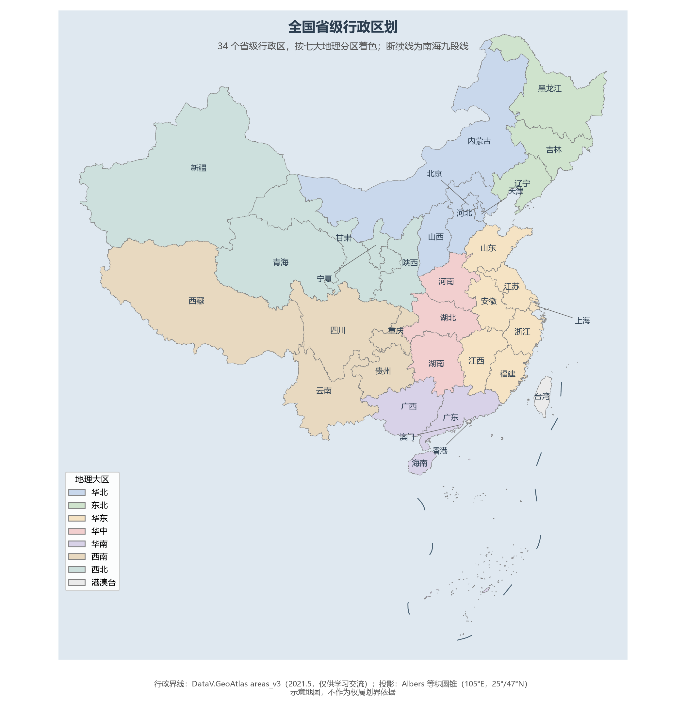
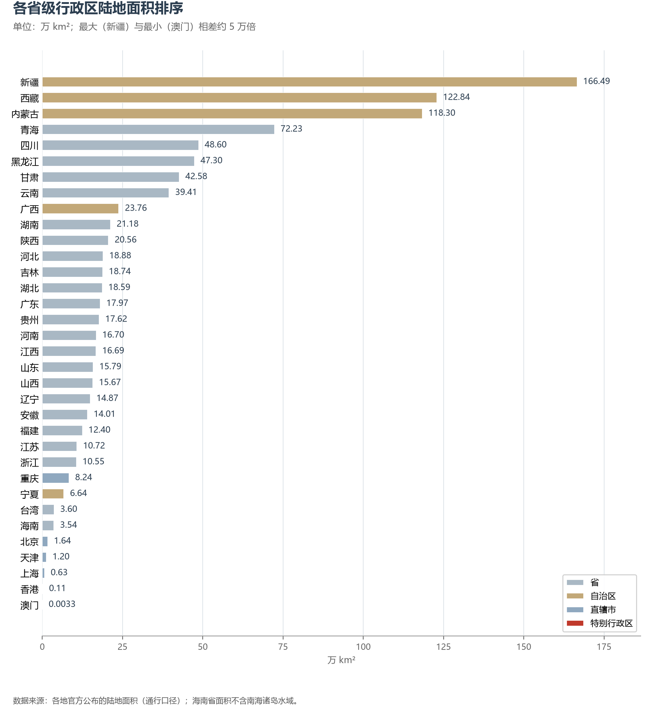
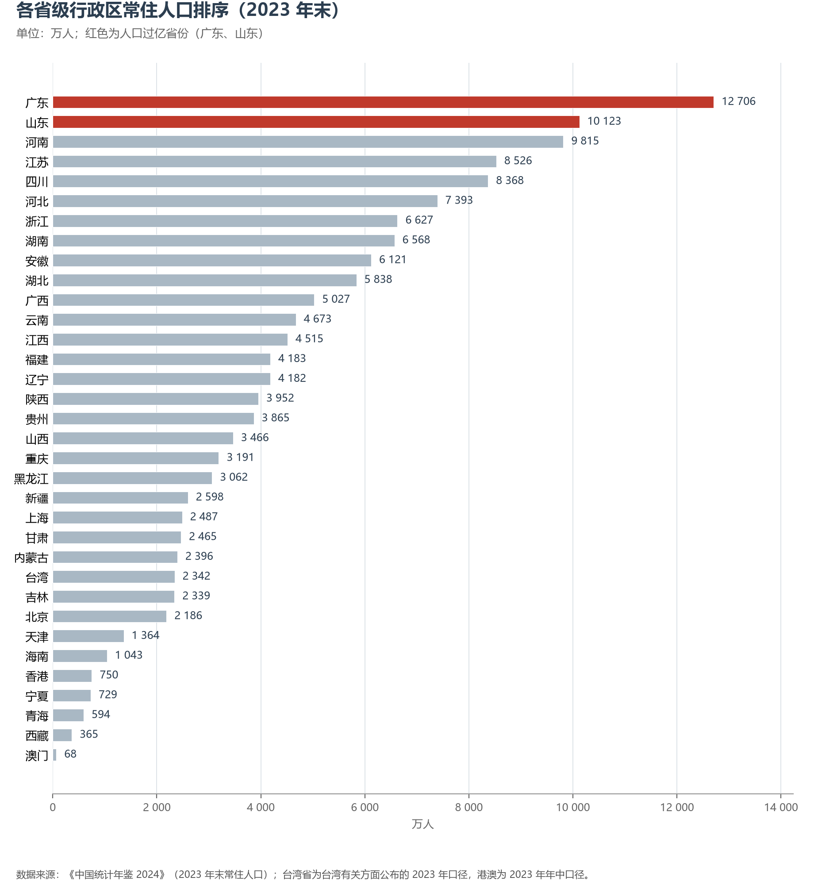
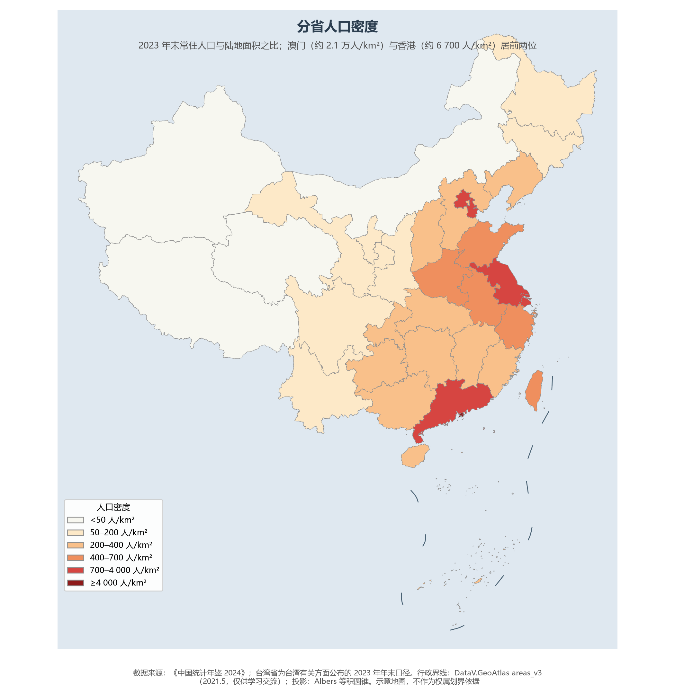

# 2.2 省级行政区总览

34 个省级行政区是打开中国地理的 34 个抽屉。它们的面积从 166 万 km² 到 33 km²，相差约 5 万倍；人口从 1.27 亿到 68 万，相差近 200 倍。把这张总表读完，中国地理的骨架就在掌握之中。

**图 2-3 全国省级行政区划**：34 个省级行政区按七大地理分区着色，断续线为南海九段线。

## 一、面积格局：大省都在边疆

面积前五名——新疆（166.49 万 km²）、西藏（122.84 万 km²）、内蒙古（118.30 万 km²）、青海（72.23 万 km²）、四川（48.60 万 km²）——全部位于西部与北部边疆，五个省区合计约 528 万 km²，占了全国陆地面积的 55%。**新疆若视作一个国家，其面积可排进世界前二十**，比伊朗（164.8 万 km²）还大；一个若羌县（约 20 万 km²）抵得上两个浙江省。

另一端则是五座城市型政区：澳门（33 km²）、香港（1 114 km²）、上海（6 340 km²）、天津（11 966 km²）、北京（16 410 km²）。最大与最小之间相差约 5 万倍——这是单一制国家政区形态谱系的空间写照：行省管广土，直辖市政都市，特别行政区治弹丸而通全球。

**图 2-4 各省级行政区陆地面积排序**：自治区（棕）包揽前三，直辖市（蓝）与特别行政区（红）垫底。

## 二、人口格局：两个亿级大省

常住人口超亿的省级行政区只有两个：**广东（12 706 万）与山东（10 123 万）**（2023 年末；2024 年末广东增至约 12 780 万、山东降至约 10 080 万）。广东一省人口已超过日本（约 1.24 亿），若视作国家可列世界第 12 位左右；前五大省（粤、鲁、豫、苏、川）合计约 4.95 亿人，占全国的 35%。

人口最少的省级行政区是**西藏（365 万）**，不及广东的 3%；澳门（68.3 万）也只有西藏的约五分之一。排序表呈现出清晰的"秦岭—淮河 + 胡焕庸线"结构：人口大省几乎全部位于东部季风区，百万人口以上的省级行政区中，位于胡焕庸线西北侧的有内蒙古、甘肃、宁夏、青海、新疆、西藏六个——它们合计占全国陆地面积的 55%，人口却只占全国的 6.5%，这为第 9.2 节的人口分布分析埋下伏笔。

**图 2-5 各省级行政区常住人口排序（2023 年末）**：红色为人口过亿的广东、山东。

## 三、人口密度：省界的另一种读法

人口除以陆地面积，得到完全不同的排序：**澳门（约 20 700 人/km²）、香港（约 6 700）、上海（3 923）、北京（1 332）、天津（1 140）**五座城市型政区包揽前五；在真正的"省"里，江苏以 795 人/km² 居首，广东（707 人/km²）次之——人口第一大省并不是密度最高的省。另一端，西藏（3 人/km²）、青海（8）、新疆（16）、内蒙古（20）四区合计占全国陆地面积的一半，人口却不足全国的 5%，密度最高的内蒙古也不及全国平均值的七分之一。密度地图上那条自东北向西南的色带边界，正是胡焕庸线的轮廓。

**图 2-6 分省人口密度**：2023 年末常住人口与陆地面积之比，东南稠密、西北稀疏的格局一目了然。

## 四、省名与简称：一部压缩的地理史

34 个省名与简称，本身就是一部中国地理与历史教科书：

- **以江河湖海为名**：黑龙江、浙江、青海直接取自水域；河南、河北以黄河为界，湖南、湖北以洞庭湖为界，广东、广西以古"广信"为界；
- **以山为界**：山东、山西分居太行山两侧；陕西得名于周代的"陕原"（今河南陕州区）；
- **两地合称**：安徽＝安庆＋徽州，江苏＝江宁＋苏州，福建＝福州＋建州，甘肃＝甘州＋肃州；
- **古国古州为简称**：晋（山西）、冀（河北，古冀州）、鲁（山东）、豫（河南，古豫州）、秦（陕西）、蜀（四川）、黔（贵州，古黔中）、滇（云南，古滇国）、粤（广东，百越之地）、琼（海南，古琼州）；
- **以江河为简称**：湘（湘江）、赣（赣江）、闽（闽江）、渝（嘉陵江古称渝水）、沪（古沪渎）、津（天子渡口）；
- **民族与特例**：五个自治区以主体民族命名；内蒙古简称"蒙"，黑龙江简称"黑"；香港、澳门分别简称"港""澳"。

一个有趣的注脚：吉林省是中国唯一省市同名的省份——省名来自省会吉林市，而吉林市名又来自满语"吉林乌拉"（沿江的城池），与松花江共生了三百年。

## 五、34 个省级行政区数据总表

| 大区 | 名称 | 简称 | 行政中心 | 面积（km²） | 常住人口（万人） | 密度（人/km²） |
|------|------|------|---------|------------|----------------|---------------|
| 华北 | 北京市 | 京 | 北京 | 16 410 | 2 186 | 1 332 |
| 华北 | 天津市 | 津 | 天津 | 11 966 | 1 364 | 1 140 |
| 华北 | 河北省 | 冀 | 石家庄 | 188 800 | 7 393 | 392 |
| 华北 | 山西省 | 晋 | 太原 | 156 700 | 3 466 | 221 |
| 华北 | 内蒙古自治区 | 蒙 | 呼和浩特 | 1 183 000 | 2 396 | 20 |
| 东北 | 辽宁省 | 辽 | 沈阳 | 148 700 | 4 182 | 281 |
| 东北 | 吉林省 | 吉 | 长春 | 187 400 | 2 339 | 125 |
| 东北 | 黑龙江省 | 黑 | 哈尔滨 | 473 000 | 3 062 | 65 |
| 华东 | 上海市 | 沪 | 上海 | 6 340 | 2 487 | 3 923 |
| 华东 | 江苏省 | 苏 | 南京 | 107 200 | 8 526 | 795 |
| 华东 | 浙江省 | 浙 | 杭州 | 105 500 | 6 627 | 628 |
| 华东 | 安徽省 | 皖 | 合肥 | 140 100 | 6 121 | 437 |
| 华东 | 福建省 | 闽 | 福州 | 124 000 | 4 183 | 337 |
| 华东 | 江西省 | 赣 | 南昌 | 166 900 | 4 515 | 271 |
| 华东 | 山东省 | 鲁 | 济南 | 157 900 | 10 123 | 641 |
| 华中 | 河南省 | 豫 | 郑州 | 167 000 | 9 815 | 588 |
| 华中 | 湖北省 | 鄂 | 武汉 | 185 900 | 5 838 | 314 |
| 华中 | 湖南省 | 湘 | 长沙 | 211 800 | 6 568 | 310 |
| 华南 | 广东省 | 粤 | 广州 | 179 700 | 12 706 | 707 |
| 华南 | 广西壮族自治区 | 桂 | 南宁 | 237 600 | 5 027 | 212 |
| 华南 | 海南省 | 琼 | 海口 | 35 400 | 1 043 | 295 |
| 西南 | 重庆市 | 渝 | 重庆 | 82 400 | 3 191 | 387 |
| 西南 | 四川省 | 川/蜀 | 成都 | 486 000 | 8 368 | 172 |
| 西南 | 贵州省 | 黔/贵 | 贵阳 | 176 200 | 3 865 | 219 |
| 西南 | 云南省 | 云/滇 | 昆明 | 394 100 | 4 673 | 119 |
| 西南 | 西藏自治区 | 藏 | 拉萨 | 1 228 400 | 365 | 3 |
| 西北 | 陕西省 | 陕/秦 | 西安 | 205 600 | 3 952 | 192 |
| 西北 | 甘肃省 | 甘/陇 | 兰州 | 425 800 | 2 465 | 58 |
| 西北 | 青海省 | 青 | 西宁 | 722 300 | 594 | 8 |
| 西北 | 宁夏回族自治区 | 宁 | 银川 | 66 400 | 729 | 110 |
| 西北 | 新疆维吾尔自治区 | 新 | 乌鲁木齐 | 1 664 900 | 2 598 | 16 |
| 港澳台 | 香港特别行政区 | 港 | — | 1 114 | 750 | 6 733 |
| 港澳台 | 澳门特别行政区 | 澳 | — | 33 | 68.3 | 20 697 |
| 港澳台 | 台湾省 | 台 | — | 36 000 | 2 342 | 651 |

> 表注：人口为 2023 年末常住人口（《中国统计年鉴 2024》），香港、澳门为 2023 年年中人口，台湾省为台湾有关方面公布的 2023 年年末人口；密度＝人口 ÷ 陆地面积，由本手册计算；海南省面积不含南海诸岛水域。

## 参考与数据来源

1. 面积：各地官方公布的陆地面积（通行口径）。
2. 人口：《中国统计年鉴 2024》（2023 年末分省常住人口）；台湾、港澳为当地公布的 2023 年口径。
3. 行政界线：DataV.GeoAtlas areas_v3（2021.5，仅供学习交流）。
4. 省名由来：通行辞源资料（《中华人民共和国政区大典》等）。
