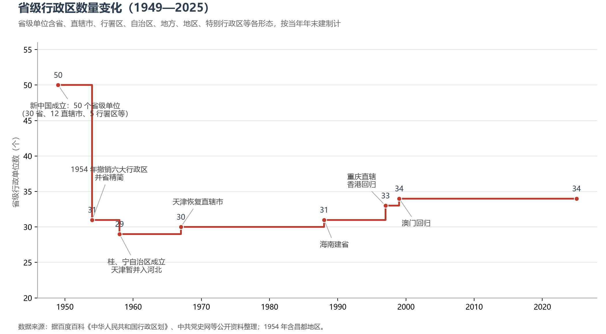
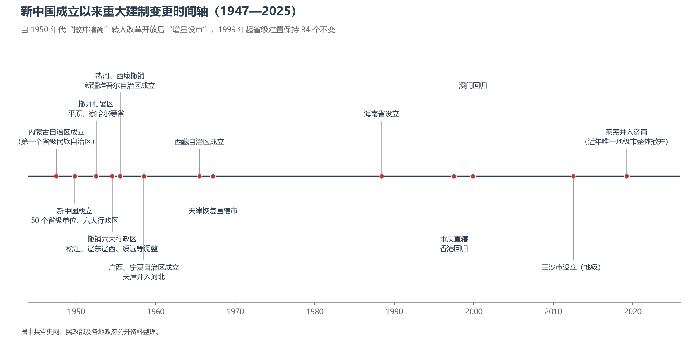
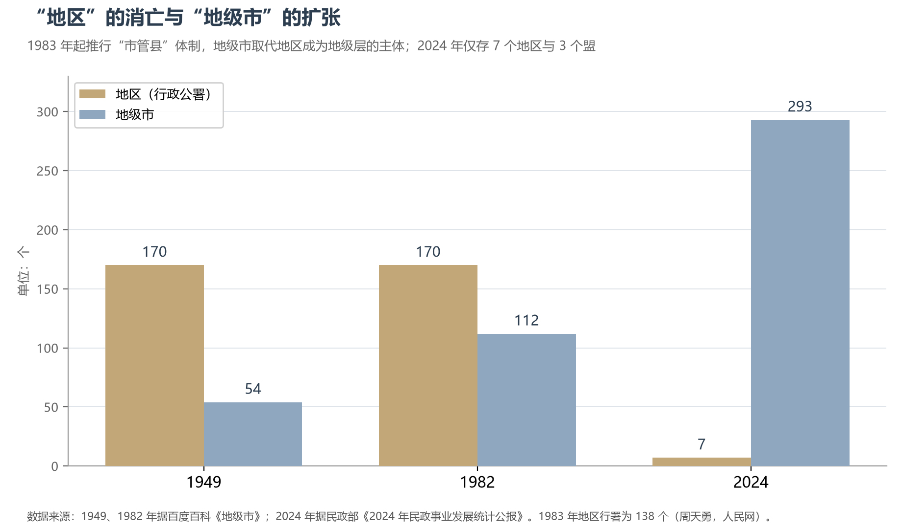

# 2.3 行政区划历史沿革

76 年间，中国的省级行政区从 50 个精简到 34 个，"地区"从 170 个消亡到 7 个，地级市则从 54 个膨胀到 293 个。行政区划的每一次变动，都是国家治理逻辑的一次显影：1950 年代做减法，是为了集中统一；1980 年代以来做加法，是为了城市化与开放。

**图 2-7 省级行政区数量变化（1949—2025）**：从"大区时代"的 50 个到今天的 34 个。

## 一、"大区时代"（1949—1954）

新中国成立之初，在省级之上设**六大行政区**（东北、华北、西北、华东、中南、西南军政委员会），是战争年代各大战略区行政建制的延续。省级单位多达 **50 个**：30 个省、12 个中央直辖市（北京、天津、上海、南京、武汉、广州、重庆、西安、沈阳、哈尔滨、长春、旅大等）、5 个行署区（此后陆续设置，最多时全国共 8 个：苏南、苏北、皖南、皖北、川东、川西、川南、川北）、1 个自治区（内蒙古）、1 个地方（西藏）与 1 个地区（昌都）。省的碎片化是历史的印记——东北有黑龙江、松江、吉林、辽东、辽西五省，华北有热河、察哈尔、绥远，华北平原上还有短暂的平原省，西南有西康省。

## 二、精简与定型（1954—1967）

**1954 年 6 月 20 日**，《中央人民政府关于撤销大区一级行政机构和合并若干省市建制的决定》公布，是中国行政区划史上动作最大的一次调整：六大行政区撤销；松江省并入黑龙江，辽东、辽西合并为辽宁，宁夏暂并入甘肃，绥远并入内蒙古；南京、武汉、广州、重庆、西安、沈阳等 11 个直辖市改为省辖市，仅保留北京、上海、天津三市。加上此前的 1952—1953 年（撤八个行署区、平原省、察哈尔省）和此后的 1955 年（热河、西康撤销，新疆维吾尔自治区成立）、1958 年（广西、宁夏自治区成立，天津一度并入河北）、1965 年（西藏自治区成立）、1967 年（天津恢复直辖市），到 1967 年，全国形成**22 省、5 自治区、3 直辖市**的格局——这一"30 个省级单位"的结构保持了整整 21 年。

| 已撤销的省级行政区 | 存续（1949 后） | 去向 |
|------------------|---------------|------|
| 松江省 | 1949—1954 | 并入黑龙江省 |
| 辽东省、辽西省 | 1949—1954 | 合并为辽宁省 |
| 绥远省 | 1949—1954 | 并入内蒙古自治区 |
| 宁夏省 | 1949—1954 | 并入甘肃省（1958 年以自治区复设） |
| 平原省 | 1949—1952 | 分入河南、山东 |
| 察哈尔省 | 1949—1952 | 分入山西、河北、内蒙古 |
| 热河省 | 1949—1955 | 分入河北、辽宁、内蒙古 |
| 西康省 | 1949—1955 | 分入四川、西藏 |
| 苏南、苏北行署区 | 1949—1952 | 合并为江苏省 |
| 皖南、皖北行署区 | 1949—1952 | 合并为安徽省 |
| 川东、川西、川南、川北行署区 | 1949—1952 | 合并为四川省 |

> 表注：各省存续时间均指新中国成立后的延续期，清代与民国时期的建置沿革不计。

## 三、增量时代（1988—1999）

1967 年之后的 21 年里，省级建置只发生过一次变动。改革开放重启了区划调整：

- **1988 年 4 月**，海南省设立——从广东省分出，辖海南岛与西沙、中沙、南沙群岛，同时成为全国最大的经济特区；
- **1997 年 3 月**，八届全国人大五次会议批准设立**重庆直辖市**——为三峡工程百万移民与川东治理而设，是中西部唯一的直辖市；
- **1997 年 7 月、1999 年 12 月**，香港、澳门回归，两个特别行政区先后成立。

至此 34 个省级行政区的格局尘埃落定，至今未再变动。

**图 2-9 重大建制变更时间轴（1947—2025）**：1947 年内蒙古自治区成立是中国共产党领导下第一个省级民族自治区。

## 四、地级与县级：一场"城市化"的静默革命

省级以下的变动远比省级剧烈，主线只有一个字：**市**。

1949 年，全国有地级市 54 个、地区 170 个——"地区"（专区）作为省的派出机构，长期是地级层的主体。**1983 年起国务院推行"市管县"体制**（当年地区行署尚有 138 个），"撤地设市""地市合并"全面铺开：2024 年仅存 7 个地区（新疆 5、西藏 1、黑龙江 1）与 3 个盟；地级市则增至 293 个，占全部 333 个地级单位的 88%。县级层面同样如此：1980—1990 年代的"撤县设市"热潮在 1997 年被国务院叫停；2017 年恢复批复后，又有数十个县改设县级市。大城市的"撤县设区"则把郊县并入城区版图。近年唯一一次地级市整体撤并发生在 2019 年——莱芜市并入济南。

**图 2-8 "地区"的消亡与"地级市"的扩张**：市管县体制彻底重塑了中国的地级层。

## 五、世界视角：调整的方式即治理的方式

把镜头拉远，大国都在调整行政区划，方式却各异：日本 1999—2014 年的"平成大合并"把 3 200 余个市町村整合到约 1 700 个，法国 2016 年把本土 22 个大区合并为 13 个，二者都以**精简合并**为主线；中国 1950 年代同样做减法，但改革开放以来的主旋律是**城市化转型**——不是减少政区，而是把"地区"改造成"市"、把"县"改造成"区"，让行政建制跟随人口与产业的流动而重新排列。区划变动的方向，就是国家结构变迁的方向。

## 参考与数据来源

1. 建制变更与年份：中共党史网《百年瞬间》、国务院历年行政区划调整批复、各地政府公开资料。
2. 1949 年省级单位构成与地区/地级市数量：百度百科《中华人民共和国行政区划》《地级市》；1983 年地区行署数：周天勇《从市管县到省管县的体制变迁》（人民网理论）。
3. 2024 年各级政区数量：民政部《2024 年民政事业发展统计公报》。
