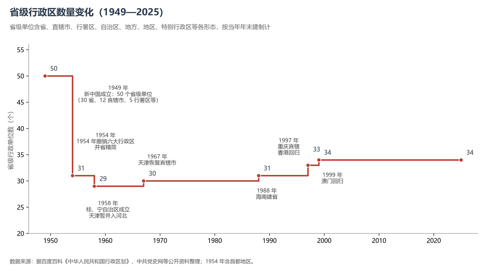
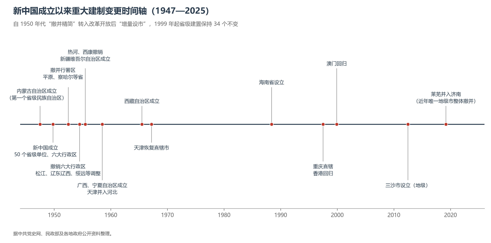
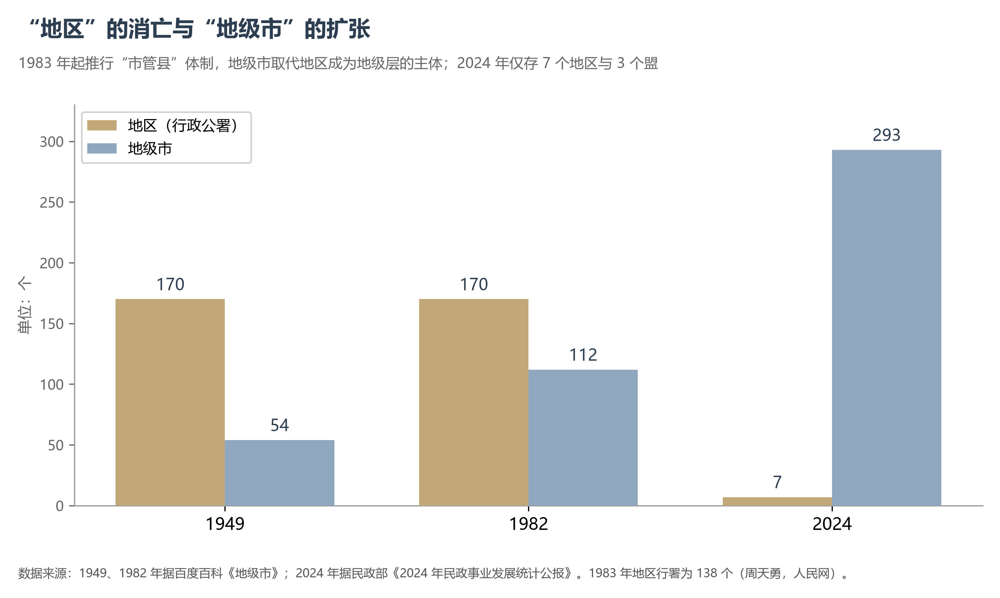

# 2.3 行政区划历史沿革

回顾新中国成立以来的 76 年历程，中国的省级行政区数量从建国初期的 50 个大刀阔斧精简至 34 个；“地区行政公署”从 170 个萎缩至仅存 7 个，而地级市则从 54 个急剧扩张至 293 个。行政区划的每一次分拆、合并、升格与撤销，都不是简单的地理更名，而是国家在不同历史发展阶段对政治安全、资源调配、工业化布局与城市化浪潮作出的最高空间响应：1950 年代做减法，是为了集中力量加强统一与恢复经济；1980 年代以来做加法与做重组，则是为了释放市场活力、推动对外开放与加速城镇化进程。

**图 2-7 省级行政区数量变化（1949—2025）**：从“大区时代”的 50 个到今天的 34 个。

## 一、两千年政区层级演进的“周期律”

若将目光从当代拉远至整部中华文明史，行政区划的演变呈现出一种极为奇妙且周而复始的历史周期律。正如历史地理学界所总结的：**“高层政区不断由虚入实、下沉为统县政区，中央被迫再次增设更高层监察区，导致层级由两级膨胀为三级、四级，随后朝廷再次裁并削层，重返两级或三级。”**

| 历史朝代 | 层级类型 | 第一级（高层政区） | 第二级（统县政区） | 第三级（县级政区） | 基层自治或管理单元 |
|---------|---------|------------------|------------------|------------------|------------------|
| **秦代** | 两级制 | — | **郡**（初置 36 郡，后增至 40 余郡） | **县 / 道**（千余个） | 乡 / 亭 / 里 |
| **两汉** | 三级制（演变） | **州**（初为十三刺史部监察区，东汉末实体化） | **郡 / 国**（统县政区） | **县 / 邑 / 道 / 侯国** | 乡 / 亭 / 里 |
| **唐代** | 三级制 | **道**（初置贞观十道监察区，后演化为实体） | **州 / 府**（三百余个） | **县**（千余个） | 乡 / 里 |
| **宋代** | 三至四级 | **路**（转运司、提刑司等四司平行分权） | **府 / 州 / 军 / 监** | **县** | 乡 / 里 / 保甲 |
| **元代** | 多级制（行省确立） | **行中书省**（中央派出机构实体化为高层政区） | **路** | **府 / 州** | **县**（四级或三级并存） |
| **明代** | 三级制 | **承宣布政使司**（省，布政/按察/都司分治） | **府 / 直隶州** | **县 / 属州** | 里甲制 |
| **清代** | 三级制 | **省**（总督、巡抚大权独揽） | **府 / 直隶厅州** | **县 / 散厅州** | 保甲制 |
| **民国** | 两级至三级 | **省** | （行政督察区，省派出虚级） | **县 / 市** | 乡 / 镇 / 保甲 |
| **当代** | 事实四级 | **省 / 自治区 / 直辖市 / 特别行政区** | **地级市 / 州 / 地区 / 盟** | **县 / 县级市 / 市辖区 / 旗** | **乡 / 镇 / 街道**（村/居委会自治） |

- **秦汉：郡县两级向州县三级演化**：秦始皇统一天下废除分封，确立郡县两级制（40 余郡统千余县）；汉武帝为加强中央集权设立“十三刺史部”，监察各郡，东汉灵帝中平五年（188 年）改刺史为州牧，赋予军政大权，“州”彻底下沉为郡之上的一级实体政区，两级制演变为州—郡—县三级制；
- **魏晋南北朝：政区极度滥设与破碎化**：南北对峙割据，统治者滥设政区，出现“百室之邑，便立州名；三家之村，空张郡目”的极端乱象，全国竟有一百多个州、数百个郡，行政效能瘫痪；
- **隋唐宋：去闲并小与道路制度**：隋文帝“存要去闲，并小为大”，坚决废除“郡”一级，恢复州—县两级制；唐太宗依山川形势设“贞观十道”（后开元增为十五道），作为巡按监察区，安史之乱后节度使割据，道成为实体；宋代吸取藩镇教训，改设“路”，实行帅司、转运司、提点刑狱司、提举常平司四司平行分权，统摄府州军监；
- **元明清：现代行省制度的诞生与定型**：元朝疆域空前辽阔，中央中书省在此地方派出“行中书省”（简称行省），行省成为地方最高政区，中国正式迈入“行省时代”；明代改行省为“承宣布政使司”，设布政使（民政财政）、按察使（司法监察）、都指挥使（军事）三司分立分权；清代正式确立总督、巡抚制度，省统府（直隶州）、府统县的三级架构基本定型，奠定了今日中国省界的基础地理轮廓。

## 二、“大区时代”与省级建置大重组（1949—1954 年）

1949 年 10 月新中国成立之初，国内面临军事清剿残余、土地改革、抗美援朝与经济恢复的艰巨任务。为了集中兵力和政权调度，党中央在中央与省之间设立了**东北、华北、华东、中南、西北、西南六大行政区**，分别设立军政委员会（后改行政委员会），对所辖省市实行统战与军政领导。

在六大行政区统辖之下，全国的省级建置呈现出高度破碎的过渡性形态，**省级行政单位总数一度多达 50 个**：包括 30 个省、12 个中央直辖市、5 个行署区、1 个自治区（内蒙古）、1 个地方（西藏）与 1 个地区（昌都）：

### 1. 消失的省级行政区全景考实
建国初期的许多省份与行署区，带有浓厚的战争接管与区域治理临时性质，在随后的制度调整中相继合并或撤销：

| 已撤销的省级建置 | 存续时间 (新中国后) | 首府/驻地 | 撤销去向与空间重组 | 设立背景与撤并原因 |
|----------------|------------------|----------|-------------------|-------------------|
| **平原省** | 1949—1952 | 新乡市 | 分拆并入河南省、山东省 | 为治理黄河历史上频繁溃决泛滥的“黄泛区”、配合土改而设立；黄河安澜与土改完成后撤销 |
| **察哈尔省** | 1949—1952 | 张家口市 | 分拆并入内蒙古自治区、河北省、山西省 | 历史上横跨长城内外的塞北省份，为加强内蒙古统一与华北经济协作而分拆撤并 |
| **绥远省** | 1949—1954 | 归绥市（今呼和浩特） | 整体并入内蒙古自治区 | 傅作义将军起义和平解放之塞外省份，1954 年与内蒙古合并，内蒙古首府由张家口迁至呼和浩特 |
| **松江省** | 1949—1954 | 哈尔滨市 | 整体并入黑龙江省 | 东北老根据地省份，1954 年撤销并入黑龙江省，黑龙江省会由齐齐哈尔迁往哈尔滨 |
| **辽东省、辽西省** | 1949—1954 | 安东（辽东）/ 锦州（辽西） | 两省合并组建为**辽宁省** | 解放战争时期为粉碎国民党军队进剿而设；1954 年两省合并重建辽宁省，省会设沈阳 |
| **热河省** | 1949—1955 | 承德市 | 分拆并入河北省、辽宁省、内蒙古自治区 | 清代木兰围场与避暑山庄所在，承接华北与东北过渡带；1955 年按经济与交通流向撤并分拆 |
| **西康省** | 1949—1955 | 雅安市 | 金沙江以东并入四川省，以西划归西藏昌都地区 | 地处川藏交界康巴藏区，“分川陕、控西藏”；1955 年第一届全国人大二次会议决议撤销 |
| **苏南、苏北行署区** | 1949—1952 | 无锡（苏南）/ 泰州（苏北） | 两行署区合并恢复**江苏省** | 渡江战役后解放区与江南新区治理需要分设行署；经济社会恢复后合并，省会设南京 |
| **皖南、皖北行署区** | 1949—1952 | 芜湖（皖南）/ 合肥（皖北） | 两行署区合并恢复**安徽省** | 沿淮河与沿江分治；1952 年恢复安徽省建制，省会定合肥 |
| **川东/西/南/北行署区** | 1949—1952 | 重庆/成都/泸州/南充 | 四大行署区合并恢复**四川省** | 四川人口规模庞大、地形封闭复杂，建国初分设四大行署区治理；1952 年合并恢复四川省 |

### 2. 十二个中央直辖市的降格与省辖化
在建国初期，中央直辖市多达 **12 个**：不仅包括北京、天津、上海，还包括**南京、广州、武汉、重庆、西安、沈阳、旅大（大连）、鞍山、抚顺、本溪**等大型中心城市和重要重工业基地。这种“大直辖市”设置是为了让中央直接集中调配战略工业城市的人财物资源支持全国建设。随着第一个五年计划的开展与省级行政体制的稳定，除北京、上海、天津外，其余 9 个直辖市相继于 1954 年降格为省辖市，分别划归所在省份领导。

## 三、精简定型与民族自治区建立（1954—1967 年）

**1954 年 6 月 20 日**，中央人民政府委员会第三十二次会议通过《关于撤销大区一级行政机构和合并若干省市建制的决定》：
- 撤销六大行政区行政委员会，彻底消除可能出现的地方分散主义，国家政令直达省一级；
- 松江并入黑龙江，辽东辽西合并为辽宁，绥远并入内蒙古，宁夏暂并入甘肃；11 个直辖市降格为省辖市。
- 1955 年撤销热河省与西康省；**1955 年 10 月 1 日，新疆维吾尔自治区成立**；
- **1958 年 3 月与 10 月，广西僮族自治区（后改壮族）与宁夏回族自治区先后成立**；天津市于 1958 年一度降为河北省辖市并作为河北省会；
- **1965 年 9 月 9 日，西藏自治区正式宣布成立**，标志着五大自治区格局全部落地；
- **1967 年 1 月，天津市恢复为中央直辖市**，河北省会随后迁往石家庄市。

到 1967 年，全国正式形成了 **22 个省、5 个自治区、3 个直辖市共 30 个省级行政区**的稳定架构。这一“30 个省级单位”的结构历经各种政治与经济考验，在长达整整 **21 年**（1967—1988 年）的岁月里未发生过一例建制增减，构成了改革开放前新中国行政区划的定型版图。

**图 2-9 重大建制变更时间轴（1947—2025）**：1947 年内蒙古自治区成立是中国共产党领导下第一个省级民族自治区。

## 四、增量时代与现代版图确立（1988—1999 年）

1978 年开启的改革开放，为中国空间版图的重构注入了澎湃的动力。为了适应对外开放窗口、大型国家世纪工程建设以及“一国两制”的宏伟蓝图，中国进入了高层次的政区“增量时代”：

### 1. 1988 年：海南脱粤建省与最大经济特区
长期以来，海南岛作为广东省下辖的行政区（海南行政区，副省级）。由于隔着琼州海峡，珠三角无暇充分顾及雷州半岛以南的海岛开发。**1988 年 4 月 13 日，七届全国人大一次会议正式批准设立海南省**，并划定海南岛为全国最大的经济特区。海南建省不仅极大激发了热带海岛的经济生机，更使国家拥有了直接面向南海三沙诸岛、经略深蓝大洋的独立省级战略支点。

### 2. 1997 年：重庆直辖与中西部极核诞生
随着长江三峡水利枢纽工程的全面启动，三峡库区面临着百万移民搬迁安置与川东秦巴山、武陵山区深度贫困的世纪难题。原四川省幅员过大（人口超 1.1 亿），省会成都难以全力统筹川东三峡库区。**1997 年 3 月 14 日，八届全国人大五次会议表决通过设立重庆直辖市**，将原四川省重庆市、万县市、涪陵市和黔江地区 4 个地级政区合并组建为新的重庆直辖市，管辖面积达 8.24 万 km²，成为我国面积最大、人口最多、中西部唯一的直辖市，构筑了成渝地区双城经济圈与西部陆海新通道的战略牵引极。

### 3. 1997 年与 1999 年：港澳回归与特别行政区成立
**1997 年 7 月 1 日，中国政府恢复对香港行使主权，香港特别行政区正式成立**；**1999 年 12 月 20 日，中国政府恢复对澳门行使主权，澳门特别行政区正式成立**。两个特别行政区的设立，将“一国两制”的伟大构想转化为生动的宪制实践，拓展了国家版图在国际金融与商贸领域的无限纵深。至此，全国 **34 个省级行政区**的最终格局正式铸就，并保持稳定至今。

## 五、中间层与基层：“市管县”革命与城镇化重组

在省级建置保持总体稳定的同时，省以下的中间层与基层政区则上演了一场伴随工业化与城市化展开的剧烈变革：

**图 2-8 "地区"的消亡与"地级市"的扩张**：市管县体制彻底重塑了中国的地级层。

### 1. “撤地设市”：市管县体制的全面铺开
1949 年建国时，全国的地级单位中，地区（专区）有 170 个，地级市仅 54 个。改革开放之初的 1982 年，地区行政公署仍多达 170 个，地级市仅 112 个。**1983 年国务院全面推行“市管县”体制**后，撤地设市如火如荼展开：地区行政公署纷纷与中心城市合并，升级为地级市。至 2024 年底，地级市激增至 **293 个**，而地区仅存新疆 5 个、西藏 1 个、黑龙江 1 个共 **7 个**。这一“市管县”变革打破了城乡二元壁垒，使中心城市的资本、技术和公共服务得以及时向周边县域纵深辐射。

### 2. “撤县设市”的浪潮与规范
改革开放后，伴随乡镇企业异军突起和县域工商业繁荣，大量农业县迅速向工商业城市演化：
- **第一波高潮（1983—1997 年）**：全国大批经济强县纷纷改设县级市，全国县级市数量从数十个爆炸式激增至 400 余个；
- **国务院紧急叫停（1997 年）**：由于部分地区盲目跟风设市、“县改市只是改了个名字、没有城市之实”、导致耕地滥占与行政管理成本剧增，1997 年国务院正式出台政策叫停撤县设市；
- **稳妥解冻与高质量推进（2017 年至今）**：历经整整 20 年的政策冻结后，2017 年民政部出台科学严格的设市指标体系，重点支持中西部具备区域中心节点功能的成熟县份撤县设市（如贵州盘州市、新疆胡杨河市等），恢复了审慎有序的高质量调整通道。

### 3. “撤县设区”：大城市的空间扩容与政策反思
为了破解特大超大城市发展空间受限的困局，新世纪以来各大中心城市大规模推行“撤县（市）设区”：
- 北京将顺义、昌平、怀柔、密云、延庆全部撤县设区，彻底告别了“县”的历史；
- 上海将南汇、奉贤、金山、崇明陆续改区，全市实现全域无县；
- 广州撤并番禺、花都、从化、增城，南京撤销江宁、江浦、六合、溧水、高淳设区；
- **2019 年地级市吸收合并特例**：经国务院批复，撤销地级莱芜市，将其全域整体划入济南市，设立济南市莱芜区、钢城区，增强了省会城市在黄河流域高质量发展中的辐射带动能级。
近年来，针对特大城市盲目贪大求全、“摊大饼”式圈地、削弱县域自主权等问题，国家发改委与民政部明确提出“慎重撤县设区”，强调严控撤县建区节奏，保护乡村历史肌理与县域经济特色。

## 参考与数据来源

1. 历史政区沿革：周振鹤《中国行政区划通史》（十六卷本，复旦大学出版社）；谭其骧《中国历史地图集》。
2. 建国初期建置档案：中共中央党史和文献研究院《中国共产党的一百年》；中共党史网《建国初期的省份撤并始末》。
3. 法律决议：1954 年《中央人民政府关于撤销大区一级行政机构和合并若干省市建制的决定》；全国人大历次关于设立海南省（1988）、重庆直辖市（1997）、香港（1990）与澳门（1993）特区基本法的决议。
4. 现代政区数据统计：民政部《中国民政统计年鉴（2024）》；中国行政区划网（民政部地名研究所主办）。
