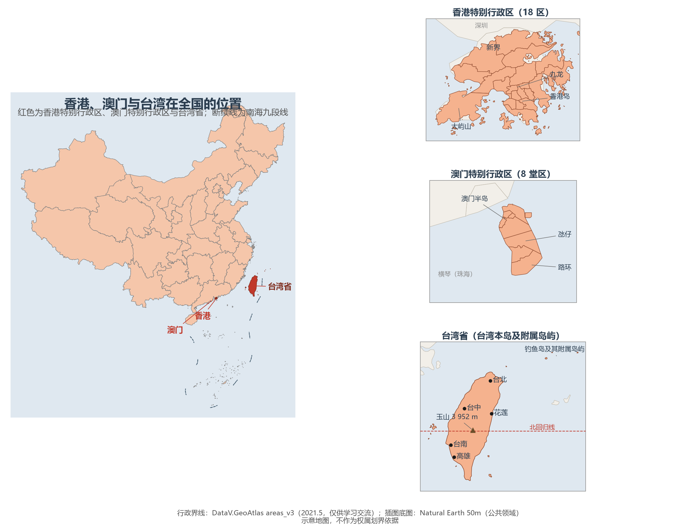
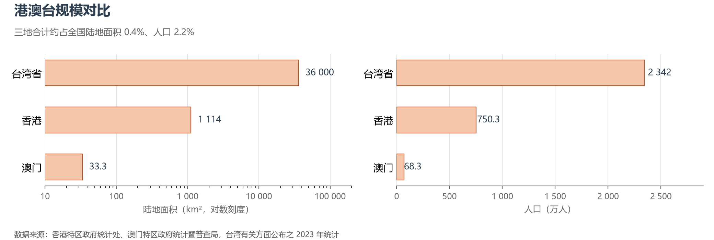

# 2.4 特别行政区与台湾省

在 34 个省级行政区中，香港、澳门、台湾三地地位特殊：它们是"一国两制"构想的实践地与国家统一议程的核心，也是全国人口密度最高、经济形态最外向的三块土地。三地合计陆地面积约 3.7 万 km²，只占全国的 0.4%，却贡献了截然不同的制度样本与经济功能。

**图 2-10 港澳台在全国的位置**：右上三幅放大插图分别为香港 18 区、澳门 8 堂区与台湾省，主图中三地以红色高亮。

## 一、"一国两制"与特别行政区制度

特别行政区的宪法依据是《宪法》第三十一条——"国家在必要时得设立特别行政区"，以及第六十二条赋予全国人民代表大会"决定特别行政区的设立及其制度"的职权。两部基本法先后落地：《香港特别行政区基本法》于 1990 年 4 月 4 日由七届全国人大三次会议通过，1997 年 7 月 1 日香港回归之日起实施；《澳门特别行政区基本法》于 1993 年 3 月 31 日由八届全国人大一次会议通过，1999 年 12 月 20 日澳门回归之日起实施。两个特别行政区直辖于中央人民政府，享有高度自治权——行政管理权、立法权和独立的司法权（香港终审权终审于本地终审法院），不实行社会主义制度和政策，保持原有的资本主义制度和生活方式五十年不变。

两区的治理细节各有底色。香港沿用普通法体系，以行政长官为核心的行政主导体制运行，2020 年《中华人民共和国香港特别行政区维护国家安全法》公布并列入基本法附件三，2024 年特区完成《维护国家安全条例》本地立法。澳门属大陆法传统，2009 年即完成基本法第二十三条本地立法。全国性法律除少数列入附件三者外，不在特别行政区实施。

## 二、香港：从深水良港到国际金融中心

香港位于珠江口之东、深圳河之南，由香港岛、九龙半岛、新界及 262 座离岛组成，陆地面积 1 114 km²（2023 年末）。地形是典型的"山城相依"——山地与陡坡占去大半土地，建成区仅约四分之一，最高峰大帽山海拔 957 m；维多利亚港港阔水深、潮差平稳，与旧金山、里约热内卢并称世界三大天然良港。气候属亚热带季风气候，年均气温约 23 ℃，年降水量约 2 400 mm，夏秋之交常受台风威胁。

全港人口 750.3 万（2023 年年中），密度约 6 700 人/km²。土地的稀缺逼出了两项城市工程学：**填海与垂直生长**——约 6% 的土地由开山填海而来，却承载了全港约四分之一的人口；建成区则以全球最密集的高层住宅群向上要空间。全区划为 18 个区，区议会为非政权性的区域咨询组织。

香港的分量在服务业：全球前列的国际金融中心、最大的离岸人民币业务枢纽、重要的国际贸易与航运中心，实行自由港政策和联系汇率制度（港元与美元按 7.75—7.85 的区间挂钩）。国际上常与香港并置对照的，是同样"以一城为一经济体"运转的新加坡：香港人口约为其 1.27 倍、陆地面积约为其 1.5 倍，两座城市型经济体构成了世界金融版图上最直接的一对镜像。

## 三、澳门：弹丸之地的三重身份

澳门位于珠江口之西，与珠海陆路相连，由澳门半岛、氹仔岛、路环岛及路氹填海区组成，陆地面积 33.3 km²（2023 年）——其中约六成由填海而来：1912 年有记录的面积仅 11.6 km²，百余年填海造地扩大了近两倍。人口 68.3 万（2023 年年末），人口密度约 2.05 万人/km²，与摩纳哥同为世界上人口密度最高的经济体之一。全区设 8 个堂区（葡萄牙殖民时代的 freguesia 遗存，仅作统计分区，非政权机构）。

澳门的三重身份写在一块 33 km² 的土地上：**世界旅游休闲中心**——博彩旅游业自 2006 年起规模超过拉斯维加斯，为全球最大博彩市场，2024 年入境旅客近 3 500 万人次，相当于每位居民接待 500 余名游客；**历史文化名城**——"澳门历史城区"2005 年列入《世界遗产名录》，是中西建筑与市井生活四百余年的层叠现场；**中葡商贸合作服务平台**——依托与葡语国家的语言与法律纽带，2021 年设立的横琴粤澳深度合作区更把发展腹地从 33 km² 扩展到 106 km²，为这座"微型城市"提供了物理上不可能自足的空间纵深。

## 四、台湾省：中国第一大岛

台湾省由台湾本岛及澎湖列岛、钓鱼岛及其附属岛屿、兰屿、绿岛等附属岛屿组成，全省面积约 3.6 万 km²，其中台湾本岛约 3.58 万 km²，比海南岛大出约 2 000 km²，是中国第一大岛，行政上钓鱼岛及其附属岛屿隶属台湾省宜兰县。地质上，台湾岛是菲律宾海板块与欧亚板块碰撞的产物：中央山脉纵贯南北，山地与丘陵约占全岛面积的三分之二，最高峰玉山海拔 3 952 m，是中国东部最高峰；平原集中在西部，以嘉南平原为最大。北回归线横穿嘉义、花莲一线，全岛兼具热带与亚热带气候，年降水量丰沛，基隆附近的火烧寮多年平均降水逾 6 000 mm，是中国降水最多的地方之一。岛屿的地价是灾害：地处环太平洋地震带，1999 年"9·21"集集地震（里氏 7.3 级）即为世纪之交最沉重的一次；夏秋常遭台风正面登陆，年均约 3—4 个。

全省人口 2 342 万（2023 年年末），以闽南、客家移民为主体的汉族占绝对多数，另有阿美人、泰雅人、排湾人等 16 族少数民族约 58 万人，总称"原住民"。自 2020 年起当地出生人数少于死亡人数，人口进入持续负增长。城市体系呈"西密东疏"：台北—新北都会区是政治经济中枢，台中、台南、高雄依次铺陈于西部平原。经济以制造业见长，尤其半导体——台积电一家即占全球晶圆代工约六成市场，全岛电子产业链在全球半导体分工中占据关键位置；对外贸易依存度长期高于 100%，是典型的岛屿外向型经济。

## 五、规模与格局：三地在全国的位置

**图 2-11 港澳台规模对比**：陆地面积（对数轴）与人口，2023 年口径。

三地合计约 3.7 万 km²，略大于海南省的陆地面积；合计人口约 3 160 万，占全国的 2.2%。但密度的反差才是重点：澳门 2.05 万人/km²、香港约 6 700 人/km² 的城市型密度，与全国平均（147 人/km²）相差一到两个数量级——这正是"一国两制"在空间上的含义：在主权与领土完整之下，三种社会制度、三种经济形态在同一国家的版图内各展其长。香港是内地与国际市场之间最大的资本与人民币通道，澳门连接着葡语国家市场，台湾则在全球半导体供应链中占据关键节点；三地与祖国大陆的经济联系，构成了理解中国国家版图的第三重维度——不止是土地与人口，更是制度与功能。

## 参考与数据来源

1. 《中华人民共和国宪法》第三十一条、第六十二条；《香港特别行政区基本法》（1990）；《澳门特别行政区基本法》（1993）；香港国安法（2020）及《维护国家安全条例》（2024）。
2. 人口与面积：香港特区政府统计处（2023 年年中人口 750.3 万、陆地面积 1 114 km²）；澳门特区政府统计暨普查局、地图绘制暨地籍局（2023 年年末人口 68.3 万、土地面积 33.3 km²）；台湾有关方面公布的 2023 年年末户籍人口（约 2 342 万）。
3. 经济与产业：香港特区政府统计处、金融管理局；澳门特区政府统计暨普查局（博彩业规模、2024 年入境旅客）；台湾有关方面经济统计与公开产业数据（半导体市占率为行业机构估算）。
4. 行政界线：DataV.GeoAtlas areas_v3（2021.5，仅供学习交流）；插图底图：Natural Earth 50m（公共领域）。
