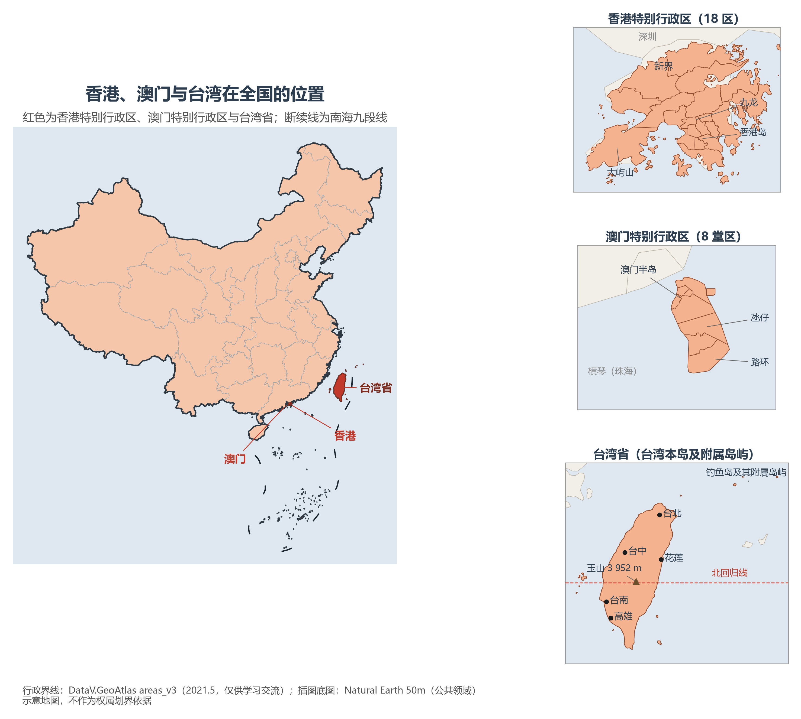
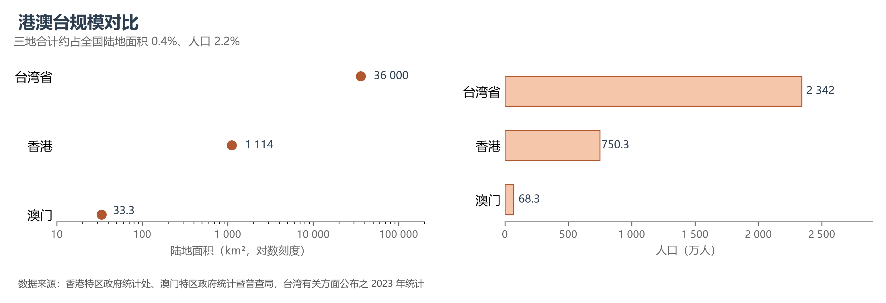
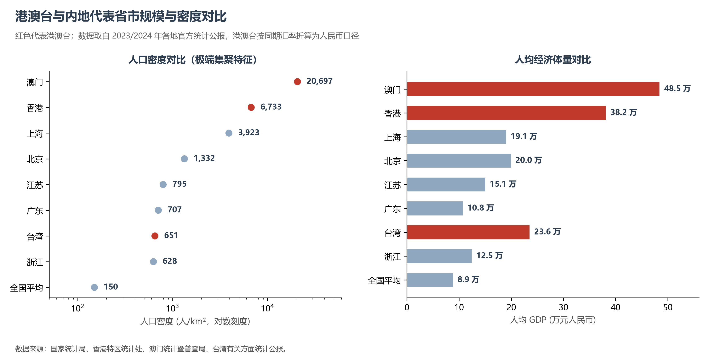

# 2.4 特别行政区与台湾省

在中华人民共和国的 34 个省级行政区中，香港特别行政区、澳门特别行政区与台湾省占据着举足轻重的特殊地位：它们是“一国两制”伟大构想的实践舞台与国家完全统一议程的核心纽带，也是全国人均经济水平最高、人口密度最大、经济形态最为外向的三块土地。三地合计陆地面积约 **3.7 万 km²**，仅占全国总面积的约 **0.4%**；合计常住人口约 **3 160 万人**，占全国的 **2.2%**。但其独特的制度设计、独特的地理区位与超高密度的现代产业，为大一统国家版图贡献了不可替代的空间功能。

**图 2-10 港澳台在全国的位置**：右上三幅放大插图分别为香港 18 区、澳门 8 堂区与台湾省，主图中三地以红色高亮。

## 一、“一国两制”法理体系与特别行政区宪制构架

特别行政区的设立，凝聚了中国特色社会主义国家制度最富创造性的政治智慧。其法理基础源自最高国家宪政框架：

- **宪法基石**：《中华人民共和国宪法》第三十一条明确规定：“国家在必要时得设立特别行政区。在特别行政区内实行的制度按照具体情况由全国人民代表大会以法律规定。”第六十二条第十四项明确全国人民代表大会行使“决定特别行政区的设立及其制度”的职权。
- **两部《基本法》的宪制保障**：
  - 《中华人民共和国香港特别行政区基本法》于 1990 年 4 月 4 日由七届全国人大三次会议审议通过，自 1997 年 7 月 1 日香港回归之日起实施；
  - 《中华人民共和国澳门特别行政区基本法》于 1993 年 3 月 31 日由八届全国人大一次会议审议通过，自 1999 年 12 月 20 日澳门回归之日起实施。
- **高度自治与司法权**：
  香港与澳门特别行政区均直接直辖于中央人民政府。两区依法享有**行政管理权、立法权、独立的司法权和终审权**。两区不实行社会主义制度和政策，保持原有的资本主义制度和生活方式五十年不变。香港沿用英美普通法系，澳门遵循欧洲大陆法系传统；全国性法律除极少数列入两部基本法附件三者外，不在特别行政区实施。
- **国家安全法治基石的夯实**：
  国家安全是一国主权最核心的体现。2020 年 6 月 30 日，十三届全国人大常委会通过《中华人民共和国香港特别行政区维护国家安全法》并列入香港基本法附件三；2024 年 3 月，香港特区立法会全票通过《维护国家安全条例》，全面完成基本法第二十三条本地立法。澳门特区则早于 2009 年即完成基本法第二十三条立法，并于 2023 年完成修法。国家安全屏障的筑牢，为“一国两制”实践开创了长期繁荣稳定的法治环境。

## 二、香港：山水相依的国际都会与空间工程学

香港特别行政区位于珠江口以东、深圳河以南，由**香港岛、九龙半岛、新界及 262 座离岛**共同组成，陆地总面积为 **1 114 km²**（2023 年末）：

### 1. 自然地理与维多利亚港良港天成
- **地质与地貌**：香港地处燕山期岩浆活动带，全境以陡峭的侏罗纪火山岩与花岗岩丘陵山地为主体，山地与斜坡占全港陆地面积的 **70% 以上**，平原极其匮乏；境内最高峰为新界中部的大帽山（海拔 957 m），大屿山岛上的凤凰山海拔亦达 934 m；
- **维多利亚港的形成机制**：香港岛与九龙半岛之间隔着狭长而深邃的**维多利亚港**（宽约 1.5~9.6 km）。维港在地质上是两条花岗岩断裂带沉降被海水淹没形成的溺谷型水道，水深常年在 **10~15 m**，风平浪静、不淤不冻，潮差仅 1~2 米，万吨巨轮可自由直泊码头，与旧金山湾、里约热内卢并称为世界三大天然良港。

### 2. 人口极端集聚与空间工程奇迹
全港常住人口达 **750.3 万人**（2023 年年中），整体人口密度高达 **6 733 人/km²**。面对极其严酷的“山多地少”地理约束，香港逼出了两项世界顶尖的城市工程学奇迹：
- **“垂直生长”与郊野公园的惊人反差**：全港实际建成区面积仅占陆地总面积的 **约 25%**，却集聚了全港 95% 以上的人口与经济活动；高层建筑数量全球第一，住宅高度普遍在 30~50 层以上。与此形成震撼对照的是，香港有高达 **40% 的土地被划为受严格法律保护的“郊野公园”**（共 24 个郊野公园与 22 个特别地区），山峦青翠、林网幽深，构成了全球超大城市中绝无仅有的“繁华都市与原始大自然咫尺相融”的生态景观。
- **百年填海造地工程**：自 1851 年首开毕打码头填海以来，香港通过历次填海造地近 **70 km²**，占总陆地面积的 **约 6%**。但这 6% 的填海土地承载了全港 **27% 的居住人口与 70% 的商业办公空间**；中环金融核心区、启德旧机场、沙田新市镇以及赤鱲角香港国际机场，全部建立在填海土地之上。

### 3. 全球超级金融中心与北部都会区战略
香港服务业占本地生产总值比重长期高于 90%，是全球公认的**三大国际金融中心之一（纽伦港）**，拥有全球最大的离岸人民币资金池，实行自由港与联系汇率制度（港元紧密挂钩美元）。近年来，香港特区政府提出**“北部都会区”**重大发展战略（涵盖元朗区与北区约 300 km² 土地），紧扣深圳河两岸，打造与深圳紧密协同创新的“国际创新科技中心”，开启了香港由维港单核向“南金融、北创科”双核联动的历史性空间重构。全港划分为 **18 个行政区**，区议会依法作为非政权性的区域咨询与服务组织。

## 三、澳门：微型空间的裂变、世界遗产与横琴新局

澳门特别行政区位于珠江口西侧，与珠海市香洲区拱北直接陆路相连，由**澳门半岛、氹仔岛、路环岛、路氹填海区**以及港珠澳大桥珠澳口岸人工岛澳门口岸等区域组成，陆地总面积为 **33.3 km²**（2023 年）：

### 1. 填海造地扩大两倍半的历史
1912 年澳门有官方精确测绘记录的土地面积仅为 **11.6 km²**。百余年来，澳门通过持续的大规模移山填海工程，将半岛与外岛不断外扩，更在氹仔与路环两岛之间填筑出面积达 6.1 km² 的**路氹填海区（Cotai）**，使两岛彻底连为一体，全区陆地面积增加了 **近两倍半**。

### 2. 全球人口密度之冠与八大堂区
澳门常住人口为 **68.3 万人**（2023 年末），人口密度高达 **20 697 人/km²**，是当今全世界人口密度最高的城市实体之一。澳门全境划分为 **8 个堂区**（花地玛堂区、圣安多尼堂区、大堂区、望德堂区、风顺堂区、嘉模堂区、圣方济各堂区及路氹区）。“堂区”（Freguesia）是葡萄牙殖民管治时期以天主教教堂为中心划分的教区遗留，在今日仅作为统计与民间习惯分区，不设政权机关。

### 3. 三重战略身份与横琴纵深突破
- **世界旅游休闲中心**：澳门是全球规模最大的综合度假城与博彩旅游市场，2024 年入境旅客突破 **3 500 万人次**，相当于每位澳门本地常住居民一年平均接待超 500 位海内外旅客；
- **世界文化遗产高地**：由大三巴牌坊、妈阁庙、东望洋灯塔、大炮台等 20 余处中西合璧历史建筑构成的**“澳门历史城区”**，于 2005 年正式列入联合国教科文组织《世界遗产名录》，是四百余年东西方文明在岭南交融并存的最生动标本；
- **中葡商贸合作服务平台与横琴新局**：依托与葡语国家的历史法律渊源，澳门常年发挥着中国与葡语国家经贸合作的“超级桥梁”功能。**2021 年 9 月，中共中央、国务院印发《横琴粤澳深度合作区建设总体方案》，将紧邻澳门的横琴岛（106 km²，相当于澳门陆地面积的 3 倍以上）辟为粤澳共商共建共管共享的合作区**；2024 年 3 月 1 日，横琴粤澳深度合作区正式实施“一线放开、二线管住”的分线管理封关运行，为澳门发展中医药、现代金融、高新技术与文旅会展注入了无限的空间纵深。

## 四、台湾省：宝岛自然地理全景与产业地缘脉络

台湾省位于中国东南沿海的大陆架上，东临太平洋，西隔台湾海峡与福建省相望，东北接琉球群岛，南扼巴士海峡与菲律宾相峙。全省由**台湾本岛及澎湖列岛、钓鱼岛及其附属岛屿、兰屿、绿岛等 80 余个大小附属岛屿**共同组成，总面积约为 **3.6 万 km²**，其中台湾本岛陆地面积约 **3.58 万 km²**，比海南岛大出约 2 000 km²，是**中国第一大岛**：

### 1. 自然地理骨架：板块碰撞与巍峨玉山
- **地质演化与造山运动**：台湾岛地处欧亚板块与菲律宾海板块强烈碰撞俯冲的前沿挤压构造带上，地质构造年轻，造山运动极其剧烈。全岛地势险峻，**山地与丘陵占全岛总面积的三分之二**。全省地处环太平洋地震带，地质断裂发育，地震频发（如 1999 年 9 月 21 日南投县集集镇发生的里氏 7.3 级大地震，造成极其惨重的人员伤亡与地形位移）。
- **五大纵向山脉体系**：
  - **中央山脉**：纵贯全岛南北，长达 340 km，是台湾全岛的“屋脊”与主分水岭；
  - **雪山山脉**：位于全岛北部，主峰雪山海拔 3 886 m，为台湾第二高峰；
  - **玉山山脉**：位于中央山脉西侧，**主峰玉山海拔高达 3 952 m，是中国东部沿海第一高峰**；
  - **阿里山山脉**：玉山山脉以西的褶皱断块山地，主峰大塔山，以云海、日出与森林小火车闻名；
  - **海岸山脉**：紧贴东部太平洋岸，与中央山脉之间夹峙着狭长深邃的**花东纵谷**。
- **平原与水网**：平原主要集中在西部沿海，**嘉南平原（面积约 4 500 km²）**是台湾全省面积最大、农业最发达的平原，屏东平原与宜兰平原次之。河流源短流急，暴涨暴落，水力资源丰富而航运价值有限，以**浊水溪（长 186 km，全岛最长）**与**高屏溪（流域面积最大）**为主要水系；天然淡水湖以日月潭最为著名。
- **气候极值与台风通道**：北回归线横穿台湾本岛中南部的嘉义、花莲一线，全岛北部属亚热带季风气候，南部属热带季风气候。全岛年降水量极为丰沛，位于台湾岛东北迎风坡的基隆**火烧寮，多年平均年降水量高达 6 558 mm**（1912 年曾测得 8 409 mm 的历史极值纪录），荣居**全中国降水量之冠**。台湾岛是西太平洋热带气旋进入我国沿海的前沿阵地，每年夏秋季节正面遭受台风侵袭平均达 3~4 次。

### 2. 历史沿革与主权归属铁证
台湾自古以来就是中国神圣领土不可分割的一部分：
- **三国与隋朝**：公元 230 年，三国吴王孙权派遣将军卫温、诸葛直率领万人船队到达“夷州”（今台湾），这是大陆政权经略台湾的最早明文记载；隋炀帝曾三次派人赴“流求”。
- **元明清中央管辖**：元世祖时期在澎湖正式设立**澎湖巡检司**，隶属福建行省泉州府，标志着中国中央政府对台湾及其附属岛屿行使正式行政管辖的开端；1662 年，民族英雄郑成功驱逐占领台湾 38 年之久的荷兰殖民者，收复台湾，设承天府；**1684 年，清政府统一台湾后设台湾府**，隶属福建省；**1885 年，清政府正式决定将台湾从福建分出单独建省**，刘铭传出任台湾省首任巡抚，主持修建了中国第一条商用客运铁路（基隆至新竹），加速了台湾全省的近代化建设。
- **抗战胜利与台湾光复**：1895 年甲午战争后，日本军国主义强迫清政府签订《马关条约》割占台湾与澎湖列岛；台湾军民进行了长达半个世纪英勇不屈的反抗斗争。1945 年 10 月 25 日，伴随中国人民抗日战争与世界反法西斯战争的伟大胜利，中国政府在台北举行台湾省受降仪式，**台湾与澎湖列岛正式宣告光复，重回祖国母亲怀抱**。钓鱼岛及其附属岛屿自古即为台湾附属岛屿，行政上自清代以来隶属台湾省宜兰县管辖。

### 3. 人口分布、都会走廊与“硅岛”半导体
- **人口结构**：全省常住人口约 **2 342 万人**（2023 年底），以汉族为主体（占总人口 97% 以上），其祖籍多为明清时期自福建南部（闽南民系）与广东东部（客家民系）渡海而来的开拓先民后代；另有阿美族、泰雅族、排湾族等 16 族少数民族约 58 万人，通称“原住民”。
- **“西密东疏”的都会走廊**：受东部崇山峻岭阻隔，台湾全省 90% 以上的人口与几乎全部现代产业高度集中在西部沿海平原地带，串联起**台北—新北都会区、桃园、新竹、台中、台南、高雄**的高密度城市与高速铁路产业走廊。
- **全球半导体“重镇”**：台湾省自 1970 年代起成功实现产业转型，依托新竹科学园区、台南科学园区等基地，培育了以台积电（TSMC）、联发科为代表的世界级半导体集群。台积电一家即占据全球先进先进制程晶圆代工 **60% 以上的市场份额**，在世界现代电子信息产业链中占据核心地位。两岸经济具有极其紧密的互补依存关系，祖国大陆常年是台湾最大的贸易顺差来源地。

## 五、规模与格局：港澳台在全国大局中的空间维度

**图 2-11 港澳台规模对比**：陆地面积（对数轴）与人口，2023 年口径。

**图 2-12 港澳台与内地代表省市经济与人口密度对比**：红色代表港澳台；数据取自 2023/2024 年各地官方统计公报，港澳台按同期汇率折算为人民币口径。

将港澳台三地置于全国 34 个省级行政区的整体矩阵中审视，可以深刻看清其独特的经济密度与战略价值：
- **微型面积与巨型密度的反差**：三地总面积约 3.7 万 km²（略大于海南省陆地面积），人口约 3 160 万人。但澳门以超 2 万人/km²、香港以超 6 700 人/km² 的极端人口密度，在全国密度梯级上遥遥领先；
- **财富创造与外向辐射极高**：按人均国内生产总值（GDP）折算，澳门（人均超 48 万元人民币）、香港（人均超 38 万元人民币）与台湾（人均约 23.6 万元人民币）均位居全国各省级单位的最前列；
- **大一统框架下的多元制度互补**：在国家主权、安全与领土完整的绝对前提下，三种法律制度（大陆法系、普通法系、混合传统）、三种独立货币（人民币、港币、新台币）、三大自由贸易港在同一国度内和谐并存。随着港珠澳大桥横跨伶仃洋、广深港高铁全线贯通、深中通道通车运行，以及未来台海跨海通道的远景规划，港澳台与祖国大陆在基础设施、经贸规则、社会民生上正在形成更加紧密的命运共同体，构成了中国经略深蓝、迈向民族复兴的超级开放前沿。

## 参考与数据来源

1. 宪法与特区基本法：《中华人民共和国宪法》第三十一条、第六十二条；《中华人民共和国香港特别行政区基本法》（1990）；《中华人民共和国澳门特别行政区基本法》（1993）；《香港特别行政区维护国家安全法》（2020）；香港特区《维护国家安全条例》（2024）。
2. 人口与土地面积：香港特区政府统计处《香港统计月刊》（2024 年版）；澳门特区政府统计暨普查局、地图绘制暨地籍局公开年报（2023/2024 年）；台湾有关方面统计公报与户籍年报（2023 年底）。
3. 台湾地理与历史典籍：《三国志·吴书·孙权传》；《临海水土志》；《隋书·流求传》；清代《台湾府志》；《开罗宣言》（1943）；《波茨坦公告》（1945）。
4. 产业与经济指标：香港特区金管局；澳门特区经济及科技发展局；台湾有关方面产业技术研调机构数据（半导体全球市场份额分析报告，2024 年口径）。
5. 规划文件：《粤港澳大湾区发展规划纲要》（2019）；《横琴粤澳深度合作区建设总体方案》（2021）。
