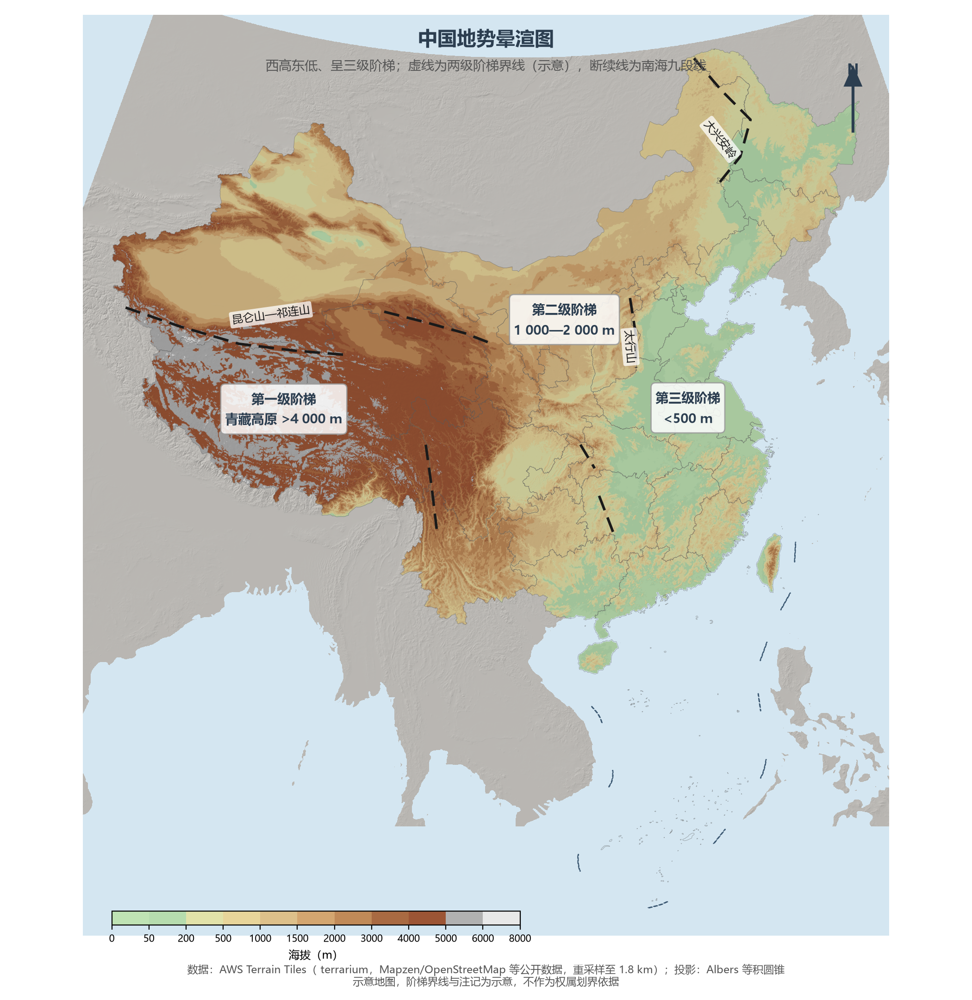
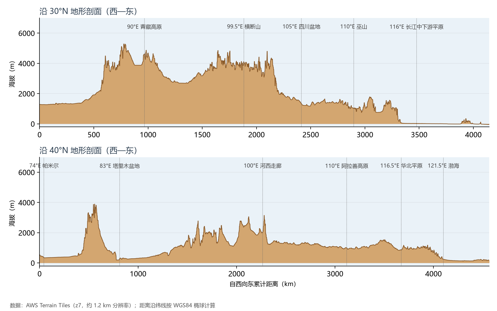
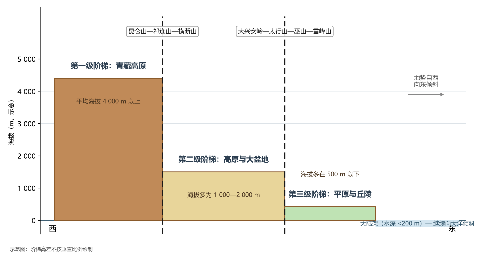

# 3.1 三级阶梯总体格局

摊开一张中国地势图，最抢眼的不是任何一座山峰，而是一个巨大的斜面：西部是连绵 250 万 km² 的高海拔隆起，东部是坦荡的平原与浅海大陆架，两者之间以两级"台阶"相接。这就是中国地形的第一定律——**地势西高东低，呈三级阶梯状分布**。它决定了大江东流的基本走向，规定了海洋水汽深入内陆的通道，也奠定了此后所有章节（气候、河流、人口、经济）的空间逻辑。

**图 3-1 中国地势晕渲图**：DEM 山体阴影叠加高程分级设色，三级阶梯与两级界线（示意）一目了然。

## 一、三级阶梯的构成

| 阶梯 | 平均海拔 | 主要地形区 | 两级界线 |
|------|---------|-----------|---------|
| 第一级 | 4 000 m 以上 | 青藏高原、柴达木盆地 | 昆仑山—祁连山—横断山 |
| 第二级 | 1 000—2 000 m | 内蒙古高原、黄土高原、云贵高原，塔里木、准噶尔、四川盆地 | 大兴安岭—太行山—巫山—雪峰山 |
| 第三级 | 500 m 以下 | 东北、华北、长江中下游三大平原，东南丘陵 | 海岸线外为大陆架 |
| 大陆架 | 水深 200 m 以内 | 渤海、黄海海底的大部分与东海、南海的近岸地带 | — |

第一级阶梯是青藏高原——平均海拔超过 4 000 m，是地球上最高、最年轻的大陆隆起；第二级阶梯由三块高原和三个大盆地拼成，是中国面积最大的一个台阶；第三级阶梯自北而南铺开三大平原，丘陵点缀其间，再向东则沉入浅海大陆架。

**图 3-2 沿 30°N 与 40°N 的地形剖面**：两条剖面直观呈现"一个斜面、两级台阶"——自帕米尔、青藏高原到东部平原，约 4 000 km 的水平行程内海拔下降了约 4 500 m。

## 二、这个格局如何塑造中国

- **河流**：西高东低使长江、黄河、珠江等大江自西向东流入太平洋，"一江春水向东流"是地形写下的句子；而阶梯交界处的巨大落差，造就了三峡、虎跳峡等峡谷与全国七成以上的水能理论蕴藏量。
- **气候**：三级阶梯与大气环流相互作用——东部低平使夏季风得以长驱直入，把海洋水汽送到 1 000 km 以上的内陆；而 4 000 m 的青藏高原本身就是一台"气候发动机"，它阻挡西风带、驱动东亚季风（详见 4.1 节）。
- **交通与经济**：东西向的每一级台阶都是工程成本的台阶——川藏铁路需要"台阶式"爬升 3 000 m，而东部平原上的路网密度是全国平均的数倍。中国经济重心千百年来落在第三级阶梯上，地形是第一个原因。

**图 3-3 三级阶梯示意**：自青藏高原经两级台阶到大陆架的地势结构（块状示意图）。

## 三、世界视角：大国地形的两种答案

把镜头拉远，一个国家的地势倾斜方向往往决定它的人居与农业格局。中国的斜面朝东——迎着太平洋季风，湿润气流爬坡成雨，东部平原因此成为人口与稻米的摇篮；印度半岛的斜面也朝向海洋（两侧海岸山与德干高原），美国则自西向东从落基山脉阶梯式降向中部大平原与东部沿海。世界主要农耕大国几乎都在"背山面海"的斜面上建立文明——中国的独特之处在于斜面的高度：第一级阶梯抬升到了 4 000 m 以上，这在各大洲都没有第二例。

## 参考与数据来源

1. 地势晕渲与剖面：AWS Terrain Tiles（terrarium 编码，Mapzen 公开数据），重采样至约 1.2—1.8 km。
2. 阶梯划分与界线：通行地理教材口径。
3. 行政界线：DataV.GeoAtlas areas_v3（2021.5，仅供学习交流）；投影：Albers 等积圆锥。
