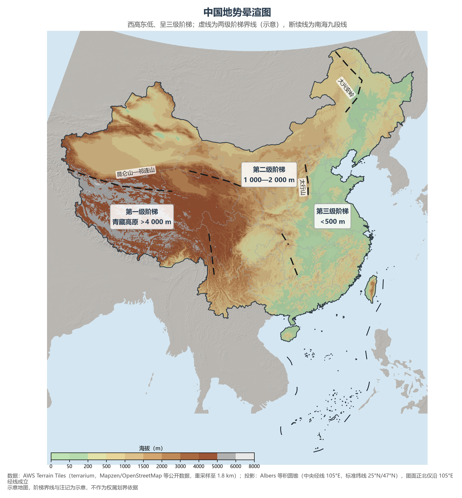
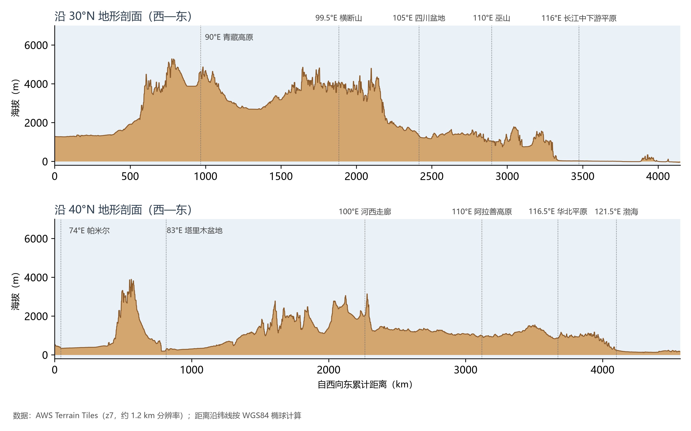
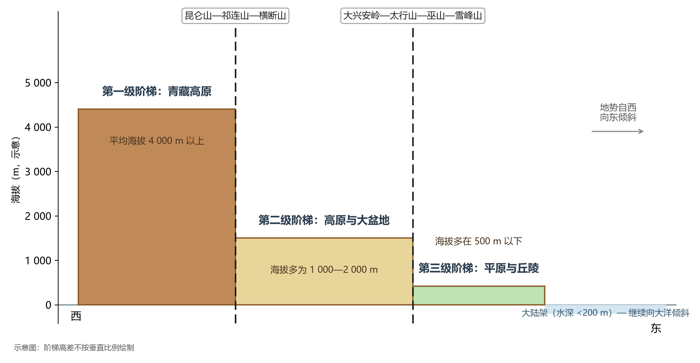

# 3.1 三级阶梯总体格局

摊开一张中国立体地貌图，映入眼帘的最显著特征不是孤立的山峦或凹陷，而是一个自西向东倾斜跌落的巨大三级巨型斜面：西部是平均海拔逾 4 000 m、面积达 250 万 km² 的高原隆起，中部是海拔 1 000~2 000 m 的高原与盆地交织带，东部则是海拔在 500 m 以下的低平原、丘陵与浅海大陆架。两者之间，以两道纵贯南北的地形急变带截然相隔。这就是中国自然地理的第一基础定律——**地势西高东低，呈三级阶梯状逐级下降**。这一宏观巨型地貌构架，自新生代印度板块与欧亚板块碰撞碰撞以来奠定，它从根本上决定了大江大河向东奔流的基本走向，规定了西太平洋水汽深入内陆的推进通道，也深远铸就了中国的农业熟制、水能格局、人口集聚与区域经济差异。

**图 3-1 中国地势晕渲图**：DEM 山体阴影叠加高程分级设色，三级阶梯与两级界线（示意）一目了然。

## 一、三级阶梯的地貌构成与构造分界

中国陆地高低落差极大，最高点珠穆朗玛峰海拔 8 848.86 m，最低点新疆吐鲁番盆地艾丁湖洼地海拔 −154.31 m，极端相对高差超过 9 000 m。在这一全球最为显著的高差跨度内，大地并非均匀倾斜，而是通过深大断裂带与山脉屏障，构筑了阶梯分明的三个地貌台阶：

| 阶梯层级 | 平均海拔高度 | 地壳厚度与岩石圈特征 | 主要组成地形单元 | 阶梯外缘控制性界线山脉 |
|---------|------------|-------------------|----------------|---------------------|
| **第一级阶梯** | **4 000 m 以上** | 地壳厚度达 60~75 km，地幔上涌，全球最厚陆壳 | **青藏高原、柴达木盆地** | 昆仑山脉—阿尔金山脉—祁连山脉—横断山脉 |
| **第二级阶梯** | **1 000~2 000 m** | 地壳厚度约 40~50 km，过渡型陆壳构造 | **内蒙古高原、黄土高原、云贵高原，塔里木盆地、准噶尔盆地、四川盆地** | 大兴安岭—太行山脉—巫山—雪峰山 |
| **第三级阶梯** | **500 m 以下**（平原大多在 50 m 以下） | 地壳厚度约 30~35 km，伸展减薄陆壳 | **东北平原、华北平原、长江中下游平原，辽东丘陵、山东丘陵、东南丘陵** | 海岸线（外侧自然过渡至水深 < 200 m 的大陆架） |

**图 3-2 沿 30°N 与 40°N 的地形剖面**：两条剖面直观呈现“一个斜面、两级台阶”——自帕米尔、青藏高原到东部平原，约 4 000 km 的水平行程内海拔下降了约 4 500 m。

### 1. 第一级阶梯：“世界屋脊”与高原核心
第一级阶梯主要由号称“地球第三极”的**青藏高原**与藏北内陆的**柴达木盆地**构成。其面积约占全国陆地面积的四分之一。在距今约 6 500 万年前始新世初期的喜马拉雅造山运动中，印度板块强烈挤压俯冲至欧亚板块之下，地壳遭受极其强烈的水平压缩与垂向隆升，使得这一区域平均海拔抬升至 4 000 m 以上。高原上雪峰林立，5 000~6 000 m 以上的极高山连绵不断，冰川广布，是亚洲各大骨干水系的水塔源头。

### 2. 第一、二级阶梯分界线：深大逆冲断裂带
连接第一级与第二级阶梯的界线，由**昆仑山脉—阿尔金山脉—祁连山脉—横断山脉**构成。这条界线是中国大陆西部最雄伟的构造断裂带，地形落差普遍在 2 000~3 000 m 以上。在祁连山北麓，山体以近乎垂直的气势直插河西走廊戈壁平原；在横断山脉地带，高山深谷相间，岭谷高差常达 3 000~4 000 m，是世界上地表起伏最为剧烈破碎的区域之一。

### 3. 第二级阶梯：高原与大型内陆盆地交错带
第二级阶梯海拔大多在 1 000~2 000 m 之间，面积约占全国国土的一半，地形类型最为丰富复杂：
- **三大高原**：内蒙古高原（地势坦荡辽阔）、黄土高原（深厚风积黄土与水土侵蚀沟壑）、云贵高原（喀斯特溶蚀峰林洼地）；
- **三大盆地**：准噶尔盆地（西北开口受西风影响）、塔里木盆地（深处内陆由极端干旱沙漠覆盖）、四川盆地（群山环抱的湿润红层紫色土盆地）。

### 4. 第二、三级阶梯分界线：大陆重力梯度巨变带
连接第二级与第三级阶梯的界线，自北而南由**大兴安岭—太行山脉—巫山—雪峰山**绵延数千公里构成。地球物理探测表明，这条分界线不仅是地貌形态的陡落线（地势在数十公里水平距离内骤降千米以上），更是一条贯穿我国东部地幔岩石圈的**布格重力异常梯度带**。分界线以西，陆壳深厚、地势高耸、以高原山地为主；分界线以东，地壳显著减薄、断陷沉降、以开阔平原和近海丘陵为主。

### 5. 第三级阶梯与沿海大陆架：低平坦荡的人文重心
第三级阶梯海拔多在 500 m 以下，自北向南舒展着中国最辽阔的三大平原——**东北平原、华北平原、长江中下游平原**，周边镶嵌着辽东半岛、山东半岛及江南各省的低山丘陵。再向东，地势隐入水深不足 200 m 的渤海、黄海、东海浅海大陆架，直至冲绳海槽与南海深海盆地。

**图 3-3 三级阶梯示意**：自青藏高原经两级台阶到大陆架的地势结构（块状示意图）。

## 二、地势格局对自然环境与人类社会的决定性控制

地势三级阶梯决非一张静态的背景板，而是时刻驱动水循环、大气环流与经济要素流动的物理发动机：

| 控制领域 | 地形地势驱动机制 | 关键地理效应与现实影响 |
|---------|----------------|----------------------|
| **气候与水汽** | 面向海洋的大型阶梯状斜面开口，利于太平洋东南季风与南海西南季风层层爬升深入 | 阻断内陆水汽散失，使丰沛降水深入内陆千余公里；青藏高原隆升阻挡冷空气并驱动季风环流 |
| **河流与水文** | “西高东低”决定大江大河总体东流入海；阶梯过渡带形成巨大的天然落差（落差数百至上千米） | 长江、黄河、珠江横贯东西沟通内地与沿海；金沙江、三峡、黄河上游聚集全国 70% 以上水能资源 |
| **交通与区隔** | 东西向阶梯过渡带山高谷深、横切大地；东部平原坦荡连绵、河湖连网 | 东西向通道工程极其险巨（如川藏铁路、宜万铁路）；第三级阶梯构筑了四通八达的高铁与运河网络 |
| **农业与经济** | 阶梯海拔直接影响气温垂直直减（每升高 1 000 m 降温约 6 ℃）与平原耕地集中度 | 第三级阶梯集聚全国半数以上耕地与近七成工业产值；第一级阶梯为高寒牧区，第二级阶梯农牧交错 |

### 1. 水汽深入与“气候动力机”
中国东部地势平缓低下，使夏季来自太平洋与南海的温暖湿润季风气流能够畅通无阻地向西北腹地挺进，深入华北平原、东北平原乃至黄土高原，造就了大面积的雨热同期气候。与此同时，平均海拔超 4 000 m 的第一级阶梯青藏高原，如同一座耸入中对流层的巨大热力岛和动力屏障：夏季它作为一个巨大的高架热源，强烈抽吸低纬海洋湿热空气北上，直接促成了强盛的东亚季风；冬季则如同中流砥柱，迫使西风环流分流为南北两支，极大加剧了北方干冷风暴与南方相对湿润的格局分异。

### 2. “大江东去”与世界最大水能富集区
“百川东到海，何时复西归。”西高东低的地势决定了我国长江、黄河、珠江、澜沧江、黑龙江等主要骨干江河均发源于第一、二级阶梯，顺应地势浩荡东流，自然沟通了东西内陆与沿海的交通物流大动脉。尤为壮观的是，当巨量江水从高一级阶梯跌入低一级阶梯时，切穿重重山脉，形成了险峻深邃的峡谷急流区（如金沙江虎跳峡、长江三峡、黄河龙羊峡至青铜峡段）：
- 全国水能理论蕴藏量达 **6.94 亿 kW**，其中 **70% 以上高度富集于第一、二级阶梯交界处**；
- 三峡工程、白鹤滩水电站、溪洛渡水电站、乌东德水电站、向家坝水电站——世界前十二大水电站中中国独占六座，全部精准落位于阶梯分界线的天然峡谷落差带上，构成了“西电东送”工程的国家级清洁能源底座。

### 3. 区域发展阶梯与交通地理重力场
地势阶梯对人类交通工程和产业布局构成了天然的成本过滤器：
- **工程难度指数级跃升**：在第三级阶梯建设高铁与高速公路，地势平坦、路网密度达全国平均数倍；而穿越第一、二级阶梯界线时，工程则面临深大活动断裂、极高地应力、高地温与高差急变的极限挑战。正在推进建设的川藏铁路（雅安至林芝段），需要在横断山脉数个山谷间多次“剧烈爬升与下切”，全线桥隧比超过 90%，是挑战地球地质极限的超级工程；
- **人口经济重力场**：自秦汉以来，尤其是南宋经济重心南移之后，第三级阶梯的三大平原与近海盆地，以其坦荡的地貌、充沛的水热与优良的通航条件，始终承载着全国 60% 以上的常住人口、70% 以上的有效耕地与 80% 以上的工业经济总量。

## 三、世界视角：大国地势形态的横向比较

将中国三级阶梯的宏观构架置于世界各大洲大国中进行横向审视，可以发现深刻的地貌形态差异：

| 国家 | 宏观地势空间构架 | 主要倾斜与水汽朝向 | 地形对文明分布的影响 |
|------|----------------|-------------------|-------------------|
| **中国** | **西高东低，呈完整三级阶梯状逐级跌落** | **面向太平洋东倾，背依内陆** | 第一级阶梯抬升至 4 000 m 绝无仅有；东倾迎风造就季风绿洲与平原人口核心 |
| **美国** | 东西两侧为高山山系，中部为坦荡开阔大平原 | 东西受高山阻挡，南北向敞开 | 太平洋水汽受科迪勒拉山系阻隔；中部南北纵通易受北极极寒与墨西哥湾暖湿对撞 |
| **俄罗斯** | 西低东高，自东向西呈阶梯状抬升（高原山地在东） | 总体向北冰洋倾斜 | 绝大多数骨干大河向北流入封冻北冰洋，未能形成东西贯通的水系经济走廊 |
| **印度** | 北部极高山屏障、中部低陷冲积平原、南部古老台地 | 南北阶梯对峙，面向印度洋敞开 | 喜马拉雅山阻挡北方寒风，印度洋季风正面横扫，恒河平原成为超高密度农耕区 |

中国独特的大陆斜面构造，在于其**第一级阶梯高度与跨度举世无双**——它不仅是一块高原，更是高悬于整个东亚平原上方的“生态水塔”与“气候动力机”。理解了三级阶梯的起伏，也就掌握了打开中国全境气候带谱、水系网络与区域人文格局的第一把钥匙。

## 参考与数据来源

1. DEM 与高程剖面数据：自然资源部 1:100万 地形要素空间数据库，AWS Terrain Tiles（Mapzen 公开开源数据，采样精度 1.2 km）。
2. 地球物理与地壳厚度：中国地质调查局、中国科学院地质与地球物理研究所深部地质勘探成果公报。
3. 水能理论蕴藏量与水电装机：国家能源局、中国水力发电工程学会统计年报。
4. 阶梯分界线标准定义：任美锷《中国自然地理纲要》；席承藩等《中国自然区划》。
