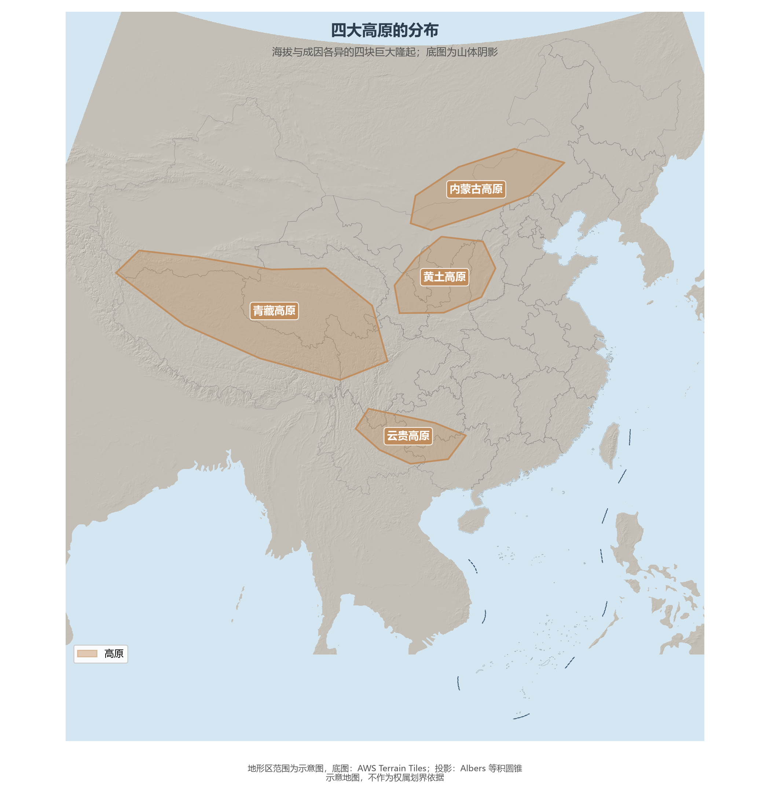

# 3.2 四大高原

中国的第二级与第一级阶梯上，分布着四块性格迥异的高原：一块是"世界屋脊"，一块是平缓坦荡的千里草原，一块是被流水切割得支离破碎的黄土世界，一块是石峰林立的溶岩大地。四块高原合计约 430 万 km²，接近全国陆地面积的一半。

**图 3-4 四大高原的分布**：底图为山体阴影，色块为示意范围。

| 高原 | 面积（约） | 平均海拔 | 地貌关键词 |
|------|-----------|---------|-----------|
| 青藏高原 | 250 万 km² | 4 000 m 以上 | 雪山连绵、冰川广布、湖泊星罗 |
| 内蒙古高原 | 70 万 km² | 1 000—1 400 m | 地面坦荡、起伏和缓、草原与戈壁 |
| 黄土高原 | 64 万 km² | 1 000—2 000 m | 千沟万壑、塬梁峁、水土流失 |
| 云贵高原 | 50 万 km² | 1 000—2 000 m | 喀斯特广布、地面崎岖、山间坝子 |

## 一、青藏高原：世界屋脊

青藏高原西起帕米尔、东至横断山，南抵喜马拉雅、北到昆仑—祁连，平均海拔 4 000 m 以上，是世界海拔最高的高原，也是中国面积最大的高原，占全国陆地面积约四分之一。它是印度板块与欧亚板块碰撞的产物——6000 万年以来的持续挤压把它抬升成地球的"第三极"：喜马拉雅等高大山脉横亘边缘，高原面上雪山冰川连绵，是长江、黄河、澜沧江、怒江、雅鲁藏布江与印度河的共同源头；高原内部湖泊上千，多为内流的咸水湖。高原的存在本身就是气候事件——它阻挡西风、泵吸季风，把 30°N 附近本该荒漠化的中国东部变成了鱼米之乡（见 4.1 节）。

## 二、内蒙古高原：平缓的千里草原

内蒙古高原东起大兴安岭西麓、西至马鬃山，东西绵延约 2 000 km，海拔多在 1 000—1 400 m 之间，是中国第二大高原。它的底色是"平"——古老的地台长期稳定抬升，地面切割微弱，呈现一望无际的波状高原景观；呼伦贝尔、锡林郭勒草原分布其上，阴山以北则渐入戈壁。平坦开阔带来了牧业与风能的双重禀赋，也带来了中国北方沙尘暴的策源地之一（见 4.4 节）。

## 三、黄土高原：风吹来的高地

黄土高原东起太行山、西至乌鞘岭、南抵秦岭、北越长城与鄂尔多斯高原相接，总面积约 64 万 km²，地跨青、甘、宁、内蒙古、陕、晋、豫七省区，是世界最大的黄土堆积区。黄土来自西北内陆的干旱区——第四纪以来西风与冬季风把粉尘持续搬运至此堆积，厚度一般 50—100 m，陇中局部逾 200 m。疏松多孔的粉砂土在夏季暴雨下极易侵蚀：千沟万壑、支离破碎的地表被流水雕成**塬**（顶面平坦的残留高地）、**梁**（长条状垄岗）、**峁**（孤立浑圆的丘顶）三种形态。黄土高原曾经森林草原广布，如今是黄河泥沙的主要来源（年输沙量历史均值约 16 亿 t，见 5.3 节），也是近几十年全球增绿最显著的区域之一——林草植被覆盖率由 20 世纪末的约 31% 升至 2020 年后的约 67%（国家林业和草原局、黄河水利委员会对黄土高原整体的监测口径）。

## 四、云贵高原：溶岩大地

云贵高原位于中国西南部，覆盖云南东部与贵州大部，平均海拔 1 000—2 000 m，地势西高东低。这里石灰岩深厚广布，亚热带湿热气候加速溶蚀，喀斯特地貌发育得淋漓尽致——峰林、峰丛、溶洞、天坑与地下暗河铺满大地，"地无三里平"是地表的真实写照。溶蚀留下的平缓洼地被称为**坝子**，是高原上人口与农田最集中的地方。中国南方喀斯特（云南石林、贵州荔波、重庆武隆等）与贵州重大工程（"中国天眼"FAST 选址于喀斯特洼地）都发生在这片溶岩大地上。

## 五、世界视角：高原与文明

四大高原合计约 430 万 km²，占全国陆地面积的 45%——这个比例在人口大国中绝无仅有。对比世界主要高原：南美洲的巴西高原面积约 500 万 km²，是世界面积最大的高原，平均海拔却不足 1 000 m；印度半岛的德干高原约 160 万 km²，美国的科罗拉多高原与哥伦比亚高原合计不足 80 万 km²。世界屋脊之"高"与黄土高原之"厚"，都是全球仅此一例的地理事实。高原不产粮，却决定水与风：青藏高原是十余条国际河流的水塔，内蒙古高原是东亚沙尘与风能的源区。读懂中国的高原，就读懂了中国水资源与生态安全格局的上游逻辑。

## 参考与数据来源

1. 面积与海拔：通行地理教材与地方志口径（青藏高原约 250 万 km²、黄土高原约 64 万 km²、云贵高原约 50 万 km²、内蒙古高原约 70 万 km²）。
2. 黄土厚度与水土流失：中国科学院黄土与第四纪地质研究公开成果；黄河年输沙量：黄河水利委员会《黄河泥沙公报》。
3. 黄土高原林草植被覆盖率：国家林业和草原局、黄河水利委员会公开监测数据。
4. 底图：AWS Terrain Tiles；地形区范围为示意勾绘。
