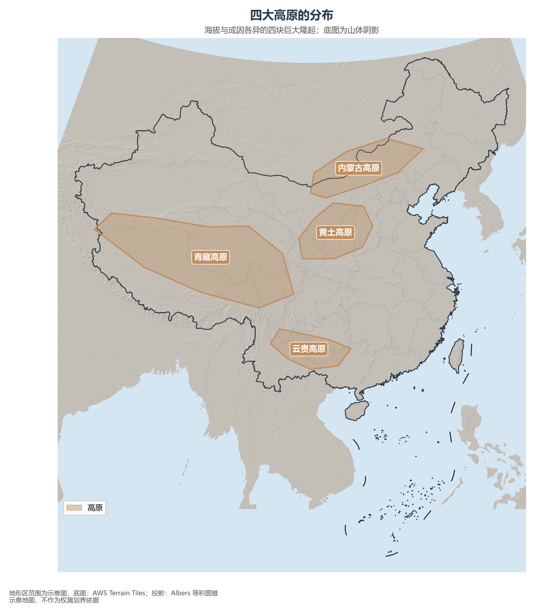

# 3.2 四大高原

在中国第一级与第二级阶梯的广袤版图上，横亘着四块性格迥异、成因各异的大型高原：一块是屹立于中对流层、被誉为“世界屋脊”的高寒雪域；一块是古老平缓、风吹草低见牛羊的千里温带草原；一块是被漫长风沙与暴雨流水合力雕琢成千沟万壑的厚层黄土世界；还有一块则是石峰林立、暗河奔涌的亚热带溶岩大地。四大高原总面积合计达 **约 430 万 km²**，占据了全国陆地国土的 **近半壁江山（约 45%）**。它们不仅构筑了中国自然地貌的主体骨架，更是维系国家水资源供给、生态安全屏障与气候环流稳定的源头中枢。

**图 3-4 四大高原的分布**：底图为山体阴影，色块为示意范围。

## 一、四大高原宏观地质与地貌总览

四大高原无论在岩石圈地质演化、外力雕琢方式还是地表覆被特征上，均展现出极其鲜明的地带性分异：

| 高原名称 | 面积 (万 km²) | 平均海拔 (m) | 构造与地质成因 | 核心地表形态特征 | 气候与年均降水量 | 主要土壤类型 |
|---------|--------------|-------------|--------------|----------------|----------------|------------|
| **青藏高原** | **约 250** | **4 000 以上** | 印度板块与欧亚板块强烈碰撞隆升的新生代造山带 | 雪山连绵、冰川广布、湖泊星罗、高寒荒漠与草甸 | 高原山地高寒气候；50~900 mm (自东南向西北递减) | 高山草甸土、高山草原土、高山寒冻土 |
| **内蒙古高原** | **约 70** | **1 000~1 400** | 古生代古老克拉通地台，长期受准平原化剥蚀 | 地面坦荡辽阔、起伏极度平缓、温带草原与戈壁连绵 | 温带大陆性干旱/半干旱气候；150~400 mm | 黑钙土、栗钙土、棕钙土、荒漠灰钙土 |
| **黄土高原** | **约 64** | **1 000~2 000** | 第四纪风力粉尘长期堆积覆盖与流水剧烈侵蚀流塑 | 塬、梁、峁地貌发育，沟壑纵横，地表支离破碎 | 温带季风向大陆性过渡气候；350~650 mm (夏季暴雨) | 黄绵土、褐土、黑垆土 (粉砂质，易受侵蚀) |
| **云贵高原** | **约 50** | **1 000~2 000** | 巨厚海相碳酸盐岩在亚热带高温多雨下强烈溶蚀 | 峰林峰丛交错、溶洞天坑密布、地表崎岖、山间多坝子 | 亚热带季风气候；1 000~1 500 mm (湿热多雨) | 石灰土、红壤、黄壤 (土层薄，石漠化敏感) |

## 二、青藏高原：世界屋脊与“地球第三极”

青藏高原西起帕米尔高原，东至横断山脉，南抵喜马拉雅山脉，北抵昆仑山—阿尔金山—祁连山北麓，东西长约 2 800 km，南北宽约 300~1 500 km，面积达 **约 250 万 km²**，占据中国陆地总面积的 **26.0%**。作为地球上平均海拔最高、面积最广阔、地质年代最年轻的极高高原，它被国际地理学界公认为南极、北极之外的**“地球第三极”**：

### 1. 构造隆升史与三大次级地貌区
在距今约 6 500 万年前的白垩纪末期至古近纪，印度次大陆以每年约 15 cm 的惊人速度向北漂移，与欧亚板块发生碰撞造山。强烈的地壳压缩与增厚，使地壳厚度剧增至 60~75 km。高原面上耸立着喜马拉雅、冈底斯、唐古拉、巴颜喀拉等数条海拔在 6 000 m 以上的巨大东西向山脉。高原内部根据形态分为三大差异显著的次级单元：
- **羌塘高原（藏北高原）**：位于昆仑山与冈底斯—念青唐古拉山之间，面积超 60 万 km²，地势平缓开阔，平均海拔达 4 500~5 000 m。气候严寒干旱，多为永久冻土与高寒草原荒漠，分布着全国最为密集的高原内流湖群（如色林错、纳木错等上千个高盐/咸水湖泊），大部分为无人区；
- **柴达木盆地**：青藏高原东北部的封闭高原型内流盆地，富集庞大的盐湖与矿产资源（详见 3.3 节）；
- **藏南雅鲁藏布江谷地**：由雅鲁藏布江干流深切形成的断陷深宽谷地，海拔降至 3 000~3 800 m，受印度洋水汽沿大峡谷逆向渗入影响，气候相对温和湿润，灌溉水源充足，自古是西藏最重要的农耕区（青稞、冬小麦主产区）与政治文化中心（拉萨、日喀则、山南均坐落于此）。

### 2. 亚洲水塔之源与全球气候引擎
青藏高原发育着全球中低纬度地区规模最为庞大的现代冰川群（拥有冰川逾 4 万条，储水量超 4 000 km³），是**长江、黄河、澜沧江（湄公河）、怒江（萨尔温江）、雅鲁藏布江（布拉马普特拉河）、印度河、恒河**等十余条跨国大江大河的母亲源头，维系着亚洲下游近 20 亿人口的生产生活命脉。同时，高原巨大的物理抬升构成了中对流层的热力驱动泵，它抽吸夏季风深入东亚大陆，塑造了中国乃至整个北半球的大气环流格局（详见 4.1 节）。

## 三、内蒙古高原：平缓坦荡的千里草原

内蒙古高原东起大兴安岭西麓，西至甘肃、新疆交界的马鬃山，南抵阴山山脉与明长城，北出阿尔泰山南麓延伸入蒙古国，东西绵延达 2 000 余 km，海拔多在 1 000~1 400 m 之间，面积约 **70 万 km²**，是中国面积第二大的高原：

### 1. 准平原化的古老克拉通地台
与青藏高原年轻剧烈的造山隆升截然不同，内蒙古高原在地质构造上属于非常古老的古生代陆块地台。数亿年以来，构造运动长期保持大面积平稳缓慢的整体升降，缺乏强烈褶皱，历经漫长地质岁月的冰劈、风化、风蚀与流水剥蚀夷平，地表呈现出极其坦荡开阔的**剥蚀准平原景观**。高原面上几乎看不到尖锐的峰峦，大多呈现起伏不足数十米的波状宽谷与缓丘，“极目天舒、一览无余”。

### 2. 经度地带性水分递变景观带
内蒙古高原呈狭长带状东西展布，受东南季风衰减规律控制，年降水量自东向西由 450 mm 逐步递减至不足 100 mm，展现出世界上最完整、最经典的温带草地经度地带性植被梯级演变：
- **呼伦贝尔高原（东部）**：年降水 350~450 mm，受大兴安岭水汽拦蓄，发育水草丰茂的**草甸草原与森林草原**，黑钙土与栗钙土肥沃，是中国最重要的优质肉牛、乳牛与细毛羊天然牧场；
- **锡林郭勒高原（中部）**：年降水 250~350 mm，地表主要为典型的**针茅、羊草温带典型草原**，畜牧业发达；
- **乌兰察布与鄂尔多斯高原（中西部）**：年降水 150~250 mm，植被逐渐稀疏低矮，向**荒漠草原**过渡，生态承载力降低；
- **阿拉善高原（西部）**：年降水不足 100 mm，地表植被退化，演变为浩瀚的**温带荒漠与戈壁沙丘**，巴丹吉林沙漠（拥有世界上最高大的沙山）与腾格里沙漠横卧其间。

内蒙古高原坦荡平阔的地形与强盛的西北风系，使其成为国家“西电东送”工程规模最大的**陆上风电与大型光伏新能源大基地**，但其春季干旱大风也使其成为影响京津冀与中国北方强沙尘暴的策源通道之一（详见 4.4 节）。

## 四、黄土高原：风吹来的高地与流塑千沟万壑

黄土高原东起太行山，西至青海乌鞘岭与日月山，南抵秦岭北麓，北越长城与鄂尔多斯荒漠高原相接，总面积达 **约 64 万 km²**，横跨青海、甘肃、宁夏、内蒙古、陕西、山西、河南七省区，是**全人类分布面积最广、堆积厚度最大、黄土地貌保存最完整的第四纪风成地层区**：

### 1. 第四纪风成假说与黄土厚度
地质学界公认的“风成假说”（刘东生院士等确证）指出：黄土并非河流原生沉积，而是在第四纪更新世（距今约 260 万年以来）漫长干冷冰期中，强劲的西风急流与蒙古—西伯利亚冷高压驱动的东亚冬季风，持续将中亚和我国西北内陆极端干旱区荒漠的细粉砂粉尘吹扬至中空，当风力遇到太行山、秦岭等高山阻挡减速后，降落沉降而成的巨厚堆积层。黄土高原的黄土厚度一般在 **50~100 m**，在甘肃兰州九州台、临夏等厚层黄土区，最大连续堆积厚度超过 **300 m**。

### 2. 黄土典型地貌演进谱系：塬、梁、峁
黄土由粒径在 0.005~0.05 mm 之间的均质粉砂构成，无层理、疏松多孔、富含碳酸钙结核，且具有极其发育的**垂直节理**。在旱季干燥坚挺，可直立成壁（天然适宜开凿窑洞居住）；但一旦遭遇夏季高度集中的暴雨冲刷浸泡，水溶侵蚀极快，地表迅速崩解溃塌。漫长的水土流失将高原面剥蚀切割为三大地貌演进形态：
- **黄土塬**：水土流失初期保留下来的顶面宽阔平坦、周边被陡峭侵蚀沟深切的巨大残留黄土台地。如甘肃庆阳的**董志塬**（面积达 900 余 km²，被誉为“天下黄土第一塬”）、陕北的**洛川塬**。塬面完整、土层深厚，是黄土高原最核心的耕地与城镇依托；
- **黄土梁**：塬面四周被纵向流水沟壑长期切穿、分割后，残留演变而成的长条状长垄状隆起山梁，呈波状延伸；
- **黄土峁**：黄土梁进一步被横向侵蚀切断、崩塌破碎后，残留在沟壑之间的孤立凸起的馒头状浑圆小山丘。塬、梁、峁的演变序列，直观记录了黄土地表被流水从完整逐步撕裂为支离破碎的地形解体过程。

### 3. 水土流失与世界级绿色奇迹
千沟万壑的黄土地形曾经给中华民族带来深沉的水土灾难。在过去几百年间，黄土高原全域水土流失面积一度超过总面积的 70%，年均土壤侵蚀模数高达数千至数万吨/km²，每年将平均 **16 亿吨泥沙**倾泄入黄河，造成黄河下游泥沙淤积演变成悬河（详见 5.3 节）。

自 1999 年国家启动退耕还林还草工程与黄河流域小流域综合治理以来，通过“塬面整修梯田、沟头修筑防护工程、沟道建设淤地坝拦泥淤地、陡坡全域退耕还林造林”，黄土高原上演了震撼世界的**“由黄变绿”生态逆转**：
- 林草植被覆盖率由 1999 年的 **31.6% 持续跃升至 2024 年的 67% 以上**，生态绿色防线向北推进了 400 余公里；
- 黄河干流主要水文站实测年均输沙量已从历史高峰的 16 亿吨骤减至近年来不足 **2 亿吨**，“一碗水半碗沙”的浊浪正逐步转为绿水常流。

## 五、云贵高原：溶岩大地的喀斯特奇峰与坝子农业

云贵高原位于中国西南部，西起横断山脉哀牢山，东止雪峰山，北临四川盆地，南接广西丘陵，涵盖云南省哀牢山以东的大部与贵州省全境，平均海拔在 **1 000~2 000 m** 之间，地势由西北向东南呈阶梯状倾斜，总面积 **约 50 万 km²**：

### 1. 喀斯特（岩溶）地貌的极致发育
云贵高原在古生代至三叠纪曾是广袤平缓的古特提斯洋温暖浅海，沉积了厚达数千米的纯净碳酸盐岩（石灰岩、白云岩）。伴随喜马拉雅造山带抬升，这片巨厚的石灰岩高原出露地表。由于深处亚热带季风气候区，年降水量充沛（1 000~1 500 mm）且气温较高，溶解了空气和土壤中大量弱酸性二氧化碳的地下水与地表径流，对碳酸盐岩开展了数百万年如一日的化学溶蚀与机械冲刷侵蚀：
- 地表发育出**石芽、溶沟、落水洞、峰丛、峰林、孤峰**以及垂直下坠百米以上的**天坑与地缝**；
- 地下则发育出纵横交错成百上千公里的**多层溶洞系统与地下暗河水网**；
- 地表犬牙交错、奇峰突兀，因此素有“地无三里平”的地理断语。贵州荔波、施秉，云南石林等典型岩溶景观已被联合国教科文组织集体列入《世界自然遗产名录》（详见 3.5 节）。

### 2. “地表水贵如油”与高山坝子农业
喀斯特地貌赋予了云贵高原鬼斧神工的视觉景观，却也带来了极端严酷的水土赋存矛盾——**“地表水贵如油，地下水滚滚流”**。由于地表岩石裂隙和溶洞遍布，降雨迅速通过漏斗落水洞渗入极深的地下暗河系统，导致降水量虽超千毫米，地表却常年发生工程性极度干旱；加上碳酸盐岩成土速度极慢（每形成 1 cm 冲积厚土层需数万年岩石风化），地表水土极易流失而裸露出不毛灰岩，形成脆弱的“石漠化”地带。

为了在这片破碎的溶岩大地上繁衍生息，世代各族人民将生产生活重心锚定在高原上被称为**“坝子”**的低平盆地上：
- **坝子的地理实质**：是在山地与峰丛环绕中，由局部断陷构造、溶蚀洼地充填河流冲积物而形成的平坦低洼盆地或缓坡谷地；
- **全区重力中枢**：虽然坝子总面积仅占云贵高原总面积的 **约 5%**，但全区几乎全部大中城市（昆明坝子、曲靖坝子、贵阳盆地、遵义平坝等）、近 80% 的人口、全域九成以上的高产水田和现代化交通干道，均高度浓缩集聚在这 5% 的珍贵平地上。

高原特殊的喀斯特漏斗洼地甚至衍生出意想不到的现代科学工程价值——贵州平塘县天然形成的封闭喀斯特大窝凼洼地，排水良好、电磁宁静，被国家选址建成了直径 500 米的世界最大单口径巨型射电望远镜——**“中国天眼”（FAST）**，成为深空天文探测的国之重器。

## 六、世界视野：高原地形与华夏文明的母体依托

将中国四大高原与世界其他大陆的高原形态进行综合横向对比，更能看清其独特的战略价值：

| 高原名称与国家 | 面积 (万 km²) | 平均海拔 (m) | 水文与河流系统关联 | 对周边农耕文明的辐射控制力 |
|---------------|--------------|-------------|-------------------|--------------------------|
| **青藏高原（中国）** | **约 250** | **4 000 以上** | **“亚洲水塔”，十余条世界大河源头** | **居高临下统摄东亚与南亚数十亿农耕人口命脉** |
| **内蒙古高原（中国）** | **约 70** | **1 000~1 400** | 黑龙江水系源区，北方内流区 | 欧亚大草原南缘，北方风能与现代游牧屏障 |
| **黄土高原（中国）** | **约 64** | **1 000~2 000** | 黄河中游核心水土沉积与补给区 | 华夏农耕文明摇篮，半坡仰韶文明与秦汉故都 |
| **云贵高原（中国）** | **约 50** | **1 000~2 000** | 长江上游（金沙江）与珠江主要发源地 | 西南多民族走廊，面向东南亚的生态屏障 |
| **巴西高原（巴西）** | 约 500 | 750 (多在千米以下) | 巴拉那河等发源地，起伏平缓低矮 | 巴西农业与牧业核心大粮仓 |
| **德干高原（印度）** | 约 160 | 600~900 | 戈达瓦里河等东流入孟加拉湾 | 印度半岛内部棉花种植黑土台地 |
| **科罗拉多高原（美国）** | 约 39 | 1 500~2 100 | 科罗拉多河深切大峡谷 | 荒漠干旱半荒漠，以地质国家公园旅游为主 |

四大高原合计占全国陆地面积的 45%，这个比例在世界大国中绝无仅有。中国的高原不直接产出大量的精耕粮食，却通过高海拔积雪冰川掌握着大洋水循环的水龙头，通过千里平原与黄土调节着季风扬尘与水土生态。**高原是中国自然地理的“源头与水塔”，也是东亚季风系统与生态环境最上游的天然安全屏障。**

## 参考与数据来源

1. 青藏高原与冰川参数：中国科学院青藏高原研究所《青藏高原现代冰川与生态环境考察报告》；《中国第二次冰川编目》。
2. 黄土沉积与地貌分类：刘东生《黄土与环境》（科学出版社）；中国科学院水利部水土保持研究所《黄土高原水土流失治理成效公报（1999—2024）》。
3. 喀斯特出露与溶蚀研究：袁道先《中国岩溶学》（地质出版社）；中国地质调查局岩溶地质研究所监测报告。
4. 植被与草地资源：农业农村部全国畜牧总站《中国草地资源统计年报》。
5. 底图数据：AWS Terrain Tiles 数字高程模型（Mapzen 开源），Albers 等积圆锥投影。
