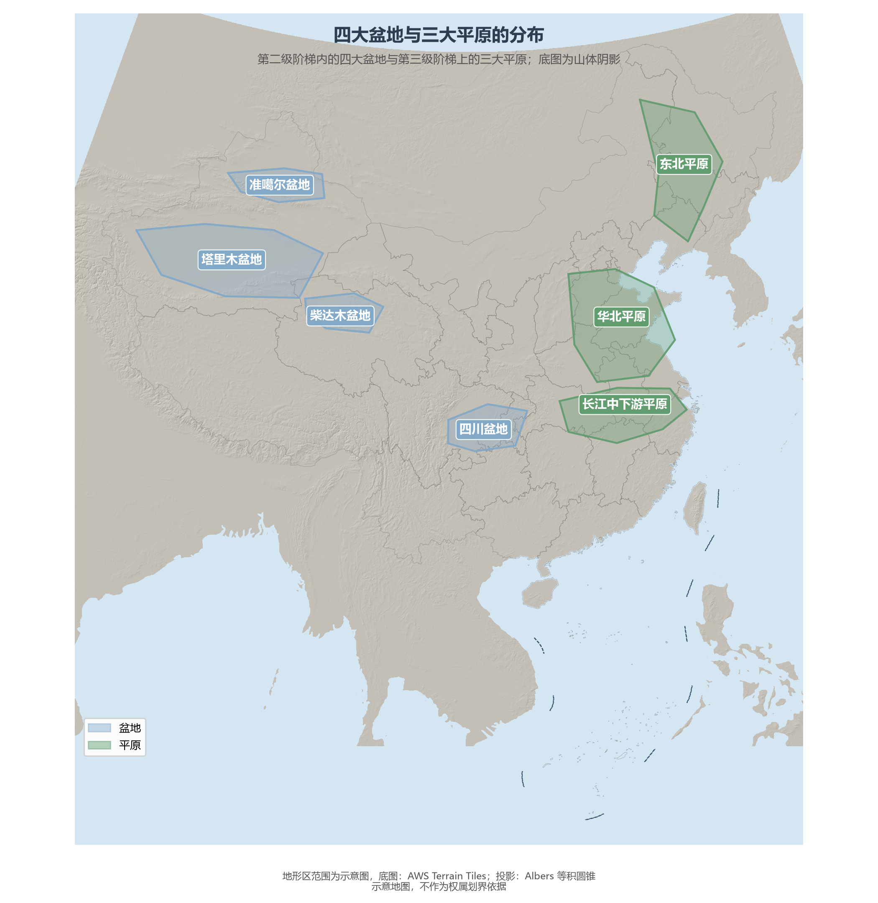

# 3.3 四大盆地与三大平原

如果把高原看作地形的"高原台地"，盆地与平原就是大地上的"容器"与"铺面"：四大盆地嵌在第二级阶梯内部，三大平原铺在第三级阶梯之上。七片地形区合计约 260 万 km²，是中国人口、耕地与城市最密集的承载面。

**图 3-5 四大盆地与三大平原的分布**：底图为山体阴影，色块为示意范围。

## 一、四大盆地：深居内陆的"大容器"

| 盆地 | 面积（约） | 海拔 | 一句话画像 |
|------|-----------|------|-----------|
| 塔里木盆地 | 50 余万 km² | 800—1 300 m | 中国最大盆地，中央是中国最大沙漠 |
| 准噶尔盆地 | 38 万 km² | 500—1 000 m | 纬度最高，西北侧有缺口、降水稍多 |
| 柴达木盆地 | 25 万 km² | 2 600—3 000 m | 海拔最高的盆地，"聚宝盆" |
| 四川盆地 | 26 万 km² | 300—700 m | "紫色盆地"，天府之国 |

**塔里木盆地**位于天山与昆仑山之间，是世界面积最大的内陆盆地。中央的塔克拉玛干沙漠面积约 33 万 km²，是世界第二大流动沙漠；盆地年降水量不足 100 mm，但天山、昆仑山的冰雪融水在山麓滋养出一串绿洲，串起古丝绸之路的南道与北道。**准噶尔盆地**夹在天山与阿尔泰山之间，因为西北侧的山地缺口接纳了西风带的水汽，降水明显多于塔里木，古尔班通古特沙漠是中国最大的固定、半固定沙漠。**柴达木盆地**是青藏高原东北部的"盆中之盆"——海拔 2 600 m 以上的高寒荒漠盆地里藏着察尔汗等上百个盐湖，钾盐、铅锌、石油与盐湖锂资源使其得名"聚宝盆"。**四川盆地**四周环山、底部以紫色砂页岩为主，风化成肥沃的紫色土；亚热带湿润气候与都江堰水利使它自秦汉以来就是"天府之国"，如今承载着约 1 亿人口，是四大盆地中唯一以人烟稠密著称的一个。

四大盆地之外还有一个以"低"闻名的成员：吐鲁番盆地。这个天山东端的小型山间盆地，大部分地面低于海平面，其中的艾丁湖洼地低于海平面 154.31 m，是中国陆地最低点——与珠穆朗玛峰之间 9 000 余米的相对高差，正是三级阶梯之外中国地势的另一个极端注脚。

## 二、三大平原：文明的承载面

| 平原 | 面积（约） | 海拔 | 构成 |
|------|-----------|------|------|
| 东北平原 | 35 万 km² | 多在 200 m 以下 | 三江平原、松嫩平原、辽河平原 |
| 华北平原 | 30 万 km² | 多在 50 m 以下 | 黄河、淮河、海河冲积而成，又称黄淮海平原 |
| 长江中下游平原 | 20 万 km² | 多在 50 m 以下 | 江汉、洞庭湖、鄱阳湖、苏皖沿江、长江三角洲平原 |

三大平原都是河流冲积的杰作，也都写满了"人地关系"。**东北平原**是中国面积最大的平原，黑土层厚达数十厘米，是全球四大黑土区之一，如今贡献着全国约四分之一的粮食产量（见 11.2 节）；冬季漫长的严寒使作物一年一熟。**华北平原**由黄河与海河、淮河合力淤积，地面平阔、土层深厚，是小麦与玉米的主产区，却也是全国人均水资源最紧张的地区之一（见 6.4 节）。**长江中下游平原**地势最低平，河湖密布如网——洞庭湖、鄱阳湖、太湖散布其间，素有"水乡泽国""鱼米之乡"之称，稻田与淡水渔业的历史都在三千年以上。

## 三、世界视角：平原即人口

把人口密度地图与地形图叠在一起，规律几乎无需解释：世界人口最稠密的十片区域，九片位于大河冲积平原或三角洲——恒河平原、尼罗河三角洲、湄公河三角洲，以及中国的华北与长江中下游。中国三大平原合计约 85 万 km²，只占全国陆地面积的 9%，却承载了全国约一半的人口。平原是文明的底盘，也是被占用最快的土地——三大平原同时是全国建设扩张最快的区域，这正是 6.3 节耕地保护制度要面对的矛盾。

## 参考与数据来源

1. 面积与海拔：通行地理教材口径（塔里木盆地约 50 余万 km²、东北平原约 35 万 km²、华北平原约 30 万 km²、长江中下游平原约 20 万 km² 等）。
2. 塔克拉玛干沙漠面积：中国科学院新疆生态与地理研究所公开数据（约 33 万 km²）。
3. 底图：AWS Terrain Tiles；地形区范围为示意勾绘。
