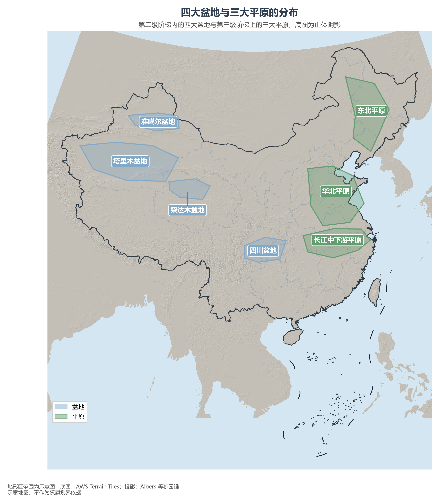

# 3.3 四大盆地与三大平原

如果把高原看作大地抬升的“高地台面”，盆地与平原就是地壳构造运动与外力沉积合力塑造的“超级容器”与“辽阔铺面”：四大盆地深嵌在第二级阶梯与第一级阶梯交汇处，三大平原舒展于第三级阶梯的东部滨海与大河下游。七大单元合计面积近 260 万 km²，承载了全国 65% 以上的耕地面积与超过 60% 的常住人口，是中国地质构造、自然资源富集与华夏农业文明、现代工业城市群最核心的地理底盘。

**图 3-5 四大盆地与三大平原的分布**：底图为山体阴影，四大盆地嵌入第二级阶梯，三大平原舒展于第三级阶梯，构成中国最具承载力的几何空间。

---

## 一、四大盆地：内陆深处的地质容器与资源宝库

中国的“四大盆地”形态各异、生境迥绝。除柴达木盆地高踞青藏高原东北部（第一级阶梯内部）之外，塔里木、准噶尔与四川盆地均坐落在第二级阶梯，且被高耸的阿尔泰山、天山、昆仑山、祁连山、秦岭、大巴山等环抱。四周山岭的强烈阻隔，赋予了盆地极其独特的小气候环流、水系汇流机制以及深层油气矿产富集规律。

| 盆地名称 | 所在阶梯 | 面积（约） | 基底海拔 | 地候与植被特征 | 典型地貌内核 | 核心战略资源与经济地位 |
|:---|:---|:---|:---|:---|:---|:---|
| **塔里木盆地** | 第二级阶梯 | 53 万 km² | 800—1 300 m | 极端干旱温带大陆性气候；荒漠与绿洲灌丛 | 塔克拉玛干沙漠（33.7 万 km² 流动沙丘）、山前洪积扇绿洲 | 中国最大内陆盆地；西气东输主力气源地（富满/顺北超深层油气）、优质商品棉与林果基地 |
| **准噶尔盆地** | 第二级阶梯 | 38 万 km² | 500—1 000 m | 中温带干旱半干旱气候；受西风水汽滋润 | 古尔班通古特沙漠（4.88 万 km² 固定/半固定沙漠）、风蚀雅丹 | 克拉玛依油田、准东巨型煤田；天山北坡城市带与绿洲现代农业灌溉区 |
| **柴达木盆地** | 第一级阶梯 | 25.7 万 km² | 2 600—3 000 m | 高原高寒干旱气候；高寒荒漠、盐滩与风蚀丘陵 | 察尔汗等巨型盐湖群、雅丹地貌、荒漠戈壁 | “高原聚宝盆”；国家战略级钾盐、盐湖锂、硼、镁产业基地，青藏交通大枢纽 |
| **四川盆地** | 第二级阶梯 | 26 万 km² | 300—700 m | 亚热带季风性湿润气候；常年多雾阴湿、少日照 | 紫色砂页岩丘陵、川东平行岭谷、成都冲积平原 | “天府之国”；全国最稠密人口承载区（近 1 亿人），成渝地区双城经济圈，粮食与天然气基地 |

### 1. 塔里木盆地：克拉通腹地的巨型沙海与绿洲链

塔里木盆地位于天山与昆仑山、阿尔金山之间，东西长约 1 500 km，南北宽约 600 km，面积达 53 万 km²，是**世界面积最大的封闭内陆盆地**。

- **构造基底与油气突破**：盆地基底为古老的塔里木克拉通板块，历经多期构造挤压与巨厚沉积，深层油气成藏条件极优。近年来，中国石油与中国石化在此攻克了 8 000—9 000 m 超深层油气勘探开采极限（如富满油田、顺北油气田“地下珠峰”工程），成为国家“西气东输”工程最关键的气源大动脉源头。
- **沙海与生命长廊**：盆地腹地分布着面积达 33.76 万 km² 的**塔克拉玛干沙漠**（占全盆地面积近 64%），流动沙丘面积占 85% 以上，流动沙丘高大且常呈新月形沙丘链与金字塔沙丘展布。年降水量普遍不足 50 mm，局部甚至不足 10 mm，而潜在蒸发量高达 2 500—3 000 mm。
- **高山冰雪融水与绿洲走廊**：环抱盆地的天山与昆仑山脉冰川积雪融水汇入，孕育了中国最长的内流河——**塔里木河**（干流全长 1 321 km，流域全长 2 486 km）。高山融水流出山口后在山前倾斜平原下渗形成潜水，在冲积平原前缘溢出形成环状串珠式绿洲，滋养了阿克苏、喀什、和田、库尔勒等绿洲城市。环盆地绿洲沿古丝绸之路南道与北道分布，如今建成了格库铁路与和若铁路，形成了全球首条环沙漠闭环铁路线。

### 2. 准噶尔盆地：西风惠顾的半封闭盆地

准噶尔盆地夹于天山北坡与阿尔泰山之间，平面呈朝向西北开口的不规则三角形，面积约 38 万 km²。

- **西风气流的馈赠**：准噶尔盆地地势由东向西微倾，海拔 500—1 000 m。其西北边缘的阿尔泰山前与准噶尔西部界山存在诸多山地垭口与河谷缺口（如阿拉山口、额尔齐斯河谷）。大西洋与北冰洋南下的湿润西风气流由此长驱直入，年降水量达 150—250 mm，天山北坡迎风坡降水甚至可达 400—600 mm，使准噶尔盆地比塔里木盆地明显湿润。
- **固定沙海与风蚀雅丹**：盆地中央为**古尔班通古特沙漠**（面积约 4.88 万 km²），是中国最大的固定与半固定沙漠。得益于较为充沛的降水与冬季稳定积雪，沙丘表面广泛覆盖着梭梭、白梭梭等耐旱灌木及早春短命植物群落，植被盖度达 15%—25%。此外，盆地边缘乌尔禾等地受强劲西北风与间歇流水雕琢，发育成形态各异的风蚀雅丹群（“魔鬼城”）。
- **产业聚集高地**：盆地孕育了克拉玛依油田与准东煤田，天山北坡由于水源相对丰富，形成了集聚石河子、奎屯、昌吉等城市的“天山北坡经济带”，棉花机械化采摘、高产玉米和加工番茄享誉全国。

### 3. 柴达木盆地：高寒天境上的“聚宝盆”

柴达木盆地坐落于青藏高原东北缘，四周为阿尔金山、祁连山与昆仑山所环抱，平均海拔 2 600—3 000 m，面积约 25.7 万 km²。

- **高寒内陆盆地**：与其它三个位于第二阶梯的盆地截然不同，柴达木属于典型的高原盆地，内部年降水量自东南向西北由 200 mm 递减至不足 20 mm，蒸发量高达 2 000—3 000 mm，属极端干旱的大陆性高寒气候。
- **盐湖矩阵与资源底气**：由于新生代地层断陷与第三纪以来湖泊不断退缩蒸发，地表留下了察尔汗盐湖、大柴旦盐湖、一里坪盐湖、西台吉乃尔等大小上百个干盐湖和卤水湖。其中**察尔汗盐湖**面积达 5 856 km²，是中国最大的可溶性钾镁盐矿床，氯化钾储量占全国总量的 80% 以上，是保障国家粮食化肥自主可控的命脉基地。伴随新能源产业爆发，盆地内超大规模的盐湖提锂与硼、镁、溴开采，使柴达木成为名副其实的新能源资源保障“压舱石”。
- **极端景观**：盆地西北部广泛发育着全球规模最庞大、形态最壮观的水上雅丹与陆地风蚀戈壁垄槽，呈现荒凉壮美的“类火星地貌”。

### 4. 四川盆地：水旱从人的紫色沃土

四川盆地西依青藏高原东缘的邛崃山、大雪山，北靠大巴山与米仓山，东接巫山，南临大娄山与云贵高原，面积约 26 万 km²。

- **盆地构造与紫色土**：四川盆地是一个大型中新生代前陆沉积盆地，在地质历史上曾是一片巨大的内陆湖泊（“巴蜀湖”）。湖相沉积了深厚达数千米的白垩系与侏罗系紫红色砂岩、泥页岩。第四纪抬升侵蚀后，这些岩石极易风化，形成了富含磷、钾、钙等营养矿物元素的**紫色土**，保肥抗酸，是中国南方最具肥力的非地带性土壤。
- **三大地貌分区**：
  1. *成都平原（川西平原）*：面积约 7 300 km²，由岷江、沱江等多条河流自青藏高原东坡奔涌出山后形成的巨型复合冲积扇平原。战国李冰修建的都江堰水利工程巧妙借助地势“分流、排沙、引水”，使成都平原 2 200 多年来“水旱从人，不知饥馑”，成为闻名天下的“天府之国”。
  2. *川中丘陵*：面积达 8.4 万 km²，海拔在 300—500 m 之间，丘陵波状起伏，梯田层叠，水网细密，人口极为稠密。
  3. *川东平行岭谷*：位于华蓥山以东，由多条东北—西南走向的长条状背斜山脉与向斜谷地相间排列，是世界上最典型的隔挡式褶皱地貌之一。
- **微气候与人口极核**：四川盆地深陷山地包围中，北方冬季强冷空气难以翻越秦巴山脉，盆内气温显著高于同纬度长江中下游地区；夏季潮湿多雨，蒸发水汽不易散逸，云雾天数全国最多（年均日照不足 1 200 小时，常有“蜀犬吠日”之说）。这种优越的温湿匹配孕育了集聚近 1 亿人口的成渝城市群，是我国西南地区经济发展最强劲的动力引擎。

---

> [!NOTE]
> **陆地极低点：吐鲁番盆地**  
> 在四大盆地之外，位于天山支脉博格达山与库鲁克塔格山之间，深陷着一个面积仅约 5 万 km² 的小型山间断陷盆地——**吐鲁番盆地**。盆地底部极其低洼，大部分地面低于海平面，中央的**艾丁湖**洼地水面高程为 **-154.31 m**，是**中国陆地最低点**，也是仅次于西亚死海（约 -430 m）的世界第二低陆地。夏季地表极限温度可超 70 ℃，以“火洲”闻名于世，古代劳动人民利用山麓地下暗渠修建了上万条“坎儿井”，构筑起戈壁沙漠深处独特的绿洲节水奇迹。

---

## 二、三大平原：巨江冲积的华夏粮仓与文明主轴

中国的三大平原——东北平原、华北平原与长江中下游平原，总面积约 85 万 km²，全部分布在第三级阶梯上。它们主要是各大水系携带大量泥沙在近海地壳沉降带经过漫长地质时期堆积填平而成的冲积平原。平坦辽阔的地表、深厚肥沃的土壤、密布的水网与优越的水热条件，使三大平原成为中华文明持续繁衍与现代中国工农业发展的中枢。

| 平原名称 | 面积（约） | 平均海拔 | 主导成因与冲积水系 | 主要土壤类型 | 耕作制度与主力作物 | 水土资源瓶颈 | 核心城市群与战略定位 |
|:---|:---|:---|:---|:---|:---|:---|:---|
| **东北平原** | 35 万 km² | < 200 m | 黑龙江、松花江、嫩江、辽河冲积与漫流 | 黑土、黑钙土、草甸土（肥力极高） | 一年一熟；大豆、玉米、粳稻、春小麦 | 积温不足、春季易旱、黑土层流失退化 | 哈长城市群、辽中南工业基地；“天下粮仓”国家粮食安全最稳固压舱石 |
| **华北平原** | 30 万 km² | < 50 m | 黄河、淮河、海河合力冲积（黄河为主） | 潮土、褐土、风沙土与局部盐碱土 | 两年三熟或一年两熟；冬小麦、夏玉米、花生、棉花 | 水资源极度紧缺、地下水超采与春旱频发 | 京津冀协同发展区、中原城市群；政治文化中心与北方主粮核心产地 |
| **长江中下游平原** | 20 万 km² | < 50 m（下游 2—10 m） | 长江干支流及太湖、洞庭、鄱阳水系泛滥堆积 | 水稻土、红壤母质冲积土 | 一年两熟至三熟；双季稻、油菜、淡水渔业 | 汛期洪涝灾害频发、耕地受工业建设蚕食 | 长江三角洲城市群、长江中游城市群；全国经济活力最强、高新技术制造业枢纽 |

### 1. 东北平原：黑土沃野上的“天下粮仓”

东北平原位于大兴安岭、小兴安岭与长白山脉之间，南北长约 1 000 km，东西宽约 400 km，面积达 35 万 km²，是**中国面积最大的平原**。

- **三部组合结构**：
  1. *三江平原*：位于黑龙江、乌苏里江与松花江交汇处，地势低平，沼泽湿地广袤。新中国成立后经过大规模屯垦，曾经的“北大荒”蜕变为国家现代农业示范区“北大仓”。
  2. *松嫩平原*：由松花江与嫩江冲积而成，地势波状起伏，分布着开阔的草甸草原与广袤沃土。
  3. *辽河平原*：由辽河及其支流冲积而成，向南缓倾入渤海辽东湾，工业发达、农业密集。
- **珍稀的“耕地大熊猫”**：东北平原地处温带湿润半湿润季风区，冬季寒冷漫长，土壤微生物分解极其缓慢，枯枝落叶经过上千年转化累积，形成了有机质含量极高、团粒结构极佳的**黑土和黑钙土**，黑土层厚度达 30—100 cm，是中国乃至全球极其罕见的四大黑土带之一。
- **现代化规模大农业**：地势辽阔平坦，地块完整连片，极利于大农机集群协同作业。东北平原贡献了全国 1/4 以上的商品粮调出量，粳稻和非转基因高蛋白大豆产量全国领先，是名副其实的国家粮食安全“压舱石”。目前，针对几十年来水土流失导致的黑土层“变薄、变瘦、变硬”问题，国家已启动全面实施的黑土地保护战略与保护性耕作工程（“梨树模式”等）。

### 2. 华北平原：大河造陆与千万人口生存线

华北平原西起太行山脉，东临渤海与黄海，北界燕山，南抵桐柏山与大别山，西南与桐柏山相连，面积约 30 万 km²，又称**黄淮海平原**。

- **河流造陆的奇迹**：华北平原由黄河、淮河、海河及其支流带来极其丰富的泥沙在新生代构造沉陷盆地中长年淤积而成。其中，黄河以其世界罕见的高输沙量（历史上年均输沙超 10 亿吨）起到了无可匹敌的造陆主导作用。千百年来黄河不断改道泛滥，形成了以孟津为顶点的巨型冲积扇，并与海河、淮河冲积物相互交叠镶嵌，地势开阔平坦，绝大多数地区海拔低于 50 m。
- **地貌自西向东梯次分异**：
  - *山前洪积冲积扇平原*：分布于太行山、燕山麓前，排水良好，地下水埋藏较浅，土壤肥沃，古老名城（保定、石家庄、邯郸、安阳等）沿古驿道呈线性分布；
  - *中部泛滥冲积平原*：河渠纵横、坡降极微，微地貌洼地、决口扇密布，历史上饱受早涝、盐碱交替之苦；
  - *滨海低平原*：靠近渤海湾，地势极低，地下水矿化度高，潮间带广布盐碱荒滩。
- **水资源紧缺与现代生态修复**：华北平原土层深厚，热量充沛，光照充足，是全国最核心的冬小麦与夏玉米一年两熟区。然而，该区域人均水资源占有量不足全国平均水平的 1/6。20 世纪后半叶因超采地下水维持高密度农业灌溉，曾形成全球最大的“华北地下水降落漏斗区”。随着**南水北调中线与东线工程**全面通水，沿线大中城市生活用水全面置换，并实施常态化大河生态补水与地下水超采综合治理，使得太行山前地下水位实现历史性止跌回升。

### 3. 长江中下游平原：江南鱼米之乡与超级经济带

长江中下游平原西起巫山，东抵东海与黄海之滨，北接大别山与淮阳丘陵，南邻江南丘陵，面积约 20 万 km²。

- **串珠式串联单元**：平原沿长江干流自西向东呈狭长条带状展开，由五个次级平原串联组成：
  1. *江汉平原*：位于湖北中南部，由长江与汉江汇流泥沙充填古云梦泽而成；
  2. *洞庭湖平原*：环绕洞庭湖四周，地势低平，湘、资、沅、澧四水汇集；
  3. *鄱阳湖平原*：赣江、抚河、信江、饶河、修水汇注鄱阳湖所形成的广袤冲积平原；
  4. *苏皖沿江平原*：沿芜湖、南京至镇江之间的长江两岸狭窄冲积阶地与泛滥洲滩；
  5. *长江三角洲平原*：镇江以东至长江入海口，面积近 5 万 km²，海拔大多在 2—10 m 之间，是长江泥沙不断堆积向海延伸形成的巨型复合三角洲。
- **水网如织与“鱼米之乡”**：平原区降水量达 1 000—1 400 mm，河网密度全国第一，密集的河流、湖泊（洞庭湖、鄱阳湖、太湖、巢湖等）与人工灌渠、水塘交织成网，水体面积占陆地面积的 10%—20%。历代劳动人民修建堤防与“圩田/围垸”，稻麦轮作、水禽水产养殖高度融合，素有“熟天下”的美誉。
- **当代经济重心地图**：作为长江经济带的平原核心区，长三角城市群依托优越的江海交汇航运优势与平原腹地，集聚了中国最具创新力和竞争力的现代高科技制造集群，创造了全国近 1/4 的经济总量，实现了自然地理平原向世界级城市群经济底座的完美跨越。

---

## 三、盆地与平原：人地关系的地理辩证法

三大平原与四大盆地，集中体现了中国地理格局中“地形约束与人工重塑”的深刻辩证逻辑：

1. **“盆地藏能，平原沃农”的资源空间互补**：四大盆地深埋着煤炭、石油、天然气、钾盐与锂盐，构成了新时代中国能源与战略化工原料的“地下宝库”；而三大平原与四川盆地则贡献了中国 80% 以上的主粮产出，构筑了 14 亿人饭碗的不可撼动的“粮食安全屏障”。西气东输、西电东送、北煤南运、北粮南运等跨流域大通道，正是在盆地与平原之间纵横交错编织。
2. **“平原扩展与红线坚守”的现代空间博弈**：平原区凭借极其低廉的建设平整成本和便利交通，成为城镇化推进最迅猛的区域。大城市沿平原边缘铺展，不可避免地侵占最平整肥沃的耕地。守住 18 亿亩耕地红线、在三大平原推进永久基本农田划定与高标准农田建设，成为统筹粮食安全与新型城镇化永恒的战略定力。

---

## 参考与数据来源

1. 面积与地势高程口径：中华人民共和国自然资源部、中国地质调查局全国地貌遥感调查数据库。
2. 塔克拉玛干沙漠与古尔班通古特沙漠数据：中国科学院新疆生态与地理研究所荒漠化监测公报。
3. 超深层油气开采：中国石油塔里木油田分公司、中国石化西北油田分公司公开工程技术通报。
4. 黑土地与粮食产能：农业农村部《国家黑土地保护工程规划纲要（2021—2030年）》。
5. 底图与空间边界：AWS Terrain Tiles；地形区矢量范围依据《中国自然地理图集》综合示意绘制。
