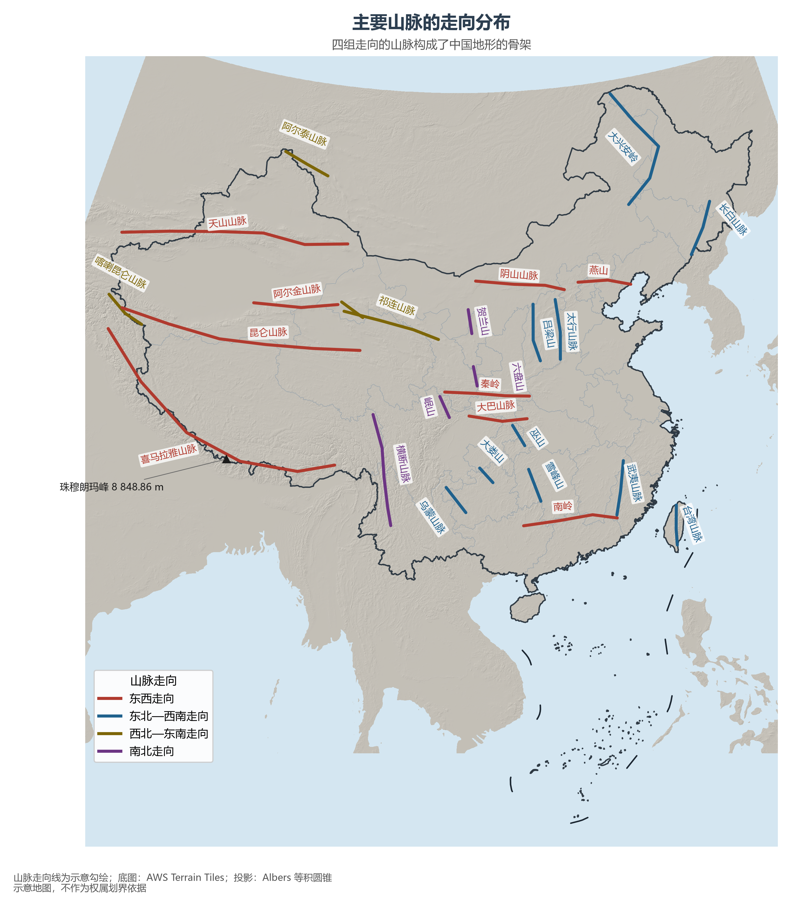
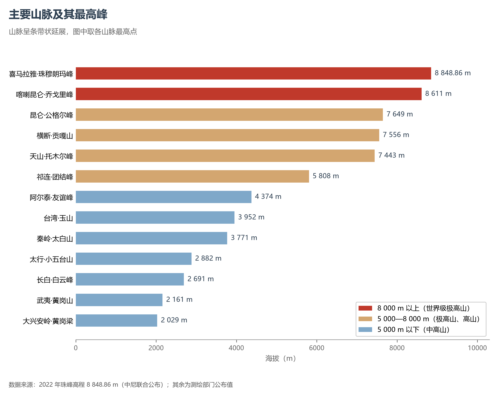

# 3.4 主要山脉体系

如果说地势三级阶梯构成了中国大地层层跌落的“宏观骨架”，那么纵横交织的一条条高大山脉，就是支撑起这个骨架的“承重梁”与“龙脉网络”。受新生代特提斯构造域强烈闭合、印度洋板块向欧亚板块东北向俯冲碰撞，以及太平洋板块西向俯冲的联合驱动，中国成为世界上构造隆升最剧烈、地壳运动最活跃的陆地大陆。

全国山地、丘陵与高原合计占陆地面积的近 70%。这些不同走向的山脉，不仅在平面上框定出一个个形态各异的盆地、高原与平原，在垂直空间上切割出巨大的起伏落差，更天然充当着季风气候的阻隔屏障、江河水系的分水岭、生态系统的庇护所，以及中华人文地理与历史政区的边界基石。

**图 3-6 主要山脉的走向分布**：四组走向以颜色区分，山脉线为示意勾绘。

---

## 一、五组走向：挤压应力场中的山体网络

地质构造力学的剪切与挤压应力场，赋予了中国山系高度规律的走向格局。按照走向特征，全国主要山脉可系统划分为五大组群：

| 走向系统 | 代表性山脉群 | 最高峰及海拔 | 地质力学成因背景 | 关键地理分水岭与分界作用 |
|:---|:---|:---|:---|:---|
| **东西走向**（纬向构造体系） | **北列**：天山山脉、阴山山脉 **中列**：昆仑山脉、阿尔金山、祁连山、秦岭、大别山 **南列**：南岭（五岭） | 托木尔峰（7 443 m） 公格尔峰（7 649 m） 太白山（3 771 m） 猫儿山（2 141 m） | 欧亚板块内部古生代—中生代多期缝合带受近南北向挤压隆升 | 划分中国南北气候带（秦岭为中国最重要的南北分界线）；南岭为长江与珠江水系分水岭；天山横亘新疆分南北疆 |
| **东北—西南走向**（环太平洋构造体系） | **西列**：大兴安岭、太行山脉、巫山、雪峰山 **中列**：长白山脉、辽东丘陵千山、武夷山脉 **东列**：台湾山脉（中央/玉山/雪山等） | 黄岗梁（2 029 m） 小五台山（2 882 m） 白云峰（2 691 m） 黄岗山（2 158 m） 玉山（3 952 m） | 太平洋板块向西俯冲导致的弧后伸展与大陆东缘挤压造山带 | **西列是第二级与第三级阶梯的宏大分界线**，也是黄土高原与华北平原、四川盆地与长江中下游的分水屏障；东列玉山为中国东部最高峰 |
| **西北—东南走向** | 阿尔泰山脉、祁连山脉、小兴安岭 | 友谊峰（4 374 m） 团结峰（5 808 m） | 中亚造山带及青藏高原北东向挤出滑移剪切 | 阿尔泰山为中国与哈、俄、蒙天然界山；祁连山为青藏高原东北边缘，河西走廊生命“水塔” |
| **南北走向**（经向构造体系） | 贺兰山、六盘山、横断山脉（沙鲁里山、大雪山、云岭等） | 贡嘎山（7 556 m） 贺兰山主峰（3 556 m） | 青藏高原物质向东逃逸受华南地块与扬子准地台阻挡而强烈向南挤出 | 横断山脉形成壮丽的“四江并流”平行岭谷与垂直自然带；贺兰山阻挡腾格里与乌兰布和沙漠东侵，维系银川平原“塞上江南” |
| **弧形走向** | 喜马拉雅山脉、喀喇昆仑山脉、冈底斯—念青唐古拉山脉 | 珠穆朗玛峰（8 848.86 m） 乔戈里峰（8 611 m） | 印度板块向北直接楔入碰撞欧亚板块的前沿锋面断裂褶皱带 | 青藏高原南部天然巨型围墙；拦截印度洋西南季风水汽，孕育全球最密集高山极峰群与现代冰川群 |

### 1. 东西走向：古老缝合带上的气候分界与文明防线

东西走向山系构成了中国大陆最古老的纬向骨架，如同三条巨大的横梁锁定了大地的经纬：

- **天山—阴山**：西段天山横亘新疆中部，东西绵延 2 500 km（中国境内约 1 700 km），将新疆截然分割为暖温带干旱的南疆（塔里木盆地）与中温带半干旱的北疆（准噶尔盆地）；东段阴山横贯内蒙古中南部，是温带草原牧区与黄土高原农耕区的生态交错带和古代长城筑造前线。
- **昆仑山—秦岭**：西起帕米尔高原，东至大别山，长达数千公里。其中，**秦岭**西起甘肃白石山，东延至豫鄂交界，犹如一道拔地而起的巨幅屏风，东西绵延 1 600 余公里，主峰太白山拔海 3 771 m。它在冬季坚决阻挡南下的西伯利亚冷空气，在夏季强行拦截北上的太平洋暖湿气流，从而造就了中国最为显著的南北气候、水文、土壤、植被与农业分界线。
- **南岭**：由越城岭、都庞岭、萌渚岭、骑田岭和大庾岭等五座山岭统称“五岭”，平均海拔在 1 000 m 左右，最高峰猫儿山海拔 2 141 m。南岭虽绝对海拔不高，但山峦叠障，是长江流域与珠江流域的分水岭，自古便是中原汉文化向岭南百越传播的天然险阻与交通孔道（如灵渠、大庾岭梅关古道）。

### 2. 东北—西南走向：阶梯分界的巨型台阶石

这组走向由三列平行展布的山脉组成，是东亚大陆岩石圈受西太平洋俯冲带影响形成的典型盆山体系：

- **西列（二、三级阶梯分界线）**：自北向南由**大兴安岭**（东北森林宝库与季风界线）、**太行山脉**（西侧为晋东南黄土高原与沁水盆地，东侧以千米断崖断裂式跌入华北平原）、**巫山**（长江在此切穿巫山形成举世闻名的长江三峡）、**雪峰山**（云贵高原向江南丘陵过渡带）组成。这道长达 4 000 余公里的山岭巨障，正是中国自然地理上最决定性的阶梯分界线。
- **中列与东列**：长白山脉呈东北走向延伸，天池为中朝界湖；武夷山脉横亘赣闽边界，是赣江水系与闽江水系的分水岭；东列的**台湾山脉**纵贯全岛，受欧亚板块与菲律宾海板块强烈挤压，地势陡峻，主峰玉山高达 3 952 m，不仅是台湾岛之巅，更是包括中国大陆东半壁在内的整个中国东部第一高峰。

---

## 二、巅峰对话：全球 14 座 8000 米级极高峰与中国名山极高点

**图 3-7 主要山脉及其最高峰海拔**：8 000 m 级的极高峰全部集中在喀喇昆仑与喜马拉雅两大弧形山脉，体现了新生代青藏高原板块碰撞的无双力量。

### 1. 8000 米极高峰：地球第三极的耸立

全球海拔超过 8 000 米的极高峰共有 14 座，全部坐落于喜马拉雅山脉和喀喇昆仑山脉之中。受控于印度板块每年约 40—50 mm 向北与欧亚板块的汇聚挤压，这一区域隆升速率惊人，**其中有 9 座位于中国国界线上或完全位于中国境内**：

| 山峰名称 | 海拔高程 | 所属山系 | 地理区位 / 边境归属 | 攀登与地学特殊性 |
|:---|:---|:---|:---|:---|
| **珠穆朗玛峰** | **8 848.86 m** | 喜马拉雅山脉 | 中国西藏定日县 / 尼泊尔界峰 | **世界第一高峰**；2020年中尼联合精确测定雪面高程，地质年抬升率约 4 mm |
| **乔戈里峰 (K2)** | **8 611 m** | 喀喇昆仑山脉 | 中国新疆叶城县 / 巴基斯坦界峰 | **世界第二高峰**；地形陡峭、气候极其恶劣，被称为“野蛮巨峰”，攀登致死率极高 |
| **洛子峰** | 8 516 m | 喜马拉雅山脉 | 中国西藏定日县 / 尼泊尔界峰 | 世界第四高峰；北侧有巨大的洛子壁，与珠峰以南坳相连 |
| **马卡鲁峰** | 8 463 m | 喜马拉雅山脉 | 中国西藏定日县 / 尼泊尔界峰 | 世界第五高峰；峰体巨大呈巨型金字塔形，冰川裂隙极其发育 |
| **卓奥友峰** | 8 201 m | 喜马拉雅山脉 | 中国西藏定日县 / 尼泊尔界峰 | 世界第六高峰；常作为高海拔商业登山和科学科考的重要基地峰 |
| **希夏邦马峰** | **8 027 m** | 喜马拉雅山脉 | **中国西藏聂拉木县（全境）** | **全球 14 座 8 000 m 级高峰中，唯一一座完全位于中国境内的极高峰** |
| **加舒尔布鲁木 I 峰** | 8 068 m | 喀喇昆仑山脉 | 中国新疆叶城县 / 巴基斯坦界峰 | 世界第十一高峰（隐峰），喀喇昆仑山脉第二高峰 |
| **布洛阿特峰** | 8 051 m | 喀喇昆仑山脉 | 中国新疆叶城县 / 巴基斯坦界峰 | 世界第十二高峰（宽峰），与 K2 仅相距 8 公里 |
| **加舒尔布鲁木 II 峰** | 8 035 m | 喀喇昆仑山脉 | 中国新疆叶城县 / 巴基斯坦界峰 | 世界第十三高峰，喀喇昆仑山脉冰川群的核心汇流区 |

### 2. 区域标志性山峰与相对高差奇观

除了 8 000 m 级峰，中国各大地理单元的最高峰同样代表了极其壮观的地貌断代：

- **贡嘎山（7 556 m，横断山脉/大雪山）**：被称为“蜀山之王”。贡嘎山东坡垂直切入大渡河河谷（海拔约 1 300 m），在不足 30 km 的水平距离内，**相对高差超过 6 200 m**，造就了全球陆地上最为陡峻的自然落差和最完整的从亚热带常绿阔叶林到极高山永久冰雪带的垂直生态谱带。
- **托木尔峰（7 443 m，天山山脉）**：天山最高峰，位于中国新疆阿克苏温宿县，是中亚内陆干旱区冰川分布最密集的大山核，也是世界游离于极高纬度之外罕见的超高冰峰。
- **太白山（3 771 m，秦岭山脉）**：秦岭主峰，高拔于关中平原渭河谷地之上，“太白积雪六月天”，是我国青藏高原以东大陆部分第一高峰。
- **神农顶（3 106.2 m，大巴山脉/神农架）**：华中第一高峰，有“华中屋脊”之称，是第三纪古老孑遗动植物的避难方舟。

---

## 三、山脉即分界：中国地理的天然控制网

在中国的地理认知系统中，山脉不仅是海拔的凸起，更是所有自然要素与人文格局的分野线。记忆并理解以下核心山脉的分界功能，是把握全书后续各章节的关键钥匙：

| 山脉名称 | 宏观地形区界线 | 气候与干湿区分界 | 流域分水岭 | 历史人文与生态屏障 |
|:---|:---|:---|:---|:---|
| **秦岭** | 南方地区 与 北方地区 | 暖温带 与 亚热带（1月0℃等温线）；湿润区 与 半湿润区（800mm等降水量线） | 长江流域 与 黄河流域 | 水田稻作 与 旱地麦作界线；南船北马传统交通界线；大熊猫、朱鹮核心栖息地 |
| **大兴安岭** | 内蒙古高原 与 东北平原；第二阶梯 与 第三阶梯 | 季风区 与 非季风区（400mm等降水量线）；半湿润区 与 半干旱区 | 黑龙江水系（松花江/嫩江）与 内流区呼伦贝尔水系 | 农耕文化 与 游牧/渔猎文化界线；大兴安岭针叶林北方林海防风固沙屏障 |
| **太行山脉** | 黄土高原 与 华北平原；第二阶梯 与 第三阶梯 | 季风迎风坡多地形雨，背风坡干旱少雨 | 黄河干流（汾河水系）与 海河水系各支流 | 历史上“天下九塞”之一；华北抗日根据地天然堡垒；断裂带陡崖地貌 |
| **巫山** | 四川盆地 与 长江中下游平原；第二阶梯 与 第三阶梯 | 阻滞东部湿润气流长驱直入，形成长江峡谷微气候 | 长江干流深切（瞿塘峡、巫峡、西陵峡） | “巴蜀文化”与“荆楚文化”地理分野；三峡水利枢纽与防洪中枢地带 |
| **南岭** | 江南丘陵 与 华南两广丘陵 | 中亚热带 与 南亚热带界线；冬季阻挡冷空气南侵 | 长江水系（湘江、赣江）与 珠江水系（西江、北江） | 中原农耕区与岭南海洋商贸文化界线；古代南北五大驿道孔道 |
| **贺兰山** | 内蒙古高原 与 宁夏平原（黄土高原西北角） | 季风区与非季风区边缘；极端干旱荒漠与干草原界线 | 黄河干流水系 与 西北阿拉善内流区 | 抵挡乌兰布和、腾格里沙漠东移侵吞，造就“塞上江南”银川平原沃土 |
| **祁连山** | 青藏高原东北缘 与 河西走廊（内蒙古高原） | 高原高寒区 与 西北温带干旱荒漠区界线 | 柴达木内流水系、青海湖水系 与 黑河、石羊河、疏勒河等河西内流河 | 河西走廊粮果基地的“生命水源母体”；丝绸之路河西咽喉命脉 |
| **武夷山** | 江南丘陵（赣江流域）与 浙闽丘陵（闽江流域） | 阻挡冬季偏北气流越海，保护福建沿海温湿 | 鄱阳湖赣江水系 与 闽江水系 | 世界文化与自然双重遗产；大红袍武夷岩茶发祥地；东亚生物基因库 |

---

## 四、世界视角：大陆碰撞造山带的活态标本

从全球构造地貌视角审视，中国是世界上最典型的**陆—陆碰撞活跃造山带国家**。

1. **碰撞隆升与全球对比**：
   - 相比于北美落基山脉（古老平缓的板块俯冲地体）、南美安第斯山脉（大洋板块向大陆板块俯冲形成的火山弧型山脉）以及欧洲阿尔卑斯山脉（碰撞相对缓和且已趋于相对成熟剥蚀），中国的喜马拉雅—横断山脉与青藏高原周边造山带展现出**最高的隆升速率、最深的构造下切深度、最密集的活动断裂带与最频繁的强震发生率**。
2. **超级工程挑战与技术突破**：
   - 这一年轻、陡峻、活跃的山脉体系，在赋予中国无与伦比的丰富水能资源（见 5.2 节）和立体生态景观的同时，也构成了交通基础设施建设最严酷的物理制约。中国在青藏铁路、雅万高铁、川藏铁路（隧道占比超 80%，穿越数十条大活动断裂带和地热、岩爆、大落差地质带）中创造的桥隧建设工程奇迹，正是在直面并战胜这种极端山地挑战中铸就的全球典范。

---

## 参考与数据来源

1. 珠穆朗玛峰及各大名山高程：中华人民共和国自然资源部、国家测绘地理信息局权威测绘数据（2020年珠峰雪面高程 8 848.86 m）。
2. 全球 14 座 8 000 米级高峰坐标及数据：国际登山联合会（UIAA）与中国登山协会档案记录。
3. 板块力学机制与山脉走向分类：中国地质调查局《中国区域地质志》、任美锷《中国自然地理纲要》。
4. 地理界线综合指标：中国科学院地理科学与资源研究所生态地理分区数据库。
5. 底图与空间走向：AWS Terrain Tiles；山脉走向为根据构造线与主山脊示意勾绘。
