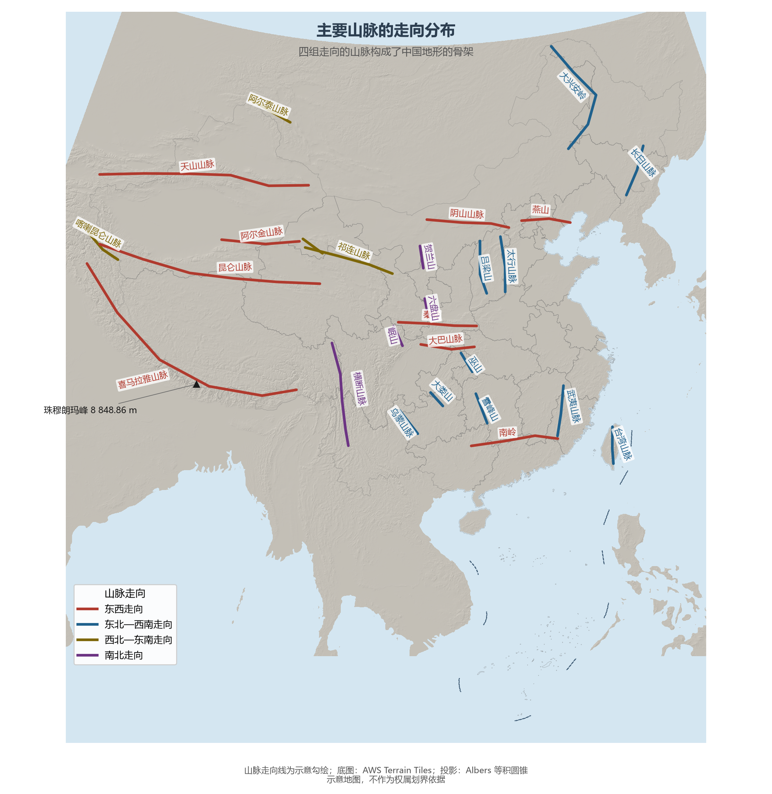
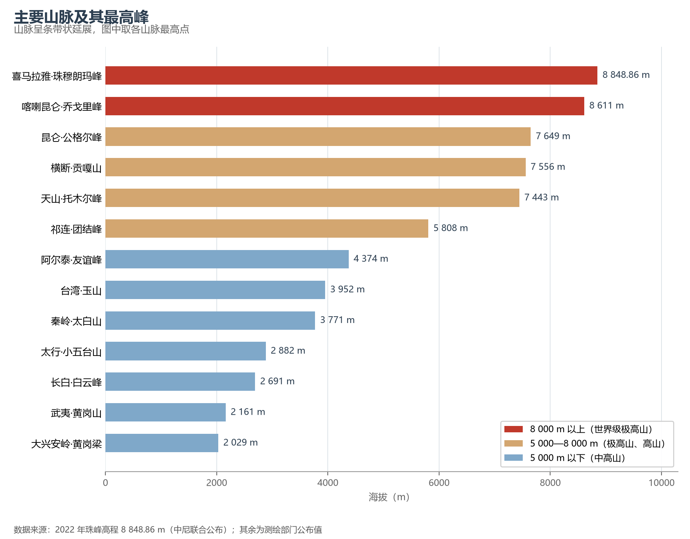

# 3.4 主要山脉体系

如果说三级阶梯是地形的"骨架层次"，山脉就是骨架本身。中国的山脉按走向可分为四组：东西走向、东北—西南走向、西北—东南走向与南北走向，它们相互交织，把国土分割成高原、盆地与平原，也充当着一条条天然的地理分界线。

**图 3-6 主要山脉的走向分布**：四组走向以颜色区分，山脉线为示意勾绘。

## 一、四组走向，四种成因

- **东西走向**（天山—阴山、昆仑山—秦岭、南岭）：最古老的一组，多由古板块缝合带挤压而成。它们恰好把中国分成大致平行的纬向条带——秦岭更是全国最重要的地理分界线：1 月 0 ℃ 等温线、800 mm 等降水量线、暖温带与亚热带的分界都沿它展开（见第 4 章）。
- **东北—西南走向**（大兴安岭—太行山—巫山—雪峰山，长白山—武夷山，台湾山脉）：太平洋板块俯冲影响下的新生代隆起，构成第二、三级阶梯的界线与东部边缘山地。
- **西北—东南走向**（阿尔泰山、祁连山）：西北边疆的"斜向骨架"，祁连山是河西走廊的"水塔"。
- **南北走向**（横断山、贺兰山、六盘山）：集中于两个枢纽地带——横断山脉在青藏高原东缘平行排列、大江深切，是"山即是谷、谷即是山"的平行岭谷世界；贺兰山—六盘山则纵贯宁夏、陕甘，与秦岭相接构成"南北地震带"的构造背景。
- **弧形走向**（喜马拉雅山脉）：世界上最高峻的山系，绵延约 2 400 km、平均海拔超过 6 000 m，呈向南凸出的大弧形展布在青藏高原南缘，是全球 14 座 8 000 m 级高峰中最集中的山脉。

## 二、极点：珠穆朗玛峰

喜马拉雅山脉中、尼边境上的珠穆朗玛峰是世界最高峰。2020 年 12 月，中尼两国联合公布其最新雪面高程为 **8 848.86 m**。它仍在以每年数毫米的速度继续抬升——板块碰撞尚未停止。8 000 m 级的高峰全部集中在中国西部边陲：喀喇昆仑山脉主峰乔戈里峰（8 611 m）是世界第二高峰；横断山脉最高峰贡嘎山（7 556 m）以东坡 6 000 余米的落差俯瞰成都平原，是世界相对高差最大的山峰之一；天山最高峰托木尔峰（7 443 m）守着中亚的雪线，祁连山最高峰团结峰（5 808 m）则是河西走廊众河之源。在东部，台湾岛的玉山（3 952 m）是中国东部最高峰，秦岭主峰太白山（3 771 m）扼守着南北方分界线的最高点。

**图 3-7 主要山脉及其最高峰海拔**：8 000 m 级的山峰全部集中在喀喇昆仑与喜马拉雅两大山脉。

## 三、山脉即分界

把主要山脉的走向线与后面各章的地图对照，会发现山脉就是中国地理的"目录"：大兴安岭划分季风区与非季风区、内流区与外流区；阴山划分内蒙古草原与黄土农耕区；秦岭划分南与北；南岭划分长江流域与珠江流域；太行山划分黄土高原与华北平原；巫山划分四川盆地与长江中下游平原；武夷山划分赣江流域与东南沿海。记住这张山脊网络，后面每一章的分区逻辑都会迎刃而解。

## 四、世界视角：褶皱带上的国家

中国是世界上最典型的"大陆碰撞型"山地国家：全球 14 座 8 000 m 以上高峰中有 9 座位于中国边境线上或中国境内（喜马拉雅与喀喇昆仑），全国山地、丘陵与高原合计占陆地面积的三分之二，"山地大国"是比"人口大国"更少被提及的基本国情。相比之下，美国本土以平原山地相间为主，俄罗斯以低平的西伯利亚为主体。山多、山高、山新（喜马拉雅仍在生长），决定了中国耕地比例低（6.1 节）、水能丰富（5.2 节）、交通成本高（12.1 节）这三个贯穿全书的事实。

## 参考与数据来源

1. 珠穆朗玛峰高程：2020 年 12 月中尼联合公布雪面高程 8 848.86 m；其余山峰海拔为通行测绘口径。
2. 山脉走向分类：通行地理教材口径；走向线为示意勾绘。
3. 底图：AWS Terrain Tiles。
