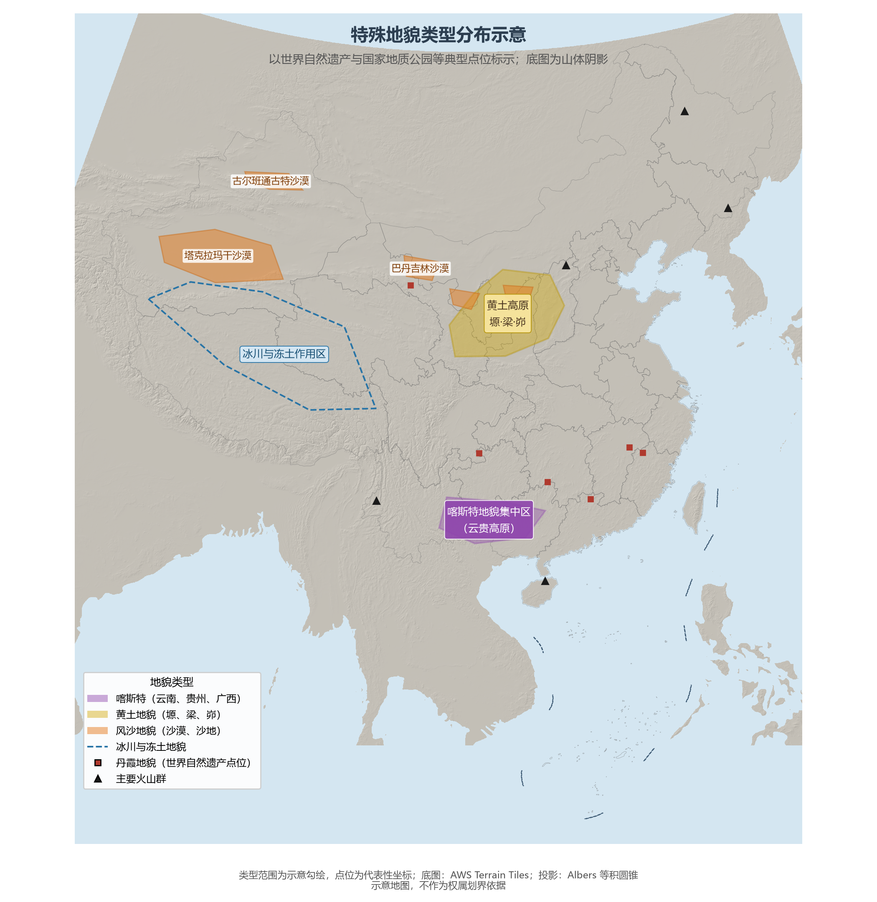

# 3.5 特殊地貌与地质景观

常规的地形分类之外，中国还有一组由特殊外力塑造、并以独特景观闻名的地貌家族：水的溶蚀造就喀斯特，风的搬运造就沙漠与雅丹，流水与暴雨雕刻黄土，高寒塑造冰川冻土，地球内部的力量则留下火山。它们多数分布在经济版图的边缘，却贡献了中国世界自然遗产的绝大部分。

**图 3-8 特殊地貌类型分布示意**：类型范围为示意勾绘，点位选取世界自然遗产等代表性坐标。

## 一、喀斯特地貌：水的雕刻

碳酸盐岩在含 CO₂ 的水中被缓慢溶解，形成峰林、峰丛、洼地、溶洞与地下暗河——这就是喀斯特（岩溶）地貌。中国的碳酸盐岩出露面积约 130 万 km²（含埋藏区则超过 200 万 km²），以云贵高原与广西为核心，是全球喀斯特发育最典型、最连续的区域。2007 年与 2014 年，"中国南方喀斯特"分两期列入《世界遗产名录》（云南石林、贵州荔波、重庆武隆；广西桂林、贵州施秉、重庆金佛山、广西环江）。峰丛洼地发育到极处便是天坑——重庆奉节小寨天坑深 662 m，是世界上最大的天坑。喀斯特地区的特殊矛盾是"地表水贵如油、地下水滚滚流"——雨水沿溶隙漏入地下河，工程与农业都要绕开这片看不见的水系。

## 二、丹霞地貌：红层的陡崖

红色砂砾岩层在流水切割与重力崩塌下形成"顶平、身陡、麓缓"的方山与石峰，即丹霞地貌——其名称即来自 1928 年地质学家冯景兰在粤北丹霞山的研究命名。中国的红层盆地遍布南方，2010 年"中国丹霞"（广东丹霞山、江西龙虎山、湖南崀山、贵州赤水、福建泰宁、浙江江郎山）整体列入世界遗产。丹霞与喀斯特同属湿润区的造型地貌，一个以"红"著称，一个以"青"闻名，常在同一省份内遥相对望。

## 三、风沙与雅丹：风的塑造

西北内陆年降水量不足 200 mm，风力成为主导外力。风积地貌表现为塔克拉玛干、古尔班通古特等大沙漠与新月形沙丘链；风蚀地貌则以罗布泊北缘的雅丹群为代表——垄槽相间的"魔鬼城"是古湖相地层被定向大风刻蚀的产物。风沙地貌同时是荒漠化的主战场（见 7.2 节），防沙治沙工程（如塔里木沙漠公路的草方格固沙）已成为世界规模的治沙实践。

## 四、黄土地貌：暴雨与粉尘的合谋

黄土高原的塬、梁、峁（见 3.2 节）是风力堆积与流水侵蚀的接力作品。黄土垂直节理发育，窑洞、夯土长城与"沟壑纵横"的景观同出一源。它也是中国水土保持研究一百年的主试验场——从 1930 年代的考察到今天的淤地坝体系与退耕还林。

## 五、冰川冻土与火山：高寒与地下之火

青藏高原及天山发育现代冰川 4.6 万余条，面积近 6 万 km²，是亚洲水塔的固体水库；高寒区之下是广达 200 余万 km² 的多年冻土，青藏铁路的建设难题大多源于此。火山地貌集中在东北（长白山天池火山、五大连池）、云南腾冲与海南琼北，多为休眠火山——五大连池的熔岩台地与堰塞湖形成于 1719—1721 年老黑山、火烧山两座火山的喷发，是中国年代最新的火山地貌之一；长白山天池火山在清代仍有喷发记录。五大连池、长白山等已是世界地质公园。截至 2026 年，中国拥有的联合国教科文组织世界地质公园达 51 处，居世界首位。

## 参考与数据来源

1. 喀斯特出露面积：中国地质调查局公开数据。
2. 世界自然遗产与地质公园名录：联合国教科文组织（UNESCO）公布名单（截至 2026 年）。
3. 冰川条数与面积：中国科学院寒区旱区环境与工程研究所《中国冰川目录》统计。
4. 底图：AWS Terrain Tiles；类型范围为示意勾绘。
