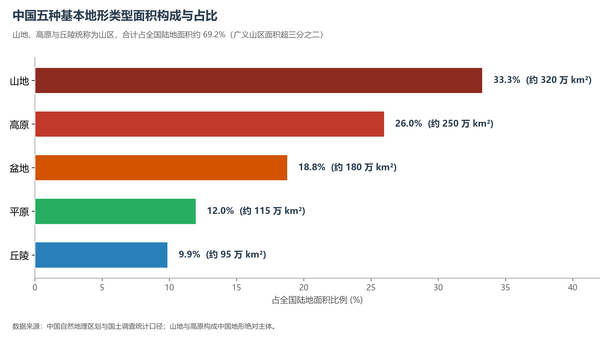
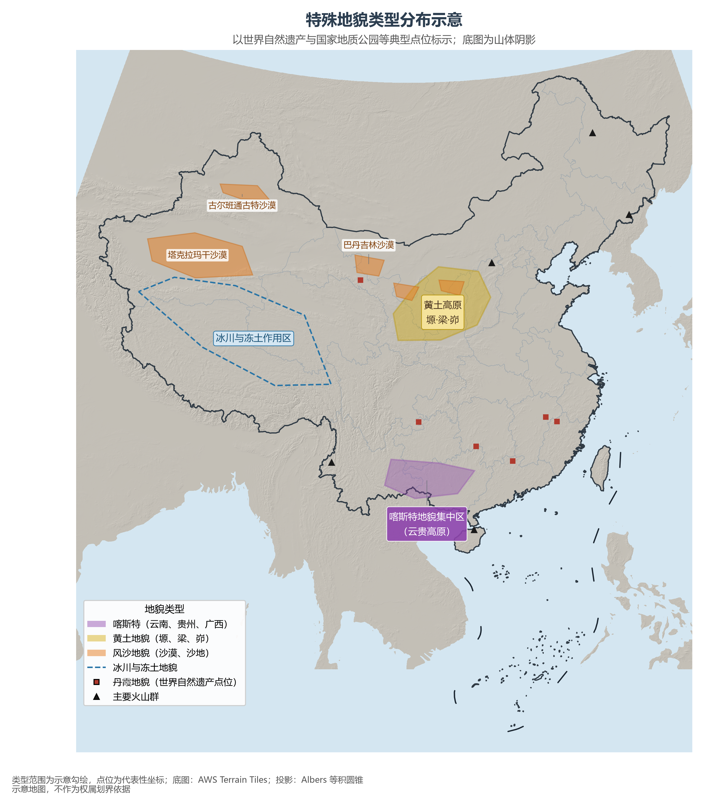
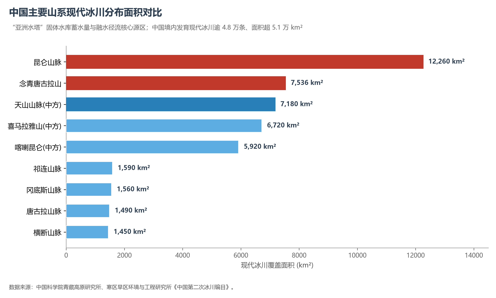

# 3.5 特殊地貌与地质景观

在三级阶梯、四大高原、四大盆地、三大平原与纵横山系的常规宏观地形框架之下，中国幅员辽阔的疆土在内外营力的极致交响中，发育出一系列形态奇异、成因复杂、举世罕见的特殊地貌地质奇观。水流溶蚀出幽深莫测的喀斯特暗河与峰林，大风与烈日磨蚀出广袤沙海与苍凉雅丹，暴雨在巨厚粉尘层上撕扯出千沟万壑的黄土沟壑，严寒与高海拔积聚起滋养百川的现代冰川与多年冻土，而地球内部炙热的岩浆则喷涌出千姿百态的火山熔岩。

**图 3-9 全国五种基本地形类型面积构成**：山地（33.3%）、高原（26.0%）、盆地（18.8%）、平原（12.0%）、丘陵（9.9%），山地与高原占据国土近六成。

这些特殊地貌不仅构成了中国最具辨识度的地学景观骨架，孕育了全国绝大多数联合国教科文组织世界自然遗产和世界地质公园，更深刻塑造了不同区域的土壤特质、水资源赋存形式与生态承载极限。

**图 3-8 特殊地貌类型分布示意**：类型范围为示意勾绘，点位选取世界自然遗产等代表性坐标。

---

## 一、喀斯特地貌（岩溶）：水与石灰岩的亿年溶蚀奇迹

喀斯特（Karst，地质学称**岩溶**）是可溶性岩石（主要为石灰岩、白云岩等碳酸盐岩）受到含有二氧化碳的地表水和地下水溶蚀、侵蚀以及重力崩塌、钙华沉淀所形成的各种地貌形态的总称。

| 演化阶段 / 地貌形态 | 核心形态特征 | 典型发育地区与代表景点 | 地理学机制与水文意义 |
|:---|:---|:---|:---|
| **溶沟、石芽、石林** | 地表岩石沿节理面溶蚀裂开，石柱林立，高数米至数十米 | 云南昆明石林（世界自然遗产） | 喀斯特发育初始阶段，雨水沿碳酸盐岩垂直裂隙强烈溶蚀下切 |
| **峰丛洼地 / 盲谷** | 基部基岩相连、上部分离成簇的高耸石峰，簇间封闭洼地深度达百米 | 贵州荔波、贵州平塘、广西环江 | 地下水位深埋，垂直向下强溶蚀；平塘大窝凼为中国天眼（FAST）天然选址 |
| **天坑（巨型岩溶漏斗）** | 深度与口径超百米、四周陡崖环绕的巨型陷坑，底部常通暗河 | 重庆奉节小寨天坑（深 662 m，世界最大）、广西乐业天坑群 | 地下巨型溶洞大厅受地下河长期冲刷淘空，顶部岩层发生剧烈重力巨型崩塌 |
| **峰林谷地与孤峰残丘** | 石峰孤立挺立于宽广冲积平原之上，基部互不相连，奇峰倒影 | 广西桂林漓江两岸、阳朔峰林、贵州万峰林 | 喀斯特演化成熟晚期，地下河演变为地表河，侧向溶蚀与河流漫流堆积占优 |
| **地下溶洞与暗河系统** | 地下数层连通的宏大空腔，发育石钟乳、石笋、石柱、地下瀑布 | 贵州绥阳双河洞（亚洲第一长洞，已探明超 400 km）、织金洞 | 地下水在承压与无压状态下长年沿层理溶蚀流淌，形成立体隐秘水网 |
| **高寒钙华梯池（沉积地貌）** | 泉水出露后温度升高、压力降低释放 CO₂，碳酸钙沉淀为阶梯彩池 | 四川黄龙、九寨沟（高寒喀斯特） | 特殊的低温水化学沉淀，梯级边石坝与清澈碧水构成高原人间瑶池 |

- **全球分布核心**：中国碳酸盐岩地表出露面积约 130 万 km²，若加上埋藏区则超过 200 万 km²，占全国陆地面积的 1/5 以上。其中以**云贵高原、广西西北部与湖南西南部**构成了全球面积最大、地质发育最连续完整的亚热带热带喀斯特连片区。
- **世界自然遗产“中国南方喀斯特”**：联合国教科文组织于 2007 年与 2014 年分两期将云南石林、贵州荔波、重庆武隆、广西桂林、贵州施秉、重庆金佛山、广西环江联合列入《世界自然遗产名录》，完整展示了从高原到平原连续演化的喀斯特全景序列。
- **“石漠化”矛盾与地表缺水困局**：喀斯特地区地形破碎、土层极薄（石灰岩成土速率极慢，形成 1 厘米土层往往需要上万年）。由于岩溶裂隙极其发育，降水迅速沿漏斗、落水洞渗入地下暗河，形成“**地表水贵如油、地下水滚滚流**”的严重工程性缺水；历史上过度陡坡开垦常导致水土流失殆尽、基岩大面积裸露，形成触目惊心的“石漠化”生态危机，至今仍是西南石漠化治理与生态修复的攻坚区。

---

## 二、丹霞地貌与红层景观：流血的砂岩与陡崖造型

丹霞地貌是指在中生代至新生代陆相产状平缓的厚层红色砂岩、砾岩地层（俗称“红层”）分布区，受地壳抬升、外力流水切割、重力崩塌及风化侵蚀，所形成的以“**顶平、身陡、麓缓**”为特征的方山、石墙、石柱、赤壁与峡谷地貌。

- **中国学者自主命名的地学名词**：1928 年，中国著名地质学家冯景兰在广东省北部仁化县丹霞山考察时，将这套巨厚红色砂砾岩层命名为“丹霞层”；1939 年，地质学家陈国达正式确立“丹霞地貌”这一科学术语。丹霞地貌是地质学历史上极少数由中国科学家自主发现、命名并走向世界的国际地学科普概念。
- **“中国丹霞”世界遗产**：2010 年，由广东丹霞山（成熟期）、江西龙虎山（老年期）、湖南崀山（壮年期）、贵州赤水（青年早期）、福建泰宁（青年期）、浙江江郎山（壮年晚期）联合组成的“中国丹霞”整体列入联合国《世界自然遗产名录》，全面系统地揭示了红层地貌在不同构造抬升与流水侵蚀阶段的发育演化全生命周期。
- **丹霞与彩色丘陵的区别**：大众常将甘肃张掖的“七彩丹霞”与典型南方湿润丹霞混淆。地质学上，张掖景区主体属于干旱区泥岩与粉砂岩在剧烈褶皱弯曲后出露风化形成的**彩色丘陵**（彩丘），以斑斓的弧形条带纹理见长；而真正的丹霞地貌必须具备高耸垂直的“**赤壁丹崖**”这一陡立几何要素。

---

## 三、风成与雅丹地貌：风力主宰的荒漠世界

在中国西北内陆年降水量低于 200 mm 甚至不足 50 mm 的温带大陆性极端干旱区，外力流水作用急剧退化，**风力**跃升为塑造地貌的绝对主导营力，造就了雄浑浩瀚的巨型沙漠（风积地貌）与千姿百态的雅丹残丘（风蚀地貌）。

| 地貌系统 | 营力机制与形成过程 | 空间分布与规模特征 | 代表性景观与工程现实 |
|:---|:---|:---|:---|
| **大沙漠与沙地（风积地貌）** | 强劲定向风搬运松散砂质碎屑物，在低洼避风处沉积形成流动或固定沙丘 | “八大沙漠”：塔克拉玛干、古尔班通古特、巴丹吉林、腾格里、柴达木、库姆塔格、库布齐、乌兰布和；“四大沙地”：毛乌素、浑善达克、科尔沁、呼伦贝尔 | 塔克拉玛干流动沙丘占 85%；巴丹吉林沙漠拥有海拔超 1 600 m 的“沙漠珠峰”必鲁图沙峰（相对高差 400 余米）与 140 余个沙间咸水湖群（2024年列入世界自然遗产） |
| **雅丹地貌（风蚀地貌）** | 维吾尔语“雅尔丹”（陡壁的小丘）。干涸古湖相/河流相水平泥岩砂岩地层，经长期风蚀与间歇性暴雨冲刷形成垄槽相间残丘 | 主要分布在新疆罗布泊周边、柴达木盆地中西部、准噶尔盆地乌尔禾等极端干旱干涸古湖盆区 | 罗布泊白龙堆雅丹、三垄沙雅丹；柴达木盆地东台吉乃尔湖“水上雅丹”（全球罕见湖泊浸润风蚀丘）；克拉玛依乌尔禾“魔鬼城” |
| **荒漠化防治与生态工程** | 围绕流动沙丘侵蚀道路、农田与城市展开的防风固沙与生态屏障构筑 | 三北工程生态廊道建设、塔里木沙漠公路与和若铁路沿线“绿色长廊” | “草方格沙障”（麦草扎成 1m×1m 网格固定流沙）成为享誉全球的中国治沙发明；库布齐沙漠开创全产业链光伏治沙新路径 |

---

## 四、黄土地貌：风成粉尘与暴雨冲蚀的千沟万壑

黄土地貌是在黄土高原数百米巨厚第四纪风成黄土堆积体上，受到剧烈水土流失、暴雨深切与重力塌陷共同雕琢形成的独特地貌系统。

- **黄土“风成说”的确立**：中国科学院刘东生院士等几代地学学者通过数十年的黄土古地磁、微观粒度分析与红粘土年代学测定，彻底证实了中国黄土高原是近数百万年来，在强劲冬半年西北季风吹扬下，将中亚及蒙古高原内陆荒漠戈壁剥蚀细碎的粉尘长期沉降堆积而成的**风成巨厚堆积体**。
- **典型侵蚀演化序列**：
  1. **黄土塬**：顶面平坦开阔、周边被沟壑深切环抱的巨型黄土高台阶地，如甘肃庆阳**董志塬**（面积超 700 km²，号称“天下黄土第一塬”），是黄土高原最重要的高产农耕区；
  2. **黄土梁**：塬面受暴雨径流长期深切切割后，残留下来的长条状延伸的黄土山梁；
  3. **黄土峁**：山梁进一步被横向侵蚀切断，形成的一个个孤立浑圆的馒头状穹状小丘；
  4. **千沟万壑的侵蚀沟谷**：微小的细沟、切沟最终汇成下切达百米以上的冲沟与崩塌滑坡壁，使地表呈现极其破碎的面貌。
- **黄土特性与窑洞居所**：黄土垂直节理极度发育，富含碳酸钙结核，干燥时结构致密、直立性极强，天然利于掏挖横穴式居住空间（**黄土窑洞**）；然而黄土遇水极易湿陷软化并剧烈剥落，成为导致黄河历史上泥沙淤积严重的根源，造就了当代“退耕还林”与“淤地坝拦截”综合小流域治理的宏大画卷。

---

## 五、冰川冻土与亚洲水塔：高寒地带的固态水库

**图 3-10 中国主要山系现代冰川规模对比**：昆仑山脉、念青唐古拉山脉与天山山脉为我国现代冰川主要覆盖区，储量巨大。

### 1. 现代冰川体系与类型分异

根据中国科学院寒区旱区环境与工程研究所第二次全国冰川编目，中国现有现代冰川 **48 571 条**，总面积达 **51 766 km²**，冰川储量约 **4 500 km³**，是全球中低纬度地区规模最大、最集中的现代冰川聚集区。

| 冰川类型 | 气候与水汽来源 | 冰体物理特征与运动速度 | 典型代表山脉与代表冰川 |
|:---|:---|:---|:---|
| **大陆型冰川**（亚大陆型 / 极大陆型） | 处于中亚内陆干旱区，降水补给稀少（年降水 200—500 mm） | 冰体温度极低（-5 ℃ 至 -10 ℃ 以下），积累消融缓慢，冰舌运动速度极慢，冰面纯净 | 昆仑山脉（中昆仑玉珠峰冰川）、天山山脉（托木尔峰现代冰川群、乌鲁木齐河源一号冰川）、祁连山脉（老虎沟12号冰川）、阿尔金山脉 |
| **海洋型冰川**（温性冰川） | 紧靠印度洋暖湿季风通道，高空降水量极其充沛（年降水可达 1 000—3 000 mm） | 冰体温度接近 0 ℃，补给极其强烈，消融迅速，冰川移动流速极快（年移百米以上），末端深入森林带 | 念青唐古拉山脉东段（卡钦冰川，长 35 km，面积 172 km²，中国最大海洋型冰川）、横断山脉贡嘎山（海螺沟冰川，冰瀑落差达 1 080 m）、米堆冰川 |

### 2. “亚洲水塔”的战略枢纽地位

青藏高原及其周边高耸入云的喜马拉雅、喀喇昆仑、天山、昆仑等巨型山系，因其广袤的永久积雪与冰川被国际地学界统称为**地球“第三极”**与“**亚洲水塔**”。
- 这里的固态水库直接孕育并补给着**长江、黄河、澜沧江（湄公河）、怒江（萨尔温江）、雅鲁藏布江（布拉马普特拉河）、印度河、塔里木河、阿姆河、锡尔河**等九大亚洲超级江河；
- “亚洲水塔”的径流补给维系着包括中国中下游平原、中亚中东、南亚与中南半岛在内的全球近 **20 亿人口**的饮水、粮食生产与工业能源命脉，是名副其实的亚洲大陆生态安全与地缘稳定的战略基石。

### 3. 多年冻土与高原工程极限

中国多年冻土面积达 **215 万 km²**，占国土面积的 22.4%，其中青藏高原多年冻土面积约 **106 万 km²**，是全球中低纬度海拔最高、面积最广的多年冻土带。
- 冻土表层的“活动层”具有强烈的季节性水热物理变化：夏季气温升高，活动层融化形成松软泥泞的融沉软层，承载力急剧跌落；冬季气温骤降，活动层水体结冰膨胀数倍，产生强烈的冻胀顶托破坏。
- **青藏工程的中国解法**：在修建青藏铁路与青藏公路的过程中，中国工程科技专家创造性提出了“主动降温、保护冻土”的核心理念，广泛采用**插设热棒传热技术、片石通风气冷路基、铺设保温遮阳板**以及在极不稳定的深厚不稳定冻土区采取**特长高架桥跨越（“以桥代路”）**，成功攻克了高寒多年冻土区路基沉陷破坏这一世界百年铁路建设难题。

---

## 六、火山地貌与地质公园：地球深部的活态脉动

中国虽然整体位于板块内部碰撞挤压环境，火山活动以大陆内部裂陷与深大断裂引张为主，但在东北大陆边缘、雷州半岛—海南岛以及云南横断山地热活动带，依然保留了规模宏伟、类型极其丰富的年轻火山地貌。

- **黑龙江五大连池（天然火山博物馆）**：位于黑龙江北部，由 14 座火山锥与数千平方公里黑色玄武岩台地组成。其中老黑山与火烧山最近一次爆发发生在清康熙年间（**1719—1721 年**），喷出的巨量黏稠熔岩堵塞了讷谟尔河支流白河，截断河流蓄水形成了 5 个由地下暗道连通的串珠状火山堰塞湖（五大连池）。区内完整保存着世界上最壮观的翻花熔岩、喷气锥、喷气碟、熔岩隧道、微缩火山口熔岩瀑布等火山微地貌。
- **长白山天池火山群**：天池是长白山主峰顶部的巨型火山口湖（水面海拔 2 189 m，最深处达 373 m），是中朝界湖。大约在公元 946 年（五代十国时期），长白山火山发生了全球近两千年来规模最大的爆裂式火山喷发之一（地质学称“千禧年喷发”），巨量火山灰甚至漂洋过海沉积于日本北海道；史料记载清代康熙四十一年（1702 年）仍有喷发烟尘记录，目前是一座极具地热活动特征的活跃休眠火山。
- **雷琼火山群与玛珥湖奇观**：分布于雷州半岛与海南北部，湛江**湖光岩**是全球发育最典型、保存最完好的低平火山口湖（玛珥湖，Maar），由炽热地下岩浆遇丰富地下水发生极其剧烈的蒸汽爆炸塌陷形成，湖底沉积了数万年极其连续细腻的气候沉积物，被称为解读第四纪东亚古气候的“天然年轮”。
- **世界地质公园王冠**：截至 2026 年，中国入选联合国教科文组织（UNESCO）**世界地质公园**总数已达 **51 处**，稳居世界第一位（包括黄山、庐山、张家界、云台山、雁荡山、泰山、克什克腾、五大连池、龙虎山、织金洞、长白山等），系统代表了中国从太古代古老结晶基底到第四纪现代地质景观演化过程的完整谱系。

---

## 七、中国特殊地貌类型综合对照

| 地貌类型 | 核心动力来源 | 主要地层岩性 | 典型代表地区 | 关键生态矛盾与环境瓶颈 | 核心保护与现代利用模式 |
|:---|:---|:---|:---|:---|:---|
| **喀斯特地貌** | 水的化学溶蚀与侵蚀冲刷 | 碳酸盐岩（石灰岩、白云岩） | 贵州荔波、云南石林、广西桂林、重庆武隆 | 土层极其薄脆、保水性极差、“石漠化”与工程性缺水 | 世界自然遗产保护、大窝凼大科学装置（FAST）、小流域石漠化封山育林 |
| **丹霞地貌** | 流水下切侵蚀与重力崩塌 | 陆相红层（红色砂砾岩） | 广东丹霞山、江西龙虎山、湖南崀山、贵州赤水 | 红色砂岩胶结疏松，雨水冲刷下陡崖易发生重力坍塌 | 世界自然遗产名录地质科考、地质公园生态旅游开发 |
| **风积与沙漠** | 定向大风扬沙与重力沉降 | 石英砂粒、风成细沙 | 塔克拉玛干、古尔班通古特、巴丹吉林 | 植被极度稀疏、风沙掩埋交通干线、水资源极端匮乏 | 治沙草方格与防护林网防护、沙漠特长公路/铁路维护、风光大基地布局 |
| **雅丹地貌** | 极端大风吹蚀与暴雨冲蚀 | 水平产状古湖相粉砂岩、泥岩 | 罗布泊白龙堆、柴达木大柴旦、乌尔禾 | 极其干旱无水、基岩胶结松软、大风剥蚀破坏不可逆 | 国家地质公园原生地质遗迹保护、特种科普与极限科考基地 |
| **黄土地貌** | 风成粉尘堆积与暴雨深切 | 第四纪风成黄土（粉砂质） | 陕西延安、甘肃庆阳、山西吕梁 | 垂直节理发育、水土流失极其剧烈、湿陷性崩塌频发 | 梯田改造、淤地坝拦泥蓄水、小流域退耕还林还草综合固土工程 |
| **现代冰川** | 高海拔严寒与固态降雪成冰 | 冰川冰（重结晶致密粒雪冰） | 喀喇昆仑、天山、念青唐古拉、横断山 | 全球变暖诱发快速后退、冰崩与冰湖溃决（GLOF）灾害 | 亚洲水塔水资源战略监测预警、极高山冰川自然保护区、冰冻圈观测网络 |
| **火山地貌** | 地幔深部岩浆喷溢与冷凝 | 玄武岩、安山岩、火山碎屑岩 | 黑龙江五大连池、长白山天池、海口雷琼、腾冲 | 休眠火山潜在复苏地热异常、局部有害气体排放风险 | 世界地质公园体系建设、火山科普旅游、地热清洁能源安全梯级利用 |

---

## 参考与数据来源

1. 全国地形面积构成：中华人民共和国自然资源部第三次全国国土调查及地质地貌统计公报。
2. 喀斯特出露面积与石漠化数据：自然资源部中国地质调查局岩溶地质研究所公开报告。
3. 冰川条数与面积：中国科学院寒区旱区环境与工程研究所《中国第二次冰川编目数据集》。
4. 世界自然遗产与世界地质公园名录：联合国教科文组织（UNESCO）世界遗产中心与国际地球科学计划（截至 2026 年）。
5. 丹霞地貌成因体系：黄进、彭华等《中国丹霞地貌研究与世界自然遗产申报学术文集》。
6. 底图与空间分布：AWS Terrain Tiles；点位与类型边界依据中国科学院地理科学与资源研究所全国地貌矢量图集综合绘制。
