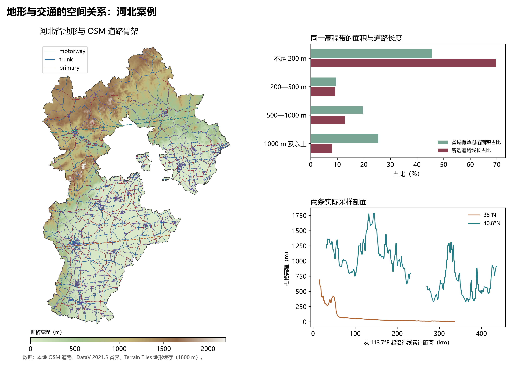

# 3.6 地形与交通的空间关系

山地、平原和河谷提供不同的通道条件。将道路骨架与地形叠加，可以观察道路分布是否在低地集中，以及山地内部的交通线如何连接不同盆地与河谷。河北省兼有坝上高原、燕山和太行山地、山前平原与沿海低地，适合做区域对照。

## 一、高程带与道路分布

图 3-18 使用本地存档 OSM 道路中的 motorway、trunk、primary 三类线要素，裁剪到河北省界后，按高程分带统计。长度计算采用 WGS 84 / UTM 50N 投影；道路沿线以不超过 900 m 的间距分段采样，读取 1800 m 地形网格的高程。

**图 3-18 河北地形与道路高程分带**：左侧为地形与所选道路骨架，虚线对应两条采样剖面；右上比较高程带的有效栅格面积占比与道路线长占比，右下为实际 DEM 采样剖面。剖面在河北省界外断开。

| 高程带 | 有效栅格面积占比 | 所选道路线长占比 |
|:---|---:|---:|
| 不足 200 m | 45.59% | 69.72% |
| 200 至不足 500 m | 9.41% | 9.34% |
| 500 至不足 1000 m | 19.54% | 12.83% |
| 1000 m 及以上 | 25.47% | 8.11% |

在这组资料中，不足 200 m 的区域占有效栅格面积约 45.6%，承载所选道路线长约 69.7%；1000 m 及以上区域的对应占比分别约为 25.5% 和 8.1%。所选道路在线长统计上偏向低地分布。地形提供了一个解释维度，城市位置、人口与产业分布同样会影响道路建设，不能把两者的空间对应直接解释为地形的单独因果作用。

## 二、从真实剖面认识过渡带

38°N 剖面展示了从太行山地向东部低地的高程下降；40.8°N 剖面则经过北部高地和起伏山地。两条剖面均从 DEM 实际取值，不是按山地和平原的印象绘制的形态示意。横轴为从 113.7°E 起沿纬线累计的椭球距离，省界外的点不参与河北剖面展示。

区域剖面有助于认识平原与山地之间的过渡，但不能用图中起伏直接判断道路的纵坡。桥梁、隧道、路基和实际线路绕行需要更精细的道路与地形资料。

## 数据来源与适用范围

本节共使用裁剪后的 38,372 条线要素，有有效高程的所选线长合计约 51,609.7 km，另有约 3.9 km 未取得有效高程。线长按数据中的线要素累计，分离式车道及并行线段分别计入，因此它不是官方公路路线里程。OSM 类别也不等同于我国公路技术等级。

边界采用 DataV 2021.5 版，地形来自本地 Terrain Tiles 的 1800 m 缓存，道路采用本地 OSM 存档，采集日期未在该文件中明确记载。分析展示区域高程分带与道路的关系，不用于道路工程设计或山峰极值判定。
