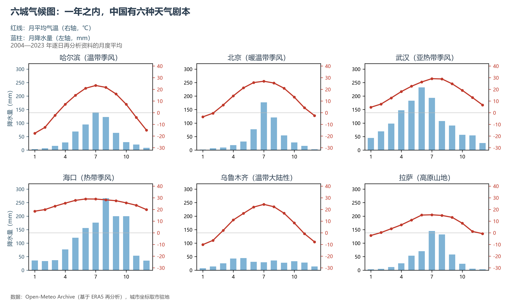
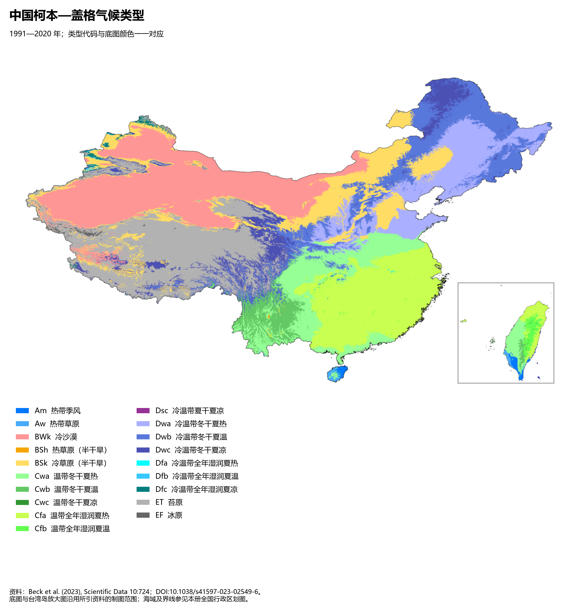

# 4.1 气候总体特征与类型

如果把中国辽阔的国土视为一个巨大的自然地理舞台，那么主导这片土地生机起落与物产轮转的根本剧本，正是中国宏大而独特的宏观气候体系。概括而言，中国气候具有两大贯穿全境的最显著本质特征：**季风气候显著**与**气候类型复杂多样**。

前者源于全球规模最大的海陆热力性质差异与青藏高原的巨型热力动力驱动，使中国成为全球季风环流最强盛、影响范围最深广的国度；后者则是由跨越近 50 个纬度的温量阶梯、深居内陆数千公里的水分梯度，以及青藏高原高达 4 000 米以上的巨大垂直高差交织而成。从琼州海峡的热带雨林，到大兴安岭的寒温针叶林，从东部沿海的膏腴水乡，到西北腹地的浩瀚沙海，几乎世界各大洲拥有的气候景观，都在这一国疆域内完整呈现。

---

## 一、季风：驱动华夏水热大循环的巨型引擎

季风（Monsoon）是大范围盛行风向随季节发生显著交替的大气环流现象。中国的季风环流是全球大气活动中心最强烈的代表，其背后依托着两台宏伟的世界级“发动机”：

### 1. 海陆热力差异与双支夏季风

- **冬季风的形成**：冬半年，广袤深沉的亚欧大陆腹地强烈降温辐射冷却，在蒙古—西伯利亚一带形成全球最强冷高压（亚洲高压 / 蒙古高压）。而同纬度的西北太平洋与印度洋洋面相对温暖，气压较低。极其干冷、深厚的偏北气流（东北季风与西北季风）自高原与内陆向海洋浩荡南下。冬季风势力强劲、影响深远，往往形成横扫全国的强冷空气与寒潮，导致中国中东部平原地区冬季气温显著低于世界同纬度其它大陆（如黑龙江漠河 1 月均温在 −26 ℃ 以下，冷如北极圈内地区）。
- **夏季风的双支交汇**：夏半年，欧亚大陆腹地受太阳直射强烈加热，空气受热膨胀上升，形成巨型印度低压（亚洲低压）；此时西太平洋与南印度洋水域相对冷凉高压。于是，来自低纬热带海洋的暖湿气流长驱深入大陆，形成两支主导夏季风：
  1. *东亚季风（东南季风）*：来自西北太平洋副热带高压的西侧与西南边缘，携带丰沛水汽向中国东部和华北长驱推进；
  2. *南亚季风（西南季风）*：越过赤道转向的印度洋暖湿气流，自孟加拉湾和南海向中国华南、西南乃至青藏高原东南峡谷输送高湿能量。
  两支夏季风为中国中东部贡献了全年中 70%—80% 的降水，造就了水热同季、生机勃发的自然奇观。

### 2. 青藏高原：大气环流的“热动力烟囱”

青藏高原的隆升，不仅改变了地壳地貌，更彻底重塑了北半球乃至全球的大气环流格局：
- **夏季的巨型热源（热力抽吸）**：在海拔 4 000 m 以上的稀薄大气中，青藏高原在强烈的太阳辐射下被剧烈加热，成为漂浮在大气对流层中层的“巨型高空热岛与热烟囱”。其地表加热空气产生强烈的上升气流，像一台超级吸尘泵一样，将印度洋与西太平洋的湿润季风气流以极大的动力抽吸进东亚大陆腹地，使东亚季风的向北推进能力增强了上千公里。
- **北纬 30° 荒漠带的“破壁者”**：按照全球三圈环流模型，北纬 20°—30° 属于永久性的副热带高压下沉气流控制区，全球这一纬度带几乎被撒哈拉沙漠、阿拉伯大沙漠等极端干旱荒漠所霸占。正是由于青藏高原夏季的热力上升运动彻底“击碎”了副热带高压带的完整连续性，迫使副高脊线向北、向海漂移，使中国长江流域与华南地区摆脱了沦为黄沙不毛之地的宿命，蜕变为水量充沛、草木苍翠的“江南鱼米之乡”。

---

## 二、季风区与非季风区：农牧与生态的分野

受深山阻隔与海陆距离衰减影响，夏季风无法覆盖中国全部领土。气象学以**夏季风能否强劲深入并带来典型丰沛夏季降水**为界线，划定出中国自然地理最重要的宏观分水岭之一：**季风区与非季风区分界线**。

- **分界线走向**：自东北向西南沿**大兴安岭 — 阴山山脉 — 贺兰山 — 巴颜喀拉山脉 — 冈底斯山脉**一线延伸。
- **界线两翼的分异**：
  - *季风区*：约占全国陆地面积的 54%，集中了全国 90% 以上的人口、95% 以上的耕地与主要大江大河干流，降水受夏季风进退控制，雨热同季；
  - *非季风区*：深居内陆或被高山环抱，夏季风水汽受阻衰竭，年降水量多在 400 mm 以下，以温带大陆性干旱、半干旱气候与高原高寒气候为主，景观以荒漠、戈壁与干草原为主，农业主要依赖冰雪融水和地下水绿洲灌溉。

---

## 三、五类气候类型与柯本分类体系

根据热量积聚、水分充沛程度与地形垂直梯度的空间组合，中国地理学体系通常将全国系统归纳为五类基本气候类型：

| 气候类型 | 核心分布区域 | 气温与降水年动力特征 | 典型年降水量 | 柯本分类对应（Köppen） | 代表城市 |
|:---|:---|:---|:---|:---|:---|
| **热带季风气候** | 雷州半岛、海南岛、台湾岛南部、云南西双版纳 | 全年高温皆夏（最冷月均温 > 15 ℃）；干湿季分明，夏季降水极其充沛，易受台风影响 | 1 500—2 500 mm | Am（季风型热带） Aw（干湿季型） | 海口、三亚、景洪 |
| **亚热带季风气候** | 秦岭—淮河以南至华南两广丘陵，青藏高原以东的南方广袤平原丘陵与四川盆地 | 冬温夏热，四季分明；最冷月均温 0—15 ℃；夏季高温多雨，梅雨与伏旱交替出现 | 800—1 600 mm | Cfa（湿润副热带） Cwa（冬干副热带） | 武汉、上海、广州、成都、杭州 |
| **温带季风气候** | 秦岭—淮河以北的华北平原、黄土高原东部、东北平原 | 冬冷干燥，夏热多雨；最冷月均温 < 0 ℃，最热月均温 > 20 ℃；降水高度集中于 7—8 月 | 400—800 mm | Dwa（暖夏冬干大陆） Dwb（冷夏冬干大陆） | 北京、济南、沈阳、哈尔滨 |
| **温带大陆性气候** | 新疆全境、内蒙古高原大部、甘肃北部等西北深居内陆区域 | 冬季严寒、夏季炎热，气温日较差与年较差极大；气候极端干旱少雨，蒸发量是降水数十倍 | < 400 mm （盆地腹地 < 50 mm） | BWk（冷荒漠气候） BSk（冷干草原气候） | 乌鲁木齐、吐鲁番、呼和浩特 |
| **高原山地气候** | 青藏高原主体（西藏、青海全境及川西、滇西北、新疆昆仑山区） | 海拔高寒，气压低、空气稀薄；日照强烈，日温差大而年温差小，降水少且集中夜间 | 100—500 mm （东南峡谷可超 1000 mm）| ET（苔原气候） EF（永久冰原）/ 高山Cwb | 拉萨、玉树、日喀则 |

**图 4-1 六城气候图（climograph）**：六种气候类型的气温—降水年循环——从海口“全年皆雨”到乌鲁木齐“全年皆旱”，再到拉萨“夏季集中”。

### 柯本气候分类的精细剖析

国际通行的柯本—盖格（Köppen-Geiger）分类法基于月均气温与月降水量阈值对全球植被气候带进行数学化严格定义。将中国置于柯本高分辨率图谱中，可以揭示传统五分法无法呈现的丰富微观过渡地带：

**图 4-2 柯本—盖格气候分类图（1991—2020 年平均，1 km 分辨率）**：数据取自 Beck 等（2023）发表于《Scientific Data》的公开数据集；右下插图放大台湾岛。原图为国际出版口径，未含南海诸岛插图与断续线，相关海域范围以本手册自绘地图为准。

1. **西南高原的“冬干夏凉”微气候（Cwb）**：在云南高原中北部（如昆明、大理），虽然纬度处于副热带，但因拔海 1 800—2 000 m，夏季无酷暑（最热月均温 < 22 ℃），冬季无严寒，年较差极小，在柯本系统中属于稀有的**亚热带高地季风气候（Cwb）**，成就了著名的“春城”特色；
2. **天山南北的环状干草原带（BSk）**：在准噶尔盆地与塔里木盆地边缘，沙漠腹地（BWk）外围环绕着一圈受高山融水与弱西风水汽滋润的冷干草原过渡带（BSk），成为维系绿洲农牧交错带的关键生境；
3. **横断山区复杂的立体气候马赛克**：山高谷深导致几公里水平距离内，谷底发育干热河谷仙人掌灌丛（BSh/BWh），山腰分布常绿与针阔混交林（Cfb/Dfb），山脊为高山苔原与积雪（ET/EF），犹如缩微了从热带到北极的全球气候景观。

---

## 四、世界视角：雨热同期的华夏禀赋与全球对比

把中国置于全球气候纬度带来审视，东亚季风赋予中国的独特自然红利一目了然：

1. **同纬度的命运分野**：
   - *北纬 30° 纬线*：自西向东穿过非洲北部是撒哈拉沙漠（年降水不足 50 mm），穿过西亚是阿拉伯半岛荒原，穿过南亚是塔尔沙漠；而一旦穿入中国长江中下游平原，年降水量骤然跃升至 1 000—1 400 mm，稻麦两熟、河网如织。
   - *北纬 40° 纬线*：穿过南欧地中海沿岸（如罗马、马德里）呈现出“夏热干燥、冬温多雨”的地中海气候（雨热不同期，农作物夏季急需引水灌溉）；而同纬度的中国北京、天津与辽西走廊，则是典型的“夏热多雨、冬冷干燥”温带季风气候，夏季高温恰逢最充沛的雨量，形成了全球极高生产力的雨养农田。
2. **支撑文明繁衍的底账**：
   全球季风区虽然仅占地球陆地面积的很小一部分，却聚集了全球超过 60% 的人口。东亚季风带来的“雨热同期”规律，使水稻这一起源于中国的喜温高产谷物能够向北一直种植到北纬 47° 的黑龙江黑土地。正是这份独一无二的气候禀赋，使中国以仅占全球约 7% 的耕地面积，成功支撑起了世界近 18% 人口的繁衍与发展。

---

## 参考与数据来源

1. 季风区界线与基本气候类型：中国气象局国家气候中心《中国气候业务规范》及教育部普通高中地理教材标准口径。
2. 城市逐月气温与降水数据：Open-Meteo Archive（基于 ECMWF ERA5 高分辨率全球大气再分析数据集，2004—2023 年 20 年逐日气候态均值）。
3. 柯本—盖格气候分类图谱：Beck, H. E. et al. High-resolution (1 km) Köppen-Geiger maps for 1901–2099 based on constrained CMIP6 projections. *Scientific Data* 10:724 (2023), doi:10.1038/s41597-023-02549-6（CC BY 4.0）。
4. 青藏高原大气环流动力学机制：叶笃正、高由禧等《青藏高原气象学》、中国科学院大气物理研究所多年研究专论。
