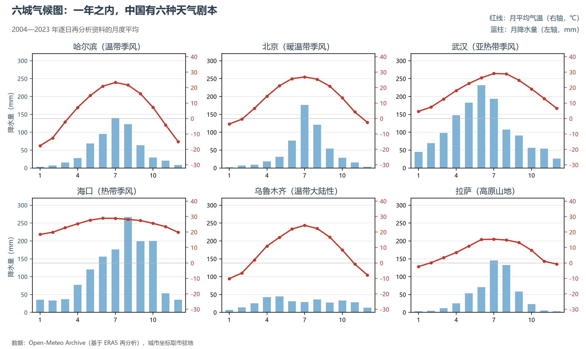
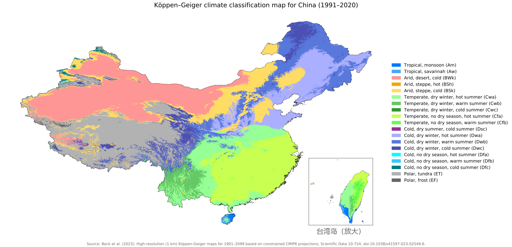

# 4.1 气候总体特征与类型

中国气候可以用两个词概括：**季风显著，类型多样**。前者来自海陆格局——世界最大的大洋与最大的大陆之间的热力差异，使中国成为全球季风最典型、影响范围最广的国家；后者来自地形——5 个温度带、4 类干湿区与 4 000 m 的海拔落差，把一个国家装进了从热带雨林到极地冰原的几乎全部气候箱。

## 一、季风：中国气候的发动机

冬季，亚洲高压盘踞蒙古—西伯利亚，寒冷干燥的偏北风从陆地吹向海洋——这就是冬季风，它使中国冬季比世界同纬度任何地方都冷：漠河 1 月均温约 −26 ℃，与北极圈内的部分地区相当。夏季，亚洲低压打开大门，来自太平洋与印度洋的暖湿气流长驱北上——夏季风带来 70% 以上的年降水量，使"雨热同期"成为东亚农业的天赐禀赋。

季风区与非季风区以大兴安岭—阴山—贺兰山—巴颜喀拉山—冈底斯山为界：界线以东以南，降水随夏季风进退；以西以北，山地阻挡了水汽，是干旱半干旱的世界（见 4.3 节）。青藏高原在这台机器里是第二台发动机——它在夏季像个巨大的热烟囱抽吸气流，强化了东亚季风，也把副热带高压带"顶碎"，使长江流域免于像撒哈拉那样沦为沙漠。

## 二、五类气候的版图

按温度、水分与地形的组合，中国可划分为五类基本气候类型：

| 气候类型 | 分布 | 特征 | 代表城市 |
|---------|------|------|---------|
| 热带季风 | 雷州半岛、海南、云南南部、台湾南部 | 全年皆夏，旱雨两季 | 海口 |
| 亚热带季风 | 秦岭—淮河以南 | 冬温夏热，雨热同期 | 武汉 |
| 温带季风 | 华北与东北 | 冬冷夏热，降水集中夏季 | 北京、哈尔滨 |
| 温带大陆性 | 西北内陆 | 干旱少雨，年较差、日较差大 | 乌鲁木齐、吐鲁番 |
| 高原山地 | 青藏高原 | 高寒，垂直分异显著 | 拉萨 |

**图 4-1 六城气候图（climograph）**：六种气候类型的气温—降水年循环——从海口"全年皆雨"到乌鲁木齐"全年皆旱"，再到拉萨"夏季集中"。

教材的五类划分简洁明快，国际学界则通行柯本（Köppen）气候分类。两套口径互为映照：热带季风对应 Am/Aw，亚热带季风对应 Cfa/Cwa，温带季风对应 Dwa/Dwb，温带大陆性对应 BWk/BSk，高原山地对应 ET/EF 及各高山冷类。柯本口径的价值在于刻画过渡与细节——云南高原的大片 Cwb（夏凉冬干）、塔里木盆地边缘的 BSk 环带、横断山垂直带谱上的色彩马赛克，都是五类框架里看不到的纹理。

**图 4-2 柯本—盖格气候分类图（1991—2020 年平均，1 km 分辨率）**：数据取自 Beck 等（2023）发表于《Scientific Data》的公开数据集；右下插图放大台湾岛。原图为国际出版口径，未含南海诸岛插图与断续线，相关海域范围以本手册自绘地图为准。

## 三、世界视角：同纬度，不同命运

把中国与世界同纬度地区对比，季风的价值一目了然：北纬 30° 线穿过撒哈拉、阿拉伯半岛时是连绵荒漠，穿过长江流域时是年降水 1 000 mm 以上的鱼米之乡；北纬 40° 的马德里夏干冬雨，同纬度的北京则是夏雨冬燥。全球季风区承载了世界约六成人口，而东亚季风区是其中面积最大、季风最稳定的一块——这是中国以世界 7% 的耕地养活近 18% 人口的气候底账。

## 参考与数据来源

1. 气候类型划分：通行地理教材口径；季风区界线沿大兴安岭—阴山—贺兰山—巴颜喀拉山—冈底斯山（示意）。
2. 城市气候图：Open-Meteo Archive
3. 柯本气候分类图：Beck, H. E. et al. High-resolution (1 km) Köppen-Geiger maps for 1901–2099 based on constrained CMIP6 projections. Scientific Data 10:724 (2023), doi:10.1038/s41597-023-02549-6（CC BY 4.0，经 Wikimedia Commons 获取；台湾岛插图取自同数据集分图）。（基于 ERA5 再分析），2004—2023 年逐日资料月度平均。
