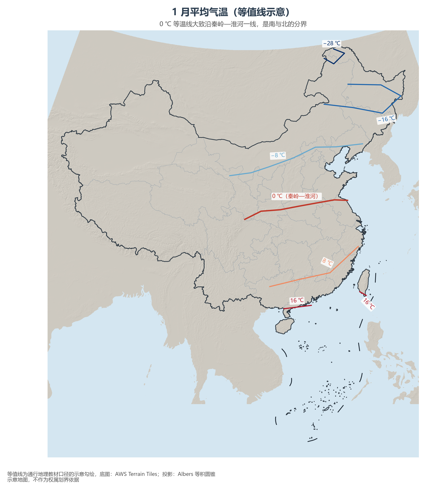
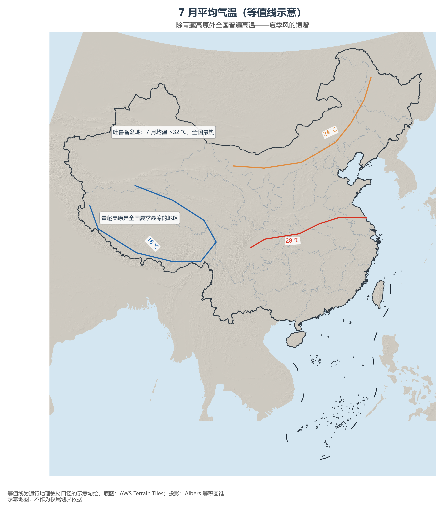
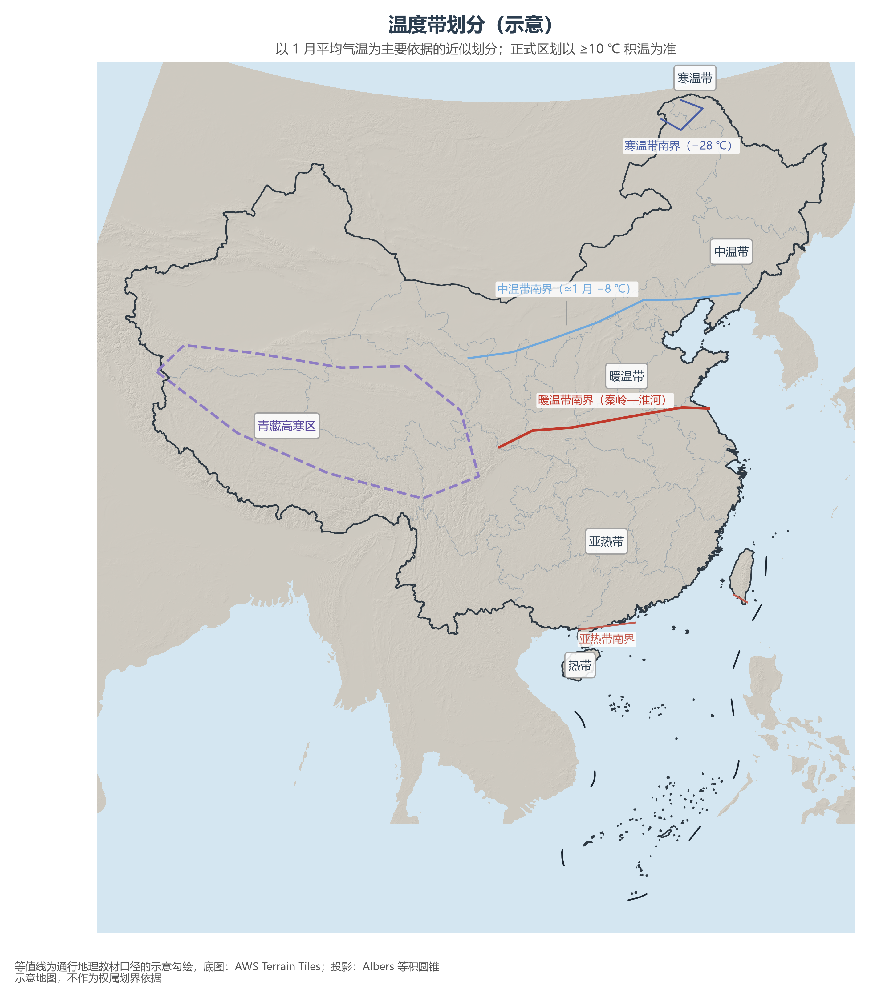

# 4.2 气温分布与温度带

在中国辽阔的版图上，气温的空间分异与季节节律，直接决定了生物圈物候的荣枯、农作物的熟制选择、人居建筑的防寒隔热构造，以及庞大能源物资跨区域调运的流动方向。

理解中国气温格局，核心在于把握一条颠扑不破的宏观基本定律：**冬季南北温差极其悬殊，夏季全国（除高山高原）普遍高温**。从 1 月近 50 ℃ 的极寒梯度，到 7 月不足 8—10 ℃ 的大体均一，这种“冬悬殊、夏均一”的剧烈年循环，正是中国大陆季风气候给大地打上的鲜明烙印。

**图 4-3 1 月平均气温等值线（示意）**：等温线密集且大体东西走向——纬度与冬季风共同主导。

---

## 一、冬季气温：50 ℃ 极寒跨度与秦岭—淮河分界线

在漫长的冬半年，中国大地的气温等温线呈现出极其密集、走向大体与纬线平行的形态，自南向北迅速跌落。

### 1. 冬季南北极端温差的成因机制

1 月份，我国最南端的三亚、西沙群岛月均温高达 22—25 ℃，郁郁葱葱、温暖如夏；而最北端的大兴安岭北段黑龙江漠河，1 月均温骤降至 −26 ℃ 至 −30 ℃，严寒刺骨、千里冰封。南北跨越近 50 ℃ 的温差，是两股巨大自然力量合力的结果：
- **太阳辐射随纬度剧烈衰减**：冬季太阳直射南半球，我国南方正午太阳高度角仍可达到 40°—45°，且白昼长达 11 小时左右；而在最北方，正午太阳高度角骤降至 15° 以下，白昼仅有 7—8 小时，“昼短光弱”，地表吸收热量微乎其微；
- **冬季风的直面冲击与地形阻隔效应**：发源于蒙古—西伯利亚的干冷冬季风顺地势南侵，北方首当其冲，冷空气长驱直入；而南方有秦岭、大巴山、大别山等崇山峻岭层层阻隔，冷空气被阻滞削弱，使得南北温差被进一步急剧放大。

### 2. 秦岭—淮河 0 ℃ 等温线的战略坐标

在图 4-3 中，**1 月 0 ℃ 等温线**是全书乃至整个中国地理中最关键的一条分界线。它西起青藏高原东南边缘，横穿秦岭山脉主脊，沿淮河干流向东直抵黄海之滨：
- **物理与生态分野**：0 ℃ 线以北，河流冬季普遍结冰封冻，落叶阔叶林与针叶林占据主导，土壤以微碱性的褐土、黑钙土与黄绵土为主；0 ℃ 线以南，大江大河终年不冻，常绿阔叶林终年郁郁葱葱，土壤以酸性红壤、黄壤与水稻土为主；
- **农业熟制与供暖红线**：0 ℃ 线以北农田实行冬小麦与夏玉米轮作或一年一熟，传统农舍厚墙重顶、家家建火炕，现代城市全面纳入**强制集中供暖区**；0 ℃ 线以南以水稻两熟或三熟为主，传统民居开敞透风，历史上未列入集中供暖区，成为当代南方“湿冷”体验与冬季采暖诉求讨论的地理背景。

> [!NOTE]
> **中国“极寒极点”纪录**  
> 中国最冷的地方位于大兴安岭北端。黑龙江省漠河市阿木尔镇在 **2023 年 1 月 22 日 7 时实测到 −53.0 ℃** 的极端低温，打破了漠河 1969 年 2 月 13 日创下的 −52.3 ℃ 历史纪录，正式成为中国现有气象记录的最低温极值。内蒙古呼伦贝尔的根河、图里河等地，年平均气温低至 −5 ℃ 以下，全年封冻期长达 7—8 个月，被称为中国“冷极”。

---

## 二、夏季气温：普遍高温与两极对峙

进入盛夏 7 月，气温地图呈现出与冬季截然相反的全新图景：全国（除青藏高原外）等温线变得极其稀疏，无论南方还是北方，几乎全部浸润在 20 ℃ 以上的炎夏之中。

**图 4-4 7 月平均气温等值线（示意）**：等温线稀疏，全国（除高原）普遍高温。

### 1. 夏季普遍高温的物理机制

7 月，黑龙江哈尔滨月均温可达 23 ℃，与广州（28.5 ℃）、海口（28.8 ℃）的差距缩小到不足 5—6 ℃。
- 夏季太阳直射北半球，虽然北方正午太阳高度角依然略低于南方，但**北方的白昼时间显著长于南方**（夏至日漠河白昼长达 17 小时，而海口仅约 13 小时）。北方较长的日照时数有效弥补了太阳高度角的微小不足；
- 加上夏季风将低纬洋面丰沛的热量和水汽送达全国广大平原，使东北平原与华北平原能够积蓄巨大热量，水稻得以在北纬 45° 以上高产繁衍。

### 2. 夏季的两极对峙：全国“热极”与高空“凉岛”

在普遍高温的背景下，中国地形的两个极致单元形成了戏剧性的对照：
- **全国“热极”：吐鲁番盆地**  
  吐鲁番 7 月均温高达 32.8 ℃，日最高气温经常越过 40 ℃，极端最高气温曾达 **49.6 ℃**（地表温度可突破 80 ℃，俗称“沙窝煮鸡蛋”）。其极端高温是由特殊盆地地形决定的：深陷天山峡谷中（艾丁湖负海拔 −154.31 m），地形极度闭塞，热量难以对流散逸；降水极度稀少、晴空万里，地面吸收强烈的太阳直射辐射；加之周围高山冷空气下沉时受绝热压缩产生的剧烈**焚风效应**，使吐鲁番成为名副其实的内陆“火洲”。
- **夏季“凉岛”：青藏高原**  
  青藏高原 7 月均温多在 8—15 ℃ 之间，大片区域属于“高原无夏”。根据对流层气温垂直递减率，海拔每升高 1 000 m，气温约下降 6.5 ℃。平均海拔超过 4 000 m 的青藏高原，相当于比同纬度平原天然降低了约 26 ℃，成为炎炎盛夏中中国乃至整个低纬欧亚大陆最辽阔的高原避暑“冷极”。

---

## 三、中国六大温度带与农业熟制图谱

气象学与农业气候学根据**日平均气温 ≥ 10 ℃ 的稳定持续期积温（活动积温）**，结合极端最低气温与作物生长指标，将中国自北向南系统划分为五个温度带以及一个面积广袤的高原气候区。

**图 4-5 温度带划分（示意）**：正式区划以 ≥10 ℃ 积温为准，本图为以 1 月均温为依据的近似表达。

| 温度带名称 | ≥10 ℃ 积温指标 | 核心覆盖地理范围 | 农业熟制系统 | 主要代表作物与典型林果 |
|:---|:---|:---|:---|:---|
| **寒温带** | < 1 600 ℃ | 黑龙江大兴安岭北部（漠河、呼玛） | 一年一熟（生长期仅 80—100 天，早霜风险高） | 春小麦、马铃薯、大麦、落叶松林 |
| **中温带** | 1 600—3 400 ℃ | 东北平原大部、内蒙古高原大部、准噶尔盆地 | 一年一熟 | 春小麦、大豆、玉米、高粱、甜菜、优质粳稻、红富士苹果（辽南） |
| **暖温带** | 3 400—4 500 ℃ | 华北平原全境、黄土高原大部、塔里木盆地、辽东半岛、山东半岛 | 两年三熟 或 一年两熟 | 冬小麦、夏玉米、棉花、花生、苹果、梨、葡萄、温带落叶阔叶林 |
| **亚热带** | 4 500—8 000 ℃ | 秦岭—淮河以南至雷州半岛以北、青藏高原以东的广阔南方地区（占国土约 26%） | 一年两熟至三熟 | 双季水稻、油菜、甘蔗、柑橘、茶叶、毛竹、常绿阔叶林 |
| **热带** | > 8 000 ℃ | 雷州半岛、海南岛全境、台湾岛南部、云南西双版纳与元江河谷 | 一年三熟（全年皆可农作） | 晚造水稻、天然橡胶、椰子、芒果、香蕉、胡椒、热带季雨林 |
| **青藏高寒区** | 日均温 ≥ 10 ℃ 积温普遍 < 2 000 ℃ | 青藏高原主体（海拔 > 3 000 m 区域） | 一年一熟（高寒低产） | 青稞、耐寒豌豆、春油菜、高山草甸畜牧业（牦牛、藏系绵羊） |

---

## 四、世界视角：超大温差孕育的内需大循环

中国气温体系在世界大国对比中展现出极其罕见的**全谱系连续性**：

1. **与主要大国的结构差异**：
   - *俄罗斯与加拿大*：国土虽辽阔，但绝大部分领土深陷中温带与寒温带，冬季均一漫长，热量严重不足，农业熟制单一（几乎全为一年一熟，大部分冻土带无法耕种）；
   - *澳大利亚与巴西*：大部处于热带和亚热带，缺乏完整的温带与冷温带生态梯度；
   - *美国本土*：虽然温度跨度较大，但其国土北界大多止于北纬 49°，且缺乏像青藏高原这样大面积的低纬超高海拔冷岛单元。
2. **“同国不同天”的经济地理赋能**：
   从海口的三熟热带果蔬到东北大平原的一季优质黑土粮，中国 90% 以上的人口紧密聚居在由热带、亚热带、暖温带和中温带构筑的连续地理阶梯之上。这种多熟制、多物产、季相交错的自然底盘，为全国构建“**南菜北运**”（冬春两广海南反季蔬菜供应北方千家万户）、“**北粮南运**”（东北中温带高蛋白大豆与黄金玉米调往南方饲养加工）、“**候鸟式避暑康养与冬季度假消费**”等跨气候带超大规模国内经济大循环，奠定了坚实无双的自然物质基础。

---

## 参考与数据来源

1. 气温等值线与温度带划分指标：中国气象局《中国气候图集》、郑度等《中国生态地理区域系统研究》。
2. 极端最低与最高气温记录：国家气象科学数据中心（CMDC）中国国家地面气象站极值历史公报（2023年漠河 −53.0 ℃ 极值）。
3. 积温与农业熟制数据：农业农村部种植业管理司《全国农作物优势种植区域规划》。
4. 吐鲁番与青藏高原热学机制：中国科学院地理科学与资源研究所陆地表层格局与模拟院重点实验室公报。
