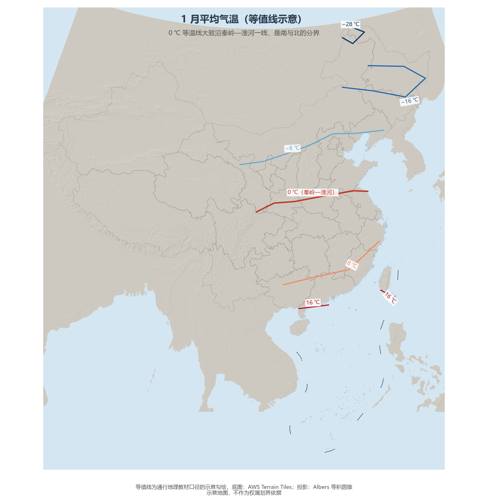
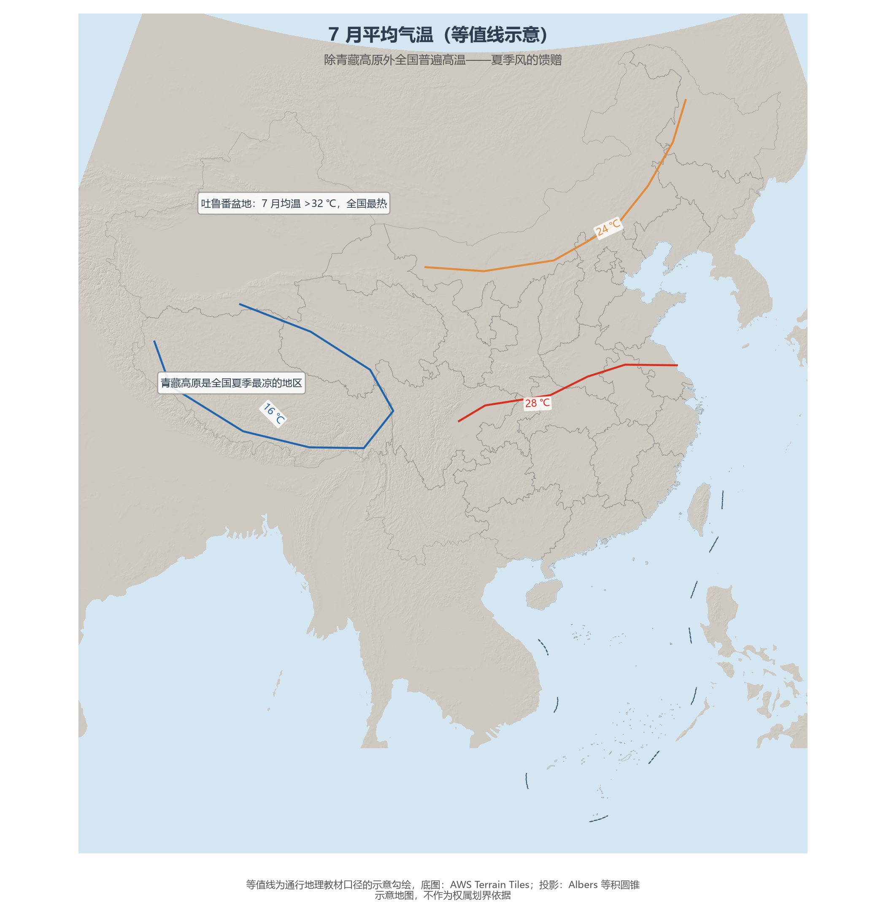
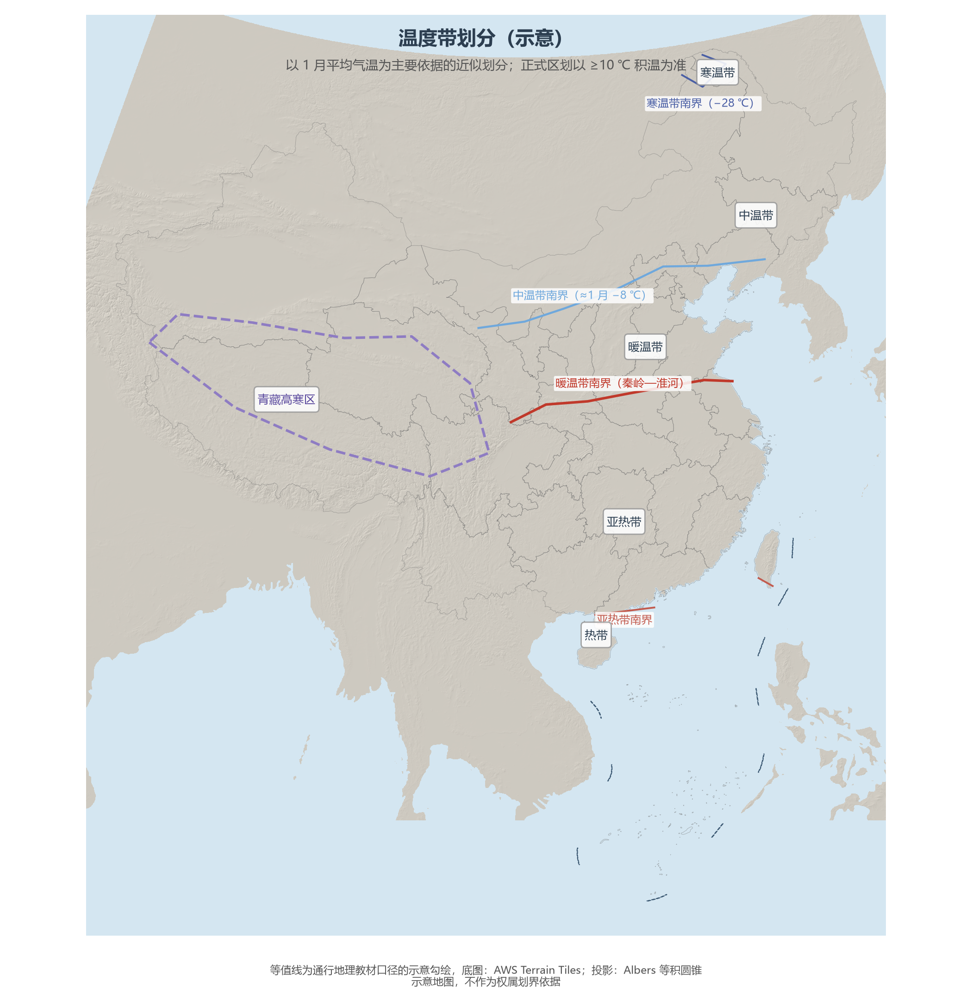

# 4.2 气温分布与温度带

中国气温分布的第一定律是：**冬季南北温差大，夏季普遍高温**。1 月，黑龙江北端与海南岛南端的均温相差约 50 ℃；7 月，这个差距缩小到 10 ℃ 以内（青藏高原除外）。这一"冬悬殊、夏均一"的节奏，是冬季风强劲、夏季太阳高度普升的直接结果。

**图 4-3 1 月平均气温等值线（示意）**：等温线密集且大体东西走向——纬度与冬季风共同主导。

## 一、冬季：0 ℃ 线就是南北分界线

1 月 0 ℃ 等温线大致沿**秦岭—淮河**一线延伸，它与 800 mm 等降水量线、亚热带与暖温带分界线高度重合，构成中国最重要的地理分界线：线以北河流冬季结冰、作物一年两熟或两年三熟、民居需要取暖；线以南河水常年流淌、水稻可一年两熟至三熟。向西北，气温随纬度与冬季风势力递减：−8 ℃ 线大致沿长城一线，−16 ℃ 线横穿吉林北部，−28 ℃ 以下的"寒极"只出现在大兴安岭北端——1969 年漠河录得 −52.3 ℃ 的全国极端最低气温。

**图 4-4 7 月平均气温等值线（示意）**：等温线稀疏，全国（除高原）普遍高温。

## 二、夏季：普遍高温与两个极端

7 月，除青藏高原外，全国大部分地区均温在 20—30 ℃ 之间：哈尔滨与海南的夏温只差数度，水稻因此可以一路种到黑龙江。两个极端同样著名：**吐鲁番**7 月均温超过 32 ℃，极端最高气温 49.6 ℃（2015 年），是名副其实的"火洲"；**青藏高原**则因海拔每升高 1 000 m 气温约降 6.5 ℃，7 月均温不足 16 ℃，是全国夏季最凉的地区。

## 三、温度带：积温画出的五色图

以日平均气温 ≥10 ℃ 的积温为主要指标，中国自南而北划分为热带、亚热带、暖温带、中温带、寒温带五个温度带，另有面积巨大的青藏高寒区。温度带直接决定农业熟制：热带一年三熟，亚热带一年两熟至三熟，暖温带两年三熟至一年两熟，中温带一年一熟，寒温带只能勉强一年一熟。

**图 4-5 温度带划分（示意）**：正式区划以 ≥10 ℃ 积温为准，本图为以 1 月均温为依据的近似表达。

## 四、世界视角：跨度即多样性

中国的 1 月均温从 −30 ℃ 到 20 ℃ 以上，跨越了从北极苔原到热带的温度区间——这一跨度在全球大国中只有美国（含阿拉斯加）可与之相比，但中国 90% 以上的人口生活在温度带完整过渡的连续国土上，形成世界上最大规模的"同国不同天"。俄罗斯的寒冷是均匀的寒冷，澳大利亚的炎热是均匀的炎热，中国的气候则是一场纵贯 50 个纬度的渐变——这为多熟制农业、多品类物产与"南菜北运""北粮南运"的国内大循环提供了天然条件。

## 参考与数据来源

1. 等温线与温度带：通行地理教材口径（示意勾绘）；极端气温：中国气象局国家气候中心公开记录。
2. 正式温度带划分依据：《中华人民共和国气候图集》与 ≥10 ℃ 积温标准。
