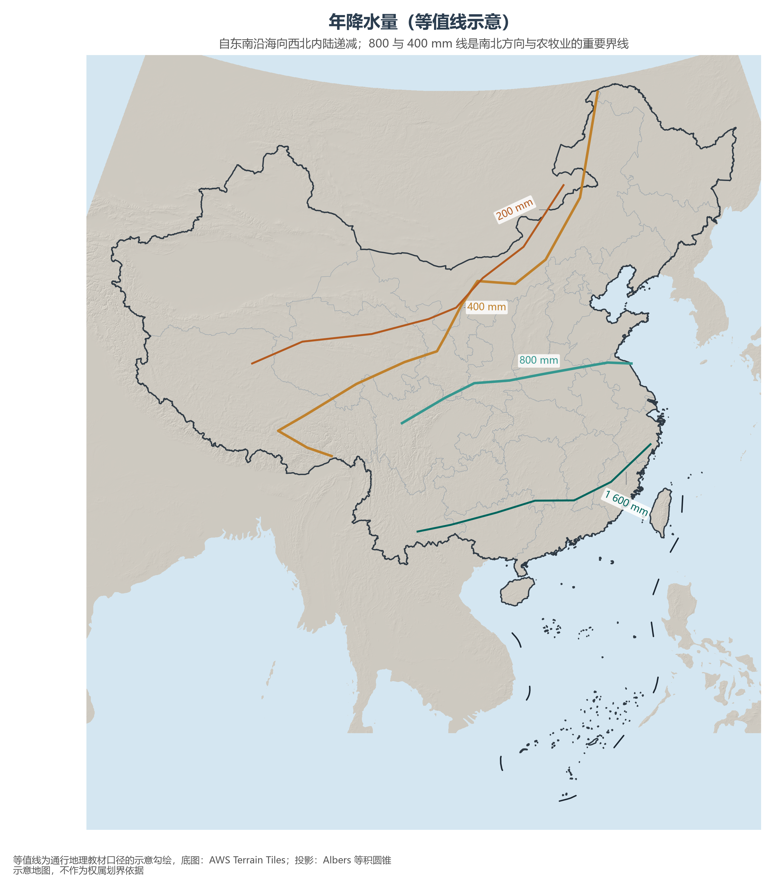
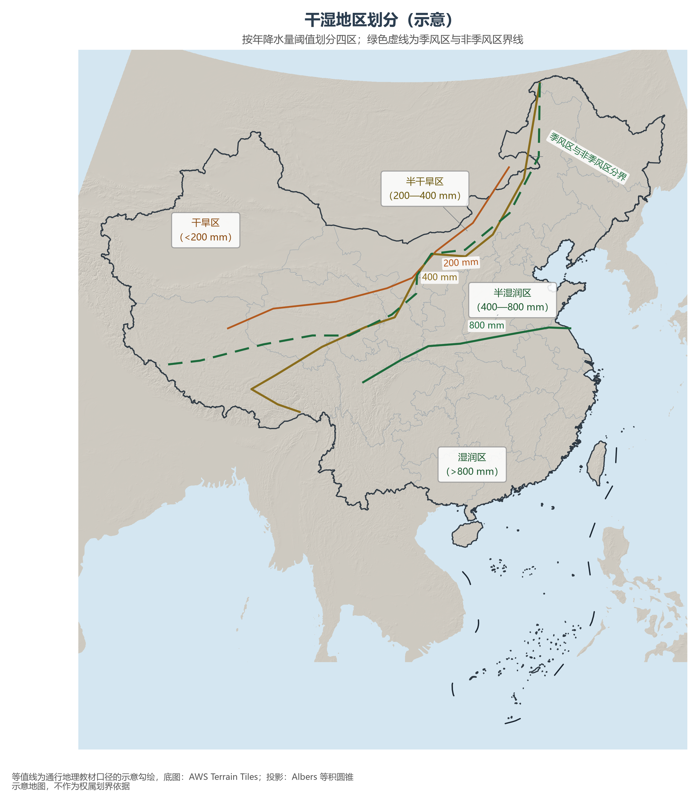

# 4.3 降水分布与干湿地区

水分是维系生命与地表生态演替的另一只决定性巨手。中国水资源的总体丰沛度、空间分配与时序涨落，牢牢遵循着由季风环流与地形地貌共同铸造的两大基本定律：

1. **空间分布定律：自东南沿海向西北内陆阶梯式剧烈递减**；
2. **时间分配定律：年内高度集中于夏秋汛期，且年际降水变率极大**。

从台湾东北部火烧寮年降水逾 6 500 mm 的滂沱暴雨，到塔里木盆地腹地托克逊不足 10 mm 的赤地千里，这两大定律不仅谱写了华夏农耕文明与游牧文明交织演进的历史底色，也构成了今天统筹国家水网建设、旱涝防灾减灾与生态空间管制的现实基准。

**图 4-6 年降水量等值线（示意）**：1 600、800、400、200 mm 四条等降水量线构成从湿润到干旱的阶梯。

---

## 一、四条关键等降水量线：国土格局的四重基石

在中国地图上，四条关键的年降水量等值线宛如四道无形的巨型闸门，自东南向西北层层锁定了自然景观与经济生计的梯度变迁：

### 1. 1 600 mm 等降水量线：东南丰水与暴雨廊道
大致沿浙闽丘陵、南岭南麓向西延至云南西双版纳与中缅边境。这条线以南和以东的区域，直面南海与西北太平洋暖湿水汽的第一道锋芒，是我国水热资源最充沛的热带与南亚热带湿润核心区。这里森林常青、江河径流量极大，同时也是台风风暴潮与特大暴雨最频繁肆虐的走廊。

### 2. 800 mm 等降水量线：南北方农业与生态分野
西起青藏高原东南边缘，横贯秦岭山脊，沿淮河干流向东入海。它与 1 月 0 ℃ 等温线大体重合，是**中国南方湿润区与北方半湿润区的分界线**：
- 线以南年降水量在 800—1 600 mm 之间，天然水分盈余，以水田农业（双季稻、水生蔬菜）为主；
- 线以北年降水量降至 800 mm 以下，蒸发蒸腾量增大，转为典型的旱地农业（冬小麦、夏玉米、杂粮）。

### 3. 400 mm 等降水量线：中国地理最核心的“生命分割线”
自东北的大兴安岭西麓出发，经内蒙古通辽、张家口、山西北部、陕北榆林、甘肃兰州，向西南穿过青海西宁至西藏拉萨与喜马拉雅山东端。
- **三重地理身份高度重合**：它既是**半湿润区与半干旱区**的分界线，又是**森林植被与温带草原植被**的分水岭，更是华夏历史上**传统农耕文明（农田村落）与游牧草原文明（逐水草而居）**的天然分界线；
- **人口分界线的地理物理支撑**：著名的人口地理分界线——**胡焕庸线（黑河—腾冲线）**在空间走向上与 400 mm 等降水量线保持着惊人的平行与空间契合，深刻揭示了水资源承载力对人类聚落集聚分布的根本决定性。

### 4. 200 mm 等降水量线：干旱荒漠与绿洲灌溉的分水岭
大致沿阴山西段、贺兰山、祁连山北麓延伸至青藏高原北部昆仑山脉。
- 它是**半干旱区与极端干旱区**的分界线；
- 200 mm 线以东以南，天然降水尚可勉强支撑稀疏的草原植被和退化的雨养旱作；而线以西以北，年降水量不足 200 mm（甚至不足 50 mm），天然地表径流几乎完全断绝，除了由高山冰雪融水补给的雪山脚下**绿洲灌溉农业**之外，其余广大内陆腹地尽是浩瀚荒漠与戈壁。

---

## 二、干湿四区：水热平衡下的景观演替

根据年降水量与潜在蒸发量的对比关系（干燥度指标），我国划分为四大干湿地区。水分的梯次衰减，在地表直观映射为从茂密森林到赤地黄沙的宏伟生态序列。

**图 4-7 干湿地区划分（示意）**：绿色虚线为季风区与非季风区分界，三条实线为 800/400/200 mm 等降水量线。

| 干湿地区 | 年降水量 | 干燥度指标（蒸发量/降水） | 核心分布区域 | 代表性天然植被与土壤 | 主要农业形态与生态屏障功能 |
|:---|:---|:---|:---|:---|:---|
| **湿润区** | > 800 mm （东南局部 > 2 000 mm） | < 1.0 （降水充沛，地表水分盈余） | 秦岭—淮河以南的南方各省、东北长白山及小兴安岭山区 | 亚热带常绿阔叶林、热带季雨林、温带针阔混交林；红壤、黄壤、水稻土 | 稻田农业、淡水渔业与亚热带经济林；长江中下游流域防洪蓄洪水源涵养地 |
| **半湿润区** | 400—800 mm | 1.0—1.5 （水分基本平衡，春季偏旱） | 华北平原、黄土高原大部、松嫩平原、辽河平原 | 温带落叶阔叶林、森林草原过渡带；棕壤、褐土、黑土、潮土 | 旱地农耕（小麦、玉米、大豆、棉花核心主产区）；北方地下水漏斗压采综合治理区 |
| **半干旱区** | 200—400 mm | 1.5—2.0 （蒸发显著大于降水，干旱频发） | 内蒙古高原大部、黄土高原西北部、青藏高原大部 | 温带典型草原、高寒草甸草原；黑钙土、栗钙土 | 畜牧业（放牧草原牧区）及局部引黄灌溉农耕区；北方防风固沙防沙带 |
| **干旱区** | < 200 mm （盆地腹地 < 50 mm） | > 2.0 （蒸发能力可达降水数十倍） | 新疆全境、内蒙古阿拉善盟、青海柴达木盆地、甘肃河西走廊西段 | 温带荒漠草原、荒漠戈壁；棕钙土、荒漠灰钙土、盐渍化土壤 | 绿洲灌溉农业（棉花、甜菜、瓜果）；防风固沙、荒漠化防治核心阻击区 |

---

## 三、降水季节演进：夏季风锋面雨带的“三跳两停”

我国季风区降水高度集中于夏季，其背后是西太平洋副热带高压脊线与南下冷空气交汇形成的**锋面雨带**，在东部平原上呈现出高度规整的季节性南北位移规律（俗称雨带的“三跳两停”）：

| 演进时段 | 主导天气阶段 | 雨带停滞核心区域 | 水汽机制与致灾特征 |
|:---|:---|:---|:---|
| **春末（4—5 月）** | 华南前汛期 | 广东、广西、福建、海南 | 南海暖湿水汽低空急流抬升，以对流性短时特大暴雨为主 |
| **初夏（6 月中—7 月上）** | 江淮“梅雨” | 长江中下游平原、太湖流域、淮河流域 | 副高第一次北跳，冷暖气团在江淮僵持，形成连绵阴雨与流域性大洪水 |
| **盛夏（7 月下—8 月）** | 北方“七下八上”雨季 | 华北平原、黄土高原、东北平原 | 副高第二次北跳越过 30°N，北方迎来全年最强降水；南方转入伏旱 |
| **秋季（9 月以后）** | 夏季风南撤与华西秋雨 | 西南盆地、汉水流域、陕南关中 | 冷空气迅速南下主导，副高向洋面退缩；秦巴山区多夜雨、连阴雨 |

1. **4—5 月：华南前汛期**  
   低纬暖湿偏南气流增强，雨带在华南沿海（两广、福建、海南）长期徘徊。降水主要以对流性暴雨、低空急流暴雨为主，广州、海口等城市进入全年第一个雨量高峰；
2. **6 月中旬至 7 月上旬：副高第一次北跳，长江中下游“梅雨”**  
   副热带高压脊线跨过北纬 20°，雨带北推至长江中下游平原和淮河流域。暖湿空气与北方南下的冷空气在江淮流域剧烈僵持，形成阴雨连绵、降水强度大、日照微弱的梅雨天气（俗称“黄梅天”），极易诱发长江、鄱阳湖、洞庭湖流域性特大洪涝；
3. **7 月中旬至 8 月：副高第二次北跳，北方“七下八上”汛期**  
   副热带高压脊线进一步北推越过北纬 30°，雨带迅速北进至华北平原、黄土高原与东北平原，进入北方著名的**“七下八上”主汛期**（7 月下旬至 8 月上旬）。北方一年中 60% 以上的暴雨集中在这一两个月内完成；
   *此时的南方反应*：长江中下游平原在雨带移走后，被副热带高压下沉气流稳定控制，晴热少雨，气温飙升，形成严重的盛夏**“伏旱”**；
4. **9 月以后：副高衰退，夏季风急速撤退**  
   大陆冷高压强势反弹，雨带迅速南撤越过长江；与此同时，来自孟加拉湾的水汽在秦岭、大巴山前抬升，造就了四川盆地、汉水流域和关中地区的**“华西秋雨”**；至 10 月，夏季风全面退出中国大陆，全国转入干凉的冬半年。

---

## 四、世界视角：季风不稳定性与世纪治水工程

与欧美温带海洋性气候（全年降水均匀、无明显旱涝）或地中海气候（冬雨夏干、年际波动较小）相比，中国东亚季风降水最深层的痛点在于**极大的年际不稳定性**：

- **季风进退失常的旱涝灾难**：
  - 若某一年夏季风势力异常强大，雨带推进极快，在北方长期滞留，就会导致“**北涝南旱**”（华北、东北洪涝，长江流域干旱）；
  - 反之，若夏季风疲软迟滞，雨带长期盘踞江淮以南无法北上，就会酿成“**南涝北旱**”（长江中下游连年泛滥，北方平原严重干旱）。
- **工程治水超越自然约束**：
  这种降水时间高度集中、空间极端不均、年际暴旱暴涝交替的气候底色，逼迫华夏民族自大禹治水、李冰修都江堰以来，历经数千年探索建立了全球最复杂的大江大河水利工程网络。从新中国成立以来建成的 9.8 万余座大中型水库（防洪库容达数千亿立方米），到长江三峡水利枢纽、黄河小浪底调水调沙工程，再到纵贯千里的**南水北调东中线工程**（将长江充沛之水跨流域调补华北干旱缺水平原），本质上都是当代中国用人类工程智慧平抑东亚季风不可预测性的伟大史诗。

---

## 参考与数据来源

1. 降水量等值线与干湿分区标准：中国气象局《中国气候图集》、中华人民共和国水利部全国水资源调查评价公报。
2. 锋面雨带位移与副高动态：陶诗言、丁一汇等《东亚季风的长期演变机制》及国家气候中心季风监测周报。
3. 极端降水记录：台湾气象部门火烧寮气象站历史极值公报（1912年年降水 8 409 mm 历史极值，常年平均 6 558 mm）。
4. 世纪水网与防洪数据：中华人民共和国水利部《全国水利发展统计公报》。
