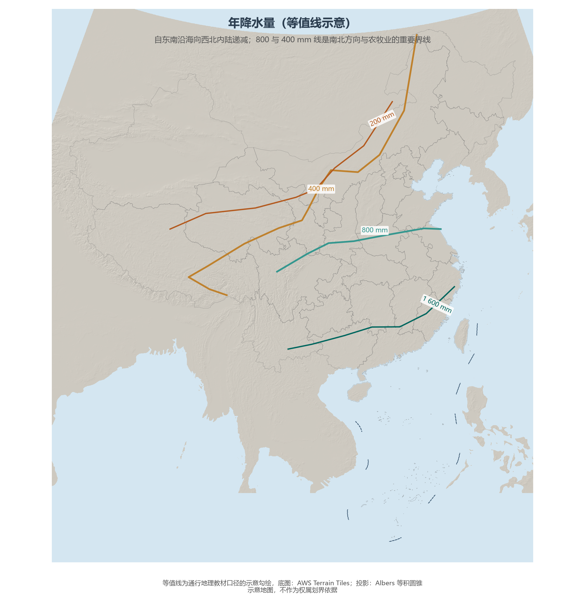
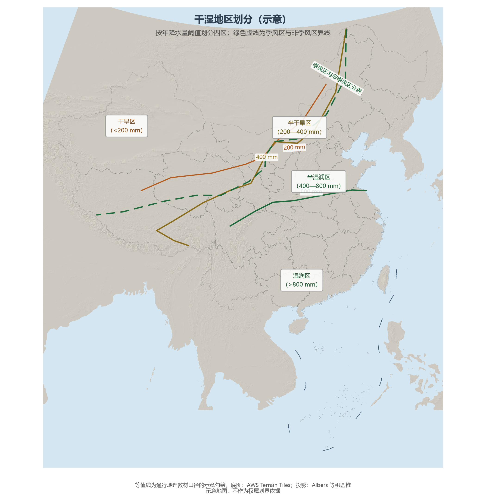

# 4.3 降水分布与干湿地区

中国降水的第一定律是**自东南沿海向西北内陆递减**：台湾火烧寮的年均降水超过 6 000 mm，而塔里木盆地腹地不足 25 mm——相差两个数量级以上。第二定律是**时间上高度集中**：多数地方 5—9 月的降水占全年的 70% 以上，愈往北方集中程度愈高。两条定律共同写下中国农业"靠天吃饭"的剧本，也写下旱涝灾害交替的年历。

**图 4-6 年降水量等值线（示意）**：1 600、800、400、200 mm 四条等降水量线构成从湿润到干旱的阶梯。

## 一、四条等降水量线，四重地理界线

- **1 600 mm 线**：大致沿浙闽山地、南岭南侧与云南南部——其东南是中国的热带、南亚热带湿润世界；
- **800 mm 线**：沿秦岭—淮河至青藏高原东南缘，与 1 月 0 ℃ 线大体重合——南方水田与北方旱地的分界；
- **400 mm 线**：从大兴安岭经张家口、兰州、拉萨至喜马拉雅山东端——它同时是半湿润与半干旱、农耕与畜牧、季风区与非季风区的界线，与胡焕庸线高度相关（见 9.2 节）；
- **200 mm 线**：大致沿阴山西段、贺兰山至青藏高原北缘——以西是中国干旱区的核心，绿洲农业取代雨养农业。

## 二、干湿四区

按降水量与蒸发量的对比（干燥度），全国划分为**湿润、半湿润、半干旱、干旱**四类干湿区。湿润区森林遍布，半湿润区是森林草原与农耕文明的核心带，半干旱区草原则退，干旱区荒漠广布、农业全部依赖灌溉。值得注意的是，干湿区的边界并不安稳：近 40 年西北西部呈现"变暖变湿"趋势，新疆多数气象站记录到降水增加——但相对于巨大的蒸发潜力，"变湿"远不足以改变干旱区的基本面貌。

**图 4-7 干湿地区划分（示意）**：绿色虚线为季风区与非季风区分界，三条实线为 800/400/200 mm 等降水量线。

## 三、降水的季节分配：南北方的时间差

夏季风的进退决定雨带的移动：4—5 月雨带滞留华南（华南前汛期），6—7 月北跳至长江中下游（梅雨），7—8 月抵达华北、东北（华北雨季），9 月迅速南撤。于是**南方雨季长、北方雨季短**：广州月降水超过 100 mm 的月份有 8 个月，北京只有 4 个月，却要在其中完成全年九成的降水任务。北方降水的高集中度是一把双刃剑——春旱夏涝交替，使华北平原既是粮仓又是水荒之地（见 5.5 节与 11.2 节）。

## 四、世界视角：季风降水的天赋与风险

世界同纬度地区大多受副热带高压控制而干燥，唯有东亚与南亚的季风区获得了集中而丰沛的夏季降水——这是中国以 7% 耕地养活近 18% 人口的水分基础。但季风是"年际不稳定"的：夏季风强则北涝南旱，弱则南涝北旱，年降水变率远高于地中海气候区。中国的水库库容、防洪体系与"丰枯调剂"的南水北调，本质上都是在为季风的不确定性购买保险。

## 参考与数据来源

1. 等降水量线与干湿区划分：通行地理教材口径（示意勾绘）。
2. 雨带进退与季节分配：中国气象局国家气候中心《中国气候公报》通行结论。
3. 西北变暖变湿：中国气象局气候变化中心《中国气候变化蓝皮书》。
