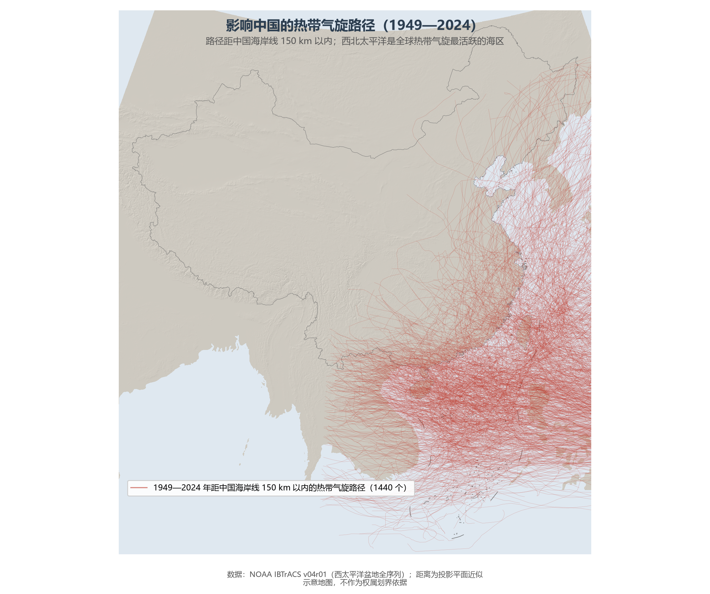

# 4.4 气象灾害

季风给了中国雨热同期红利，也把风险写进了同一条合同：夏季风的每一次进退失据，都对应着一类气象灾害。台风、暴雨洪涝、干旱、寒潮与沙尘暴，是中国灾情最重的五类天气事件——全球气象灾害损失的约四分之一发生在中国东部这一块只占全球陆地 2% 的季风土地上。

**图 4-8 影响中国的热带气旋路径（1949—2024）**：76 年间共 1 440 个热带气旋的路径接近过中国海岸线——西北太平洋是全球热带气旋最活跃的海区，中国是全球登陆台风最多的国家之一。

## 一、五类灾害的时空档案

- **台风**：年均约有 7—8 个台风或强台风登陆中国，广东、台湾、海南、福建是登陆最多的四省。台风贡献了东南沿海年降水的两至三成，"利"与"害"一体两面；2014 年"威马逊"、2024 年"摩羯"（超强台风级登陆海南）是近年破坏力最强的个例。
- **暴雨洪涝**：季风降水的高集中度使洪涝成为中国损失最重的灾害。七大江河中，长江、淮河、黄河的流域性大洪水塑造了中国的治水史——1998 年长江大洪水、2021 年郑州"7·20"特大暴雨（小时雨强 201.9 mm）是两个时代的警示。
- **干旱**：华北的春旱、江淮的伏旱、西南的冬春旱各有节律。1972 年起黄河下游连年断流，是干旱与人用水叠加的极端案例（见 5.3 节）。
- **寒潮与低温**：冬半年寒潮平均每年 3—4 次，可直达华南乃至南海北部；2008 年南方低温雨雪冰冻灾害影响 20 个省，是交通系统的一次压力测试。
- **沙尘暴**：源区在中亚与内蒙古的干旱半干旱区，春季沿西北路径影响北方；近 20 年因三北防护林与沙源治理，沙尘日数已降至 1960 年代的三分之一以下，但 2021 年、2023 年的强沙尘暴表明跨国境沙源仍难根除。

## 二、减灾体系：从"抗"到"防"

中国的气象灾害治理已形成"监测—预报—预警—应急"的闭环：风云系列气象卫星 9 颗在轨运行，全国自动气象站逾 6 万个，暴雨预警信息通过手机短信直达受影响区域。工程与非工程措施并重：三峡工程的防洪库容 221.5 亿 m³，使荆江河段防洪标准从十年一遇提高到百年一遇；1998 年大洪水后启动的退田还湖、移民建镇，则是"给河流让路"的思路转变。

## 三、世界视角：季风国家的共同考题

孟加拉国的气旋风暴潮、印度的季风失败、中国的旱涝急转——亚洲季风区的国家面对同一份考卷。中国答卷的特殊性在于规模：全球最大的防洪工程体系、最大的调水工程与最密集的气象观测网都部署在中国。但气候变化正在提高考卷难度——近年"旱涝急转"（先旱后涝的快速切换）与台风北上（影响范围向东北扩展）成为新趋势，灾害治理从"历史经验外推"转向"风险动态管理"已是必答题。

## 参考与数据来源

1. 台风路径与个数：NOAA IBTrACS v04r01（西太平洋盆地）；登陆个数：中国气象局台风年鉴口径。
2. 郑州"7·20"小时雨强：国务院灾害调查组报告；三峡防洪库容：中国长江三峡集团公开资料。
3. 沙尘日数变化：中国气象局国家气候中心《中国气候变化蓝皮书》。
