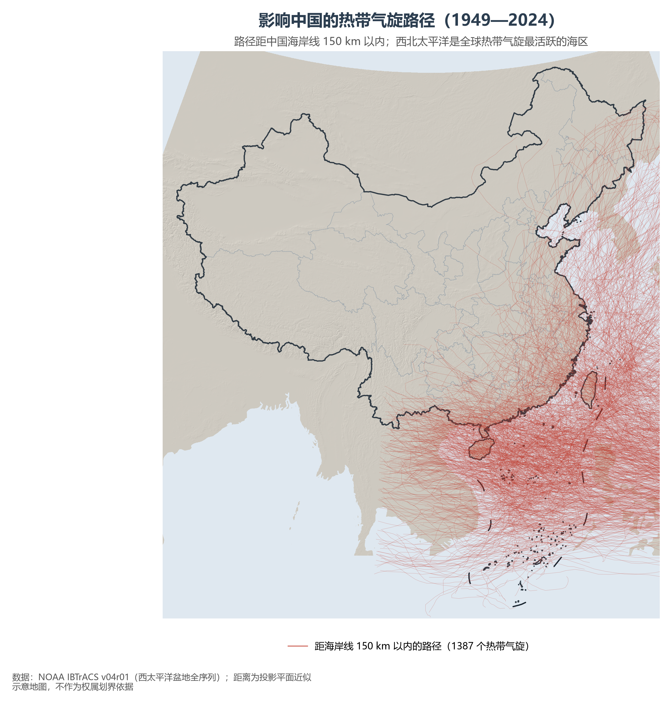
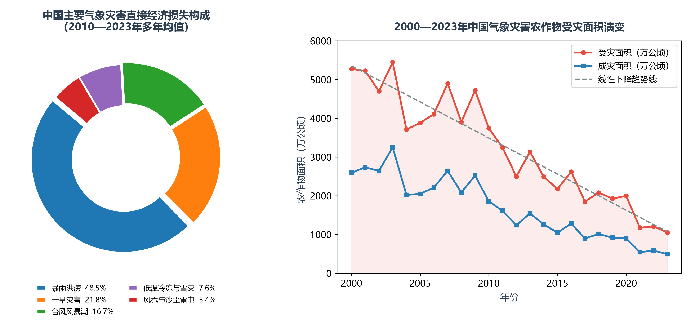

# 4.4 气象灾害

季风环流在赋予中国大陆丰沛雨热同期的巨大农业红利的同时，也把极高的气候波动风险刻进了地理底盘。夏季风推进迟速不均、冬季风强度年际震荡、副热带高压脊线位置异常摆动，直接导致中国成为世界上遭受气象灾害种类最多、分布最广、灾情最为严重的国家之一。

据应急管理部与中国气象局统计，在我国所有的自然灾害损失中，**气象灾害及其引发的次生衍生灾害（山洪、泥石流、风暴潮）占比超过 70%**。全球气象灾害造成的经济损失，约有近四分之一发生在东亚季风控制下的中国中东部地区。

**图 4-8 影响中国的热带气旋路径（1949—2024）**：76 年间共 1 440 个热带气旋的路径接近过中国海岸线——西北太平洋是全球热带气旋最活跃的海区，中国是全球登陆台风最多的国家之一。

**图 4-9 中国主要气象灾害直接经济损失构成与受灾演变**：暴雨洪涝与干旱构成气象灾害经济损失主体，高标准农田与防洪体系推动农作物受灾面积长期波动下降。

---

## 一、五大主导气象灾害的时空机理档案

中国地域辽阔，不同区域面临的主导演化灾害类型与发生节律截然不同。按照成因机制与破坏烈度，主要气象灾害系统呈现出清晰的时空格局：

| 灾害类型 | 主要致灾动力与大气环流机理 | 核心高发地理区域 | 易发季节与时间节律 | 历史典型极端个例与影响 |
|:---|:---|:---|:---|:---|
| **暴雨洪涝** | 冷暖空气剧烈交汇形成锋面气旋、西南低涡抬升及地形雨强烈下切 | 长江流域、淮河流域、珠江流域、海河流域及东南沿海 | 6—8 月（南方汛期至北方“七下八上”） | 1998年长江松花江全流域大洪水；2021年郑州“7·20”特大暴雨（小时雨强 201.9 mm）；2023年海河“23·7”流域性特大洪水 |
| **干旱与高温热浪** | 副热带高压或大陆暖高压长期稳定盘踞，盛行下沉气流增温且无降水 | 华北平原（春旱）、长江中下游（伏旱）、西南喀斯特山区（冬春连旱） | 春季（北方）、盛夏7—8月（南方）、冬春季（西南） | 1972年华北特大干旱导致黄河下游频繁断流；2022年盛夏长江全流域“汛期反枯”严重高温干旱，鄱阳湖水体面积锐减 80% |
| **台风及风暴潮** | 低纬热带洋面深厚对流系统发展为超强热带气旋，伴随狂风、巨浪、暴潮与暴雨 | 广东、海南、台湾、福建、浙江及山东、辽宁沿海 | 7—10 月（夏秋台风高发季） | 2014年超强台风“威马逊”（登陆风力17级）；2024年秋季超强台风“摩羯”重创琼粤桂；2021年“烟花”超长滞留浙江 |
| **低温冷冻与雪灾** | 极地冷涡南下，强冷空气（寒潮）大规模爆发，低空逆温层造就冻雨 | 东北、华北、内蒙古（寒潮强降温）；江南、华南及西南（低温雨雪冰冻） | 11月至翌年3月（冬半年） | 2008年1—2月南方特大低温雨雪冰冻灾害（罕见冻雨覆冰压垮特高压输电走廊，造成 20 省交通电力中断）；2023年12月全国强寒潮 |
| **风雹与沙尘天气** | 强对流深厚不稳定能量爆发（雷暴大风、冰雹）；春季内陆蒙古气旋大风扬沙 | 华北、西北、黄淮平原（沙尘）；黄土高原、西南山区与东部平原（冰雹雷暴） | 3—5 月（春季沙尘与强对流高发期） | 1993年西北“5·5”特强黑风暴；近年北方春季跨国境强沙尘天气；局地强风雹对高价值林果设施农业的突发重创 |

---

## 二、“北方暖湿化”与极端天气的地理新格局

进入 21 世纪特别是近十余年来，伴随全球气候变暖向纵深发展，中国大气水热环流的时空格局正在经历深远而复杂的深刻重塑，引发了学界对“北方气候暖湿化”与极端天气常态化的广泛研究：

### 1. 降水波动北抬与北方极端强降水频发
观测数据表明，过去 40 年间，中国西北干旱区（新疆、青海、河西走廊）气温上升的同时，降水量与天山融水径流呈现弱上升波动，塔里木河流域偶见突发性冰雪融水洪峰。与此同时，华北平原与黄土高原的暴雨强度显著攀升：
- 2021 年河南郑州“7·20”特大暴雨（单站 24 小时降水达 624.1 mm，接近该地全年常年降水量）；
- 2023 年海河流域“23·7”特大强降水（北京门头沟、房山与河北邢台局地过程降水量突破 1 000 mm，引发太行山前百年一遇特大山洪）。
这种现象并未从根本上消除北方水资源禀赋贫乏的客观现实，但**由于北方城市与农村水利基础设施长期依据干旱半干旱环境设计（排水防涝标准偏低），导致北方平原一旦遭遇极端短时强降水，极易诱发超出历史防御经验的严重洪涝与次生山洪灾害**。

### 2. 超强台风北上长驱深入内陆
随着西北太平洋副热带高压在夏季异常偏强偏北，传统上在华南和东南沿海登陆后迅速消亡减弱的台风，近年来频繁出现“内陆深远渗透”甚至“全路径北上横扫”：
- 2020 年 8 月下旬至 9 月上旬，“巴威”“美莎克”“海神”三个台风在短短半个月内接连正面袭击东北平原，造成东北主粮产区大面积玉米倒伏与江河超警；
- 2023 年第 5 号台风“杜苏芮”在福建晋江登陆后，残余环流在强大的副高与大陆高压阻隔下，沿华北水汽通道长驱直入京津冀长达数天，造成华北历史上罕见的极端特大暴雨。

### 3. 长江全流域罕见“汛期反枯”与旱涝急转
2022 年盛夏 7—8 月，本应是长江中下游抗洪排涝的“七下八上”关键期，西太平洋副热带高压却反常形成稳定持久的巨型暖性高压脊，牢牢笼罩长江全流域。导致长江流域发生自 1961 年有完整气象记录以来范围最广、持续时间最长、强度最高的极端罕见高温干旱综合事件：
- 长江干流与鄱阳湖、洞庭湖出现历史罕见的“**大汛之年无大汛，反而伏秋连旱、汛期反枯**”，鄱阳湖水体面积由丰水期的近 4 000 km² 骤降至不足 600 km²，提前 100 天进入极枯水位；
- 沿江多个水电站蓄水跌落至死水位，诱发了大规模跨区域电力保供调度的巨大挑战。

---

## 三、减灾体系：从“被动应急”向“全链条韧性治理”跨越

面对季风灾害的严峻挑战，中国立足“防抗救相结合，常态减灾与非常态救灾相统一”，构建了全球规模最大、协同度最高的现代综合防灾减灾救灾工程与技术体系：

1. **“空—天—地”一体化高精度气象监测矩阵**：
   - 空间部署由多颗风云极轨（晨昏/上午/下午轨道）与风云静止气象卫星（精准凝视东亚与西太平洋台风对流云系）组成的空间星座；
   - 地面布设超过 7 万个国家级与区域级自动气象观测站，实现乡镇覆盖率 100%；
   - 部署 200 余部新一代 S/C/X 波段多普勒双偏振天气雷达网，使强对流短临暴雨预警提前量提升至 40 分钟以上，暴雨预警信号通过国家突发事件预警信息发布系统（SMS短信直达与应急广播）实现点对点精准靶向推送到受威胁群众手中；
2. **大江大河梯级巨型水利工程群联合调度**：
   - **长江干支流梯级水库群**：以三峡水利枢纽为核心（防洪库容达 221.5 亿 m³），联合上游乌东德、白鹤滩、溪洛渡、向家坝等巨型水电站构建了总防洪库容超 500 亿 m³ 的世界级超级水库群，成功将荆江河段防洪标准由十年一遇跃升至百年一遇；
   - **黄河与淮河调蓄控制**：小浪底水利枢纽水沙联合调度彻底终结了黄河下游频繁决口改道的历史，淮河入海水道与王家坝闸分洪蓄洪体系为淮河流域构筑起坚实的流域防洪“安全阀”；
3. **海绵城市与生态韧性空间重塑**：
   从“以排为主”向“蓄排结合、给水以出路”转变。大江大河沿线全面落实“退田还湖、平垸行洪、移民建镇”；北方与中东部主要城市系统推进高标准排水管网与海绵城市建设，农田水利广泛实施“高标准农田建设”（有效规避干旱与渍涝），使我国农作物受灾面积从 2000 年代的年均 4 000—5 000 万公顷显著下降至近年的 1 000—1 500 万公顷左右（见图 4-9）。

---

## 参考与数据来源

1. 台风历史路径与活动参数：NOAA IBTrACS v04r01（西太平洋盆地）及中国气象局《热带气旋年鉴》。
2. 气象灾害直接经济损失与受灾面积序列：中华人民共和国应急管理部防汛抗旱与减灾司、国家统计局《中国统计年鉴》《中国气象灾害年鉴》（2000—2023年连续序列）。
3. 极端降水记录：国务院灾害调查组《河南郑州“7·20”特大暴雨灾害调查报告》、水利部海河水利委员会海河“23·7”流域性特大洪水纪实。
4. 防洪工程调蓄能力：中国长江三峡集团有限公司、黄河水利委员会工程运行技术公报。
