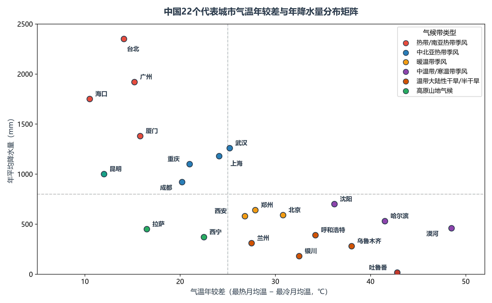

# 4.5 典型城市气候图集

如果说气温等温线与等降水量线刻画了中国宏观气候的“骨架轮廓”，那么一座典型城市的气候图（Climograph），就是这片土地生命节律与水热脉搏的“微观指纹”。

气候图在平面直角坐标系中，以 12 个月为时间横轴，用红线折线（通常对应右侧纵轴）描摹气温由冬至夏的吸纳与回落，用蓝色柱状（对应左侧纵轴）呈现降水由枯转丰的跌宕起伏。这种将“水”与“热”融为一体的直观图谱，生动映射出中国从南到北、自东向西波澜壮阔的自然地理梯度。

**图 4-10 全国代表城市气温年较差与年降水量分布矩阵**：以气温年较差 25 ℃ 与年降水量 800 mm 为基准轴，直观揭示我国代表城市在热带、亚热带、温带季风、大陆干旱与高原高寒五大象限中的空间集群。

---

## 一、六大基准城市：六种气候律动的全景解剖

在第 4.1 节所展示的六城气候图（见图 4-1）中，哈尔滨、北京、武汉、海口、乌鲁木齐与拉萨，分别构成了中国六大代表性气候类型的“标准样本”。它们在气温年较差、降水分配比重与水热耦合形态上，呈现出高度鲜明的特征：

| 代表城市 | 气候类型归属 | 海拔高程 | 年平均气温 | 1月均温（最冷月） | 7月均温（最热月） | 气温年较差 | 年平均降水量 | 降水集中期与特征 |
|:---|:---|:---|:---|:---|:---|:---|:---|:---|
| **海口** | 热带季风气候 | 14 m | 24.5 ℃ | 17.5 ℃ | 28.8 ℃ | 11.3 ℃ | 1 750 mm | 5—10 月为主汛期，8—10 月台风雨显著，呈双峰型，全年无冬 |
| **武汉** | 亚热带季风气候 | 23 m | 17.2 ℃ | 4.2 ℃ | 29.1 ℃ | 24.9 ℃ | 1 260 mm | 4—7 月降水连绵，梅雨期极易成涝；盛夏受副高控制酷热伏旱（“火炉”） |
| **北京** | 暖温带季风气候 | 43 m | 12.8 ℃ | −3.2 ℃ | 27.2 ℃ | 30.4 ℃ | 590 mm | 7—8 月两月降水占全年 65% 以上；春季干旱多风，冬冷夏热 |
| **哈尔滨** | 中温带季风气候 | 142 m | 4.8 ℃ | −17.6 ℃ | 23.4 ℃ | 41.0 ℃ | 530 mm | 6—8 月为集中降水期；冬季冰封长达 5 个月，农事一年一熟 |
| **乌鲁木齐** | 温带大陆性干旱气候 | 918 m | 7.3 ℃ | −12.6 ℃ | 24.2 ℃ | 36.8 ℃ | 280 mm | 全年各月降水稀少而相对均匀；冬季有稳定积雪，大洋水汽极其微弱 |
| **拉萨** | 高原山地气候 | 3 650 m | 8.8 ℃ | −1.6 ℃ | 16.3 ℃ | 17.9 ℃ | 450 mm | 6—9 月降水占全年 85% 以上；夜雨率高达 80%，日温差大而年温差小 |

### 1. 哈尔滨：冬季风强威的教科书
哈尔滨最冷月（1 月）均温接近 −18 ℃，历史极端低温曾突破 −40 ℃；然而其 7 月均温可跃升至 23 ℃ 以上，**气温年较差超过 40 ℃**。这种剧烈温差深刻印证了强大的冬季风对我国东北高纬度平原的绝对统治。降水高度汇聚于盛夏 7—8 月，虽然无霜期仅有 130—140 天，但夏季高温与充足水分同期降临，为优质单季粳稻和大豆的灌浆成熟提供了宝贵的光热窗口。

### 2. 北京：春旱与夏涝在同一年轮中交替
北京的气温曲线与哈尔滨具有相似的“陡升陡降”特征，但整体上移约 10 ℃。最耐人寻味的是其降水柱状图：春季（3—5 月）气温急速回升，地表蒸发旺盛，三个月降水总和往往不足 60 mm，形成典型的“春旱”；然而一进入 7 月下旬至 8 月上旬，西太平洋副高外围水汽与冷空气剧烈交汇，降水柱状拔地而起，两三个月便宣泄完全年六成以上的雨水，导致北京在相邻的月份间剧烈上演抗旱与防汛的双重攻坚。

### 3. 武汉：长江梅雨与伏旱火炉的交替震荡
武汉作为长江中游平原腹地的特大都会，最冷月均温稳稳保持在 0 ℃ 线上方的 4 ℃ 左右，大江终年畅流；夏季 7 月月均温逼近 30 ℃，日间极端高温屡破 39—40 ℃。其降水在 4—7 月随西南暖湿气流与锋面抬升绵延不绝，造就梅雨季节的丰沛降水；而盛夏 7 月中旬后迅速进入副高盘踞的伏旱期，云量极少、强日照、高湿闷热，使其成为中国江淮平原著名的“火炉城市”标本。

### 4. 海口：低纬热带海洋的双峰水汽
海口的气温曲线近乎一条平直横线，最冷月均温仍在 17 ℃ 以上，最热月不足 29 ℃，**气温年较差仅 11 ℃ 左右**，属于典型的“全年皆夏、长夏无冬”。其降水节律具有独特的“双峰”特征：第一峰出现在 5—6 月的西南季风前汛期，第二峰则在 8—10 月随频繁登陆或掠过琼州海峡的热带气旋（台风）而喷薄而出。

### 5. 乌鲁木齐：远离大洋的荒漠孤岛与西风微澜
乌鲁木齐是全球距离大洋最遥远的大型城市（距最近的印度洋海岸线也超过 2 500 km）。四周高山严密合围，使其年平均降水量仅 280 mm 左右。但与华北暴雨高度集中不同，乌鲁木齐月降水量相对均匀（各月多在 15—35 mm 之间）。天山峡谷常年截获来自大西洋与北冰洋的大气微量西风水汽，在冬春季节形成珍贵的降雪堆积，充当了天山山麓绿洲工农业不可或缺的固体储水库。

### 6. 拉萨：高原日光城与经典的“拉萨夜雨”
高拔于海拔 3 650 m 之上的拉萨，在稀薄高透的大气中享受着全国前列的年均 3 000 小时强日照（“日光城”）。由于高海拔冷却效应，夏季 7 月均温仅 16 ℃ 左右，夏无酷暑；又由于低纬度与冬季白天强烈日照的持续加热，1 月均温维持在 −2 ℃ 附近，冬无极寒，**年较差仅 17.9 ℃**。最奇特的气候景观在于**降水高度夜雨化**：夏季来自孟加拉湾的湿润气流在雅鲁藏布江谷地受夜间山风下沉与谷底热空气对流上升激发，拉萨 80% 以上的降水发生在夜间，不仅白天阳光充足利于光合作用，夜晚降雨又滋润了土壤与植被，构成了高原农业的一大奇迹。

---

## 二、从六城到全域：中国代表城市水热矩阵（图 4-10）

将全国 22 个具有标志性地理坐标的代表城市置于图 4-10 的“**气温年较差 vs 年降水量**”四象限矩阵中，我国复杂多样的气候空间谱系一览无余：

1. **第一象限：湿润低纬海洋区（年温差小，年雨量 > 800 mm）**  
   - 集聚城市：海口、三亚、广州、台北、厦门、昆明、成都、重庆。
   - 这里的核心特征是受夏季风与海洋调节深刻，冬季气温高、年较差多在 10—20 ℃ 之间。台北受地形雨馈赠年降水逾 2 300 mm；昆明虽深处内陆，但依托低纬高原（Cwb），以仅 12 ℃ 的极小年温差创造了“四季如春”的人居奇迹；成渝盆地因山峦闭合保温多雾，年较差同样被显著平抑（20 ℃ 左右）。
2. **第二象限：季风水热中介区（中等年温差 20—26 ℃，年雨量 1 000—1 400 mm）**  
   - 集聚城市：武汉、上海、南京、杭州、长沙、南昌。
   - 处于中国东部南北过渡带，兼具季风雨热同期的巨大农业生产力与夏季高温伏旱考验，四季分明。
3. **第三象限：温带季风与高寒区（大年温差 26—40 ℃，年雨量 400—800 mm）**  
   - 集聚城市：郑州、西安、济南、北京、沈阳。
   - 位于秦岭—淮河以北的华北平原与东北平原南部，冬季受干冷冬季风横扫，1 月普遍在 0 ℃ 以下；夏季炎热，年温差普遍在 26—32 ℃ 之间，水资源相对紧缺，是我国旱作粮食农业的绝对核心。
4. **第四象限：极端大陆性与极寒区（极大年温差 > 35 ℃，降水极度匮乏或极端严寒）**  
   - 集聚城市：哈尔滨（温差 41.5 ℃）、呼和浩特（34.2 ℃）、乌鲁木齐（38.0 ℃）、银川（32.5 ℃）、漠河（温差 48.5 ℃）、吐鲁番（温差 42.8 ℃，年雨量仅 16 mm）。
   - 这是我国干旱半干旱非季风区与寒温带的物理缩影，深居内陆或高纬度使其丧失了大洋水汽调节，大地在酷热与极寒之间剧烈摆动。

---

## 三、气候指纹与华夏人居形态的深层交融

一座城市的气候图，最终投射在当地百姓千百年来繁衍生息的民居屋顶、餐桌风味与生活习俗之中：

- **屋顶坡度与墙体厚度的地理密码**：从海口、广州骑楼的挑檐遮雨防晒，到江南水乡斜度达 35°—45° 的青瓦坡顶（迅速排泄梅雨防漏）；再到华北平原厚达半米用以冬防严寒夏隔酷暑的砖石院墙；直至西北干旱区（如吐鲁番、喀什）平整无坡的生土平顶房（年无暴雨，平顶晒晾葡萄干与起居），建筑形态严格遵循着降水与气温曲线的数学几何；
- **味觉地理的水热反射**：川渝湘黔地区盛夏极度闷热、冬半年阴湿无日照，当地劳动人民借由辣椒花椒等辛辣食物宣散体内湿气；而西北温带大陆性气候区昼夜温差极大，植物糖分蓄积极其丰富，造就了新疆哈密瓜、吐鲁番无核白葡萄名满天下的甜蜜奇迹；
- **候鸟式生活方式的兴起**：伴随高速铁路与现代民航网络的编织，气候图年循环的南北巨大反差，催生了每年冬季数十万东北老人前往海南三亚度假过冬的“候鸟养老”，以及盛夏南方游客涌入青藏高原、长白山与云贵高原的“避暑经济”，将气候资源的多样性转化为新时代蓬勃内需的生动图景。

---

## 参考与数据来源

1. 城市气候态统计：中国气象局国家气象信息中心中国地面气候资料日值数据集（1991—2020 年 30 年整编值与 Open-Meteo ERA5 验证数据）。
2. 代表城市水热四象限矩阵数据：根据 22 个国家级基本气象基准站实测气温年较差（最热月均温 − 最冷月均温）与年累积降水量统计算法成图。
3. 民居与饮食地理规律：李旭旦等《中国人文地理概论》、陆大道《中国地理学进展》。
