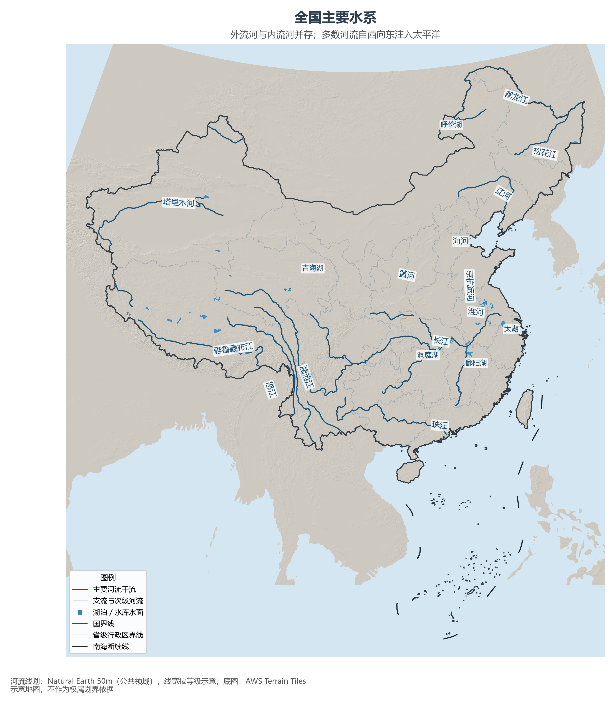
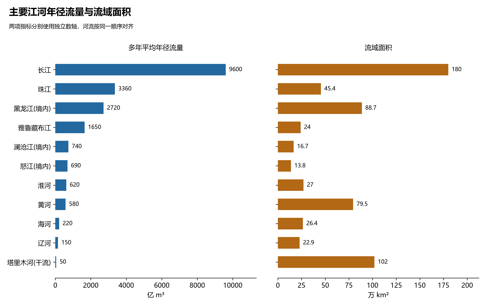

# 5.1 水系总体格局

中国的大江大河，是地势三级阶梯与季风水热大循环在地球表层刻下的最深刻水文烙印。西高东低的地势阶梯，如同一副天然的巨大滑梯，驱动着数以千计的江河自青藏高原与内陆高原浩荡东流，穿越深山峡谷，冲积出辽阔平原，最终奔腾入海。

从水文地理全貌审视，中国是一个典型的“**两分水世界**”：约占陆地面积 64% 的国土属于**外流区**，江河百川归海；约 36% 的国土属于**内流区**，流水消失于干旱腹地的沙海、盐沼与内陆湖盆之中。外流区汇聚了全国 95% 以上的水资源总量，滋养了全国 90% 以上的人口与几乎全部现代核心城市群；而内流区则以不到 5% 的水资源，支撑起茫茫沙漠戈壁边缘串珠般的绿洲文明。

**图 5-1 全国主要水系**：蓝色为 Natural Earth 50m 主要河流与湖泊，标注九大水系与代表湖泊。

**图 5-8 中国主要江河年径流量与流域面积对比**：长江与珠江以巨大水量占据前列，海河、黄河与辽河呈现汇水面积广阔而水资源相对匮乏的显著反差。

---

## 一、三大洋水系与内流区：江河归宿的地理版图

根据河流最终归宿的不同，中国外流流域分属于太平洋、印度洋与北冰洋三大洋水系，各流域在水汽来源、径流补给与地缘走向特征上分异极其显著：

| 水系归属 | 流域面积占比 | 核心骨干江河 | 汇入大洋 / 终端水域 | 水文补给动力与关键特征 |
|:---|:---|:---|:---|:---|
| **太平洋水系** | 约占外流区 87% （全国约 56%） | 长江、黄河、珠江、黑龙江、松花江、淮河、海河、辽河、钱塘江、闽江、澜沧江（出境为湄公河） | 渤海、黄海、东海、南海及鄂霍次克海 | 东南季风与西南季风主导降水补给，雨热同期，夏秋汛期显著；承载全国 80% 以上地表水资源 |
| **印度洋水系** | 约占外流区 11% （全国约 7%） | 雅鲁藏布江（出境为布拉马普特拉河）、怒江（出境为萨尔温江）、独龙江（伊洛瓦底江上游） | 孟加拉湾、安达曼海 | 印度洋西南季风强劲输送，高山冰雪融水与地形雨叠加；落差巨大，单位面积产水量极高，水能蕴藏极为富集 |
| **北冰洋水系** | 约占外流区 1.5% （全国约 1%） | **额尔齐斯河**（中国境内长 546 km，年径流约 111 亿 m³） | 出境后汇入鄂毕河，经西伯利亚注入北冰洋喀拉海 | **中国唯一属于北冰洋水系的大河**；受大西洋与北冰洋弱西风冷湿水汽补给，冬春积雪融化形成春汛，河水清冽，水能充沛 |
| **内流水系** | 约占全国陆地面积 36% | **塔里木河**（干流 1 321 km）、黑河（弱水）、石羊河、疏勒河、柴达木内流水系、藏北羌塘水系 | 终点注入内陆咸水湖（如台特马湖、青海湖）、尾闾盐沼或沿程干涸消失 | 几乎全靠高山冰雪积雪融水补给；冬春断流、夏季高温冰雪消融迎来汛期；蒸发下渗损失极大，生态极为脆弱 |

### 奇观透视：“三江并流”的地球遗产
在横断山脉纵向山岭之间，金沙江（太平洋水系）、澜沧江（太平洋南海水系）与怒江（印度洋水系）三条大江在雪山夹峙下并肩向南奔流数百公里，最近处江面直线距离不足 70 公里，却因高耸分水岭阻隔“并肩奔流而绝不相交”，最终分别奔向相距数千公里的不同大洋，构成了全球绝无仅有的“**三江并流**”世界自然遗产地质地理奇观。

---

## 二、宏观分水岭网与长江黄河“人字形”骨架

中国水系在大陆上的空间展开，受控于两条至关重要的地学控制轴：

1. **内外流区分水岭巨弧**：
   自东北向西南由**大兴安岭 — 阴山山脉 — 贺兰山 — 祁连山中东段 — 巴颜喀拉山 — 冈底斯山脉**连缀而成。这条纵贯万里的大分水岭，在空间上几乎与季风区/非季风区分界线、400 mm 年等降水量线严丝合缝地重叠：
   - 弧线以东以南，雨量丰沛，地表径流密度大，发育出奔腾万里的外流大河；
   - 弧线以西以北，夏季风水汽难越雷池，降水稀少，河流失去外流出口，退缩为孤立封闭的内陆流域。
2. **长江与黄河筑就的“人字形”文明中轴**：
   两大母亲河的源头均依偎在青藏高原腹地的**巴颜喀拉山脉**两麓：
   - 黄河从北坡发轫，以一个雄浑舒展的巨大“几”字形深切黄土高原与华北平原；
   - 长江从南坡逶迤而下，向南环抱青藏高原东南缘后掉头向东，横贯中国南方腹地；
   - 两大巨川犹如一个顶天立地的“人”字形大骨架，东西并驾齐驱，勾勒出华夏文明农耕定居与城市繁衍的核心地质版图。

---

## 三、人工水系的千年织造：大运河网络

除了天然河流，中华民族在两千余年的生产实践中，开创了举世罕见的大规模跨流域人工运河工程：

- **京杭大运河**：全长 **1 794 km**，是世界上开凿最早、里程最长的人工运河。它从北京向南跨越海河、黄河、淮河、长江与钱塘江**五大独立水系**，在南北天然河流以“纬向东西奔流”为主的中国版图上，硬生生开辟出一条贯通南北政治、经济与粮食转运（“南粮北运”）的经向水运大动脉；
- **灵渠（湘桂运河始祖）**：秦始皇于公元前 214 年下令在越城岭与海洋山鞍部开凿灵渠，巧妙利用“秤砣分水、铧嘴劈流”，使北流的湘江（长江水系）与南流的漓江（珠江水系）在岭南分水岭上实现首尾相连，为秦王朝统一岭南百越奠定了决定性的水路后勤通道。

---

## 四、世界视角：大国大江的人地密度对比

世界人口与领土大国大多拥有一条被视为国家生命线的“国民大河”：

| 大陆与国家 | 标志性国民河流 | 全长与世界排名 | 年径流量 | 流域人口规模 | 人水空间关系与战略特征 |
|:---|:---|:---|:---|:---|:---|
| **中国** | **长江** | 6 300 km（世界第3） | 约 9 600 亿 m³ | **超 4.5 亿人** | **全球人口最稠密、经济密度最高的世界级大河**；同时兼具“水电富集、内河黄金水道第一、主粮高产”三重角色 |
| **中国** | **黄河** | 5 464 km（世界第6） | 约 580 亿 m³ | **约 1.2 亿人** | 世界上输沙量最大、治水历史最悠久的母亲河，以极少水量滋养了全国 12% 人口与 15% 耕地 |
| **美国** | 密西西比河 | 6 275 km（密苏里-密西西比） | 约 5 800 亿 m³ | 约 8 000 万人 | 贯通北美中部平原的黄金农业外运水道，两岸人口密度远低于长江 |
| **俄罗斯** | 鄂毕河 / 叶尼塞河 | 5 410 km / 5 539 km | 约 4 000—6 000 亿 m³ | < 2 000 万人 | 水量充沛但流经高纬寒冷西伯利亚，封冻期长达半年以上，下游人口稀少 |
| **印度** | 恒河 | 2 525 km | 约 4 300 亿 m³ | 约 5 亿人 | 人口极度稠密，受季风强烈影响旱涝极端，水能利用与现代航运开发相对滞后 |
| **巴西** | 亚马孙河 | 6 400 km（世界第2/1） | 约 69 000 亿 m³ | < 4 000 万人 | 全球径流第一巨川（占世界入海径流近 1/5），但流经热带雨林腹地，经济开发强度极低 |

这种对比深刻揭示了中国水文地理的根本现实：中国的河流不仅承担着大自然的水汽循环，更在极其有限的国土空间内，承载着全球最密集的人口生存重托与工业制造运转。每一滴江水，都被赋予了至关重要的文明与民生重量。

---

## 参考与数据来源

1. 全国水系与内外流区划分：中华人民共和国水利部、自然资源部全国河流湖泊基本水文要素统计通报。
2. 三大洋水系参数与额尔齐斯河数据：中国水利水电科学研究院水资源研究所公开汇编。
3. 京杭大运河与灵渠历史测绘：交通运输部水运局水运工程数据库。
4. 世界大河水文对比：联合国水机制（UN-Water）全球水资源展望公报、世界银行河流与人居数据库。
