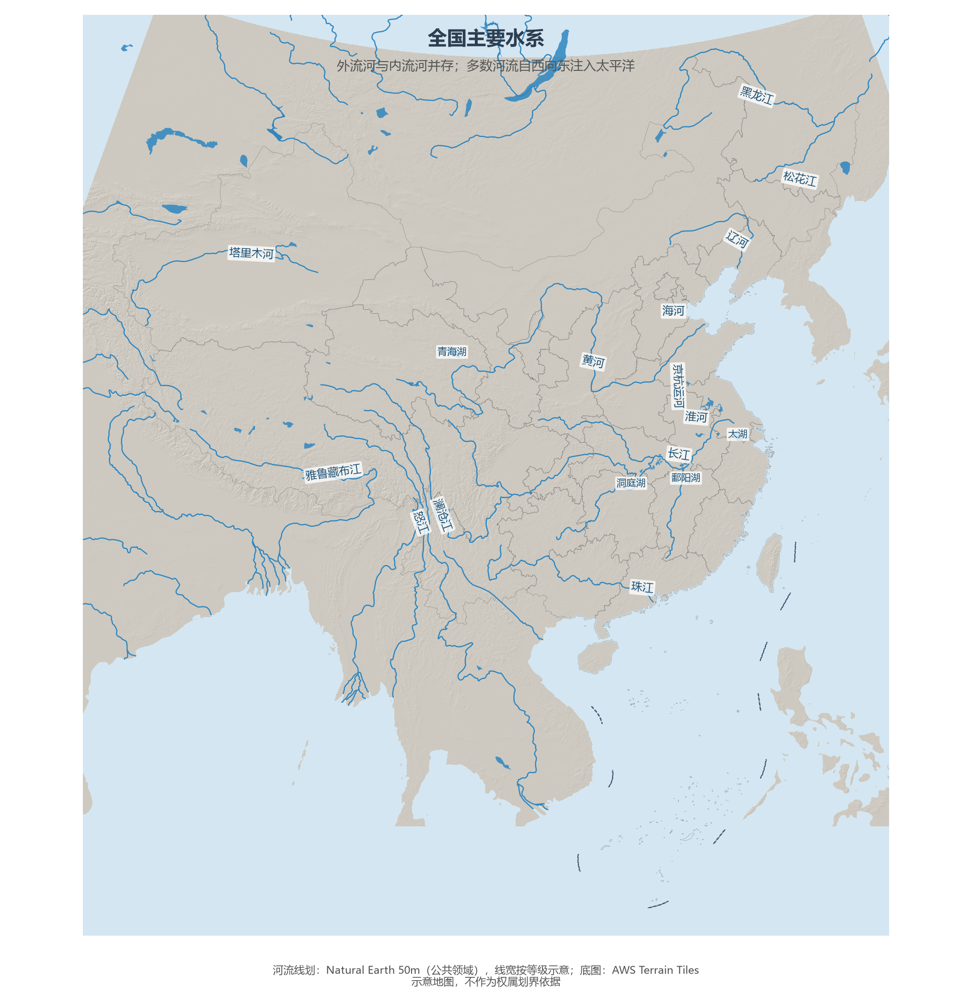

# 5.1 水系总体格局

中国是一个"两分水世界"：约三分之二的国土属于外流区——江河奔流入海；约三分之一的国土属于内流区——河流消失于沙漠、湖泊或盐沼。外流区集中了全国 95% 以上的水资源量与 90% 以上的人口，内流区则以不到 5% 的水量供养着绿洲文明。理解这张水系图，就掌握了后面资源、农业、城市各章的底层约束。

**图 5-1 全国主要水系**：蓝色为 Natural Earth 50m 主要河流与湖泊，标注九大水系与代表湖泊。

## 一、三大洋水系

外流河流按归宿分为三大水系：

- **太平洋水系**：长江、黄河、黑龙江、珠江、辽河、海河、淮河等，贡献了全国外流河径流的绝大部分；
- **印度洋水系**：雅鲁藏布江（出境后为布拉马普特拉河）、怒江（萨尔温江）、澜沧江（湄公河）——三条大江在横断山脉并肩南流，构成全球罕见的"三江并流"景观（世界自然遗产）；
- **北冰洋水系**：仅新疆北部的额尔齐斯河，出境后为鄂毕河支流，最终注入喀拉海——中国唯一的北冰洋流域。

内流区最著名的代表是塔里木河：全长约 2 179 km，是中国最长的内流河，完全依靠天山、昆仑山的冰雪融水补给，流量随气温起落，夏季为汛期。

## 二、分水岭与"人字形"格局

中国水系的宏观格局由两条对角线写就：一条是**分水岭线**——大兴安岭—阴山—贺兰山—巴颜喀拉山—冈底斯山，它同时是季风区与非季风区、外流区与内流区的界线；另一条是**长江—黄河组成的"人字形"骨架**，两大水系以巴颜喀拉山为分水，一个向南包住青藏高原东缘，一个画出一个巨大的"几"字形。京杭大运河则用人工水道把海河、黄河、淮河、长江、钱塘江五大水系串成一线，是世界上里程最长的人工运河（约 1 794 km）。

## 三、世界视角：大江大国的对应关系

世界人口前十的大国几乎都拥有一条"国民河流"：美国的密西西比、俄罗斯的伏尔加与鄂毕、印度的恒河、巴西的亚马孙。中国的对应物是长江——约 6 300 km 长度居世界第三、年径流量近 1 万亿 m³，其流域养活了全国约三分之一的人口、创造了约一半的 GDP。而与俄罗斯"河流多、人口少"相反，中国的河流几乎每一条都人烟稠密：全球人口超过 1 亿的流域仅有长江、恒河与印度河，长江是其中经济密度最高的一个。

## 参考与数据来源

1. 河流长度、内流区比例：水利部及通行教材口径。
2. 河流线划：Natural Earth 50m（公共领域）；底图：AWS Terrain Tiles。
