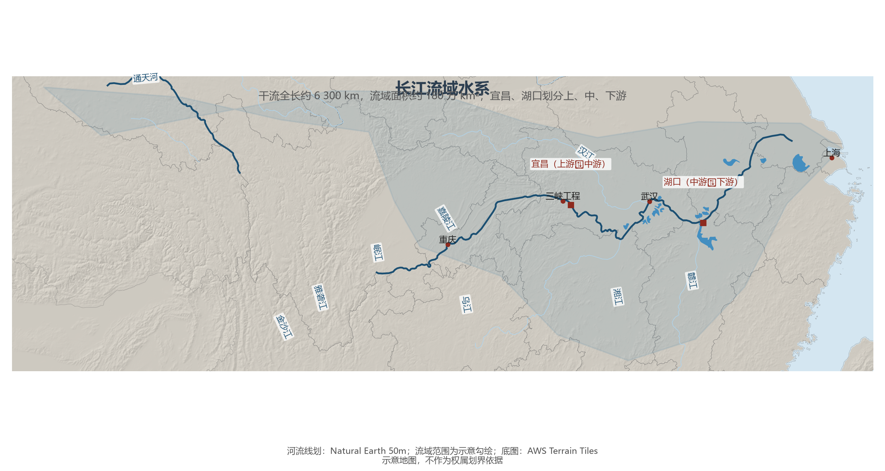
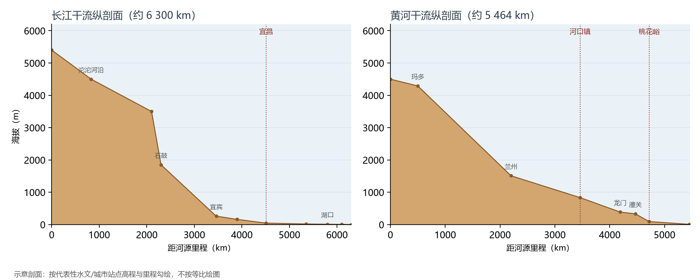

# 5.2 长江

长江是中国第一大河：干流全长约 6 300 km（居世界第三），流域面积约 180 万 km²，约占全国陆地面积的五分之一；年径流量约 9 600 亿 m³，约为黄河的 17 倍。它发源于唐古拉山脉各拉丹冬雪峰，自青藏高原一路东流，干流流经 11 个省级行政区，最后在上海注入东海。"长江"是它的乳名与学名——各拉丹冬之下叫沱沱河、通天河，玉树至宜宾叫金沙江，宜宾以下才称长江。

**图 5-3 长江流域水系**：宜昌、湖口两站划分上、中、下游；流域范围为示意勾绘。

## 一、上中下游：三段截然不同的河流

| 河段 | 分界 | 落差与特征 | 功能 |
|------|------|-----------|------|
| 上游 | 源头—宜昌 | 落差约 5 400 m，峡谷深切（虎跳峡、三峡） | 水能富集，"水电走廊" |
| 中游 | 宜昌—湖口 | 江面展宽，支流湖泊众多（汉江、洞庭、鄱阳） | 防洪要害，"九曲回肠" |
| 下游 | 湖口—入海 | 江阔水深，潮汐影响明显 | 黄金水道的主干 |

上游的雅砻江、岷江、嘉陵江、乌江四大支流携带巨大落差，聚集了全国技术可开发水能资源的半数以上；三峡工程（装机 22 500 MW，世界最大水电站）正坐落在上游末端。中游的荆江河段"九曲回肠"，是防洪最紧张的河段——1998 年大洪水即发生于此；洞庭湖、鄱阳湖两大通江湖泊是天然调蓄池，却因围垦数十年来容积大幅缩水。下游江阔水深，南京以下可通 5 万吨级海轮，长江口深水航道使万吨海轮直抵南京。

**图 5-5 长江与黄河干流纵剖面（示意）**：长江的落差集中在宜宾以上，黄河的"几"字形台阶清晰可见。

## 二、黄金水道与经济脊梁

长江水系通航里程约 6.5 万 km，占全国内河通航里程的七成以上；2023 年长江干线货物通过量约 38.7 亿 t，连续多年稳居世界内河第一，相当于十余条京广铁路的运力。流域沿线的成渝、长江中游、长三角三大城市群串珠而行——长江是中国经济的"脊梁"，也是南水北调中线与"长江经济带"战略的空间载体。

## 三、世界视角：一条河流的三重角色

同时扮演"水电基地、黄金水道、人口稠密区"三重角色的世界大河，长江几乎独一无二：亚马孙水量是长江的 7 倍却无法通航至内陆深处，尼罗河哺育的人口不及长江一半，密西西比河的水能开发程度与航运运量均不及长江。"一江连十一省、通四海"的航运纵深，是全球任何其他大河都不具备的。

## 参考与数据来源

1. 长度、流域面积、径流量：水利部长江水利委员会《长江泥沙公报》《中国河流泥沙公报》及通行教材口径。
2. 三峡装机、长江干线货运量：交通运输部长江航务管理局公开数据（2023 年）。
3. 河流线划：Natural Earth 50m；纵剖面为站点高程示意。
