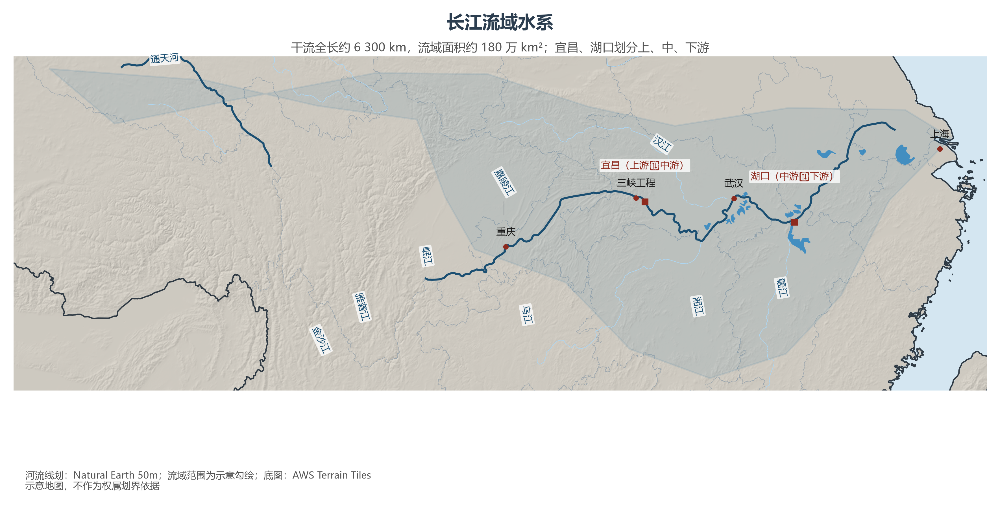
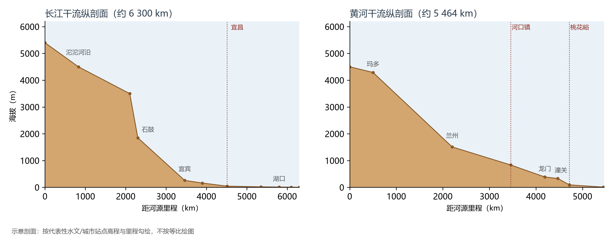

# 5.2 长江

长江，是中华民族的母亲河，也是横贯中国东西的生态与经济命脉。干流全长约 **6 300 km**，仅次于非洲尼罗河与南美洲亚马孙河，位居**世界第三位**；流域面积达 **180 万 km²**，约占中国陆地总面积的五分之一；多年平均年径流量约 **9 600 亿 m³**（约占全国河流总径流量的三分之一），水量相当于黄河的近 17 倍。

长江从青藏高原的冰川雪峰发轫，干流一路向东流经青海、西藏、四川、云南、重庆、湖北、湖南、江西、安徽、江苏、上海等 **11 个省级行政区**，数百条支流辐射扩展至黔、陕、甘、豫、鄂、湘、赣、粤、桂、浙、闽等省区，在上海市崇明岛两侧注入东海，是维系华夏文明繁衍最重要的大江大川。

**图 5-3 长江流域水系**：宜昌、湖口两站划分上、中、下游；流域范围为示意勾绘。

**图 5-5 长江与黄河干流纵剖面（示意）**：长江的落差集中在宜宾以上，黄河的"几"字形台阶清晰可见。

---

## 一、源流与分段：高山峡谷向水乡泽国的梯度演化

“长江”既是这条巨川的统称，在其上游不同河段又有独特的历史称谓：
- **沱沱河与通天河**：正源发源于唐古拉山脉主峰各拉丹冬雪峰西南侧的姜根迪如冰川，流淌于海拔 4 500 m 以上的藏北高原，初名沱沱河；与南源当曲汇合后称通天河，流经玉树巴塘河口；
- **金沙江**：自玉树巴塘河口至四川宜宾岷江汇合口，长达 2 300 余公里称金沙江，穿行于横断山区极高山深谷中；
- **长江干流**：自四川宜宾以下，纳岷江、嘉陵江等巨流后，始正式定名“长江”。

根据自然水文特征与地形演化，长江以**湖北宜昌**和**江西湖口**为界，严格划分为上游、中游与下游三大段落：

| 河段划分 | 起止区间与里程 | 落差与水文动力特征 | 主要汇入支流与湖泊 | 核心战略功能与标志性工程 |
|:---|:---|:---|:---|:---|
| **上游** | 源头 至 湖北宜昌 （长约 4 504 km，占干流 71%） | 极高山与高原深切峡谷；总落差约 **5 400 m**（占全江 90% 以上）；水流湍急，富集全球最密集的巨大水能资源 | 雅砻江、岷江（大渡河）、嘉陵江、乌江 | **世界最大清洁能源走廊**：三峡水利枢纽（2 250万kW）、葛洲坝，金沙江下游白鹤滩、乌东德、溪洛渡、向家坝四大巨型水电站 |
| **中游** | 湖北宜昌 至 江西湖口 （长约 955 km，占干流 15%） | 冲积平原与丘陵盆地；落差急剧减缓至约 40 m；江面展宽，泥沙沉积，曲流极其发育；“九曲回肠”荆江河段防洪压力极高 | 汉江（最大支流）；两大通江湖泊：**洞庭湖**（纳湘资沅澧四水）、**鄱阳湖**（纳赣抚信饶修五水） | **防洪核心与调蓄中枢**：荆江分洪工程、洞庭湖与鄱阳湖湿地调蓄生态系统；南水北调中线渠首（汉江丹江口水库） |
| **下游** | 江西湖口 至 长江入海口 （长约 938 km，占干流 14%） | 江阔水深，落差不足 20 m；受海洋潮流顶托明显；河口发育为巨型复合三角洲平原（崇明岛、长兴岛） | 青弋江、水阳江、秦淮河、黄浦江；**太湖**水系网 | **世界顶级内河黄金水道**：南京以下 12.5 米深水航道可通达 5 万吨级海轮；长三角世界级城市群与江海联运超级枢纽港群 |

---

## 二、上游：世界最大清洁能源走廊的崛起

从图 5-5 可以直观看出，长江总落差的 90% 集中在宜宾以上的上游河段。金沙江奔腾于青藏高原向云贵高原、四川盆地过渡的狭窄深谷中，虎跳峡最窄处江面仅 30 米，上下高差数千米；而在川鄂交界处，长江切穿巫山形成举世闻名的长江三峡（瞿塘峡、巫峡、西陵峡），全长 193 km，自古便有“朝辞白帝彩云间，千里江陵一日还”的险峻势能。

新世纪以来，国家在长江上游干流与主要支流上，建设了举世瞩目的**世界最大清洁能源走廊**：
- **三峡工程**：装机容量达 **2 250 万千瓦**，年发电量稳定突破 1 000 亿千瓦时，是全球规模最大的水利枢纽工程；三峡水库总库容 393 亿 m³，其中防洪库容 221.5 亿 m³，使长江中下游荆江河段防洪标准从十年一遇提高到百年一遇；
- **金沙江下游巨型水电站集群**：自上而下梯级建设了**乌东德**（1 020 万 kW）、**白鹤滩**（1 600 万 kW，单机容量 100 万 kW 创世界纪录）、**溪洛渡**（1 260 万 kW，世界第四）、**向家坝**（640 万 kW）。
六座巨型水电站联合调度，总装机容量达 7 169.5 万千瓦，相当于三个三峡工程的电能产出，构建起跨越数千公里保障华东、华中、华南电力平稳供应的“西电东送”超级绿色动脉。

---

## 三、黄金水道与长江经济带：国家战略发展的巨型轴线

长江作为通航河流，具有得天独厚的大江深水优势：干流终年不冻，江面宽阔，支流沟通南北腹地，被公认为名副其实的“**黄金水道**”。

1. **内河航运的全球奇迹**：
   - 长江水系通航总里程达 **7 万余公里**，占全国可通航内河里程的近 70%；
   - 经过长期航道系统整治，长江口深水航道常年水深达 12.5 米，使 5 万吨级海轮可直通南京，万吨级海轮常年通达武汉，千吨级内河驳船船队直达重庆；
   - 2023 年，长江干线货物通过量达到 **38.8 亿吨**，连续近二十年稳居**世界内河第一位**，其航运货运量相当于十余条大运力重载铁路的年货运总和，运能成本仅为公路的 1/5 至 1/8。
2. **串联三大增长极的“长江经济带”**：
   长江水运航道如同一根坚韧的红线，由西向东将中国最具经济活力与人口密度的三大国家级城市群串联一体：
   - 上游的**成渝地区双城经济圈**（西部大开发战略支点）；
   - 中游的**长江中游城市群**（武汉、长株潭、环鄱阳湖平原枢纽）；
   - 下游的**长江三角洲世界级城市群**（中国经济规模最大、创新要素最密集、开放程度最高的经济高地）。
   全流域覆盖的 11 个省市贡献了全国超过 46% 的常住人口与超过 45% 的经济总量。

---

## 四、“共抓大保护”：母亲河的生态涅槃

在经历了数十年高强度的岸线工业化与水电航运开发后，长江生态环境曾亮起严峻红灯（白鱀豚功能性灭绝、长江江豚濒危、部分江段水质恶化、岸线被高污染化工码头侵占）。

近年来，国家治江战略发生深刻转折，明确确立了“**共抓大保护，不搞大开发**”的最高原则：
- **实施十年禁渔**：自 2021 年 1 月 1 日起，长江流域重点水域全面推行为期十年的常年禁捕，十余万退捕渔民上岸安置转产，长江江豚自然种群数量实现历史性止跌回升（2022 年全流域野外种群回升至 1 249 头）；
- **出台《长江保护法》**：2021 年 3 月 1 日，中国首部流域专门法律《中华人民共和国长江保护法》正式施行，严格落实沿江 1 公里内严禁新建化工企业、岸线生态红线管制；
- **排污整治与岸线覆绿**：经过全面治理，长江干流水质已连续多年全线稳定保持在 **Ⅱ 类** 优良水质标准，“一江碧水向东流”的壮丽生态画卷重新回归华夏大地。

---

## 参考与数据来源

1. 长江干流长度、流域面积与径流量：中华人民共和国水利部长江水利委员会《长江流域水资源公报》《长江泥沙公报》。
2. 三峡及金沙江梯级水电装机：中国长江三峡集团有限公司年度生产运营报告。
3. 航运通航与货运量数据：交通运输部长江航务管理局《长江航运发展报告（2024）》。
4. 生态监测与禁渔进展：农业农村部《长江流域水生生物资源及生境状况公报》。
