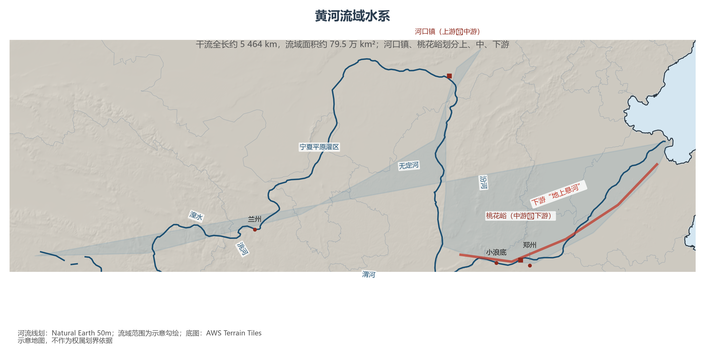
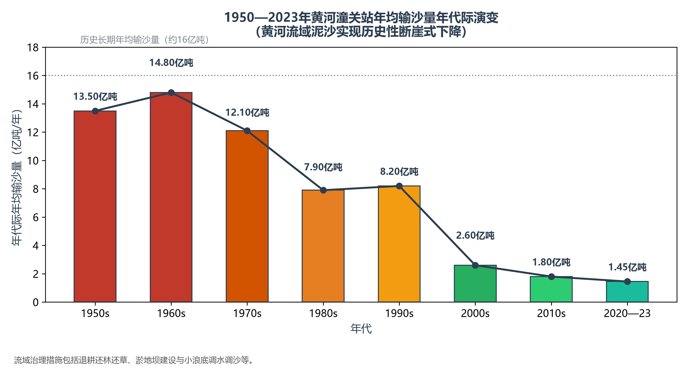

# 5.3 黄河

黄河是中华民族的母亲河，也是华夏文明最重要的发祥摇篮。干流全长约 **5 464 km**，位居中国第二长河、**世界第六长河**；流域面积约 **79.5 万 km²**（若计入鄂尔多斯内流区等范围则超 83 万 km²）。黄河发源于青海高原巴颜喀拉山北麓的约古宗列盆地，以一个雄浑无匹的巨大“几”字形大弯环抱鄂尔多斯高原与黄土高原，干流蜿蜒流经青海、四川、甘肃、宁夏、内蒙古、陕西、山西、河南、山东等 **9 个省级行政区**，最终在山东省东营市垦利区注入渤海。

黄河的本质关键词，不在于其“长”，更不在于其“大”（多年平均年径流量仅约 **580 亿 m³**，不到长江的 6%，水量甚至不及南方珠江的一条支流西江），而在于一个震撼世界的字——**沙**。“一碗水，半碗沙”，历史上多年平均年输沙量高达 **16 亿吨**，曾长期冠绝全球各大江河，由此塑造了极度复杂的河床演化与举世瞩目的治水篇章。

**图 5-4 黄河流域水系**：河口镇、桃花峪划分上、中、下游；红色为下游"地上悬河"河段（示意）。

**图 5-10 1950—2023年黄河潼关站年代际输沙量演变**：黄土高原退耕还林还草、水土保持与小浪底调水调沙工程，推动入黄泥沙实现历史性断崖式锐减。

---

## 一、源流与分段：水与沙的万里长征

黄河以**内蒙古托克托县河口镇**与**河南郑州荥阳市桃花峪**为界，清晰划分为上游、中游与下游三大水文地质段落：

| 河段划分 | 起止区间与里程 | 水文特征与泥沙变化 | 主要汇入支流与平原 | 核心功能与重大控制性工程 |
|:---|:---|:---|:---|:---|
| **上游** | 源头 至 内蒙古河口镇 （长约 3 472 km，占全长 63.5%） | 穿越青藏高原草原与黄土深谷；源头扎陵湖、鄂陵湖清澈碧蓝；刘家峡以上落差大、水清沙少；进入宁蒙后地势平缓 | 湟水、洮河；**宁夏平原、河套平原** | **水源涵养、梯级水电与塞上灌溉**：龙羊峡（库容247亿m³）、李家峡、刘家峡水电站；青铜峡与三盛公水利枢纽滋养“塞上江南” |
| **中游** | 内蒙古河口镇 至 河南桃花峪 （长约 1 206 km，占全长 22.1%） | 穿行于晋陕大峡谷；纵贯黄土高原水土流失区，**贡献了全河 90% 的泥沙**；河水由清转浊，暴雨期泥沙俱下，含沙量居世界第一 | 无定河、延河、汾河、**渭河**（最大支流，纳泾河形成“泾渭分明”） | **水土流失重灾区与水沙调控中枢**：壶口瀑布（“千里黄河一壶收”）；万家寨水利枢纽、**小浪底水利枢纽**（黄河防洪减淤王牌工程） |
| **下游** | 河南桃花峪 至 入海口 （长约 786 km，占全长 14.4%） | 进入华北冲积平原，比降骤降，流速迟滞，泥沙在两岸大堤内巨量淤积；河床高出背河地面数米至十余米，形成全球罕见的**“地上悬河”** | 支流极少汇入（如汶河）；两岸天然汇水无法进入黄河干流 | **防洪安澜与三角洲生态**：两岸千里防汛大堤；小浪底调水调沙冲淤；黄河三角洲国家级自然保护区（造陆与新生湿地保护） |

---

## 二、悬河之险与泥沙改道：黄泛区的人地史诗

在华北平原广袤的大地上，黄河下游呈现出世界上最匪夷所思的水文景观——**地上悬河**。

- **悬河的形成机制**：自河南桃花峪出山以后，黄河水势从峡谷奔涌进入平阔的华北平原，坡降由中游的千分之几骤降至万分之一左右。水流流速骤减，携带的巨量黄土泥沙在两岸堤防之间迅速落淤。千百年来，河床不断抬高，两岸人民不得不年复一年加固增高大堤，最终形成了大堤内滩地与主河槽普遍高出两侧华北平原背河地面 **4—6 米**，开封、新乡等局部河段甚至高出地面 **7—10 米**。
- **“三年两决口，百年一改道”的历史剧变**：地上悬河使黄河宛如一条巨龙在平原高空游走，极易决口漫溢。两千余年历史文献记载中，黄河下游决口泛滥达 **1 500 余次**，发生重大改道 **26 次**：
  - *北冲至天津入渤海*：在战国、西汉时期，黄河北冲海河流域，在天津附近入海；
  - *南泛夺淮入黄海*：宋金时期（1128 年杜充人为决堤）直至清代咸丰五年（1855 年），黄河大改道南侵夺淮入海长达 700 余年，泥沙淤塞淮河水系，造成苏北平原洪涝灾害频发与洪泽湖的形成；
  - *1855 年铜瓦厢决口*：黄河在河南兰考铜瓦厢最后一次大改道，东北折向山东，夺大清河河道注入渤海，形成了今天我们所见的黄河入海通道。
  整个华北平原（黄淮海平原）厚达数百米的冲积沃土，正是黄河千万年来用泥沙一次次决溢改道“人造”出来的地貌奇迹。

---

## 三、治黄奇迹：从连年断流到泥沙骤减与岁岁安澜

新中国成立以前，黄河几乎每隔几年便酿成灾变；而进入现代，中国通过全流域系统治理，实现了举世瞩目的治黄三重奇迹：

### 1. 终结黄河断流危机：连续 25 年不断流
20 世纪 70 年代至 90 年代，随着沿黄工农业引水量激增与降水偏枯，黄河下游频繁出现大面积断流。1972—1999 年间黄河下游有 22 年发生断流；在极端的 1997 年，利津水文站断流天数长达 **226 天**，断流河段长达 704 公里，几乎延伸至河南开封，造成沿线生态断链与严重工农业水荒。
- 1999 年起，水利部黄河水利委员会正式实施**全流域水资源统一干预与精准调度**，对青海、甘肃、宁夏、内蒙古、陕、晋、豫、鲁全线取水实施“按计划配额分水”，成功终结了断流历史，截至 2024 年底已实现**黄河连续 25 年全线不断流**，为下游生态恢复和经济发展提供了生命活水。

### 2. 黄土高原治理促成入黄泥沙“断崖式下跌”（图 5-10）
从图 5-10 柱状图可以看出，黄河潼关水文站（控制了中游全部汇沙）的年代际输沙量呈现出极其壮观的跳水曲线：
- 20 世纪 50—70 年代，潼关站年均输沙量高达 **12—15 亿吨**；
- 80—90 年代随着初步水土保持降至约 8 亿吨；
- 进入 21 世纪，随着国家全面推行**大规模退耕还林还草、封山禁牧、修建近 6 万座淤地坝拦泥淤地**，黄土高原植被覆盖率由退耕前的 31% 跃升至 60% 以上；
- 2010 年代后潼关年均输沙量跌落至 **1.8 亿吨左右**，近年甚至低于 **1.5 亿吨**，相比历史均值锐减了近 **90%**！黄河中游大片水域呈现出“一江碧水映两岸”的罕见生态景观。

### 3. 小浪底“调水调沙”：人造洪峰冲刷河槽
为解决下游悬河泥沙淤积难题，小浪底水利枢纽自 2002 年起开创了世界水利史上的壮举——**联合调水调沙**：
- 每年汛期前（6 月下旬至 7 月上旬），利用万家寨、三门峡、小浪底水库联合调度，制造持续数天的大流量人工强洪峰（流量达 3 000—4 000 m³/s）；
- 人造洪峰在水库底部激起高浓度泥沙“异重流”，并以巨大的流速冲刷下游主河槽，将常年淤积的泥沙卷携排入渤海；
- 实施二十余年来，黄河下游主河槽平均被**人工冲刷下切 2—3 米**，平槽泄洪能力由过去的 1 800 m³/s 显著提升至 5 000 m³/s 以上，极大地降低了悬河漫决的灾难性风险，保障了黄河两岸人民的岁岁安澜。

---

## 四、世界视角：大河治理的文明标杆

在世界大河文明的对比谱系中，黄河的治理难度堪称世界之最：

- 相比于水量丰沛、河槽相对稳定的莱茵河、多瑙河，黄河面临的是极端的水少、沙多、水沙关系极不协调的物理矛盾；
- 相比于密西西比河与恒河，黄河横亘在世界人口最稠密、历史最悠久的冲积平原之上，一旦失控将危及上亿人口的安全。
中华民族历经两千余年探索，从战国贾让“治河三策”、明代潘季驯“筑堤束水，以水攻沙”，再到当代综合运用“退耕固土、梯级拦蓄、人工调水调沙与水资源刚性约束”的大生态体系，成功将一条桀骜不驯的世界头号泥沙巨川，改造成为滋养华夏文明与区域高质量发展的“幸福河”，为全球大河流域的水沙综合治理贡献了不可替代的中国智慧。

---

## 参考与数据来源

1. 黄河长度、流域面积与水资源量：水利部黄河水利委员会《黄河流域水资源公报》《黄河泥沙公报》。
2. 潼关站输沙量与下游河槽下切数据：中华人民共和国水利部《中国河流泥沙公报（2000—2023年连续序列）》。
3. 黄河下游决口改道历史：钱宁、麦乔威等《黄河下游河床演变》及邹逸麟《中国历史地理概述》。
4. 小浪底调水调沙工程技术：水利部小浪底水利枢纽建设管理局工程技术总结报告。
