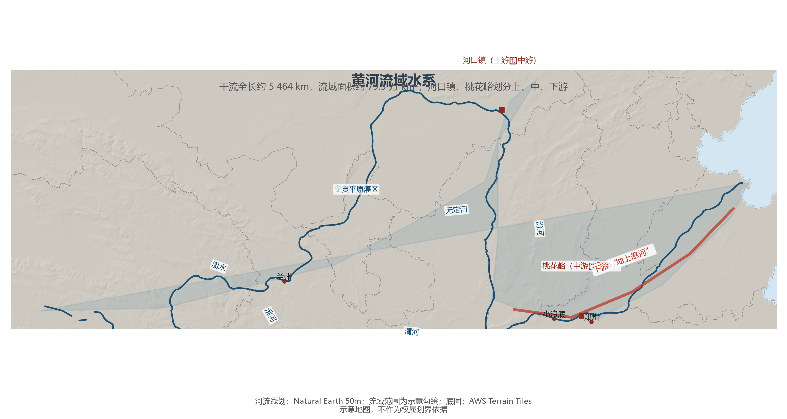

# 5.3 黄河

黄河是中国第二长河：干流全长约 5 464 km，流域面积约 79.5 万 km²。它发源于巴颜喀拉山北麓，以一个巨大的"几"字形环绕黄土高原与内蒙古高原，注入渤海。黄河的关键词不是"长"，也不是"大"（年径流量仅约 580 亿 m³，不到长江的 6%），而是**泥沙**——"一碗水，半碗沙"，含沙量曾长期居世界第一。

**图 5-4 黄河流域水系**：河口镇、桃花峪划分上、中、下游；红色为下游"地上悬河"河段（示意）。

## 一、上中下游：水与沙的三段旅程

- **上游**（源头—河口镇）：穿越高原与峡谷，兰州以下进入宁夏平原与河套平原，塑造了"黄河百害，唯富一套"的灌溉绿洲；水清而量稳。
- **中游**（河口镇—桃花峪）：穿行晋陕峡谷，接纳汾河、渭河等支流，纵贯黄土高原——**90% 的黄河泥沙来自中游**，龙门站多年平均含沙量约 30 kg/m³，汛期一度超过 100 kg/m³。
- **下游**（桃花峪—入海）：进入华北平原后坡降骤缓，泥沙大量淤积，河床以每年约 10 cm 的速度抬高，两岸大堤内的河床普遍高出背河地面 4—6 m，最深处逾 10 m——这就是"地上悬河"。历史上"三年两决口、百年一改道"（较大改道 26 次），北至天津、南夺淮河的扇形冲积扇，就是一次次决口改道写下的地质档案。

## 二、调水调沙：人与大河的和解

1972—1999 年间，黄河下游 22 年出现断流，1997 年断流长达 226 天。此后水量统一调度与黄土高原水土保持（淤地坝、梯田、退耕还林）双管齐下：2000 年以来黄河已连续 25 年不断流；潼关站输沙量已从历史均值约 16 亿 t 降至 2000 年后的 2 亿 t 以下——黄土高原由"输沙源"转向"拦沙汇"。2002 年起实施的小浪底"调水调沙"，用人工洪峰把淤沙冲入大海，塑造出稳定的河槽。

## 三、世界视角：泥沙塑造的土地

黄河是世界上输沙量曾经最大的河流，其三角洲至今仍以每年数千米的速度向渤海推进。在世界大河中，黄河的特殊性在于"泥沙与文明同步"——它既是华夏文明的摇篮，也以 2 500 余年的决溢史成为世界上被治理时间最长的大河。恒河的含沙量、密西西比的冲积平原都可与黄河类比，但"悬河三百年不改、岁岁安澜"的人工治理规模，只有黄河做到了。

## 参考与数据来源

1. 长度、流域面积、径流量、含沙量与输沙量：黄河水利委员会《黄河泥沙公报》《中国河流泥沙公报》。
2. 断流与调水调沙：水利部黄河水利委员会公开资料。
3. 河流线划：Natural Earth 50m；流域范围为示意勾绘。
