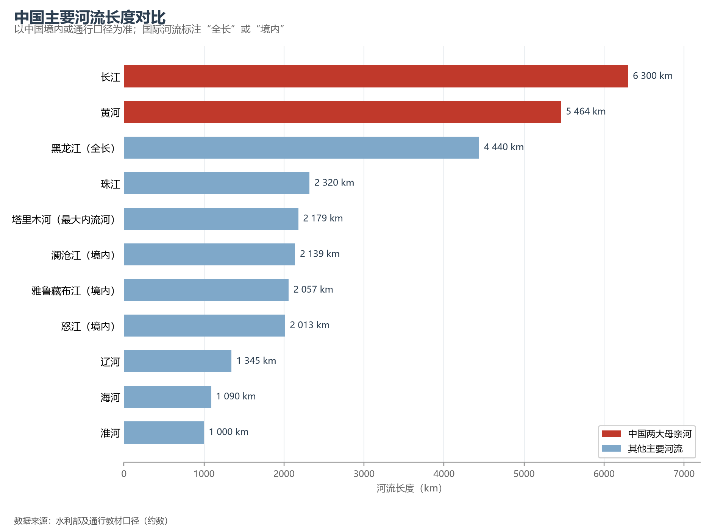

# 5.4 其他主要河流

长江黄河之外，中国还有数十条各具性格的大河：有的水量丰沛（珠江），有的横跨国界（黑龙江、澜沧江），有的深居内陆（塔里木河）。它们共同的特点是——每一条都对应着一个流域、一种农业、一段文明。

**图 5-2 中国主要河流长度对比**：以中国境内或通行口径为准。

| 河流 | 长度（约） | 注入 | 关键词 |
|------|-----------|------|--------|
| 珠江 | 2 320 km | 南海 | 水量全国第二（年径流约 3 300 亿 m³），含西江、北江、东江 |
| 黑龙江 | 4 440 km（全长） | 鄂霍次克海 | 中俄界河，结冰期最长的大河 |
| 松花江 | 1 927 km | 黑龙江 | 东北水网主干，滋养松嫩平原 |
| 辽河 | 1 345 km | 渤海 | 东北南部，重工业摇篮的水源 |
| 海河 | 1 090 km（扇状水系） | 渤海 | 华北水患与缺水并存，京津冀的命脉 |
| 淮河 | 约 1 000 km | 长江（入江水道）/黄海 | 南北气候界线的载体，"大雨大灾、小雨小灾"的治理史 |
| 雅鲁藏布江 | 2 057 km（境内） | 印度洋（出境后为布拉马普特拉河） | 世界海拔最高的大河，大峡谷最深逾 6 000 m |
| 澜沧江 | 2 139 km（境内） | 南海（出境后为湄公河） | "东方多瑙河"，连接六国的国际河流 |
| 怒江 | 2 013 km（境内） | 安达曼海（出境后为萨尔温江） | 三江并流成员，原始河谷保存最好 |
| 塔里木河 | 2 179 km | 台特马湖（内流） | 中国最大内流河，纯靠冰雪融水 |

三条值得关注的水文性格。**珠江**流域面积不足长江四分之一，水量却达长江的三分之一——全国单位面积产水量最高的主要河流，珠三角因此成为水运与水田的双重天堂。**雅鲁藏布江**在藏南的雅鲁藏布大峡谷以 504.6 km 的长度与逾 6 000 m 的深度冠绝全球峡谷，且蕴藏着全国约六分之一的水能理论蕴藏量（雅鲁藏布江下游水电工程已于 2024 年核准开工）。**海河与淮河**则是"治水国家"的最好注脚：海河流域人均水资源量不足全国平均的十分之一，淮河自 1950 年"一定要把淮河修好"起，成为新中国第一条系统治理的大河。

## 世界视角：跨境水的地缘

中国是亚洲水塔，发源或流经中国的大河滋养着下游约 20 个国家——澜沧江—湄公河流经缅甸、老挝、泰国、柬埔寨、越南，布拉马普特拉河进入印度与孟加拉国。跨境河流既是合作纽带（澜湄合作机制），也使中国的水坝与降水成为区域议题。这种"上游地位"只有中国与俄罗斯、土耳其等少数大国具备。

## 参考与数据来源

1. 河流长度与径流量：水利部及流域机构公开资料、通行教材口径（约数）。
2. 雅鲁藏布江下游水电工程：2024 年 12 月国家核准立项。
3. 河流线划：Natural Earth 50m。
