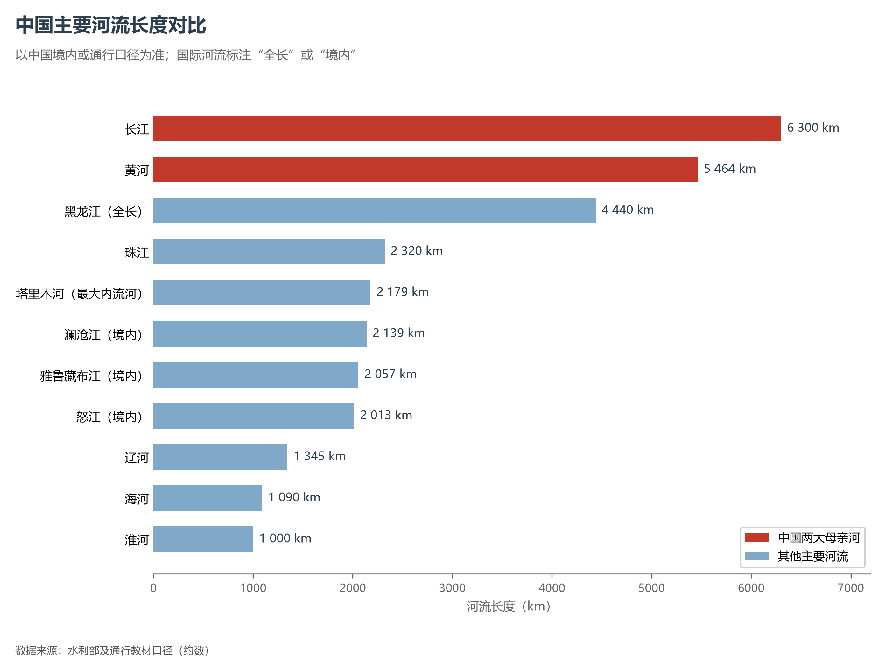

# 5.4 其他主要河流

在长江与黄河这两条举世瞩目的巨川之外，中国大地上还奔淌着数以千计各具鲜明水文性格的大江大河：流域面积在 1 000 km² 以上的河流有 1 500 余条，100 km² 以上的河流多达 22 000 余条。

这些河流有的水量充沛澎湃（如珠江），有的横贯寒带林海与国界（如黑龙江），有的以深切峡谷冠绝全球（如雅鲁藏布江），有的则深嵌于大沙漠边缘滋养绿洲（如塔里木河）。它们每一条都独立滋养着一个宏阔的自然流域，塑造了一种生生不息的农业形态，更承载着中华各民族丰富灿烂的区域文明与当代地缘合作。

**图 5-2 中国主要河流长度对比**：以中国境内或通行口径为准。

---

## 一、中国主要骨干江河全景谱系

| 河流名称 | 全长 / 境内长 | 流域面积（境内） | 多年平均径流量 | 注入大洋 / 归宿 | 水文与流域核心特征 | 沿岸核心城市与现代战略定位 |
|:---|:---|:---|:---|:---|:---|:---|
| **珠江** | 2 320 km | 45.4 万 km² | **约 3 360 亿 m³** （全国第二） | 太平洋（南海） | 水量极大（仅次于长江，是黄河的近6倍）；产水模数全国最高；由西江、北江、东江三大水系汇流而成 | 广州、深圳、香港、佛山、南宁；粤港澳大湾区生命线、平陆运河出海通道 |
| **黑龙江** （阿穆尔河） | 4 440 km（全长） （中俄界河约3000km） | 88.7 万 km² | 约 2 720 亿 m³ （全流域3460亿） | 鄂霍次克海 | 结冰期最长的大河（每年结冰 5—6 个月，流冰期凌汛）；中俄最大界河；水质极为优良，冷水性鱼类宝库 | 哈尔滨（松花江）、齐齐哈尔、佳木斯、黑河；东北黑土地粮仓水网主轴 |
| **松花江** | 1 927 km | 55.7 万 km² | 约 762 亿 m³ | 黑龙江（最大支流） | 东北平原水网主干；由嫩江与二道松花江在三岔河汇流；春秋双汛（春季融雪凌汛，夏季暴雨夏汛） | 哈尔滨、吉林、齐齐哈尔；国家超级商品粮基地最核心灌溉水源 |
| **辽河** | 1 345 km | 22.9 万 km² | 约 150 亿 m³ | 太平洋（渤海辽东湾） | 由东辽河与西辽河汇流；泥沙含量较高；地处温带半湿润区，季节分配集中 | 沈阳、鞍山、盘锦、营口；东北重工业摇篮与辽河油田腹地 |
| **海河** | 1 090 km（干支全长） （干流长仅 73 km） | 26.4 万 km² | 约 220 亿 m³ | 太平洋（渤海湾） | 典型“扇形水系”（九河下梢）；汇水极快极易造成下游特大洪涝；流域人均水资源仅 250 m³，全国缺水最甚 | 北京、天津、石家庄、保定；京津冀协同发展核心区；南水北调受水重心 |
| **淮河** | 约 1 000 km | 27.0 万 km² | 约 620 亿 m³ | 长江（入江水道）与黄海（入海水道） | 南北气候界线载体；历史上长期受黄河夺淮淤塞；“大雨大灾、小雨小灾、无雨旱灾”；新中国治淮第一河 | 淮安、蚌埠、信阳、阜阳；国家南北粮食过渡带与综合防洪减灾标杆 |
| **雅鲁藏布江** | 2 057 km（境内） （全长 2 880 km） | 24.0 万 km² | 约 1 650 亿 m³ | 印度洋（出境为布拉马普特拉河注入孟加拉湾） | 世界海拔最高大河（源头海拔 > 5 500 m）；雅鲁藏布大峡谷全长 504.6 km，最深达 6 009 m；水能理论蕴藏量占全国 1/6 | 日喀则、拉萨（拉萨河汇入）、林芝；雅鲁藏布江下游世界级水电基地建设 |
| **澜沧江** | 2 139 km（境内） （全长 4 880 km） | 16.7 万 km² | 约 740 亿 m³ | 太平洋（出境为湄公河注入南海） | “东方多瑙河”；一江连六国（中、老、缅、泰、柬、越）；深切高山峡谷，全流域梯级水电滚滚东送 | 昌都、景洪；澜湄合作国际地缘水资源合作枢纽 |
| **怒江** | 2 013 km（境内） （全长 3 240 km） | 13.8 万 km² | 约 690 亿 m³ | 印度洋（出境为萨尔温江注入安达曼海） | “三江并流”世界遗产成员；保留完整原始生态景观的自由流淌峡谷大江 | 那曲、保山、泸水；横断山区生态多样性保护天然走廊 |
| **塔里木河** | 2 179 km（干支全长） （干流 1 321 km） | 102.0 万 km² | 约 50 亿 m³（干流） （各源流 240 亿） | 内流河（注入台特马湖） | **中国最长内流河**；纯靠天山与昆仑山冰雪融水补给；滋润全球最大天然胡杨林保护区 | 阿克苏、阿拉尔、库尔勒；环塔里木盆地绿洲农业与沙漠公路防护 |

---

## 二、南方江河王者：珠江水系的丰水与水运奇迹

在南方广袤的大地上，**珠江**展现出与其相对紧凑的流域面积完全不相称的巨量水文能级：

- **水量仅次于长江的中国第二大河**：珠江流域面积（45.4 万 km²）仅为长江的 1/4、黄河的 1/2 左右，但其多年平均年径流量却高达 **3 360 亿 m³**，在全国各大江河中高居**第二位**，是黄河水量的近 **6 倍**。这得益于其地处热带与南亚热带多雨带，全流域年均降水量在 1 200—2 200 mm 之间，单位面积产水量（产水模数）傲视全国；
- **“三江汇流”的水运天堂**：珠江由**西江**（长 2 214 km，水系干流）、**北江**与**东江**汇流而成，在珠江三角洲冲积出星罗棋布的水网，通过八大口门（崖门、虎跳门、鸡啼门、磨刀门、洪奇门、横门、蕉门、虎门）注入南海。其中，东江水质清澈，是**东深供水工程**的源头，承担着香港特区约 75% 的日常淡水供应与深圳的用水命脉；
- **平陆运河**：平陆运河全长约 134.2 km，连接西江水系与北部湾钦州港，为西南地区提供新的江海联运通道。

---

## 三、北方江河与水土治理的世纪沧桑

与南方丰沛江河截然不同，北方的海河与淮河则集中体现了人地矛盾与治水防灾的极限抗争：

### 1. 海河水系：大水患与大水荒的双重交织
海河水系呈极其特殊的**掌状（扇形）水系**分布：由北运河、永定河、大清河、子牙河、南运河五大干支流自燕山和太行山区汇流至天津市区三岔河口，干流仅长 73 km，最终注入渤海。
- **极端脆弱的防洪格局**：上游山区面积占 60%，坡度极陡，一旦遭遇极端强暴雨（如 1963 年特大暴雨、2023 年“23·7”大洪水），各支流山洪几小时内同时涌入狭窄的扇形平原，形成巨大的汇流洪峰；
- **极度贫乏的人均水资源**：海河流域承载着北京、天津、雄安新区等超大城市群与密集工业，流域人均水资源量仅 **250 m³ 左右**，属于极度水荒区。南水北调中线工程通水后，每年为海河流域注入数十亿立方米丹江口清水，才使断流干涸数十年的永定河、潮白河等北方大河重新实现全线贯通入海。

### 2. 淮河：新中国第一条系统治理的母亲河
淮河发源于河南省桐柏山，介于长江与黄河两大流域之间，是自然地理上划分中国南北方气候的天然水系。
- **黄河夺淮的千年创伤**：在历史上黄河夺淮入海的 700 年间，黄河泥沙将淮河下游原有的入海出水道彻底淤死，导致淮河被迫改道借道洪泽湖、汇入长江入海，形成了极易在夏季诱发大洪涝的洼地水系；
- **从“一定要把淮河修好”到淮河安澜**：1950 年毛泽东同志发出“一定要把淮河修好”的伟大号召，国家先后建成了以佛子岭水库、梅山水库为代表的大别山大型水库群，开辟了**淮河入江水道、苏北灌溉总渠与淮河入海水道**，成功实现了淮河流域大水有泄路、大旱有蓄水，成为华夏大河由水患频仍走向水利富民的经典史诗。

---

## 四、世界视角：亚洲水塔与跨境大河的地缘格局

从地缘水文角度审视，中国西南部青藏高原作为“**亚洲水塔**”，是全亚洲最重要的跨国河流源头聚集区：

1. **跨境水系网络与地缘依存**：
   - **澜沧江—湄公河**：流经中、老、缅、泰、柬、越六国，维系着下游数千万人口的稻田灌溉与湄公河三角洲生态平衡。中国通过“**澜湄合作机制**”，在汛期防洪、枯水期应急补水、航运通航与水文数据共享方面，与下游国家建立了紧密深厚的地缘水外交纽带；
   - **雅鲁藏布江—布拉马普特拉河**：奔涌出境后流入印度阿萨姆邦与孟加拉国，滋养着南亚数亿平民；
   - **黑龙江（阿穆尔河）**：全长 4 440 km，中俄长达 3 000 公里的界河保持着长期的跨境生态合作与口岸贸易往来。
2. **上游大国的生态责任与工程实力**：
   全球范围内，同时拥有如此庞大数量跨国大河源头的国家唯有中国。中国在科学推进雅鲁藏布江下游梯级开发、澜沧江水电清洁能源开发的同时，始终坚持以水文监测共享、枯季调丰补枯等负责任的方式推进区域合作，将滔滔江河打造成为促进亚洲共同和平与繁荣的“绿色纽带”。

---

## 参考与数据来源

1. 各主要河流长度、流域面积与多年平均径流量：中华人民共和国水利部《中国水资源公报》、珠江水利委员会与松辽水利委员会官方通报。
2. 平陆运河工程技术参数：广西壮族自治区交通运输厅、平陆运河集团有限公司公开建设资料。
3. 雅鲁藏布大峡谷测量数据：国家测绘地理信息局、中国科学院地理科学与资源研究所大峡谷科学考察公报。
4. 国际跨境河流合作：外交部澜沧江—湄公河合作中国秘书处官方公报。
