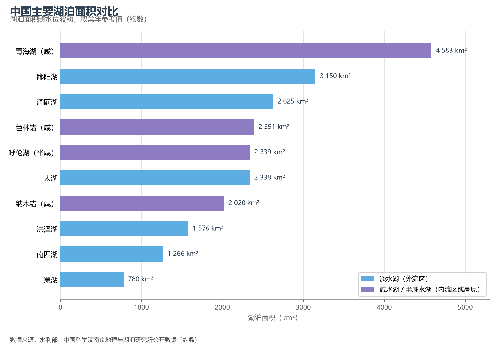
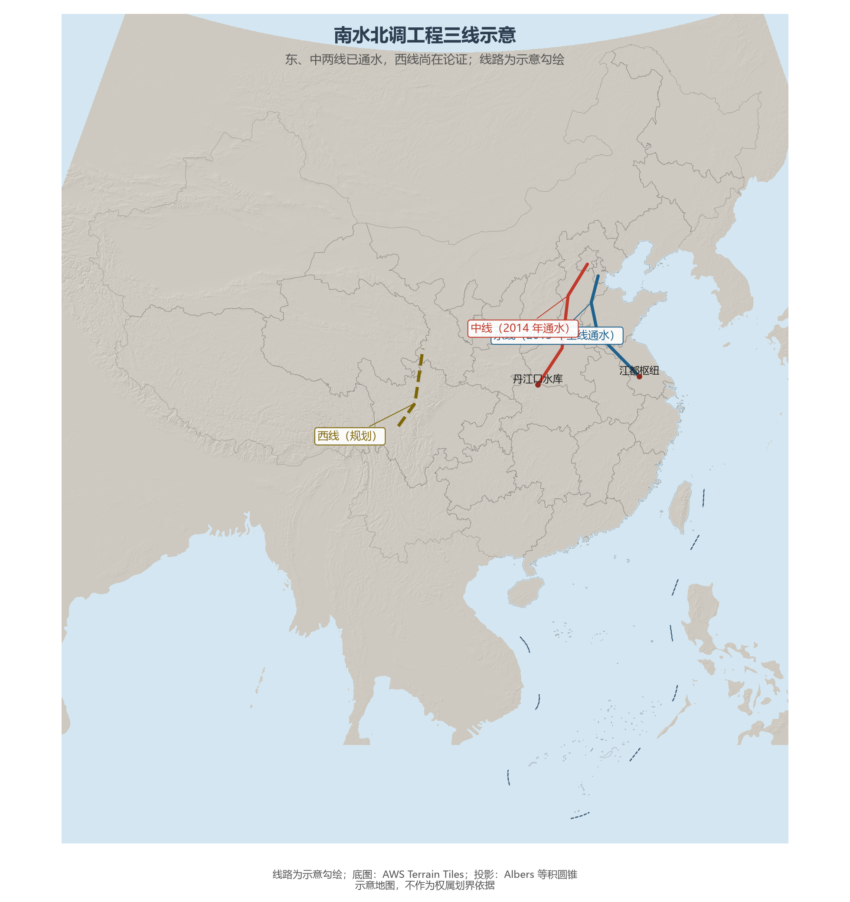

# 5.5 湖泊与水资源

中国有面积 1 km² 以上的天然湖泊 2 800 余个（2020 年代普查口径），东与西呈现两种截然不同的湖群：外流区的**淡水湖**靠江河吐纳，水位随季节涨落；内流区与青藏高原的**咸水湖**只进不出，盐分千年累积。全国水资源总量常年约 2.7—3.1 万亿 m³（2025 年为 2.72 万亿 m³），但人均只有约 2 000 m³——约为世界平均的三分之一。

**图 5-6 中国主要湖泊面积对比**：紫色为咸水湖或半咸水湖，蓝色为淡水湖。

## 一、五湖四海：湖泊档案

- **青海湖**：面积约 4 583 km²，中国最大湖泊、最大咸水湖，湖面海拔约 3 196 m——半个世纪以来水位持续回升，湖面逐年扩大；
- **鄱阳湖**：中国最大淡水湖，平水期约 3 150 km²，丰枯之间可达数倍之差，是长江中游最重要的调蓄湖与白鹤越冬地；
- **洞庭湖**：曾是中国第一大淡水湖，因泥沙淤积与围垦退居第二，"洞庭天下水"的气魄之下是持续萎缩的湖面；
- **太湖**：约 2 338 km²，长江三角洲的水缸，平均水深不足 2 m，富营养化治理三十年；
- **色林错**：约 2 391 km²，青藏高原变暖变湿的"指示器"——冰川退缩使它近二十年扩张至西藏第一大湖。

青藏高原湖泊群是中国湖泊水量的主体：全国湖泊水量的七成以上储存在高原湖群中，且多数仍在扩张——这与东部湖泊的萎缩构成了一组耐人寻味的对照。

## 二、水资源：总量可观，人均紧张

2025 年全国水资源总量 27 229.3 亿 m³，用水总量 5 944.5 亿 m³（用水效率居世界前列）；用水结构中农业约占 62%、工业与生活各占约 16%、生态约 7%。空间错配是主要矛盾：长江流域以约 35% 的水资源支撑约三成的人口，而黄淮海流域以 7.2% 的水资源承载约 35% 的人口与经济总量——地下水曾长期超采，华北平原累计亏空相当于上千亿 m³。

**图 5-7 南水北调工程三线示意**：东、中线已通水，西线在论证；线路为示意勾绘。

## 三、南水北调：把水搬过胡焕庸线

南水北调是世界最大的调水工程，三条线路各有分工：**东线**沿京杭大运河逐级北送（2013 年全线通水），**中线**自丹江口水库自流经郑州、石家庄到北京（2014 年通水），**西线**拟从长江上游调水入黄河上游，尚在论证。截至 2024 年，东中线累计调水逾 760 亿 m³，直接受益人口超 1.85 亿——北京城区七成以上供水来自南水。它改变的不仅是水量，更是华北地下水超采的止血阀与黄河流域的生态回补来源。

## 世界视角：人均水位的差距

世界人均可再生水资源约 5 500 m³，中国约 2 000 m³，以色列约 270 m³、新加坡近乎为零——中国的水紧张不是"最紧张"，而是"总量大、错配狠"：把南方的水送到北方，把丰水年的水存到枯水年，把浑水变成清水，这三件事的工程规模都居世界前列。加拿大（人均约 8 万 m³）与中国（约 2 000 m³）的差距提醒我们：水资源的真正约束从来不是总量，而是人与水的空间关系。

## 参考与数据来源

1. 水资源总量与用水结构：水利部《中国水资源公报》（2025 年）。
2. 湖泊数量与面积：中国科学院南京地理与湖泊研究所《中国湖泊志》及全国湖泊调查更新数据；青海湖、色林错面积取青海湖保护局、西藏自治区相关部门 2023—2024 年监测值。
3. 南水北调调水量：中国南水北调集团有限公司公开数据（截至 2024 年）。
