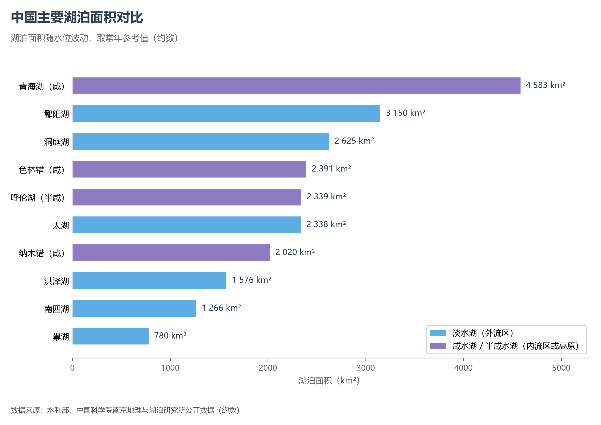
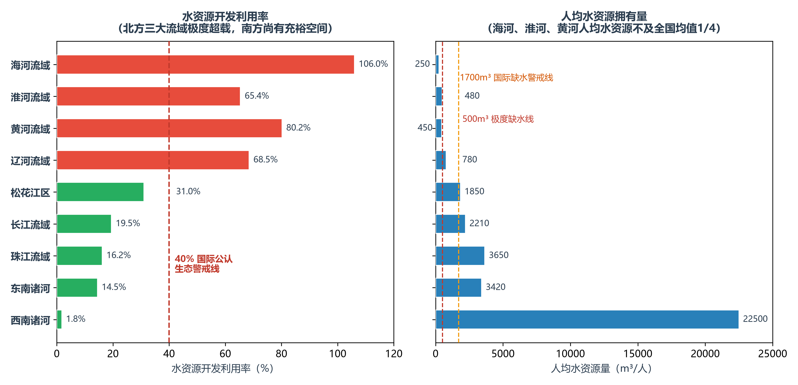
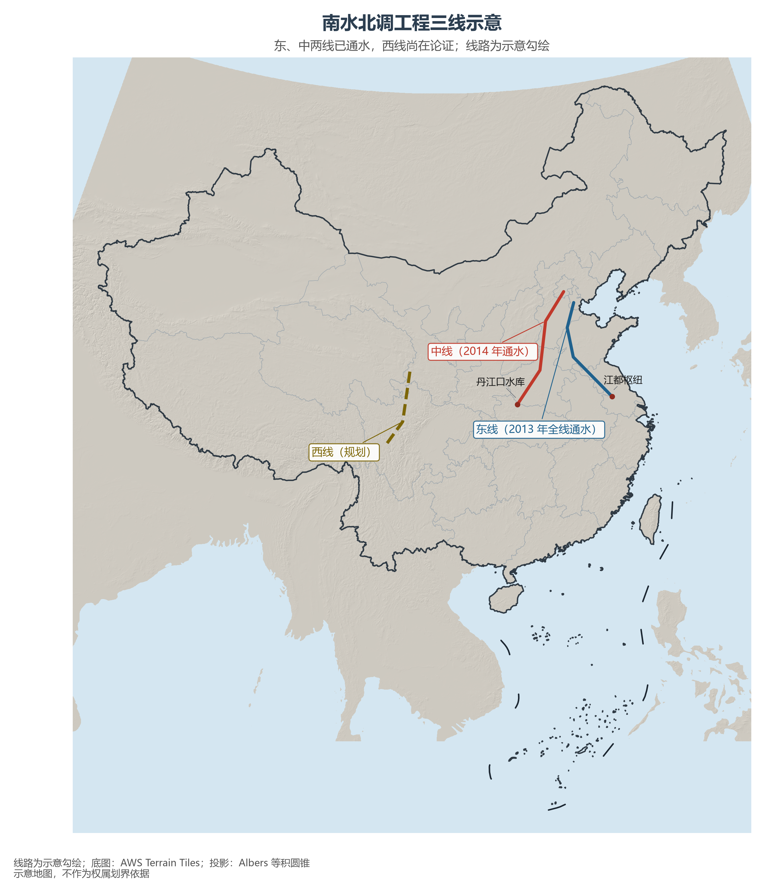

# 5.5 湖泊与水资源

在奔腾不息的江河网络之间，成千上万座大大小小的天然湖泊如同一颗颗璀璨的明珠，点缀在华夏大地的崇山峻岭与平原洼地之中。据全国湖泊资源科学普查统计，中国境内面积大于 1 km² 的天然湖泊有 **2 800 余个**，常年湖泊总面积达 **8.2 万余 km²**，湖泊水资源蓄水量逾 **8 000 亿 m³**。

然而，水资源的天然禀赋与人类经济社会的空间分布之间，存在着极其尖锐的矛盾：中国多年平均水资源总量居世界第六位，但人均水资源量仅为世界平均水平的 1/3 到 1/4，且呈现出极其悬殊的“**南丰北缺、南充北涸**”宏观格局。正是这种严峻的自然地理约束，催生了当代中国构筑“国家水网”、实施跨流域大调水的超级工程体系。

**图 5-6 中国主要湖泊面积对比**：紫色为咸水湖或半咸水湖，蓝色为淡水湖。

**图 5-9 主要水资源分区水资源开发利用率与人均水资源量对比**：海河、黄河与淮河流域开发利用率极度逼近或超过警戒红线，南方水资源相对充裕，构成了国家跨流域调水的客观必然性。

---

## 一、湖泊大家族：五大湖区与咸淡两分水

受地质构造演化、补给来源与干湿气候分异影响，中国的湖泊在地理分布上呈现出高度集中的**五大湖区**格局（东部平原湖区、青藏高原湖区、蒙新高原湖区、东北平原与山地湖区、云贵高原湖区），并在水质化学特征上严格分化为**外流淡水湖**与**内陆咸水湖/盐湖**两大类型：

| 湖泊名称 | 所在省区 | 湖面面积（约） | 湖面海拔 | 咸淡水属性 | 最大水深 / 平均水深 | 核心水文功能与生态战略地位 |
|:---|:---|:---|:---|:---|:---|:---|
| **青海湖** | 青海省 | **4 583 km²** | 3 196 m | 咸水湖（微咸水） | 31.4 m / 21.0 m | **中国面积最大的湖泊、最大的咸水湖**；半个世纪以来水位持续攀升扩张；青海湖裸鲤（湟鱼）与候鸟天堂 |
| **鄱阳湖** | 江西省 | **约 3 150 km²** （丰水期 > 4 000） | 21 m | 淡水湖 | 25.1 m / 8.4 m | **中国面积最大的淡水湖**；长江中游特大吞吐调蓄湖；全球 98% 白鹤种群冬季栖息地；丰枯水位变幅达十余米 |
| **洞庭湖** | 湖南省 | **2 579 km²** | 33 m | 淡水湖 | 30.8 m / 6.7 m | **中国第二大淡水湖**；长江荆江河段最关键的天然蓄洪盆地；纳湘资沅澧四水汇流长江；退田还湖生态修复示范区 |
| **太湖** | 江苏/浙江 | **2 338 km²** | 3 m | 淡水湖 | 4.8 m / 1.9 m | **长三角核心水缸**；典型浅水浅碟形湖泊；蓄泄长江与钱塘江水系，河网密布；富营养化综合治理样板 |
| **色林错** | 西藏自治区 | **2 391 km²** | 4 530 m | 咸水湖 | 33.0 m / 18.0 m | **西藏面积第一大湖泊**；由于青藏高原冰川消融与降水增多，近二十年面积急剧扩张，超越纳木错成为藏北新霸主 |
| **洪泽湖** | 江苏省 | **2 069 km²** | 12 m | 淡水湖 | 4.5 m / 1.8 m | 中国第四大淡水湖；地处淮河下游的过水型浅水湖泊；南水北调东线工程关键过境调蓄水库 |
| **纳木错** | 西藏自治区 | **2 020 km²** | 4 718 m | 咸水湖 | 120.0 m / 33.0 m | **世界上海拔最高的大型深水湖之一**；念青唐古拉山北麓古冰川与地质构造断陷湖；水质透明度高居全国前列 |
| **呼伦湖** （达赉湖） | 内蒙古自治区 | **2 046 km²** | 545 m | 半咸水 / 吞吐湖 | 8.0 m / 5.7 m | 内蒙古第一大湖，呼伦贝尔大草原生态明珠；高纬度寒冷草原吞吐湖，额尔古纳河水系重要调节节点 |
| **博斯腾湖** | 新疆维吾尔自治区 | **1 210 km²** | 1 048 m | 淡水湖（微咸） | 16.0 m / 9.0 m | **中国最大的内陆吞吐淡水湖**；开都河的尾闾与孔雀河的源头；天山南坡焉耆盆地的绿洲生命水源 |
| **察尔汗盐湖** | 青海省柴达木 | **5 856 km²** | 2 670 m | 干盐湖 / 晶间卤水 | 盐层厚达数米至数十米 | **中国最大可溶性钾镁盐矿床**；蕴藏氯化钾储量占全国 80% 以上；青藏铁路直接铺设在数米厚“万丈盐桥”坚硬盐盖之上 |

---

## 二、水资源总账：总量可观、人均紧缺与空间极度错配

根据水利部《中国水资源公报》，我国年水资源总体特征可高度概括为三句话：**总量居世界前列，人均极为贫乏，空间严重错配**。

### 1. 总量与人均的宏观反差
- **总量可观**：全国多年平均水资源总量约为 **2.7—2.8 万亿 m³**（2025 年约为 27 229.3 亿 m³），仅次于巴西、俄罗斯、加拿大、美国与印度尼西亚，稳居**世界第六位**；
- **人均极低**：由于人口基数庞大，我国人均水资源占有量仅约为 **2 000 m³**，不足世界人均拥有量的三分之一，在联合国粮农组织评价体系中属于“中度缺水大国”。

### 2. 空间错配的严峻现实（图 5-9）
从图 5-9 的双子图可以看出，我国水资源在水土资源配置上呈现极其触目惊心的割裂状态：
- **“南方四区”水多地少**：长江流域、珠江流域、东南诸河与西南诸河，土地面积仅占全国约 36%，却拥有全国 **81% 的水资源总量**；水资源开发利用率普遍在 15%—20% 之间，水资源环境承载力充裕；
- **“北方六区”水少地多**：黄河、淮河、海河、辽河、松花江与西北内陆区，占全国陆地面积的 64%，但水资源总量仅占全国的 **19%**；
- **“黄淮海”平原的水资源极度超载红线**：华北平原的黄河、淮河、海河三大流域，汇集了全国 35% 的人口、38.5% 的耕地与超过 35% 的经济总量，但**三大流域水资源总量仅占全国的 7.2%**！
  - 海河流域水资源开发利用率高达 **106%**（长期超采深层地下水形成数万平方公里的地下降落漏斗）；
  - 黄河流域开发利用率达 **80.2%**，淮河流域达 **65.4%**；
  - 三大流域全部远远击穿了国际公认的 **40% 生态安全红线**！这种“缺水即停摆”的刚性空间矛盾，是制约北方经济社会发展的最大自然瓶颈。

---

## 三、国家水网与重大世纪引调水工程

为化解“南方水有余，北方水严重不足”的水资源空间错配难题，中国历经数十年科学论证，构建起以“**南水北调**”为超级骨架的现代国家大水网体系：

**图 5-7 南水北调工程三线示意**：东、中线已通水，西线在论证；线路为示意勾绘。

### 1. 南水北调：跨越千里的世纪战略大动脉
- **东线工程**：从长江下游江苏扬州江都水利枢纽抽水，利用京杭大运河及平行渠道逐级设立 13 级大型提水泵站（总扬程 65 米），途经洪泽湖、骆马湖、南四湖、东平湖，穿过黄河底部特长隧洞后，自流分水至天津与山东半岛（2013 年底正式通水运营）；
- **中线工程**：从长江最大支流汉江中游的**丹江口水库**陶岔渠首全线自流引水，渠道沿伏牛山和太行山东麓开凿 1 432 公里的全封闭人工明渠与巨型倒虹吸，在郑州穿过黄河隧道，直抵北京颐和园团城湖与天津外环河（2014 年底正式通水运营）。
  - *宏大效益*：截至 2024 年底，南水北调东中线一期工程累计调水量突破 **760 亿 m³**，直接受益人口超过 **1.85 亿人**。北京城区南水供水占比超七成，彻底改变了首都的水资源格局；向华北沿线 50 余条河流进行生态补水，推动华北地下水水位实现历史性止跌回升，断流数十年的大运河实现全线水流贯通；
- **西线工程**：拟从长江上游通天河、雅砻江、大渡河等水系，通过穿越巴颜喀拉山脉的特长深埋隧洞群，调水入黄河上游青海与甘肃河段，目前正加快前期规划论证。

### 2. 重大区域引调水工程齐头并进
除了南水北调国家骨网，各大区域级战略引调水工程全面落地突破：
- **引汉济渭工程**：2023 年 7 月实现先期通水。工程以长达 **98.3 公里**、最大埋深逾 2 000 米的特长秦岭输水隧洞，彻底凿穿中国南北方分界线秦岭山脉，将长江水系汉江清水送入黄河最大支流渭河，根本上缓解了西安特大城市与关中平原的水荒；
- **引江补汉工程**（在建）：从三峡水库直接取水，打通连通丹江口水库下游的超深长隧洞，为南水北调中线提供源源不断的后续充沛水源；
- **引江济淮工程**：2022 年底实现试通水试通航，横跨淮河与长江水系，不仅缓解淮北缺水，更为皖豫开辟出千吨级江淮运河第二黄金出海通道；
- **滇中引水与环北部湾工程**：滇中引水从金沙江石鼓段调水润泽昆明高原旱区；环北部湾广东水资源配置工程从西江调水，彻底终结雷州半岛红土旱区的千年缺水历史。

---

## 四、“四水四定”与现代水安全治理

面对人多水少、水时空分布不均的客观国情，中国的治水理念经历了从“向自然无限索取”到“人水和谐共生”的深刻制度变革：

1. **“节水优先、空间均衡、系统治理、两手发力”治水方针**：将节约用水作为解决水资源紧缺的根本出路。全面推行农业滴灌喷灌技术、高标准农田水肥一体化；工业全面提升水循环利用率，万亿元 GDP 用水量在过去十年下降超过 45%；
2. **落实“四水四定”刚性约束制度**：严格贯彻落实**“以水定城、以水定地、以水定人、以水定产”**，把水资源水环境承载能力作为国土空间总体规划与重大产业布局的前置条件，严禁无视水资源禀赋盲目上马高耗水工业；
3. **世界视角的水文明转型**：中国以占全球 6% 的淡水资源，成功支撑了占全球近 18% 的人口、创造了全球近 18% 的经济总量。从古老的水患围困，到今日宏伟的国家水网、全流域水量调度与全面地下水压采治理，中国正在为发展中大国化解水资源刚性约束、迈向人水和谐现代化探索出不可替代的中国典范。

---

## 参考与数据来源

1. 全国湖泊调查数据：中国科学院南京地理与湖泊研究所《中国湖泊志》、水利部水文司全国大中型水库与湖泊特征值表。
2. 青海湖与色林错水文监测：青海省水文水资源测报中心、西藏自治区生态环境厅公开遥感监测公报。
3. 水资源开发利用率与分区分水大账：中华人民共和国水利部《中国水资源公报》《水资源管理年报（2024）》。
4. 南水北调工程运行与调水量：中国南水北调集团有限公司官方年度运行统计数据（截至 2024 年底调水超 760 亿 m³）。
