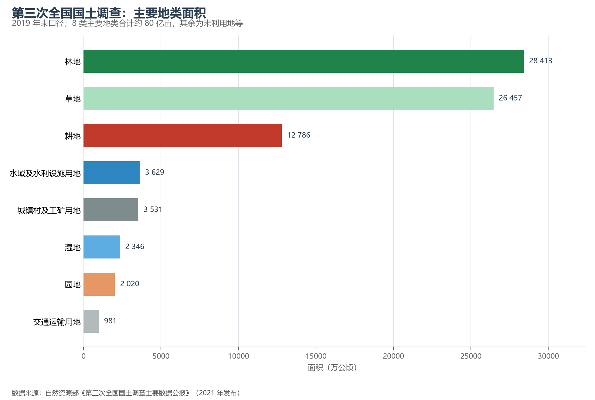

# 6.1 土地资源与"三调"

土地是一切地理要素的承载体。2018—2019 年开展的**第三次全国国土调查**（"三调"，以 2019 年末为标准时点，2021 年公布），以优于 1 米分辨率的遥感影像为基础，对全国每一块图斑"到图入库"，是迄今最精细的一次国土家底盘点。它的结论既回答了"有什么"，也回答了"紧不紧"。

**图 6-1 三调主要地类面积**：林地与草地合计近 5.5 亿公顷，是国土的生态底盘；耕地是面积最大的农用地类型。

## 一、家底：一亩一亩数出来的国土

三调主要地类中，**耕地 12 786.19 万公顷（19.18 亿亩）**、园地 2 019.55 万公顷、林地 28 412.59 万公顷、草地 26 456.99 万公顷、湿地 2 346.03 万公顷，建设用地（城镇村及工矿用地）3 530.64 万公顷，交通运输用地 980.99 万公顷，水域及水利设施用地 3 628.79 万公顷。三个结构性事实值得记住：

- **耕地占比低**：19.18 亿亩耕地只占国土的 13.3%，人均约 1.36 亩——不到世界平均水平的一半；
- **优质耕地少**：位于年降水量 400 mm 线以西、灌溉条件差或坡度大于 25 度的耕地占相当比例，真正的高产稳产田集中在东北平原、华北平原与长江中下游平原；
- **生态用地是底盘**：林地加草地近 5.5 亿公顷，占国土 57%——这既是生态安全的本钱，也意味着农业扩张的天花板早已触顶。

## 二、"十分珍惜、合理利用土地"：为什么是基本国策

1986 年，《土地管理法》把"十分珍惜、合理利用土地和切实保护耕地"确立为基本国策。背后的算术很朴素：全国每年建设用地增量以百万亩计，而耕地后备资源已不足 8 000 万亩，其中可开垦成耕地的不足一半。土地的中国故事，就是 19.18 亿亩耕地与 14 亿人口之间的永续匹配问题——这也是下一节耕地保护制度全部逻辑的起点。

## 三、世界视角：大国土地禀赋的排行

以人均耕地论，中国（约 1.4 亩/人）远低于美国（约 7 亩/人）、俄罗斯（约 13 亩/人）、印度（约 2.4 亩/人），与日本、韩国同处"耕地紧缺"组。中国的应对方式也自成一派：以占全球 9% 的耕地、6% 的淡水资源，供养全球近 18% 的人口——单产（约 430 kg/亩的粮食平均单产）位居世界前列。土地紧缺倒逼出的集约农业，是中国地理最鲜明的个性之一。

## 参考与数据来源

1. 地类面积：自然资源部《第三次全国国土调查主要数据公报》（2021 年 8 月发布）。
2. 国际对比：世界银行公开数据与 FAO 统计（约数）。
