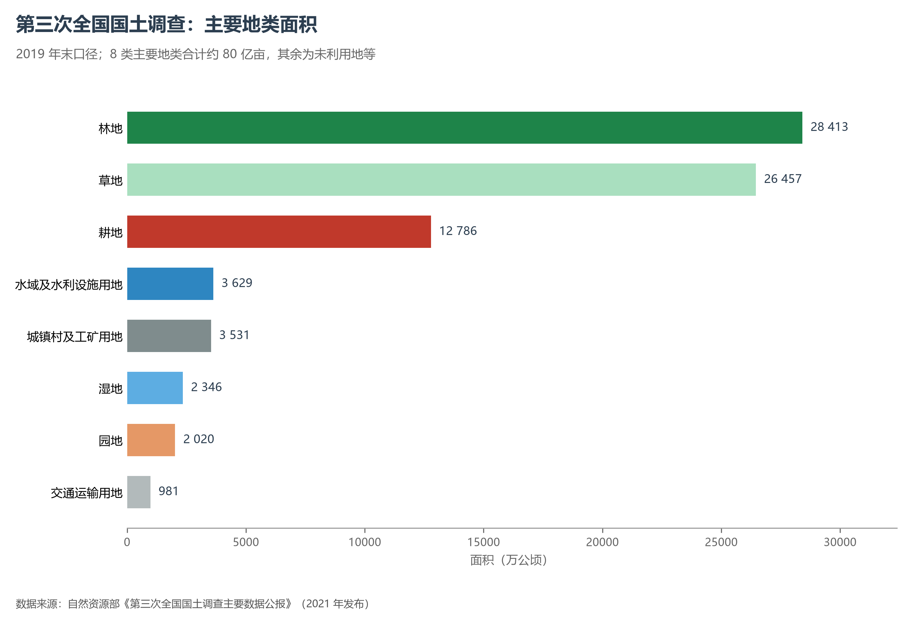
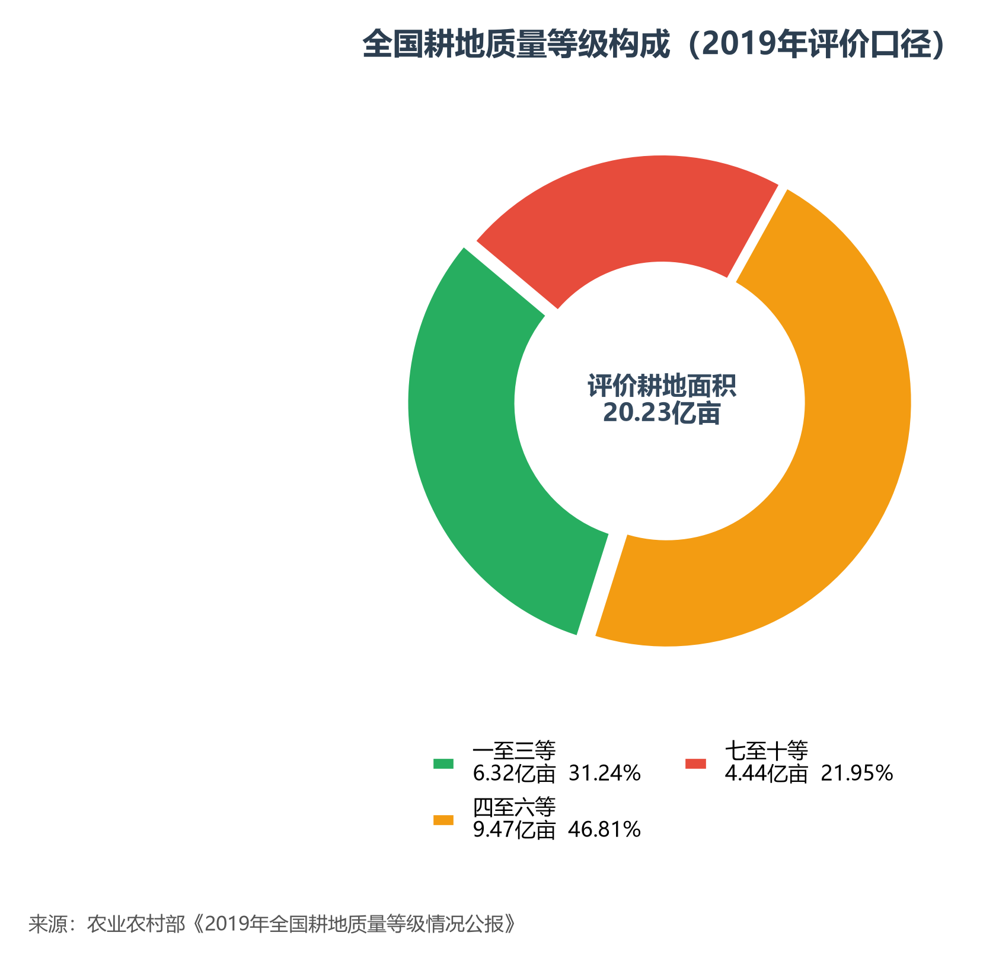

# 6.1 土地资源与“三调”

土地是一切自然资源之基，是所有经济生产活动与人类文明繁衍的空间载体。对于拥有 14 亿多人口、幅员 960 万平方公里的中国而言，如何精准摸清每一寸土地的地类归属、利用现状与生态承载边界，不仅是国家科学治理的基础，更直接关乎粮食安全底线与中华民族永续发展的命脉。

2018 年至 2019 年开展的**第三次全国国土调查**（简称“三调”，以 2019 年 12 月 31 日为统一标准时点，2021 年 8 月正式公布成果），以优于 1 米分辨率的高精度卫星遥感影像为全域底板，实地核查了全国 **2.6 亿个图斑**，全面实现了“图斑到地、像素级入库”，是中国迄今为止精度最高、技术最先进、数据最真实权威的国土家底全景大盘点。

**图 6-1 三调主要地类面积**：林地与草地合计近 5.5 亿公顷，是国土的生态底盘；耕地是面积最大的农用地类型。

**图 6-6 全国耕地质量等级构成比例**：优等高产田仅占三成，中低产田占比近七成，折射出粮食稳产保供的质量压力。

---

## 一、家底大账：三调全要素地类精细解构

“三调”首次建立了覆盖陆域国土全域的统一调查分类体系，将地表覆盖精准归纳为 13 个一级地类和数十个二级地类。在全国土地总面积中，核心地类分布格局如下：

| 一级地类 | 面积（万公顷） | 面积（亿亩） | 占国土总面积比例 | 二级地类构成与空间分布特征 |
|:---|:---|:---|:---|:---|
| **耕地** | **12 786.19** | **19.18** | **13.3%** | 水田 3 134 万公顷（占 24.5%，集聚于南方水乡与东北平原）；水浇地 3 211 万公顷（占 25.1%，主要分布于华北平原及西北灌区）；旱地 6 441 万公顷（占 50.4%，分布于黄土高原、西南喀斯特丘陵与东北漫岗） |
| **林地** | 28 412.59 | 42.62 | 29.6% | 乔木林地占 60% 以上，主要分布于大兴安岭、长白山、横断山脉及南方低山丘陵区；森林蓄积量超过 190 亿 m³ |
| **草地** | 26 456.99 | 39.69 | 27.6% | 天然牧草地占 80% 以上，主要横亘于内蒙古高原草原带、青藏高原高寒草甸及西北山地草场；草畜平衡是核心矛盾 |
| **湿地** | 2 346.03 | 3.52 | 2.4% | **三调首次单独设立为一级地类**；包括红树林地、森林沼泽、草本沼泽、沿海滩涂及内陆盐沼，是全球迁徙候鸟与碳汇核心区 |
| **园地** | 2 019.55 | 3.03 | 2.1% | 果园占 65% 以上，茶园占 17%，橡胶园主要分布于海南与滇南，主要利用山丘坡地梯级开发 |
| **城镇村及工矿用地**（建设用地主体） | 3 530.64 | 5.30 | 3.7% | 城市用地 522 万公顷、建制镇 385 万公顷、村庄用地 2 190 万公顷（占建面 62%）、采矿及独立工矿用地 433 万公顷 |
| **交通运输用地** | 980.99 | 1.47 | 1.0% | 铁路用地、公路用地（高等级公路网占主导）、农村道路、机场与港口码头用地 |
| **水域及水利设施用地** | 3 628.79 | 5.44 | 3.8% | 河流湖泊水面、水库水面（水库超 9.8 万座）、坑塘水面及水工建筑用地 |

---

## 二、中国土地资源的三大核心特征

深入研读“三调”数据，可以提炼出制约与指引中国未来发展的三个最根本的土地基本国情：

### 1. 耕地资源“总量不小，人均紧缺，后备极少”
- **人均紧迫**：全国耕地面积为 19.18 亿亩，虽然总量居世界第三位（仅次于美国与印度），但由于人口基数巨大，**人均耕地面积仅为 1.36 亩**，仅相当于世界平均水平（约 3.1 亩/人）的 44%；
- **空间失衡**：全国 64% 的耕地分布在秦岭—淮河以北，而北方水资源仅占全国 19%，“水地空间错配”严重制约着北方农业的可持续灌溉；
- **后备资源枯竭**：全国适宜开垦为耕地的后备土地资源已不足 8 000 万亩，且绝大多数深处于西北干旱半干旱区或生态极度脆弱带，开发生态代价巨大，中国耕地外延扩张的物理空间已彻底见顶。

### 2. 耕地质量金字塔：“高产稳产田仅三成，中低产田占比近七成”
农业农村部《2019年全国耕地质量等级情况公报》以 **20.23 亿亩**耕地为评价基数，将质量由高到低划分为一至十等，平均等级为 4.76 等（图 6-6）。这一质量评价基数与第三次全国国土调查的土地分类统计口径不同。
- **一至三等**：面积 **6.32 亿亩**，占评价耕地面积的 **31.24%**，是保障粮食稳定生产的重要基础；
- **四至六等**：面积 **9.47 亿亩**，占 **46.81%**，应结合土壤与水利条件改善耕地生产能力；
- **七至十等**：面积 **4.44 亿亩**，占 **21.95%**，应针对限制因素推进分类保护和质量建设。

### 3. 生态用地是绝对底盘，生产生活空间严峻承重
在 960 万平方公里的陆域国土中，**林地、草地与湿地三大生态用地合计面积达 5.72 亿公顷（约 85.8 亿亩），占全国陆地面积的近 60%**。这构成了华夏大地维系江河源头水源涵养、水土保持与碳达峰碳中和的“绿色生态底盘”。这深刻意味着，城市化扩容、基础设施建设与农业生产，必须在剩余仅约 40% 的有限国土空间内精细布局、寸土必争，杜绝任何对生态空间的蛮横侵占。

---

## 三、“十分珍惜、合理利用土地”：基本国策的历史逻辑

鉴于人多地少、耕地后备匮乏的严酷国情，1986 年颁布实施的《中华人民共和国土地管理法》庄严确立了我国的一项基本国策：**“十分珍惜、合理利用土地和切实保护耕地”**。

1. **基本国策确立的时代背景**：20 世纪 80 年代改革开放初期，伴随乡镇企业异军突起和沿海开发区热潮，全国一度出现严重的“乱占滥用耕地、圈地建厂建房”乱象，年均耕地流失达上千万亩。中央果断确立该项基本国策，建立了以县级以上土地利用总体规划为统领的用途管制法定红线；
2. **制度演进与法治升级**：从 1998 年土地管理法全面修订确立“农用地转用审批制度”，到 2006 年确立“18 亿亩耕地红线”，再到新时代确立“耕地保护党政同责、终身追责”，中国建立了全球最严格的土地用途管制制度，牢牢筑牢了 14 亿人饭碗的土地基石。

---

## 四、世界视角：集约农业与超载土地的生存奇迹

横向对比世界主要领土大国的土地资源账本，中国的集约化利用展现出独特的地理韧性：

- **美国与俄罗斯**：美国拥有人均约 7 亩的优质黑钙土与草原土，农业生产多采取大面积休耕轮作；俄罗斯人均耕地更高达 13 亩，土地资源高度富余；
- **印度**：耕地面积超 1.5 亿公顷（大于中国），但有效灌溉面积与高标准农田建设滞后，单产水平仅为中国的一半左右；
- **中国的生存奇迹**：中国在人均耕地不足世界一半、淡水资源严重错配的严酷约束下，通过大兴农田水利、测土配方施肥、良种攻关选育（杂交水稻、紧凑型玉米）以及多熟制精耕细作，**创造了粮食平均亩产超过 430 公斤（稻谷均产超 470 kg/亩、小麦超 390 kg/亩）的世界领先单产纪录**，用占世界 9% 的耕地养活了世界近 18% 的人口。这是世界大国农业地理史上绝无仅有的集约化生存奇迹。

---

## 参考与数据来源

1. 三调地类面积数据：中华人民共和国自然资源部、国家统计局《第三次全国国土调查主要数据公报》（2021 年 8 月）。
2. 耕地质量等级构成：农业农村部《2019年全国耕地质量等级情况公报》（2020 年发布）。
3. 土地管理法与基本国策历史文献：全国人大常委会法制工作委员会《中华人民共和国土地管理法释义》。
4. 国际耕地与单产对比：联合国粮农组织（FAO）FAOSTAT 统计年鉴及世界银行可持续发展数据库。
