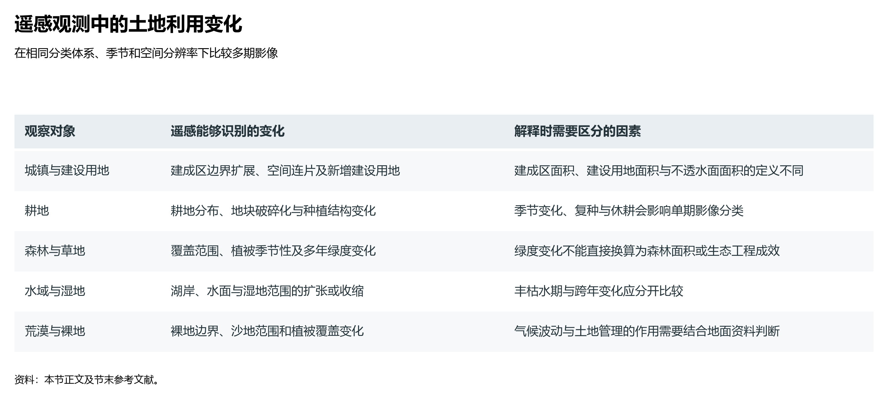

# 6.2 卫星视角下的国土利用

在现代空间信息技术崛起之前，人类对辽阔国土的摸底往往依赖于各级行政区自下而上的纸质台账报表与局部样方抽样推算，数据失真、边界模糊与统计滞后曾长期困扰着土地管理。

今天，从距地数百公里的近地轨道俯瞰华夏大地，由高分一号至七号、资源系列、环境减灾系列、风云气象系列以及商业遥感星座构筑的庞大“**对地观测国家队**”，每天向地面传输数十万景亚米级高分辨率卫星影像。自然资源部依托全国遥感影像统筹机制，对全国 **2.6 亿个地块图斑** 实施常态化“逐地块对比、逐像素审验”。中国大地的每一次建设开工、每一处林地消长与每一块农田耕作，都在天眼遥感网络中留下了毫厘毕现的时空印记。

**图 6-5 遥感观测中的土地利用变化**：按城镇、耕地、森林草地、水域湿地与荒漠裸地，列示多期影像能够识别的变化及其解释条件。

---

## 一、三调与年度变更调查：空间治理的技术革命

第三次全国国土调查不仅是一次规模浩大的国情普查，更标志着中国空间治理体系完成了一场从“粗放估算”到“**全域数字化、像素级入库**”的技术质变：

1. **多源多谱段影像的高精度覆盖**：
   三调全面应用优于 1 米分辨率的正射卫星遥感影像（DOM）作为工作底图，累计汇集处理各类高分辨率遥感影像 **2.95 亿景**。无论身处高耸的青藏高原无人区，还是东部密密匝匝的江南水网，每一块地面的自然纹理都清晰可见；
2. **“天上看、地上查、网上管”的闭环技术流程**：
   - *天上看（内业自动比对）*：利用遥感图像自动变化检测与人工智能解译算法，将最新卫星影像与历史基底矢量库自动叠合，毫秒级提取地表地类发生改变的“变化图斑”；
   - *地上查（外业精准核实）*：基层调查队员依托集成北斗高精度定位系统的移动调查终端，精准导航至现场，核实图斑地类、拍摄带空间坐标防伪水印的照片并实时回传；
   - *网上管（全生命周期监管）*：所有成果直接汇聚进入自然资源三维立体时空数据库与国土空间规划“一张图”，实现规划审批、用地报批、耕地占补与综合执法全链条联动；
3. **国土利用“年度体检”机制的确立**：
   自三调定稿以来，自然资源部建立了每年常态化开展的**全国国土利用年度变更调查**制度。这彻底终结了过去“十年大调一次、十年间家底不清”的被动局面，使中国成为全球极少数能够每年对全域国土全要素地类变化实施“像素级年度年检”的现代化大国。

---

## 二、三十年卫星解译：中国地表形态的三大历史性大重塑

将 1990 年以来三十余年的连续多时相卫星陆表覆盖数据拼接回放，中国大地的地表肌理经历了人类地理史上速度最快、规模最宏伟的三大空间大迁徙（见图 6-5）：

| 宏观演变主线 | 驱动机制与核心地理现象 | 空间表现特征与典型区域 | 正面经济成效与潜在地理矛盾 |
|:---|:---|:---|:---|
| **城镇空间几何级膨胀** | 工业化与极速城镇化驱动，常住人口城镇化率由 1990 年的 26.4% 飙升至 2024 年的 66.2% | 全国城市建成区面积由 1.3 万 km² 剧增至逾 6.5 万 km²（扩张近 5 倍）；京津冀、长三角、珠三角都市圈连片硬化 | 支撑数亿农民进城定居与全球制造中心崛起；但城镇扩张不可避免占用了最肥沃的平原城郊优质耕地（“占优补劣”矛盾凸显） |
| **耕地重心“北移与西进”** | 南方工业化占用平原良田与农业结构调整；北方黑土地开垦、水利改善与西北现代节水滴灌农业崛起 | 东南沿海优质水田比重下降；东北三江平原、松嫩平原旱田改水田，新疆塔里木山前绿洲棉田大规模外延 | 彻底逆转了千年“南粮北运”历史格局，塑造了以黑龙江（年产超1 500亿斤）为首的北方商品粮新格局；但加剧了北方“地多水少”的承载张力 |
| **生态工程驱动“地表大变绿”** | 国家持续实施退耕还林还草（超 5 亿亩）、三北防护林防护网络、封山育林及京津风沙源综合治理 | 黄土高原植被覆盖率由 31% 跃升至 60% 以上；太行山、秦巴山区及南方喀斯特石漠化山区绿色指数成倍翻越 | 黄河流域泥沙锐减 90%，水土流失大幅受控；NASA 卫星证实中国贡献了全球新增绿化面积的 1/4，稳居世界第一 |

---

## 三、世界视角：中国对地观测对全球的科学贡献

中国在大范围国土遥感监测领域的卓越实践，为全球环境变化研究与广大发展中国家的空间治理提供了宝贵的中国方案：

1. **NASA 权威认证的“中国绿化奇迹”**：
   2019 年，美国国家航空航天局（NASA）基于 MODIS 卫星传感器长达 20 年的观测数据，在国际权威学术期刊《自然·可持续发展》（*Nature Sustainability*）上发表重磅封面论文：
   - 卫星数据显示，全球 2000 年至 2017 年间新增的绿化叶面积中，**中国贡献了全球净增长量的 25%，高居世界第一位**；
   - 尤为引人注目的是，全球多数国家的绿化增长依赖于自然植被在温暖气候下的被动扩张，而**中国的绿色增长中有 42% 来自直接的造林保林重大生态工程，32% 来自集约化农田的精细化高效管护**，展现出举国体制统筹大尺度生态修复的非凡组织力量。
2. **北斗与遥感公共产品惠及全球**：
   伴随北斗三号全球卫星导航系统的高精度全球组网，以及高分卫星、风云卫星国际数据服务平台的开放，中国建立的“空间遥感—地面物联网—云端智能监管”体系正加速走向世界。从为中亚与东南亚提供大江大河流域跨境洪涝监测，到向非洲多国援助建设卫星地面接收站与荒漠化监测走廊，中国正在用先进的对地观测科技践行人类命运共同体的生态承诺。

---

## 参考与数据来源

1. 三调影像数据与图斑总量：自然资源部自然资源卫星遥感应用中心《自然资源卫星遥感应用报告》。
2. 城市建成区与城镇化演进：住房和城乡建设部《中国城市建设统计年鉴》、国家统计局人口统计公报。
3. 全球变绿贡献度权威论文：Chen, C. et al. China and India lead in greening of the world through land-use management. *Nature Sustainability* 2, 122–129 (2019).
4. 北方粮仓格局与耕地移动：中国科学院地理科学与资源研究所陆地表层空间演变团队研究专论。
