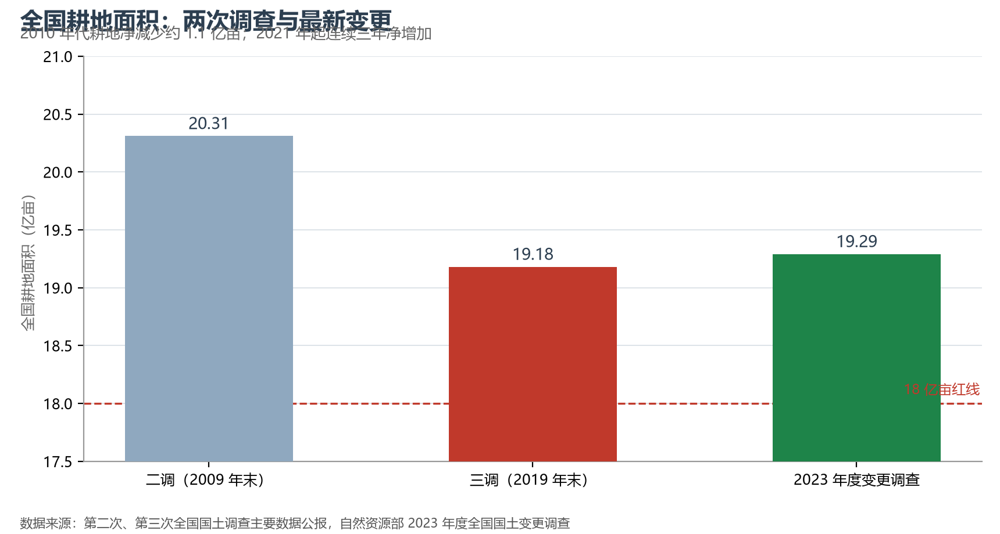

# 6.3 耕地保护与"三区三线"

19.18 亿亩耕地、14 亿多人口、每年数百万亩的建设需求——三组数字的张力，就是中国土地管理制度全部设计的起点。1994 年"18 亿亩红线"的提法进入政策视野，2006 年正式写入约束；2020 年以来，制度升级为"长牙齿"的硬措施：耕地保护党政同责、终身追责。

**图 6-2 全国耕地面积：两次调查与最新变更**：2010 年代净减少约 1.1 亿亩，2021 年起连续三年净增加。

## 一、耕地保护的制度阶梯

- **数量红线**：18 亿亩耕地保有量；2023 年度国土变更调查显示耕地 19.29 亿亩，实现连续三年净增加——"减量时代"首次逆转；
- **质量红线**：划定**永久基本农田 15.46 亿亩**，实行特殊保护，非经国务院批准不得占用；高标准农田累计建成逾 10 亿亩；
- **占补平衡与进出平衡**：建设占用耕地必须"占一补一、占优补优"；转为林地园地等其他农用地同样须在耕地总量内"进出平衡"——堵住了"耕地流失的旁门"；
- **党政同责**：2020 年起耕地保护与粮食安全纳入省级党政领导考核，"先补后占"成为铁律。

## 二、"三区三线"：一张图管空间

2022 年完成的"三区三线"划定，把国土空间划分为三类功能分区并划出三条控制线：**城镇空间**（城镇开发边界，防止城市无序蔓延）、**农业空间**（耕地与永久基本农田保护红线）、**生态空间**（生态保护红线，覆盖陆域国土约 25% 以上的重要生态区域）。三线一经划定，全国"一张图"审批——任何建设项目落位前，先过三线校验。这是中国空间治理从"多规分立"走向"多规合一"的转折：国土空间规划体系（五级三类）成为所有开发的法定前置。

## 三、世界视角：红线的经济学

用红线锁定耕地，经济学上是有争议的（机会成本、区域错配），地理学上却很直白：中国 60% 以上的人口、70% 以上的城市化增量集中在与耕地高度重叠的东部平原上——不划线，最肥沃的农田将以最快速度消失。横向对比：美国通过农业保护区与用途税制间接保护农田，日本以《农振法》划定农业振兴地域，欧盟以共同农业政策补贴维持耕地——用刚性红线"圈住"特定数量耕地的做法，中国是最大规模的一个。这不是最优雅的制度，却可能是最匹配"人多地少 + 快速城市化"双重约束的制度。

## 参考与数据来源

1. 耕地与永久基本农田数据：自然资源部 2023 年度全国国土变更调查、永久基本农田划定成果。
2. 三区三线与国土空间规划：自然资源部《全国国土空间规划纲要（2021—2035 年）》。
3. 高标准农田：农业农村部公开数据（累计建成逾 10 亿亩，2023 年）。
