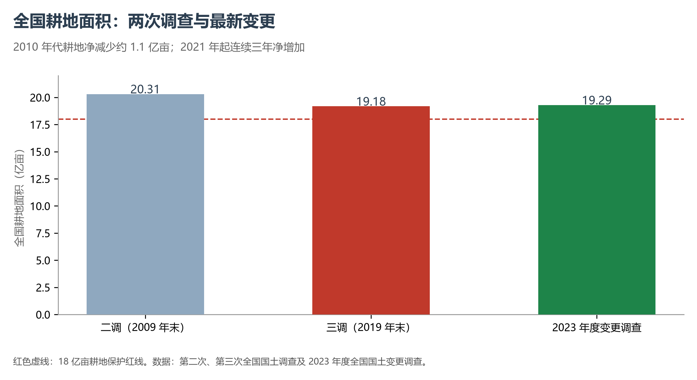

# 6.3 耕地保护与“三区三线”

19.18 亿亩耕地、14 亿多人口、每年数百万亩城市化与基础设施建设刚性需求——这三组数字之间永恒的张力，构成了中国土地管理政策与空间治理全部制度创新的原动力。

土地是不可再生的战略资源，尤其在平原与低丘仅占国土少数的中国，最平整肥沃的土地往往恰好是城市扩张、道路网络铺设成本最低的黄金区域。如果在城市化浪潮中任由资本与市场力量自发盲目蚕食平原良田，国家必将面临粮食安全崩溃的万劫不复之渊。因此，中国自 20 世纪 90 年代以来，历经三十年探索，建立起全球最严厉的耕地保护制度矩阵与“**三区三线**”空间用途管制铁律。

**图 6-2 全国耕地面积：两次调查与最新变更**：2010 年代净减少约 1.1 亿亩，2021 年起连续三年净增加。

---

## 一、耕地保护制度的四级阶梯：从规模底线到长牙齿硬措施

从图 6-2 的耕地面积演变曲线中可以看到，2009 年“二调”到 2019 年“三调”的十年间，全国耕地净减少了约 **1.13 亿亩**。耕地锐减的驱动因素既有生态退耕还林还草、城市建设合理占用，也包含了大量农村私自占用耕地建房、改种林果果树甚至挖塘养鱼等“非粮化”“非农化”流失。

面对严峻态势，国家自 2020 年起果断打出了一套“长牙齿”的耕地保护组合拳，形成了环环相扣的制度阶梯：

| 制度层级 | 制度名称与指标底线 | 核心政策抓手与实施机制 | 法定执行刚性与保障力度 |
|:---|:---|:---|:---|
| **第一级：数量红线** | **18 亿亩耕地保有量** | 守住 18 亿亩全国耕地绝对底线；2023 年度国土变更调查显示全国耕地达 **19.29 亿亩**，实现连续三年净增加，彻底扭转了“二调”至“三调”持续减量的危险下行通道 | 严格纳入各级国土空间规划刚性约束指标；全国分解下达至省、市、县三级政府，不得调减突破 |
| **第二级：质量核心** | **15.46 亿亩永久基本农田** | 在 18 亿亩耕地中，精选最肥沃、水利设施最完备的 15.46 亿亩优质农田划为“永久基本农田”；同步累计建成 **10 亿亩以上高标准农田**（旱涝保收、稳产高产） | 实行永久特殊保护；除国家重大基础设施等特殊项目经国务院批准外，任何单位和个人严禁占用；严禁改变粮食生产用途 |
| **第三级：双重闭环** | **占补平衡 与 进出平衡** | **占补平衡**：非农建设经批准占用耕地的，必须落实“占一补一、占优补优、占水田补水田”，并推行“先补后占”； **进出平衡**：耕地转为果园、茶园、林地等其他农用地及农业设施用地的，必须在同行政区内补足同等数量与质量的可以长期稳定利用的耕地 | 彻底堵死了过去“占用优质平原水田、在偏远荒山坡地上虚假补充劣质旱地”的制度漏洞；杜绝耕地内部隐性“非粮化”流失 |
| **第四级：责任机制** | **党政同责 与 田长制** | 耕地保护和粮食安全责任制全面纳入各级党委和政府领导班子年度考核；全面推行省、市、县、乡、村五级“田长制”，每块农田均有明确责任田长 | 实行“一票否决”与**终身追责**；对违法占用耕地、圈地倒卖土地行为，由国家自然资源督察机构严厉督办问责并追究刑事责任 |

---

## 二、“三区三线”：中国国土空间多规合一的划时代革命

长期以来，中国的空间规划存在着土地利用规划（国土部门）、城乡规划（住建部门）、主体功能区规划（发改部门）与生态保护红线（环保部门）各自为政、边界重叠打架的“多规并立”痛点。

2022 年，随着《全国国土空间规划纲要（2021—2035 年）》编制完成，国家在全国统一完成了**“三区三线”**的统筹划定与精准上图，实现了新中国历史上第一次全域国土空间治理向“**多规合一、一张图管空间**”的历史性飞跃：

### 1. 三区三线的系统定义
- **三区（功能分区）**：以城镇生活为主体的**城镇空间**、以农业生产为主体的**农业空间**、以生态安全为主体的**生态空间**；
- **三线（控制红线）**：
  1. **耕地和永久基本农田保护红线**：全国划定耕地保护任务不低于 18.65 亿亩，其中永久基本农田保护任务不低于 **15.46 亿亩**；
  2. **生态保护红线**：全国共划定生态保护红线不低于 **315 万 km²**（其中陆域面积占陆地国土面积 30% 以上，海洋生态保护红线不低于 15 万 km²），涵盖了青藏高原生态屏障、黄土高原—川滇生态屏障、东北森林带、北方防沙带、南方丘陵山地带等国家生态安全中枢；
  3. **城镇开发边界**：基于人口发展趋势与资源承载力，严密界定城镇集中建设区与弹性发展极限，将全国城镇建设用地扩张规模严密控制在现状建成区的 1.3 倍以内，坚决防止特大城市“摊大饼”式野蛮蔓延。

### 2. 国土空间规划体系的法定前置
“三区三线”一经划定，全部纳入全国统一的**国土空间规划“一张图”实施监督信息系统**：
- 任何建设工程、产业项目和基础设施在立项选址之初，必须首先经过“三区三线”数字化计算机辅助审查校验；
- 凡触碰永久基本农田或生态保护红线且不符合国家准入清单的项目，系统实行“一键红灯”，自动阻断报批程序，使绿色生态与优质粮田获得了无可撼动的法定硬约束。

---

## 三、世界视角：空间管制模式的跨国比较

为了在城市扩张与农田保护之间取得平衡，全球各发达经济体均演化出独特的土地用途管制模型，中国的“三区三线”模式展现出鲜明的中国特色：

| 国家 / 地区 | 核心土地保护法律与制度工具 | 运作机制与特征 | 适用国情与主要局限 |
|:---|:---|:---|:---|
| **中国** | 《土地管理法》《国土空间规划纲要》；**18亿亩红线、永久基本农田、生态保护红线“三区三线”** | **行政硬约束与国家规划统领**；指标层层分解锁定，党政同责，数字化卫星动态遥感“逐图斑年检” | 极高效率地化解了“人多地少、城镇化激进扩张”的尖锐生存危机；需要精细化处理保护与地方经济发展的利益协调 |
| **美国** | 《远东农田保护法》（FPPA）；农业保护区法案（Zoning）；自然资源保护局休耕保护计划（CRP） | **市场经济补偿与分区法结合**；政府通过购买土地开发权（PDR）补贴农户，农田多采取大面积经济休耕 | 人均耕地极其充裕（约7亩/人），不存在生存性口粮短缺危机；主要通过联邦财政补贴维持土地市场生态 |
| **日本** | 《农地法》《农业振兴地域整备法》 | **严苛的微观审批许可制**；划定“农用地区域”，非农占用需经过知事与农林水产大臣繁琐审批 | 人多地少高度相似；但由于老龄化严重，出现了数百万亩耕地荒芜撂荒与农地抛荒的新型困境 |
| **欧盟** | 共同农业政策（CAP）；“交叉遵从”（Cross-Compliance）与绿色直接补贴 | **绿色补贴与生态捆绑**；将农场主的直接收入补贴与维持农田生物多样性、水质土壤标准严格绑定 | 农业生产力高度富余；制度设计重心更偏向于环境与农业景观维护，而非单一的耕地数量规模硬兜底 |

通过对比可以看出，中国的耕地保护与“三区三线”制度，是在极其紧张的人地关系和高速度推进的工业化、城镇化双重挤压下，由国家意志主导建立的**空间防御体系**。它以法治化、数字化的铁律，将关系华夏子孙饭碗的良田和维系江河命脉的绿水青山严密保护起来，成为中国式现代化最稳固的空间基石。

---

## 参考与数据来源

1. 耕地面积与变更调查：自然资源部 2021—2023 年度全国国土利用变更调查官方公报。
2. 三区三线划定成果：自然资源部、国家发展改革委联合印发《全国国土空间规划纲要（2021—2035 年）》。
3. 永久基本农田保护与田长制：中共中央办公厅、国务院办公厅《关于加强耕地保护提升耕地质量完善占补平衡的意见》。
4. 国际农地保护制度比较：OECD《Agricultural Policy Monitoring and Evaluation》报告及联合国粮食及农业组织土地政策文库。
