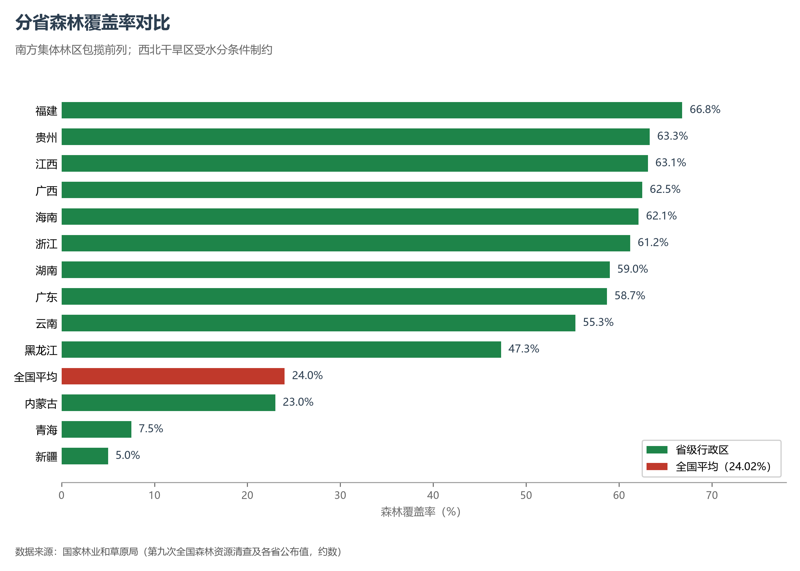
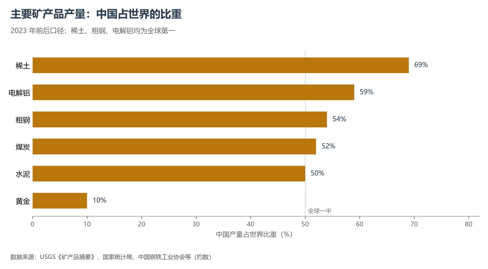
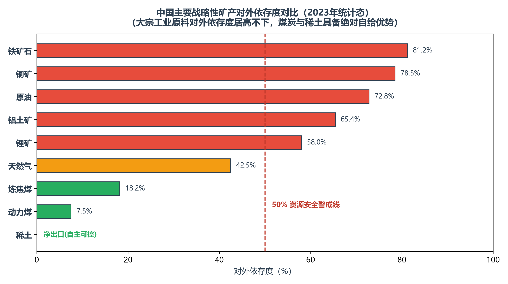

# 6.4 森林、水与矿产

如果说土地是人类一切生产活动的空间基底，那么依附于土地之上的森林、土壤、水与矿产，就是驱动现代工业体系运转与生态环境平衡的四大核心物质资源。

与相对固定的国土空间相比，这四大资源的共同本质在于**空间分布的极端非均衡性**：森林蓬勃于东南山川，土壤肥沃于北方平原，丰沛之水汇流于南方江河，而煤炭油气与关键矿藏则深埋于北方高原与西部盆地。这一错综复杂的地学空间拼图，不仅决定了中国宏大跨区域资源调配格局（如北煤南运、西气东输、西电东送、南水北调），更直接深刻影响着国家产业链安全与现代工业版图的战略重构。

**图 6-3 分省森林覆盖率对比**：南方集体林区包揽前列，西北受水分条件制约。

**图 6-4 主要矿产品产量中国占世界比重**：稀土、电解铝、粗钢、煤炭、水泥均占全球一半上下。

**图 6-7 中国重点战略性矿产对外依存度对比（2023年统计态）**：大宗工业原料对外依存度居高不下，煤炭与稀土具备绝对自给优势。

---

## 一、森林资源：从 8.6% 到 24% 的半世纪绿色蜕变

新中国成立初期，由于长期历史采伐与战火破坏，全国森林覆盖率仅为可怜的 **8.6%** 左右，水土流失与风沙侵袭严重。经过半个多世纪持续推行的全民义务植树、天然林资源保护工程与三北防护林建设，全国森林覆盖率在 2023 年正式跃升至 **24.02%**，森林面积达到 **2.31 亿公顷**，森林蓄积量超过 **194.93 亿 m³**，人工林保存面积稳居**世界第一位**。

从图 6-3 的分省森林覆盖率排行可以看出，森林空间分布呈现出极强的降水制约与地形分异：
- **南方集体林区傲视全国**：福建（66.8%）、江西（63.1%）、海南（62.1%）、浙江（61.2%）、广东（58.7%）、湖南（59.9%）、广西（62.6%）等省区，依托水热优越的亚热带季风气候与多山地形，森林覆盖率普遍在 60% 以上，构成了中国最郁郁葱葱的“绿色长廊”；
- **东北与西南国有天然林海**：大兴安岭、小兴安岭、长白山与川西、滇西北高山峡谷，保存了全国面积最大的原始天然针阔混交林，是我国最重要的木材战略储备与生物多样性天然基因库；
- **西北干旱区的生态天花板**：新疆（约 5.0%）、青海（约 7.5%）、甘肃、宁夏等西北内陆省区，受 400 mm 年等降水量线的水分刚性制约，森林覆盖率普遍不足 15%。这深刻启示生态建设必须严格遵循“**以水定绿、量水而行**”，因地制宜以防风固沙灌木与天然荒漠草原保护为主，坚决防止违背水资源承载力的盲目造林。

---

## 二、土壤资源：地带性图谱与黑土地保护

土壤是自然界“水、热、气、生、岩”综合演化数万年的终极产物，是农业生产最不可替代的活态基础。中国土壤在大陆季风气候与地形多级阶梯的控制下，展现出极其规律的**纬度地带性、经度地带性与非地带性垂直演替**图谱：

| 土壤类型 | 核心分布区域 | 成土母质与气候成因机制 | 土壤理化性状与肥力特征 | 主要农业利用与生态保护战略 |
|:---|:---|:---|:---|:---|
| **黑土 与 黑钙土** | 东北松嫩平原、三江平原（“北大仓”） | 温带湿润半湿润季风气候，草甸草原与针阔混交林下漫长腐殖化堆积 | **全球四大黑土带之一**；有机质含量高达 3%—10%，团粒结构优异，微酸性至中性，肥力极高 | 国家超级商品粮基地；2022年颁布《黑土地保护法》，推广秸秆还田（梨树模式）、免耕少耕，遏制“变薄、变瘦、变硬” |
| **潮土 与 褐土** | 华北平原、黄河中下游、海河流域 | 黄河、海河冲积洪积母质沉积；暖温带半湿润旱作季风气候 | 土层极其深厚（数十至数百米），微碱性，富含钾钙，孔隙度高，保墒能力较好 | 冬小麦与夏玉米一年两熟主产区；地下水位较浅易诱发次生盐渍化，需强化高标准农田水肥一体化调控 |
| **红壤 与 黄壤** | 长江以南江南丘陵、两广丘陵、云贵高原 | 亚热带与热带高温多雨季风，剧烈化学风化与脱硅富铝化淋溶 | 酸性强（pH 4.5—5.5），黏度重，铁铝富集，有机质分解极快，普遍缺磷 | 极适宜喜酸的茶树（大红袍、铁观音）、油茶、柑橘种植；在平原冲积低洼处经千年人工水耕熟化，演变为高产的水稻土 |
| **紫色土** | 四川盆地丘陵与盆底（川中、川东） | 侏罗纪、白垩纪紫红色砂页岩快速物理风化，岩石母质继承性强 | 风化极为迅速，土层相对较薄；富含磷、钾、钙等矿质营养养分，保肥性优 | 被誉为天然“矿质肥料库”；支撑了四川盆地繁荣密集的梯田农业；需强化梯坡固土、防治水土流失 |
| **绿洲灌淤土** | 宁夏平原、河套平原、南疆山前绿洲 | 极端干旱大陆性荒漠背景下，两千余年来引黄、引天山昆仑冰雪融水淤灌 | 在原生贫瘠荒漠土上人工淤积厚达 1—2 米的肥沃水成层，有机质大幅回升 | 人造绿洲土壤奇迹；保障塞上江南小麦、枸杞、玉米与新疆长绒棉、优质林果的高产稳产 |

---

## 三、矿产资源：资源大国与关键矿产供应链“两重天”

中国是世界上极少数矿产资源门类齐全的大国之一，已发现矿产 **173 种**，查明资源储量 **163 种**，主要矿产资源潜在总价值稳居世界前三位。

然而，从图 6-4 与图 6-7 的深度对照中，可以清晰透视出中国作为世界第一制造大国所面临的**战略性矿产供应链深刻现实**：

### 1. 宏观地理布局：“北煤、南有色、西油气、稀土分两极”
- **“北煤”的绝对优势**：中国煤炭资源保有储量超过 2 000 亿吨，主要富集在晋陕蒙新四省区（山西、内蒙古、陕西、新疆四省区原煤产量占全国的 80% 以上），是中国工业能源的“压舱石”；
- **“西油西气”陆上基石**：常规陆上石油天然气主要深藏在西北内陆沉积盆地——塔里木盆地（超深层油气）、鄂尔多斯盆地（长庆油田，全国最大油气田）、准噶尔盆地、柴达木盆地以及四川盆地（常规天然气与深层页岩气），构成了“西气东输”的源头活水；
- **“南有色”传统重镇**：有色金属主要集聚在秦岭—淮河以南古陆块造山带中——江西德兴铜矿、大余钨矿，湖南锡矿山锑矿、水口山铅锌矿，云南个旧锡矿，广西平果铝土矿等，享有“有色金属王国”的美誉；
- **“稀土两核”的全球话语权**：中国稀土资源储量与分离冶炼产能居全球绝对主导地位。北方以**内蒙古白云鄂博**轻稀土巨型铁铌稀土伴生矿为核心，南方以**江西赣州、两广丘陵**的离子吸附型中重稀土为王牌，是中国高精尖半导体、新能源汽车电机与尖端国防工业不可替代的王牌资源。

### 2. 世界制造工厂背后的“大宗原料对外依存”（图 6-7）
从图 6-4 可以看出，中国依靠庞大的工业产能，生产了全球 **54% 的粗钢、59% 的电解铝、56% 的水泥、52% 的煤炭**。但这种超大规模制造的背后，是大宗矿产对外依存度长期居高不下（图 6-7）：
- **铁矿石**：对外依存度高达 **81.2%**，年进口量常年超过 11 亿吨，主要高度依赖澳大利亚与巴西两国的海运供应；
- **铜与铝原料**：精炼铜原料对外依存度达 **78.5%**，铝土矿对外依存度达 **65.4%**（主要进口自几内亚、印度尼西亚）；
- **原油与天然气**：原油对外依存度高达 **72.8%**（年进口超 5 亿吨），天然气对外依存度达 **42.5%**，马六甲海峡航道与沿海接卸港口是国家能源安全的关键咽喉；
- **新能源关键矿产**：锂（对外依存度约 58%）、镍（对外依存度 > 85%）、钴（对外依存度 > 95%），在全球动力电池与光伏风电爆发的背景下，正成为新一代地缘矿产竞争的战略焦点。

---

## 四、世界视角：安全韧性与找矿突破战略行动

面对“富煤、贫油、少气、缺富铁铜”的客观矿产禀赋现实，中国正在统筹发展与安全，构建全新维度的资源保障体系：

1. **新一轮找矿突破战略行动**：聚焦大宗紧缺矿产（铁、铜、铝、钾）与新能源新兴战略矿产（锂、钴、镍、稀贵金属），在塔里木盆地深层、柴达木盐湖提锂、松辽盆地页岩油等关键成矿区带实现一系列重大地质突破；
2. **“立足国内，煤炭兜底”的能源基本盘**：充分发挥煤炭的兜底保障作用，大力推进煤炭清洁高效利用，同时在西北戈壁荒漠大规模建设腾格里、乌兰布和等千万千瓦级“风光大基地”，加速新型电力系统转型；
3. **“双循环”全球多元化供应链**：通过深化共建“一带一路”，加快非洲、南美、中亚等矿业资源基地多元化布局，构建陆海双向、多渠道安全弹性的海外矿产资源供应链保障网络，确保世界第一制造大国的产业链齿轮平稳运转。

---

## 参考与数据来源

1. 森林资源清查与蓄积量：国家林业和草原局《2023年中国林草资源公报》及第九次全国森林资源清查成果。
2. 土壤分类与黑土地保护：中国科学院土壤研究所《中国土壤志》及《中华人民共和国黑土地保护法》（2022年实施）。
3. 矿产资源储量与对外依存度：中华人民共和国自然资源部《中国矿产资源报告（2024）》、中国地质调查局全球矿产资源战略研究中心。
4. 工业产能全球比重：世界钢铁协会（World Steel Association）、美国地质调查局（USGS）*Mineral Commodity Summaries 2024*。
